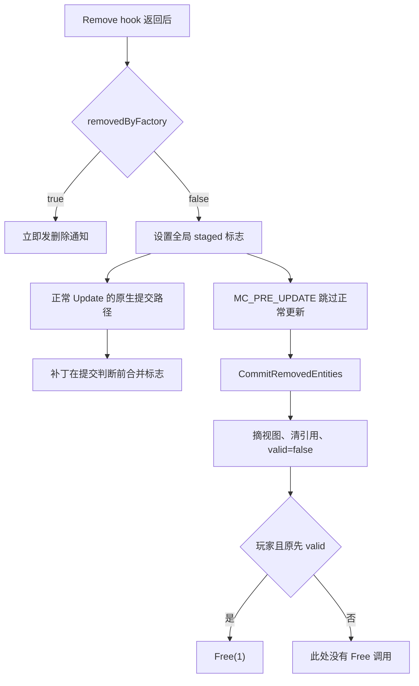

# REPENTOGON：T0-06 相关源码静态分析参考

日期：2026-10-18。分析对象：`D:\projects\REPENTOGON`，提交 `421c91d08`。

对应材料：[tx-01-70 静态分析交接任务书](/D:/projects/isaac_hook_reserach/docs/refactor/cs-t0/t0-06/tx-01-70-static-analysis-handoff.md)。

## 1. 范围与证据含义

本文交付旧 REPENTOGON 源码中可复用的生命周期、容器、字段、采样副作用和诊断记录线索，并按交接任务书 A01–E10 建立索引。本文不是对 43 个当前 EXE 问题的完整逆向交付，也不替代 tx-01-63 至 tx-01-69。

- `STATIC_CONFIRMED`：能从所列旧源码直接确认的代码、声明或注释。声明只能证明旧绑定怎样描述本体；注释中的假设仍是作者假设。
- `STATIC_INFERENCE`：根据代码得出的实现风险或含义，未提升为本体契约。
- `DESIGN_PROPOSAL`：本文提出的采集/身份处理取舍，尚未实现。
- `UNKNOWN`：本文证据不能回答，或未在本仓库找到相应实现/记录；不表示游戏没有该机制。

全部偏移均为旧源码相对对象偏移，按 x86、4-byte 指针阅读。没有新增当前 EXE 的 VA/RVA、反编译、ABI 核验或运行时观察；不复用本会话早期未确认同版的 IDA 地址。交接任务书已经说明 tx-01-69 更正过旧数值，本文的旧偏移只供识别字段和追踪差异。

本次只阅读源码并新增本文；没有调用原生函数、运行游戏/调试器、安装 Hook、构建、运行代码测试、计算或校验文件/状态哈希，也没有修改另一个项目。

## 2. 证据入口

| 编号 | 源码入口 | 可支持的内容 |
| --- | --- | --- |
| S01 | [EntityManager.cpp:63](/D:/projects/REPENTOGON/repentogon/Patches/EntityManager.cpp:63) | masked pointer 通知、工厂/玩家创建、移除提交、Reset/析构/Update 补丁 |
| S02 | [EntityPlus.cpp:22](/D:/projects/REPENTOGON/repentogon/Patches/EntityPlus.cpp:22) | 构造/Init/析构分层、lazy 初始化、副作用 |
| S03 | [EntitySaveStateManagement.cpp:1](/D:/projects/REPENTOGON/repentogon/SaveStateManagement/EntitySaveStateManagement.cpp:1) | 存档 ID 系统说明、复制/恢复、作者假设与覆盖缺口 |
| S04 | [ESSM 玩家遍历:215](/D:/projects/REPENTOGON/repentogon/SaveStateManagement/EntitySaveStateManagement.cpp:215)、[补充来源:1353](/D:/projects/REPENTOGON/repentogon/SaveStateManagement/EntitySaveStateManagement.cpp:1353) | backup、Esau Jr、待清理玩家、Pickup 池中的 Flip 保存记录 |
| S05 | [ESSM ID 分配:492](/D:/projects/REPENTOGON/repentogon/SaveStateManagement/EntitySaveStateManagement.cpp:492)、[修复:1496](/D:/projects/REPENTOGON/repentogon/SaveStateManagement/EntitySaveStateManagement.cpp:1496) | ID 回收复用、错误修复会写状态 |
| S06 | [entity_save_state_manager.lua:156](/D:/projects/REPENTOGON/repentogon/resources/scripts/repentogon_extras/entity_save_state_manager.lua:156) | 实体删除通知幂等处理、同地址新生清旧数据 |
| S07 | [NPC Morph:1192](/D:/projects/REPENTOGON/repentogon/LuaInterfaces/CustomCallbacks.cpp:1192)、[Pickup Morph:1266](/D:/projects/REPENTOGON/repentogon/LuaInterfaces/CustomCallbacks.cpp:1266) | 可变分类、PRE/POST 边界、取消/改参 |
| S08 | [Pickup 选择及暂存变量:5417](/D:/projects/REPENTOGON/repentogon/LuaInterfaces/CustomCallbacks.cpp:5417)、[Variant setter:852](/D:/projects/REPENTOGON/repentogon/LuaInterfaces/Entities/LuaEntity.cpp:852) | 请求值与最终值不同、Variant 直接修改、Effect 附加数据清空 |
| S09 | [CreateLight:7](/D:/projects/REPENTOGON/repentogon/LuaInterfaces/Entities/LuaEntityEffect.cpp:7)、[分裂 Tear:104](/D:/projects/REPENTOGON/repentogon/Patches/ASMPatches/ASMSplitTears.cpp:104) | Spawn 后补写字段、建立 Parent、立即 Update |
| S10 | [Entity.zhl:126](/D:/projects/REPENTOGON/libzhl/functions/Entity.zhl:126) | RTTI 转换、基础字段、虚表声明 |
| S11 | [EntityList.zhl:19](/D:/projects/REPENTOGON/libzhl/functions/EntityList.zhl:19)、[EntityList_EL.zhl:7](/D:/projects/REPENTOGON/libzhl/functions/EntityList_EL.zhl:7) | 多列表、缓冲描述、摘表只移动指针 |
| S12 | [LuaIsaac.cpp:32](/D:/projects/REPENTOGON/repentogon/LuaInterfaces/LuaIsaac.cpp:32) | FindByType/半径查询包装、GetRoomEntities 的实际来源 |
| S13 | [PlayerManager.zhl:68](/D:/projects/REPENTOGON/libzhl/functions/PlayerManager.zhl:68)、[LuaPlayerManager.cpp:167](/D:/projects/REPENTOGON/repentogon/LuaInterfaces/LuaPlayerManager.cpp:167) | 普通玩家名单与 Esau Jr 指针数组 |
| S14 | [Room.zhl:146](/D:/projects/REPENTOGON/libzhl/functions/Room.zhl:146)、[Game.zhl:261](/D:/projects/REPENTOGON/libzhl/functions/Game.zhl:261) | 根路径、内嵌 EntityList、Grid/door 视图 |
| S15 | [GridEntity.zhl:19](/D:/projects/REPENTOGON/libzhl/functions/GridEntity.zhl:19)、[GridEntityDesc.zhl:1](/D:/projects/REPENTOGON/libzhl/functions/GridEntityDesc.zhl:1) | Grid 独立字段域 |
| S16 | [Grid 生成补丁:83](/D:/projects/REPENTOGON/repentogon/Patches/ASMPatches/ASMGridEntitySpawn.cpp:83)、[GridEntityPlus.cpp:12](/D:/projects/REPENTOGON/repentogon/Patches/GridEntityPlus.cpp:12)、[LuaRoom.cpp:33](/D:/projects/REPENTOGON/repentogon/LuaInterfaces/Room/LuaRoom.cpp:33) | 一条具体生成顺序、空返回、448 槽证据 |
| S17 | [类型枚举:186](/D:/projects/REPENTOGON/libzhl/functions/Global.zhl:186)、[标志语义:2244](/D:/projects/REPENTOGON/libzhl/functions/Global.zhl:2244) | 动态类别、同位不同语义、persistent/no-query/transition 标志 |
| S18 | [EntityPtr.zhl:1](/D:/projects/REPENTOGON/libzhl/functions/EntityPtr.zhl:1) | 受追踪引用、SetReference、清空语义与已知理解限制 |
| S19 | [NPC:128](/D:/projects/REPENTOGON/libzhl/functions/EntityNPC.zhl:128)、[Familiar:80](/D:/projects/REPENTOGON/libzhl/functions/EntityFamiliar.zhl:80)、[Effect:49](/D:/projects/REPENTOGON/libzhl/functions/EntityEffect.zhl:49)、[Pickup:137](/D:/projects/REPENTOGON/libzhl/functions/EntityPickup.zhl:137)、[Player:730](/D:/projects/REPENTOGON/libzhl/functions/EntityPlayer.zhl:730) | 专用字段及心量布局 |
| S20 | [RNG.zhl:22](/D:/projects/REPENTOGON/libzhl/functions/RNG.zhl:22)、[Entity RNG/Seed:245](/D:/projects/REPENTOGON/libzhl/functions/Entity.zhl:245) | RNG 四个 uint32 与独立 InitSeed |
| S21 | [Checksum.zhl:1](/D:/projects/REPENTOGON/libzhl/functions/Checksum.zhl:1)、[SaveSyncing.cpp:342](/D:/projects/REPENTOGON/repentogon/SaveSyncing/SaveSyncing.cpp:342) | 文件流 checksum 声明与实际文件调用 |
| S22 | [GameState.zhl:1](/D:/projects/REPENTOGON/libzhl/functions/GameState.zhl:1) | 存档读写接口、旧保存结构与 Online 加入注释 |
| S23 | [onlinestub.lua:277](/D:/projects/REPENTOGON/repentogon/resources/scripts/repentogon_extras/onlinestub.lua:277)、[默认未加载:2145](/D:/projects/REPENTOGON/repentogon/resources/scripts/main_ex.lua:2145) | 消费控制台 desync 文本，不是 native 记录生产链 |
| S24 | [Hook 约定:55](/D:/projects/REPENTOGON/repentogon/dllmain.cpp:55)、[Hook 安装:397](/D:/projects/REPENTOGON/libzhl/HookSystem.cpp:397) | super 链、优先级、注册安装 |
| S25 | [ASMCallbacks.cpp:28](/D:/projects/REPENTOGON/repentogon/Patches/ASMPatches/ASMCallbacks.cpp:28) | 更新跳过、补偿提交与本地 patch 构造 |
| S26 | [EntitySaveStateEx.cpp:19](/D:/projects/REPENTOGON/repentogon/SaveStateManagement/EntitySaveStateEx.cpp:19) | 扩展保存 JSON 及支持类别，不是全世界比较格式 |
| S27 | [EntityFactory.zhl:1](/D:/projects/REPENTOGON/libzhl/functions/EntityFactory.zhl:1)、[Game Spawn 声明:28](/D:/projects/REPENTOGON/libzhl/functions/Game.zhl:28) | 本体入口签名、部分工厂池布局；没有原版完整函数体 |
| S28 | [旧 Grid API 声明:1](/D:/projects/REPENTOGON/libzhl/functions/Isaac.zhl:1)、[全局 Grid 工厂声明:1](/D:/projects/REPENTOGON/libzhl/functions/GridEntity.zhl:1) | 两个不同 Grid 创建入口，参数语义不可混用 |

## 3. 生命周期：源码能确认的局部顺序

### 3.1 普通动态实体与玩家

`STATIC_CONFIRMED`，S01：

```text
EntityFactory::Create hook
  原 Create(type, force)
  若返回非空：NotifyNewEntity(entity)
  返回 Entity*

Entity_Player::constructor hook
  原构造
  NotifyNewEntity(this)

Entity::Remove hook
  原 Remove
  若 removedByFactory：NotifyDeleteEntity(this)
  否则：s_stagedRemove = true

Entity::destructor hook
  NotifyDeleteEntity(this)
  原析构
```

通知参数是 `LuaEngine::GetMaskedPointer(address)`；[该函数](/D:/projects/REPENTOGON/libzhl/functions/LuaEngine.zhl:92) 为指针与 `_pointerMask` 异或。这是本进程地址派生值，没有跨进程身份或防同址复用的代次语义。

`UNKNOWN`：本仓库不能把上述独立 hook 自动串成完整原版 `Spawn → Create → Init → 发布` 时序。尤其工厂返回非空，不足以证明初始化或发布已正常完成；玩家构造通知也不是“已加入玩家名单”的证明。

`STATIC_CONFIRMED`，S02：Entity 构造完成后分配 Holder；每次基类 Init hook 在 `super(...)` 前销毁旧 EntityPlus 并按 type 新建扩展数据；基类析构 hook 在 `super()` 前删除 Holder。Remove 时销毁 EntityPlus 的 hook 已注释。两份基类析构 hook 都是默认优先级，不能按源文件顺序断言它们的相互顺序。

`STATIC_INFERENCE`：构造、一次逻辑使用、一次初始化、房间发布、最终内存释放必须分别建模；计数 ctor 会漏池复用，计数 Init 又可能把重新初始化误计为新对象。当前版本应另追事件嵌套与发布点。

### 3.2 提交清理：明确存在的补偿实现

`STATIC_CONFIRMED`，S01、S25：`CommitRemovedEntities()` 只在全局 staged 标志为真时工作，逐列表倒序检查 `_exists`，顺序为：

```text
updateEL：!exists → RemoveAt
renderEL：!exists → RemoveAt
wispEL：!exists → RemoveAt
mainEL：!exists → 主体清理 → RemoveAt
persistentEL：!exists → 主体清理 → RemoveAt
```

主体清理实际顺序：

1. 非玩家：`NotifyDeleteEntity`。
2. 保存 `wasValid`；调用 `ClearReferences()`；设置 `_valid = false`。
3. 玩家且 `wasValid`：虚调用 `Free(1)`。
4. 当前列表 `RemoveAt()`；循环结束清空全局 staged 标志。

其余 EL 不在这个函数中处理。`RemoveAt()` 只移动 Entity 指针并减少长度，不析构实体；`entityOwner` 是此实现的清理职责标记，不能解释成统一内存所有权。



图中的正常原生提交只表示补丁接入位置，不表示其全部原始实现已在本次恢复。Reset/EntityList 析构另有调用 Remove 后补发删除通知的 ASM patch；Update 主列表补丁在 ClearReferences 前通知，persistent 补丁对非玩家通知。相关函数在 S01 的 191、217、232、257 行附近。

`STATIC_CONFIRMED`：正常 Update 补丁在检查局部 staged 标志前，非 transition 时调用 PRE_ROOM_COLLISION_PASS，再将局部标志与全局 staged 合并。注释说明原版局部标志检查存在更新顺序依赖。全局 staged 是清理触发信息，不是按实体计数的事件日志。

`UNKNOWN`：原 Remove 的全部 writer、各派生类最终析构/allocator 路径，以及所有特殊早退；不能仅从某次缺枚举推断析构。

### 3.3 Grid：有完整可读代码的一条路径

`STATIC_CONFIRMED`，S16，限 `RoomSpawnTrampoline`：

```text
PRE 回调可取消 → 返回 nullptr
调用 Isaac::CreateGridEntity(type, index)
  返回 nullptr：不执行下面的槽位发布/Init，最终返回 nullptr
  返回非空：
    room->_gridEntities[index] = entity
    写 desc.variant、desc.varData
    teleporter 分支写 desc.state
    调用 entity->Init(seed)
返回 entity
```

这里是先写入槽位，再调用 Init；所以“已在容器里”不能独立证明所有初始化已结束。这只证明 RGON 的该补丁路径，不代表所有原版/Mod Grid 创建路径的相同顺序。文件另有多处内联 SpawnGridEntity 补丁，不能只观察一个顶层 Spawn 函数就宣称覆盖全部 Grid。

S28 中 `Isaac::CreateGridEntity(Type, Index)` 使用自定义寄存器参数声明；全局 `CreateGridEntity(GridEntityType, seed)` 是另一个入口。C++ hook wrapper 的 `__cdecl` 不应直接抄成原生寄存器 ABI。

## 4. 八类来源、识别和遗漏

本节是来源规格的旧源码参考；没有证明这些集合在任意时刻的并集包含所有已分配对象。

| 类别 | 已有来源与识别 | 重要遗漏/误计风险 |
| --- | --- | --- |
| Player | roster `_playerList`；updateEL 的 Type=1；backup/Esau Jr/persistent 待清理补源；`ToPlayer()` | 普通名单不会自动展开备用形态；twin/replaced 关系须核对有效性并去重；保留对象不能全部算活跃玩家 |
| NPC | updateEL；`ToNPC()`；Type 10–999 只作粗筛 | 单一 Type=10、敌对/可伤害/IsActiveEnemy 过滤都不是完整 NPC 类枚举；Effect=1000 和 Text=9001 不能混入 |
| Tear | updateEL；Type=2 | 与 Projectile 是不同类别；只查发射者/碰撞/半径会缩小范围；当前 C++ Entity 包装没有 ToTear helper |
| Projectile | updateEL；Type=9、`ToProjectile()` | 发射者、阵营、外观不是类型判断；两次快照之间消失的对象无法靠快照补齐 |
| Pickup | updateEL；Type=5、`ToPickup()` | 只查 collectible variant 会漏其它拾取物；工厂槽和 Flip/MovingBox 保存记录不是房间成员 |
| Familiar | updateEL；Type=3、`ToFamiliar()` | wispEL 只覆盖其子集；按单玩家 owner 筛选会漏其它关系；`_familiarData` 是保存数据 |
| Effect | updateEL；Type=1000、`ToEffect()` | 可见性/碰撞过滤不完备；`_effectEL` 的完整规则未暴露；搬起的 Grid 描述可由 Effect variant 136 携带 |
| GridEntity | 独立 Grid 槽与 door view；desc.type/variant/state | 不在动态 EL；边界、装饰、损坏状态、door 别名和最后一个槽位都要单独处理 |

依据：S04、S10–S19；NPC 的实际 RTTI 分派例见 [ASMGridEntityCollision.cpp:79](/D:/projects/REPENTOGON/repentogon/Patches/ASMPatches/ASMGridEntityCollision.cpp:79)，Familiar 的实际查询见 [CustomCache.cpp:133](/D:/projects/REPENTOGON/repentogon/Patches/CustomCache.cpp:133)，搬起 Grid 的 Effect 见 [LuaEntityEffect.cpp:52](/D:/projects/REPENTOGON/repentogon/LuaInterfaces/Entities/LuaEntityEffect.cpp:52)。

`GetRoomEntities()` 只把 updateEL 的每个指针包装进 Lua 表，不检查 valid/exists/dead。FindByType 带缓存与 IgnoreFriendly 参数；空间查询带 partition。`FLAG_NO_QUERY` 的注释为 Hide from query results；各原版查询如何精确处理它仍需本体依据。完整性研究不应把某个查询结果直接当作世界全集。

### 4.1 容器布局及旧声明不一致

`STATIC_CONFIRMED`，S11、S13、S14、S16：

| 对象 | 成员 | 旧相对偏移 | 形态 |
| --- | --- | --- | --- |
| Game | Room | 0x18300 | 指针 |
| Game | PlayerManager | 0x1BAA8 | 内嵌对象 |
| Game | EntityFactory | 0x25AF8 | 指针 |
| Room | EntityList | 0x1218 | 内嵌对象 |
| Room | gridEntities | 0x24 | 声明为 447 项指针数组 |
| Room | doors | 0x724 | 8 项指针数组 |
| EntityList | main / persistent / update / render | 0x20 / 0x30 / 0x40 / 0x50 | 各为内嵌 EL |
| EntityList | effect / temp / bufferTemplate / wisp | 0x60 / 0x70 / 0x80 / 0x90 | 各为内嵌 EL |
| EL | sublist / data / capacity / size | 0 / 4 / 8 / 12 | bool、Entity**、u32、u32；结构 16 bytes |
| PlayerManager | playerList / esauJrState | 0 / 0x80 | std::vector / 4 项 Player* |

`vector_EntityPlayerPtr` 在 [ExtraTypes:192](/D:/projects/REPENTOGON/libzhl/functions/ExtraTypes:192) 只声明 size=12、align=4；它不是 EL，不可在 +0x0C 读 size。原始 begin/end/capacity 字段位置仍应依目标 ABI 核实，不能由 EL 布局替代。

Grid 存在明确的旧声明差异：数组声明 `[0x1BF]` 是 447 项，但 Lua 生成接口接受 0..447，GridEntityPlus 使用 448 项。相邻 doors 的偏移也留下一个指针宽度的间隙。`STATIC_INFERENCE`：这是末尾槽未完整命名的线索；不能仅按声明长度遍历，也不能把声明外 C++ 索引当作合法实现。当前直接读取跨度以 tx-01-69 和当前 EXE 指令为准。

旧源码未证明所有门一定不在 Grid 槽中、或一定都在其中。合并来源须保留来源集合并按本次有效对象关联去重；跨生命周期不能只按同地址合并。

## 5. 字段读取与变更时机

### 5.1 基础 Entity 候选：旧布局

| 字段 | 旧偏移 | 宽度/旧类型 | 稳定性与可用性 |
| --- | --- | --- | --- |
| Index | 0x20 | u32 | 这里只确认命名/布局，不从本仓库推出永久或跨房身份 |
| Type / Variant / SubType | 0x28 / 0x2C / 0x30 | 各 4-byte unsigned | 可变分类；不是身份 |
| SpawnerType / SpawnerVariant | 0x34 / 0x38 | 各 u32 | 独立分类字段，不证明引用对象仍在或仍同代 |
| Flags | 0x168 | u64 | 动态位串；按类别解释，完整保留宽度 |
| valid / visible / exists / dead | 0x170 / 171 / 172 / 173 | 各 1-byte bool | 不同状态，不能互相替代；不独立证明初始化完成 |
| removedByFactory | 0x177 | 1-byte bool | Remove hook 的通知分支条件；不是通用代次 |
| Position / Velocity | 0x33C / 0x360 | 各 Vector | 同阶段快照；精确组件布局/当前偏移沿用当前证据 |
| Parent / Child / Target / SpawnerEntity | 0x3BC / 3C0 / 3C4 / 3C8 | 各 4-byte EntityPtr | 不同关系槽；可改写、为空或在清理中归空 |
| Drop RNG | 0x3DC | 16 bytes | 四个 u32：seed、shift1、shift2、shift3 |
| InitSeed | 0x3EC | u32 | 与 Drop RNG 分离；没有唯一性或全生命周期不变承诺 |

依据：S10、S18、S20。这些是旧结构声明，不构成对未初始化/未发布/已退休对象任意读取的许可。

### 5.2 专用字段

| 域 | 候选 | 旧偏移/宽度 | 限制 |
| --- | --- | --- | --- |
| NPC | StateFrame / State | 0x410 / 0xB64，各 int32 | 不能据此当作全对象年龄；具体 AI 递增/复位未完整记录 |
| NPC | ProjectileCooldown / Delay | 0xBA0 / 0xBA4，各 int32 | 不替代其它 NPC timer |
| Familiar | Player / State | 0x410，4-byte 裸指针 / 0xD88，int32 | Player 不是 EntityPtr，不能继承相同清理保证 |
| Effect | State / Timeout / LifeSpan | 0x450 / 0x45C / 0x460，各 int32 | CreateLight 允许后两者为 -1；不能统一每帧减一 |
| Pickup | Timeout | 0x540，int32 | 不代表通用 Entity timer |
| Tear | TearFlags | 0x428，BitSet128 | 与基础 64-bit EntityFlags 不同 |
| Player | Max/Red/Eternal/Soul/Black hearts | 0x1340 / 1344 / 1348 / 134C / 1350，各 int32 | 多字段健康表示；不能直接替代其它类通用 HP |
| GridEntity | desc | 0x04，内嵌 0x20-byte 描述 | 与 Entity 字段域不同 |
| GridEntity | Type / Variant / State | 对象+0x04 / 08 / 0C，各 int32 | 是 Grid 类型枚举/状态，不能套动态 Type 编号 |
| GridEntity | SpawnSeed / VarData / Initialized | 对象+0x14 / 18 / 1C，u32 / int32 / bool | Initialized 位本身不证明完整发布/身份连续 |
| GridEntity | VariableSeed / GridIndex / SpawnFrame | 对象+0x20 / 24 / 28，各 4 bytes | index/seed 都不是永久身份；Grid RNG 从对象+0x2C 起 16 bytes |

依据：S15、S19、S20；[TearFlags 声明](/D:/projects/REPENTOGON/libzhl/functions/EntityTear.zhl:71)。本次未找到旧 Entity/NPC 布局中命名为 HitPoints/MaxHitPoints 的通用 HP 成员；不能据此否定本体存在该字段，也不能覆盖 tx-01-65 的当前分析与用户接受假设。Tear/Projectile/Player 没有在此确认的专用通用 State/Timeout，输出应保留未确认，不借用其它类偏移。

### 5.3 有源码证据的变更时机

`STATIC_CONFIRMED`，S07–S09：

- NPC/Pickup Morph：hook 保存旧分类，PRE 可取消或改参；调用原函数后发 POST。这证明可以观察原方法前后，而不证明原方法内部是否又 Init、是否保留所有 seed/引用/成员资格。
- Pickup Morph 暴露 `KeepSeed`。POST 分支传递的 KeepSeed 等参数不能直接当作原生执行后 seed 已验证保留的证据；必须读前后状态或追本体。
- Pickup Init hook 保存请求 Variant/SubType，后续 selection 回调可改写结果。这里使用文件级全局变量保存请求参数，没有嵌套调用栈；这是 A08 重入研究的一条具体风险，不能照抄成重入安全观察器。
- Lua Variant setter 直接改 `_variant`；Effect 的 `_varData` 在改前归零，Variant 变化会影响附加字段解释。
- CreateLight 在 Spawn 返回后再写 State/Timeout/LifeSpan/颜色/缩放，部分路径消费随机数。因此 POST_INIT 不保证调用方已补完字段。
- 分裂 Tear 在 Spawn 后重设多项字段与 Parent，然后显式 Update，再发 POST_FIRE_SPLIT_TEAR。采样不能假定每个对象在顶层每轮只 Update 一次。

`STATIC_CONFIRMED`，S17：EntityFlags bit 19 在 NPC/Tear/Pickup 上分别解释为 NO_SPIKE_DAMAGE/LASER_POP/ITEM_SHOULD_DUPLICATE；[状态复制代码](/D:/projects/REPENTOGON/repentogon/LuaInterfaces/Entities/LuaEntity.cpp:415) 直接改 EntityFlags 和 countdown。分类、flags、timer 应分别复制，不相互推导。

`UNKNOWN`：完整字段 writer、NPC Morph 的 seed 规则、所有 Restore 的保持表、位置/速度最终写入阶段、各 timer 单位和暂停行为；没有在本文恢复完整 AI。

## 6. 引用、身份与 ESSM：能借鉴什么

`STATIC_CONFIRMED`，S18：EntityPtr 的 wrapper 用 SetReference 建立/清理关系，析构时 SetReference(nullptr)。注释明确承认原生追踪数据结构并未完全理解；不能从此包装证明全进程所有指针都有相同安全性。

`STATIC_CONFIRMED`，S09：分裂 Tear 的代码先看 SpawnerEntity，再回退到 Parent 获取玩家；注释提到部分 Tear 行为使用 Parent，而 Knife 使用专用函数。因此 owner 不应合并为单一裸指针，应该保留关系种类。

`STATIC_CONFIRMED`，S03、S05：ESSM 是扩展保存结构管理，不是只读采集器。它主动把 marker/id 写入原结构字段，恢复前暂时还原原值，恢复后再写回 marker/id。Copy/Deserialize 会分配新的存档 ID；IdManager::ClearId 把 ID 放回 reusableIds，NewId 优先回收使用。该 ID 既不永久单调，也不证明跨进程一致。

`STATIC_CONFIRMED`：StabilityChecker 检出错误时可执行 DefaultRestore、NewHijack、CopySaveStates、ClearId 和 Lua ClearStates；Room::Init 返回后的 hook 会调用它，Debug 构建还在 Manager::Update 后调用。它是检查加修复，不是无副作用观测。参见 S05 及 [调用点:3395](/D:/projects/REPENTOGON/repentogon/SaveStateManagement/EntitySaveStateManagement.cpp:3395)。

`STATIC_CONFIRMED`，S03：源码主动记录无单一房间 reset 入口、存在不经 ctor 的保存结构创建、Online 未处理情况、智能指针残留，以及多个 Store/Restore 覆盖假设。相关注释可作为当前路径复核清单，不能被当成穷尽覆盖证明。

`STATIC_CONFIRMED`，S06：Lua 的实体删除通知重复时直接返回；新实体通知若发现同地址旧记录会先删除旧数据。这是本进程数据清理策略，不是事件无丢失或全局新生顺序证据。

`DESIGN_PROPOSAL`：本地跟踪将 Entity 与 Grid 分域；分配本地 generation/序号；分类、seed、index 全部作为快照属性。仅出现一次已分配地址、Init、槽位写入中的任一事件都不单独充当最终发布成功。启用前对象标 first_observed，不补造历史 spawn ordinal。该提议尚依赖当前创建/发布/复用链的补证，本文不指定当前 native Hook。

`DESIGN_PROPOSAL`：引用记录区分 null、known-current、unresolved、retired、ambiguous-reuse；未知地址不自动绑定某个已回收 ID。同进程地址只保留诊断用途，不作为跨进程比较 key。以上状态名称是草案，不是仓库既有协议或实现。

## 7. 更新接入与只读性限制

### 7.1 已存在的更新行为

`STATIC_CONFIRMED`，S25：Game::Update hook 在调用 super 前重置 callbackPause。MC_PRE_UPDATE 可跳过正常主更新；跳过时仍调用 CommitRemovedEntities、render_sort、HUD::PostUpdate。故“到达 Game::Update 返回”不独立证明正常世界更新完成。

`STATIC_CONFIRMED`，S01：PRE_ROOM_COLLISION_PASS 被放在原版提交删除判断处，并在 transition 时跳过。[回调文档](/D:/projects/REPENTOGON/docs/docs/enums/ModCallbacks.md:1486) 说明可在碰撞前改实体。这不是冻结快照，也不是 worker 不再写对象的证明。

`STATIC_CONFIRMED`，[旧标志注释](/D:/projects/REPENTOGON/libzhl/functions/Global.zhl:2238) 提到 odd frame 的 60fps 更新标志；未在本仓库找到任务书要求的 outer token、Authority tick、StandardRoom/标准尾部观察协议。这里不由该注释推导具体 odd Player-only 调用链。

`STATIC_CONFIRMED`，S24：super 可能是前一层 hook；低优先级 hook 在外层先进入，返回后执行其后半段。仅在一个源文件里看到 super exactly-once，不足以证明整个链或所有分支都 exactly-once。旧框架注册安装也不替代 isaac_hook_reserach 的统一安装/恢复 owner。

`UNKNOWN`：当前 g_update 后/coop TopExit 前的 ABI、同次标准分支标记、当前主线程证明、并发 writer 排除、异常退栈和生命周期作废链；这些属于交接项目当前源码及 EXE，不能由旧 RGON 位置回答。

### 7.2 已确认不能直接作为纯读采样的现有路径

| 路径 | 源码中的行为 | 对只读方案的影响 |
| --- | --- | --- |
| GetEntityPlus/GetEntityPlusHolder(true) | 缺失时 new Holder，写实体 padding，可能记录错误 | 不因 getter 名称就调用 |
| Lua GetRoomEntities/FindByType | 新建 Lua 表、包装 userdata；查询带 Cache 参数 | 本体直接字段复制与 Lua 查询不是同一操作 |
| EL Untie/RemoveAt/Destroy | 分配/复制列表缓冲，移动指针或清理 EL | 不作为读取 helper 调用 |
| EntityPtr SetReference | 登记或拆除追踪关系 | 复制原始引用槽，不构造带登记副作用的临时引用 |
| RNG Next/RandomInt/RandomFloat | 原生 RNG 操作入口；不是原始状态拷贝 | 不为采集随机值而推进 live RNG |
| ESSM 保存、稳定性检查 | 写 marker/id、修复状态、分配或回收 ID、触发 Lua | 借鉴说明，不能复用为无修改捕获 |
| CreateLight/分裂 Tear | 生成、随机数消费、字段修改，后者还 Update | 仅用作 writer 时序证据，不在采集时执行 |

依据：S02、S03、S05、S09、S11、S12、S18、S20；[EL Untie 的分配复制](/D:/projects/REPENTOGON/libzhl/IsaacRepentance_static.cpp:652)。

`DESIGN_PROPOSAL`：原生对象只在选定同步窗口复制到自有缓冲；后台线程只接收值副本及本地关联编号，不能持 Entity/Room 指针继续读。缺来源、非法 size/capacity、读失败、缓冲不足、生命周期不确定分别报告；不静默截断并标为完整。此处是设计影响，仓库没有现成实现可移植。

## 8. 原生 framestate/checksum/RNG history：正反线索

### 8.1 已定位的是文件 checksum 用途

`STATIC_CONFIRMED`，S21：Checksum::Generate 的旧声明接收 `KAGE_Filesys_FileStream*` 与起止参数；SaveSyncing::GetGamestateChecksum 构造本地/SteamCloud 文件对象，OpenRead 后调用 `Generate(0, file, 16, 4)`。这里只确认文件调用及实参；未据此推导具体校验算法、精确字节覆盖或每帧世界摘要。

`STATIC_CONFIRMED`，S22：GameState 有 read/write/rerun 接口、保存对象数组、路径与 checksum 字段。read 的 isLocalRun 注释提到加入已有 Online match 的读档；这只是 Online 关联线索，不证明存在某个 FrameStore 格式，更不证明全部实时实体字段被保存。

### 8.2 desync 检测脚本是消费者

`STATIC_CONFIRMED`，S23：onlinestub::DesyncDetect 读控制台历史前五条中的 `Checksum mismatch` 文本，然后显示 UI，提供 rewind/restart 操作。它没有计算世界状态差异，也没有产出原生 framestate；默认 main_ex 的加载语句被注释。脚本定义 OnlineRNG 也不等于 RNG history 生产链。

### 8.3 RNG 状态不是调用历史

`STATIC_CONFIRMED`，S20：RNG 旧布局为四个 u32，Next/RandomInt/RandomFloat/SetSeed 只提供签名。Entity.InitSeed 与 Drop RNG 独立。本文没有恢复 native 调用 history 的格式、tick、调用点、对象身份或输入输出关联。

| 任务所需内容 | 本仓库实际找到的内容 | 可以支持什么 | 不能推出什么 |
| --- | --- | --- | --- |
| 实时世界帧记录 | 未找到恢复完成的生产链 | 当前 EXE 的后续研究问题清单 | 不宣称游戏不存在该记录 |
| 状态摘要字段覆盖 | 文件 checksum 调用、GameState 存档声明 | 区分文件/存档线索与实时摘要 | 不能列出世界字段覆盖全集 |
| RNG history | RNG 结构与操作签名 | 原始状态候选布局 | 不能推断可重放或 tick 对齐 |
| Online 会话状态 | GameState read 注释、Online stub | 追踪方向与隔离注意事项 | 不复用 Online manager/session/buffer |
| buffer 生命周期/转换 | 部分保存文件结构 | 后续查分配/完成/重用的方向 | 不证明帧 buffer owner、排序、量化、压缩 |
| 可逆 snapshot | 未找到证明 | 保留未知 | 不把诊断 dump 或存档当作 snapshot apply |

E 组涉及的 native 生产链仍需当前 EXE 的字符串、xref、读取字段与写入记录数据流。本文没有调用任何生产函数或校验路径。

## 9. 对交接任务书 43 项的逐项索引

下表是“旧源码能提供多少依据”，不是 43 项当前静态任务的完成声明。混合标签分别约束事实与设计；证据均指本文 S 编号及详细节。

### A：身份与生命周期

| 编号 | 结论与证据类型 | 依据 | 对实现的影响与未决项 |
| --- | --- | --- | --- |
| A01 | STATIC_CONFIRMED：工厂非空和 Player ctor 后通知；Grid 某路径槽位写入先于 Init | S01、S16；§3 | 不能把工厂返回或容器出现单独当成功新生；当前发布点 UNKNOWN |
| A02 | STATIC_CONFIRMED：Grid 回调取消及工厂空返回分支；普通工厂空值不通知 | S01、S16 | 候选对象与成功成员分开；本体异常/早退闭包 UNKNOWN |
| A03 | STATIC_CONFIRMED：removedByFactory 分支、部分固定池、Init 重置扩展数据 | S01、S02、S27 | 同地址需要代次；Remove→Init→发布完整原生覆盖顺序 UNKNOWN |
| A04 | STATIC_CONFIRMED：补偿提交清引用/valid=false/条件 Free/摘表顺序 | S01、S11；§3.2 | Remove/通知/清理/析构分开；未枚举不自动退休 |
| A05 | STATIC_CONFIRMED：NPC/Pickup Morph 前后同一个 this 的观察与旧分类记录 | S07 | 分类改变不能直接新生；内部 Init/替换及 seed 保留细节 UNKNOWN |
| A06 | STATIC_CONFIRMED：保存 ID Copy/Restore/Deserialize 和备用玩家遍历；含作者假设 | S03–S05 | 存档 ID 不证明原实体身份连续；当前 Replace/Restore 必要本体路径待补 |
| A07 | STATIC_CONFIRMED：persistent 标志、多 reset 场景和智能指针残留说明 | S03、S17 | 不能 Room 变化即销毁全部；run/room 代次规则是 DESIGN_PROPOSAL |
| A08 | STATIC_CONFIRMED：Lua 删除幂等、同地址新生清旧记录、多清理通知点、选择参数全局变量 | S01、S06、S08 | 去重与重入要显式设计；没有全局事件无丢失证明 |
| A09 | DESIGN_PROPOSAL：启用前对象标 first_observed | §6 | 不伪造历史 spawn ordinal；仓库无相应 bootstrap 实现 |
| A10 | STATIC_CONFIRMED：动态/Player/Grid 分路径以及八类来源 | §3、§4 | 单 Game::Spawn 覆盖不足；原版/Mod 全分支覆盖 UNKNOWN |
| A11 | STATIC_CONFIRMED：分类可变、ESSM ID 回收；未见 seed 唯一性保证；DESIGN_PROPOSAL：本地代次 | S05、S07–S10、S20；§6 | 身份与快照分离；跨进程候选 key 尚无已实现方案 |
| A12 | STATIC_CONFIRMED：独立 EntityPtr 槽与 Familiar 裸 Player*；DESIGN_PROPOSAL：引用可用状态 | S18–S20；§6 | 同址不自动同代；不确定引用保持 unresolved/ambiguous |
| A13 | UNKNOWN：全 Mod、跨进程顺序、唯一性和事件实际无丢失 | S03、§1、§6 | 无证据不建立关联/不宣称可比较；不以地址补身份 |

### B：采样接入

| 编号 | 结论与证据类型 | 依据 | 对实现的影响与未决项 |
| --- | --- | --- | --- |
| B01 | STATIC_CONFIRMED：旧更新 hook 与 patch 构造；当前最小入口 ABI UNKNOWN | S24、S25 | 只作观察位置线索；不可复制旧跳转跨度/寄存器假设 |
| B02 | STATIC_INFERENCE：返回外层 Update 不足以证明标准全更新 | S25；§7.1 | 标准分支、Room、尾部应同次关联；具体 token 接入未在旧项目实现 |
| B03 | UNKNOWN：旧项目没有已定位的 coop TopExit owner 接口 | §7.1 | 必须读交接项目当前源码，不能覆盖已有 observer |
| B04 | UNKNOWN：Authority tick 与完整 capture 的对应 | S17 的 odd 注释只作线索 | 不用 render/loop 计数替代模拟 tick |
| B05 | UNKNOWN：目标窗口主线程证明及并发 writer 排除 | S01 只见 Lua state 断言等局部事实 | 不从主线程调用推断进程无并发写 |
| B06 | STATIC_CONFIRMED：Room reset/restore 分散、transition 例外 | S01、S03 | 只比较批前后指针不够；当前 lifecycle 信号/作废协议待补 |
| B07 | STATIC_CONFIRMED：旧 super 链与安装注册；当前单事务方案 UNKNOWN | S24 | 不把旧 RGON 全局安装当当前统一 owner；另核对重定位/回滚 |
| B08 | STATIC_CONFIRMED：Lua 通知失败会记日志、原更新可被回调跳过；DESIGN_PROPOSAL：采集失败独立 | S01、S25 | 不把旧回调失败处理当无丢失保证；采集失败不得改原调用次数 |

### C：读取规格

| 编号 | 结论与证据类型 | 依据 | 对实现的影响与未决项 |
| --- | --- | --- | --- |
| C01 | STATIC_CONFIRMED：多 EL、roster/保留关系、Grid/door 来源 | S04、S11–S16；§4 | 合并对象保留 membership；不宣称 updateEL 是全世界 |
| C02 | STATIC_CONFIRMED：旧字段偏移/宽度；当前值不由本文确认 | S10、S15、S19、S20；§5 | 使用 tx-01-65–69 当前总表；专用字段未证实则未知 |
| C03 | STATIC_CONFIRMED：exists/valid 不同、Grid 槽位可先于 Init | S01、S16 | 枚举记录与字段可用性分开，单一标志不证明全初始化 |
| C04 | STATIC_CONFIRMED：EL 16-byte 布局、vector 12-byte 旧声明、Grid 447/448 差异 | S11、S13、S16；§4.1 | 当前跨度/ABI 待核对；DESIGN_PROPOSAL：失败显式、不静默截断 |
| C05 | STATIC_CONFIRMED：lazy init、Lua/EL 分配、引用登记、RNG/ESSM 写入 | §7.2 | 不能直接调用这些路径完成只读采样 |
| C06 | DESIGN_PROPOSAL：同步复制值、自有缓冲交接 | §7.2 | 旧项目没有相应异步 capture 实现；后台不读 native 指针 |

### D：记录与比较

| 编号 | 结论与证据类型 | 依据 | 对实现的影响与未决项 |
| --- | --- | --- | --- |
| D01 | UNKNOWN：没有找到任务要求的世界样本头/Authority 对齐格式 | S26 是扩展存档 | 需新设计 schema 和不同时段不可比较表示 |
| D02 | UNKNOWN：没有找到完整浮点位串/NaN/-0/排序规范 | S26 仅为已有保存 JSON 线索 | 不能把旧 JSON 当确定性编码契约 |
| D03 | STATIC_INFERENCE：masked pointer 和回收 ID 不适合跨进程状态 | S01、S05、S06 | 地址只诊断；引用关联需身份/未知表示 |
| D04 | UNKNOWN：没有找到世界实体匹配/碰撞处理比较器 | S05 的 duplicate 检查是保存结构修复 | 不复用修复过程来强造匹配 |
| D05 | UNKNOWN：没有找到 run→room→class→entity→field 差异输出 | 本次源码检索范围 | 需独立记录/比较设计，不以 checksum 相同代替 |
| D06 | DESIGN_PROPOSAL：将同副本重复编码、变更自有副本、缺口与对齐作为未来观察量 | §7.2、§10 | 本次未实现/运行验收；原生无修改等仍需未来运行证据 |

### E：原生记录生产链

| 编号 | 结论与证据类型 | 依据 | 对实现的影响与未决项 |
| --- | --- | --- | --- |
| E01 | STATIC_CONFIRMED：文件 checksum 调用；native 帧生产者 UNKNOWN | S21；§8 | 不因 Checksum 命名就当世界摘要 |
| E02 | STATIC_CONFIRMED：GameState read Online 注释、stub 条件且默认未加载 | S22、S23 | 不证明 native 记录的模式/更新阶段 |
| E03 | STATIC_CONFIRMED：保存结构声明含 Room/Player 等；实时生产读取源 UNKNOWN | S22 | 不以保存数组等同八类动态实体全集 |
| E04 | UNKNOWN：native 源字段到帧记录位置的映射未找到 | §8.3 | 自有最小字段与原生记录覆盖差异仍需追数据流 |
| E05 | UNKNOWN：帧记录的排序/量化/过滤/打包规则 | S21、S22 不包含其完整实现 | 不推断浮点或指针转换方式 |
| E06 | UNKNOWN：native 帧 buffer 分配/完成/重用/释放 | §8 | 文件读写对象生命周期不替代帧 buffer 生命周期 |
| E07 | STATIC_CONFIRMED：RNG 四字状态；history 内容 UNKNOWN | S20 | 不以原始 state 推断调用序列或可重放 |
| E08 | STATIC_CONFIRMED：现有文件/helper 路径可分配/读文件/UI/写状态 | S21、S23、§7.2 | 不执行诊断生产者；native 生产副作用仍待静态恢复 |
| E09 | STATIC_CONFIRMED：存在 Online 关联线索与覆盖缺口注释 | S03、S22、S23 | 保持研究与 C/S 接入隔离，不能由线索授权复用其会话 |
| E10 | UNKNOWN：未形成当前原生字段覆盖/可逆性结论 | §8 覆盖线索表 | 仅作背景；不宣称 snapshot、反序列化或 apply 已恢复 |

## 10. 交接建议与交付边界

可以直接带入当前分析的问题清单：

1. 选择出生观察点时，分别追对象取得、Init 完成、容器发布、调用方补写；普通对象、Player、Grid 分别处理。
2. 复用研究优先串起 removedByFactory、旧引用清理、重新 Init 与发布，区分裸地址复用与同一次逻辑使用。
3. 以 ESSM 的复制/恢复/备用玩家例外作搜索线索，不抄其 intrusive marker/id 或 StabilityChecker 作为只读方案。
4. 来源保留 membership；字段同时保存可用性与原始位串；缺项不能填零。没有完整标准更新的 tick 明确表示样本缺口。
5. 用当前交接项目的 loop_runtime/coop owner 设计观察接入；旧 RGON 只提供反例与候选，不决定当前位置或 ABI。
6. E 组先区分文件 checksum、存档、Online 加入状态与真正诊断帧生产者；按当前字符串/xref/data-flow 另追。

本文交付的是新增旧源码参考文档、局部时序、八类来源、旧读取表、变更与副作用证据、43 项关联索引。没有新增 native Hook 方案的当前 ABI/指令证据，也没有完成 D 组 schema 或 E 组生产链，更没有实现 capture/临时身份/比较器。

首次观察对象、不完整样本、身份不确定、引用歧义和未知字段的显式输出属于本文建议；实际覆盖、事件无丢失、并发正确、连续采样无修改和 Hook 恢复都没有运行时证据。本文不为这些事项给出静态 PASS。

完成后的唯一整体审阅：已核对本次文档的源码引用、证据标签、版本范围、43 项索引与未决边界；没有执行代码或运行时验收。
