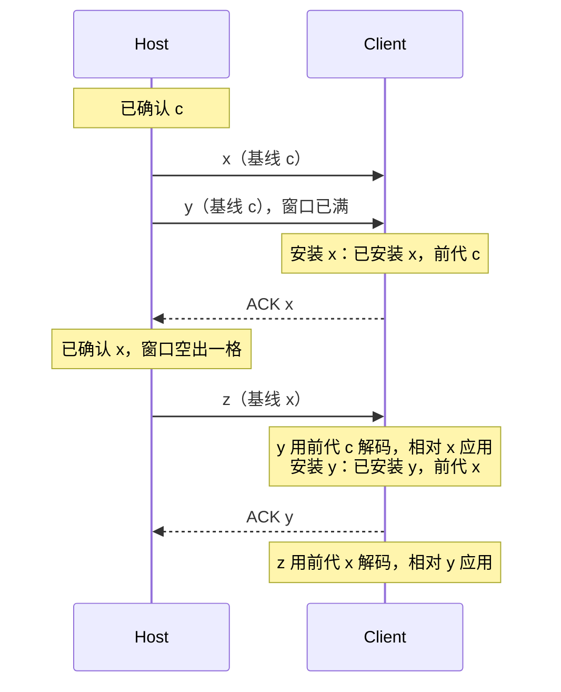

# World 应用节奏修复：发送窗口与前代解码基线，及主线程成本

**2026-11-17 最终一致修订（E1—E9 已同意，尚未实施）**：[设计文档](eventual-consistency-revision.md)、[规范第17节](../../refactor/project-conventions.md#17-原生二进制状态同步重构)。任务一的窗口 2／前代深度 1 由 N=8／B=64KiB 窗口与 K=8 快照环取代（E2），ACK 改为接收确认（E1）；任务二剩余 F1—F6 停止实施（E9）。本文下列旧合同按时点保留，实施后以修订为准。

初稿日期为 2026-11-16，更新至 2026-11-17（Asia/Singapore）。**任务一 P1—P12 已实现，协议版本为 83。任务二第 1—4 步及后续 M5 已在第 15 步续测**，读数见 4.1.1—4.1.5 节。M5 试验后按用户指示恢复第 4 步的提交调度和整批描述。后续候选见 4.12 节，均未实施。文中标明“推算”的时序和预期没有逐段实测。

上级：[现行规范第17节](../../refactor/project-conventions.md#17-原生二进制状态同步重构)、[总计划](README.md)。相关合同：[接受与恢复](9-acceptance-recovery.md)、[预算](9-budget-capacity.md)、[Host 发布](11-host-publish.md)、[增量应用与双通道](13-client-incremental-apply.md)、[应用频率修复方案](13-client-apply-frequency.md)、[第15步验收](15-e2e-acceptance.md)。

## 1. 问题与目标

第 15 步 100 敌怪、四身体直连复测（180.633 秒，无泪弹、敌弹、拾取或 FX）：

| 项 | 实测 |
| --- | --- |
| Host | 59.972 tick/s，29.989 ordinary/s |
| World | 发送 3720，安装 3717，**20.578Hz**，旧基线拒绝 2 |
| Body | 发送 10670（59.070Hz），安装 10283（56.927Hz） |
| World 端到端（收包到发布） | 均值 42.809ms |
| 其中主线程接票等待 | 11.408ms |
| 其中准备后等待提交 | 6.430ms |
| World 安装 | 均值 3.950ms，3717 次全部超过 2ms，1349 次超过 4ms |

这里有两个互相独立的问题：

1. **World 发送是停等的**。Host 有未确认的 World 目标时不发新帧，所以 World 频率等于一次完整往返的倒数。往返又只能落在 60Hz 的 Manager 边界上，于是周期不是 2 帧（30Hz）就是 3 帧（20Hz）。
2. **Client 主线程每批成本按整个场景计**。安装全部超过 2ms，准备和安装又常常装不进同一个 8ms 窗口。

本文把它们列为两项任务。**任务一先做，做完后在第 15 步续验内实测；任务二不要求立刻完成，是否实施、按什么顺序实施，等任务一的实测数据出来再定。**

目标指标不变：高负载下 World 30Hz、Body 60Hz，动态安装 p95≤2ms、p99≤4ms。带宽、期限、三池内存总额、5 份表快照、每流一票据、唯一主线程写段、真实成功 ACK 均不放宽。

## 2. 原因定位

### 2.1 停等及其配套限制

| 原因 | 位置 | 说明 |
| --- | --- | --- |
| World 有未确认目标就不发新帧 | `host_publish.cpp:553-556` | `world_outstanding` 为真时只允许 `world_retry` |
| 重试间隔两个周期 | `host_publish.cpp:413-418` | World 约 67ms |
| 差分基线只取已确认目标 | `host_publish.cpp:612, 631` | 这一点是对的，任务一保留 |
| Client 只认当前已安装版本作 World 基线 | `acceptance.cpp:96-97` | 旧基线的例外只给普通 Body |
| 前代纯值根只为 Body 保留 | `client_shadow.cpp:479, 545-553, 1018-1021` | `StateApplyOccupancy(target)!=2` 直接返回 false |
| 同流在途时不解码下一帧 | `client_receive.cpp:90-93, 501` | 整条链串行 |
| 等待位里已有进度的候选不被替换，新到的帧直接丢 | `client_receive.cpp:393-396` | 停等下不会遇到，连发后会遇到 |

停等是在 I 轮之后加上的。I 轮没有停等也没有 World 前代：Host 以 30Hz 发出 5238 个 World，Client 安装 3343 个（18.489Hz），拒绝 1900 个，**被拒的全部是旧基线**。也就是约三分之一的帧在上一帧的 ACK 回到 Host 之前就发出了，它们的基线比 Client 已安装的版本旧一代。停等把这 1900 次拒绝压到了 2 次，但频率仍是 20Hz。前代解码基线要接住的正是这批帧。

### 2.2 一次往返为什么是 3 帧

以下时间线由 42.809ms 端到端、48.6ms 周期和两项等待反推，没有逐段实测。

| 时刻（相对 Manager 边界 k） | 事件 |
| --- | --- |
| k | 上一帧发布，回执交给网络线程 |
| k＋约 4ms | AppliedAck 到 Host，Host 发下一帧 |
| k＋约 10ms | 下一帧到 Client，后台开始解码、检查、计划、描述 |
| k＋约 19ms | 后台完成，错过 k＋16.7ms 的边界 |
| k＋33.3ms | 主线程接票并准备 |
| k＋50ms | 安装并发布 |

两处各罚一帧：后台完成时刚错过一个边界；准备和安装没有装进同一个窗口。消掉任何一处，周期就回到 2 帧。停等本身只贡献端到端之外约 5.8ms 的折返，但它把“帧到达的时刻”锁在边界后约 10ms，使后台几乎必然错过下一个边界。

### 2.3 主线程成本

| 原因 | 位置 | 说明 |
| --- | --- | --- |
| 指令生成遍历全部字段 | `client_atomic_install.cpp:746` | 每个标量叶一条操作，与变化量无关 |
| 任一新实体或格子使整批不建模板 | `client_atomic_install.cpp:611-670` | `fresh_world` 是整批开关 |
| 未变块跳过的条件窄 | `client_atomic_install.cpp:382-388` | 只限根直属、非嵌套、非显示字段 |
| 回调写集已知的条件窄 | `client_atomic_install.cpp:1469`、`client_atomic_bindings.cpp:569-603` | 需要稳态显示、成员集合不变、几何与配置表当前 |
| 稳态显示只容许两类事件 | `client_binary_scene.cpp:192-196` | 其余事件（如 SFX）使整批退出稳态 |
| 安装逐操作循环，运行期再合并相邻字节 | `client_atomic_install.cpp:1053-1196, 1123-1138` | 粒度是叶不是块 |
| 发布全量读回 | `client_atomic_install.cpp:1197-1245` | 与实际写入量无关 |
| 指令生成不可中断 | `client_atomic_install.cpp:1408-1436` | 窗口剩余不够时整段推到下一帧 |
| 字段暂存遇 CPU 队列借用时返回等待 | `client_preparation.cpp:450` | 本批推到后续 Manager 边界，发生频率没有读数 |

run127（四身体）每次安装约 35738 条操作，安装 3.295ms，其中写入 2.045ms、发布读回 0.443ms、封存绑定 0.512ms；另有排序 0.656ms。折算每条操作约 92ns，单条实现没有明显浪费，问题在操作数。100 泪弹 H 轮主线程描述约 7.35ms、写段约 3.29ms。直连 B 轮 World 的 B3 略过字节与 B4 模板命中均为 0。

## 3. 任务一：发送窗口与 World 前代解码基线

### 3.1 思路

把停等看成“发送窗口为 1”。任务一把窗口放到 2，并让 Client 多保留一代 World 纯值根用于解码：

- Host 最多允许 **2 个**未确认的普通 World 目标在途。每帧的差分基线仍取已确认目标。
- Client 保留**当前已安装**和**刚被替换的前一代**两份 World 纯值根。线上基线等于其中任何一份都能解码出完整目标，再相对当前已安装状态生成应用差异。
- 窗口大小 ＝ 1 ＋ 前代深度。两个数必须一起改，不能只改一边。

为什么窗口 2 配深度 1 恰好够：一帧发出时的基线是当时已确认的目标 c。Client 处理这一帧时，已安装版本只可能是 c，或 c 之后被接受的某一帧。窗口为 2 保证 c 与这一帧之间最多只有 1 个未确认目标，所以 Client 在两者之间最多接受过 1 帧，c 必然还是“当前已安装”或“前一代”。只放开停等而不设窗口时，一旦往返超过两个发送周期，基线就会比前一代更旧，帧发出去也只会被拒。

设 L 为 Host 发出一帧到收到其 AppliedAck 的时间。任务一之后 World 的可持续频率约为 min(30, 2/L)，按 Host 的 30Hz 节拍取整：L 不超过约 66ms 时保持 30Hz。同机的 L 由 20.578Hz 的周期反推不超过约 48ms，余量约 18ms。**L 超过 66ms（例如跨设备 RTT 较高）时频率仍会下降**，只是比停等的 1/L 高一倍。之后若要再放宽，做法是同时加大窗口和前代深度，代价见 3.5 节。

### 3.2 Host 改动

| 编号 | 内容 | 落点 |
| --- | --- | --- |
| P1 | **发送窗口**。账本里目标号大于真实已确认号的普通 World 目标占用窗口。占用少于 `world_send_window=2` 时可发新目标，窗口满时合并到最新来源 | `HostStatePublisher::Next` |
| P2 | **新帧触发条件**。来源修订更新，或来源事件水位超过真实完整发送的最高水位，即有新内容 | `StateEventQueue::SentWatermark` |
| P3 | **事件水位单调**。事件段从已确认水位之后选取。预算截断使选段低于已发最高水位时，跳过该 World 节拍。持续达到既有 World 陈旧期限后，走原预算恢复路径 | `HostStatePublisher::Next` 的事件选段 |
| P4 | **重试保留**。窗口满且上次完整发送已过去两个 World 周期时，可用最新已确认基线与新目标号重试，暂时超出窗口。窗口有余量但没有新内容时，同样可重试尚未确认的目标 | `HostStatePublisher::Next`、`WorldRetryDue` |
| P5 | **计数**。每 Peer 状态页输出 `binary_world_window_skips`、`binary_world_inflight_max`、`binary_world_retries` | `HostStatePublisher::WorldProgress`、Host 状态页 |

跳过计数只计有新内容却因窗口满而跳过的节拍。重试在完整发送登记后计数，在途峰值包含重试。事件预算不足期间 Body 仍可获得自己的发送机会。

不改动：差分基线取已确认目标；带哪些块按已确认来源判断；账本、恢复槽和正文租约；联合、基线、恢复路径；Body 发送；换表规则（见 3.5 节）。

### 3.3 Client 改动

| 编号 | 内容 | 落点 |
| --- | --- | --- |
| P6 | **接受资格**。按普通单流查询前代资格。World 的线上 base 旧于已安装版本时，精确命中合格前代根则进入 Decode，其余旧 base 仍 Reack。联合帧要求严格匹配 | `ClientStateAcceptance::Assess`、`StateCandidateContext::HasRetainedDecodeBase` |
| P7 | **保留与清空**。普通 World 真实成功后，把刚被替换的 World 根留作前代；再次成功即替换。联合或 base=0 成功、World 进入恢复、关闭时清空 | `client_shadow.cpp` 的 `Complete`、`Recover`、`Close` |
| P8 | **World 前代的资格条件**。同 route、同 scope；线上基线等于前代的目标版本；前代版本小于当前已安装版本；报文所指的成员表和资源表快照都在。World 允许成员闭包变化 | `ClientShadowStorage::RetainedDecodeBase` |
| P9 | **解码基线与应用基线分开**。构建工作为 World 选用解码基线（已安装或前代）；成员变化清单、计划、校验、指令生成一律相对当前已安装状态。Begin 封存实际应用基线，进入写段和后台接受时各复核一次 | `ClientShadowStorage::BuildStep`、`ClientStateAcceptance::Begin` |
| P10 | **重建结果向已安装状态归一**。验证重建块的字节、解码结构和引用语义，与已安装块等价时沿用其内容和来源。整记录等价且目录代次匹配时复用整记录 | `ClientShadowStorage::NormalizeWorldRecord` |
| P11 | **World 原始报文位**。等待中的候选已有进度或普通 World 已在途时，将最新的合格报文留在唯一原始报文位。本流空闲后转入候选槽 | `ClientStateReceiver::Impl` 的 `StoreWorldRaw`、`PromoteWorldRaw` |
| P12 | **计数**。World 诊断页输出 `world_predecessor_decoded`、`wait.world_predecessor_missing`、`wait.world_queue_replaced` 和 `wait.world_queue_expired` | `ClientApplyWait`／`ClientApplyVolume` |

**P8 的理由。** Body 不拥有成员的进出，所以 10.4 节要求前代和当前 Body 的每个根在报文目录里保持同一编号和身份。World 正是成员进出发生的流，实体离开后前代的闭包必然不再相等，照搬这个条件会让前代在有实体离场的帧上全部失效。World 的严格路径本来就要处理“基线目录与目标目录不同”：`FindInvalidated` 按编号和身份逐项比较两张目录，把改义入口传播给消费块；继承块的引用改绑由 `shadow_inherited_link_rebound` 拒绝；继承的消费块失效而报文未带时返回 `JointRequired`。这些检查不假设两张目录相邻。前代解码只是让两张目录之间多隔一步，沿用同一组检查即可。

**P9 实现。** `BuildStep` 按流选解码根，每个工作片复核根对象仍保持一致。`Changes()` 相对 `Installed(0)` 计算，准备目标的 `previous` 取自当前已安装根，派发前复核引用未变。Begin 封存实际应用基线版本，原生写段前的发布预留和后台接受 Success 时分别复核该版本。

**P10 实现。** 前代解码的普通 World 在继承检查和完整记录解码后，以当前已安装根归一。归一时同步改绑根字段字节视图。资源表代次变化时，等价块沿用已安装内容、结构和来源，资源链接仍借目标快照。块版本用于安装计划元数据和 Room／Grid 描述的范围、字节借用校验。B4 读取变化掩码和结构模板，B5 通过内容和解码结构对象以及精确链接判定 `SameBlock`。Body 沿用其原有解码根复用路径。

**P11 的理由。** 停等下新帧只在上一帧确认后到达，不会撞上正在解码的候选。连发后，上一帧完成、等待位里的候选开始解码的那段时间（估计约 10ms）里到达的帧会被 `client_receive.cpp:393-396` 直接丢弃。两端节拍相位固定落在这个区间时会持续丢帧。原始报文位的规则照搬 10.4 节的 Body 等待位：只存原始报文，按 capacity 计入 Wire 池；目标号严格更新才替换；同目标内容冲突仍失败；期限为 `world_wait_ms`，从首次收包算起，替换不续期；过期只丢该帧；联合候选、恢复、关闭立即清空。窗口为 2 时，Client 同时持有的 World 帧最多是一个在途或解码中的候选加一个原始报文。

**P11／P12 实现。** 原始报文转入普通候选槽时沿用首次入位的绝对期限。原始报文位自身到期仅丢该包；转入后按候选状态处理。前代解码计数以完整候选封存为准，安装仍看 Success 计数。前代缺失只计因找不到精确前代版本而 Reack 的新目标；表快照缺失仍可见于通用旧基线拒绝数。

### 3.4 事件

- Host 的事件段从已确认水位之后选取，这一点不变。连发时相邻帧重复携带未确认事件，Client 按序号去重：序号不大于已安装水位的跳过，已有条目且正文相同的跳过（`client_events.cpp:35-45`）。
- 去重时要求同一事件前后两次的成员代次和资源代次相同，否则以 `client_event_epoch_rebinding` 失败。Host 的换表规则保证旧表下发过的事件全部确认后才换表（`host_publish.cpp:474-475`），所以同一事件不会在两个代次下各出现一次。任务一不动这条规则。
- 事件回放、提升和水位推进仍只随 World 真实成功发生。本任务不做在途预解码，所以 `events.Receive` 始终在上一帧提升之后执行。
- 重复携带会增加 World 字节数。事件多的场景须看带宽计数。

### 3.5 成员目录、租约与换表

- 前代 World 根持有它自己的成员表快照。Client 回报的 `member_floor` 取所有被外部引用的快照的最小代次（`client_tables.cpp:279-286`），所以会自动多停留一代。
- Host 有 3 份成员租约（`host_publish.cpp:373`）。任务一之后稳态需要的代次是：前代、已安装、最新目标，最多 3 个，正好用满。下限回报晚于 ACK 到达时会短暂触发 `member_backpressure`，延后换入新目录。
- 缓解沿用 `RetainBodyPredecessor` 的做法：前代根在新目录下闭包逐项等价时改绑到新目录，不占旧快照。有实体离场时无法改绑，只能多借一代。
- **租约是否从 3 加到 4 不预先决定**，看实测的 `member_backpressure` 计数。5 份表快照的上限不变。
- Host 沿用换表条件。已确认的 World 目录对须匹配当前目录，已确认事件水位须覆盖该目录来源，且可靠目录已收齐。成员高频变化（100 泪弹）仍受这些条件和租约限制。3.9 节分别记录稳定成员和高频换表的场景。

### 3.6 明确不做的事

- **不做在途预解码。** 上一帧在主线程期间，等待位里的下一帧仍不解码。预解码能把后台时间提前，但成员变化清单、事件接收和上述指针比较都要改成“解码时与应用时两次求值”。先看任务一实测的后台耗时再定，列入任务二的 M6。
- 不改 Body、联合、base=0、恢复、线字段形状、ACK 身份。
- 不改主线程调度、8ms 窗口、安装器。这些归任务二。
- 不放宽真实成功 ACK：只有全部原生写入和发布成功才发原目标的 AppliedAck。

### 3.7 版本与合同修订

- 接受语义变化，按版本规则递增整数版本 **82→83**，拒绝混用旧版本。线字段形状不变。
- `wire.json` 增加常量 `world_send_window`＝2。
- 实施时同步修订：[接受与恢复](9-acceptance-recovery.md)的“普通 base 等于成功安装版本”在普通单流 World 上放宽为“等于成功安装版本或唯一保留的前代”；[增量应用](13-client-incremental-apply.md) 10.1 节的“普通 World 等待槽 1 个”增加一个原始报文位，10.4 节的前代基线适用范围加上 World；[预算](9-budget-capacity.md)容量表。

### 3.8 实施前列出的失败方式

| 失败方式 | 设计中的对应 |
| --- | --- |
| 把旧基线的增量直接写到当前原生对象上 | P9：先重建完整目标，再相对当前已安装求差 |
| 成员变化清单相对解码基线计算，重复创建或漏删原生实体 | P9：清单只相对已安装；不做预解码 |
| 前代超过一代、属于旧 route／scope、来自未成功候选 | P7、P8：版本精确相等，只留一代，恢复即清 |
| 实体离场使前代全部失效 | P8：不要求成员闭包相等 |
| 前代目录里的编号在目标目录中已换成别的身份 | 现有 `FindInvalidated` 与继承块引用检查 |
| 窗口放开但前代深度没跟上，或反之 | 3.1：两个数成对；常量同源 |
| 窗口满后两帧都丢，Host 永久停发 | P4：重试保留 |
| 重试使在途数超过窗口，基线旧于前代 | Client 按旧基线 Reack，补发的 ACK 推进 Host 已确认号，下一帧自愈 |
| 有在途帧时事件条件恒真，每拍重发 | P2 |
| 字节预算截断使新帧事件水位倒退，触发恢复 | P3 |
| 同一事件在两个成员代次下出现 | 3.4：换表规则不动 |
| 事件重复回放，或前一帧未提升就接收后一帧 | 3.4：序号去重；不做预解码 |
| 新帧撞上正在解码的候选被丢 | P11 |
| 原始报文位被重复包续命、被旧目标覆盖、同目标冲突 | P11：照搬 Body 等待位规则 |
| 前代多借一代目录，租约用满后目录与帧互等 | 3.5：闭包等价时改绑；现有背压只延后换表，不停已发目录的 World |
| 重复携带的块被当成变化，B4／B5 命中率下降 | P10 |
| 迟到的 Success 或写段前应用基线变化 | 现有 Begin 封存与两处复核 |
| 联合、恢复、关闭与在途的两个 World 帧相遇 | 现有撤回规则；前代与原始报文位一并清空 |
| 新旧版本混连 | 82→83，握手拒绝 |

### 3.9 实施顺序与实测

实施顺序：

1. 常量与版本（3.7）。
2. Client：P6、P7、P8、P9，再做 P10、P11、P12。此时 Host 仍是停等，行为应与现在一致。
3. Host：P1—P5。
4. 静态审阅，同步修订 3.7 列出的合同文档。
5. 在第 15 步同一整体验收内续测。

续测场景和要读的数：

| 场景 | 对照值 | 要读的计数 |
| --- | --- | --- |
| 100 敌怪、四身体直连，180 秒 | World 20.578Hz，端到端 42.809ms，旧基线拒绝 2 | World 发送／安装频率；旧基线拒绝数；经前代解码的帧数；窗口满跳过的节拍数；端到端；`main_queue`、`commit_queue`；Decode／Inspect／Plan／Describe 各段；安装分位数 |
| 100 泪弹 | World 14.242Hz | 同上，另加 `member_backpressure`、换表次数、原始报文位过期数 |
| 空场景 | 30／60Hz | 回归：频率不降，无新增拒绝或恢复 |
| 联合、换房、恢复与连发相遇 | 现有覆盖项 | 无半安装、事件不重播、前代与报文位清空 |
| 延迟与丢包（现有代理可用时） | 无 | 频率随 L 的变化是否符合 min(30, 2/L)；重试与 Reack 自愈 |

预期（推算，非承诺）：100 敌怪场景 World 回到 27—30Hz。安装分位数不会因任务一改善。100 泪弹场景受换表确认等待限制，改善幅度不确定。

布局 83 实测：100 敌怪 26.009Hz，低于预期下限；100 泪弹 17.591Hz；空场景 29.981Hz。安装分位数未改善。

读数怎么用：

| 实测结果 | 含义 | 任务二先做什么 |
| --- | --- | --- |
| World 约 30Hz，安装仍超标 | 节奏问题已解，剩安装成本 | M1—M4 |
| World 在 20—27Hz，`commit_queue` 高 | 准备与安装仍跨帧 | M5，再 M1 |
| World 在 20—27Hz，后台各段合计超过约 12ms | 后台错过边界 | M6 |
| 窗口满跳过的节拍多 | L 超过 66ms | 先按各段耗时找最长的一段 |
| 旧基线拒绝仍多 | 前代未命中 | 先修任务一，读前代缺失首因 |
| 100 泪弹明显低于 100 敌怪 | 换表确认等待 | 另立设计，不属于本文两项任务 |

布局 83 的实测落在上表第二行：World 26.009Hz，`commit_queue` 6.976ms。后台合计约 10.5ms，接近第三行的界限。旧基线拒绝为 0，窗口满跳过 539 拍。100 泪弹明显低于 100 敌怪，对应最后一行。上表是实测前登记的对应关系。任务二细化后的顺序以 4.10 节为准：先降后台和主线程准备的成本，M5 看其后的读数。

实机测试前按规范先告知用户需要配合的操作和停止手动操作的时机。

## 4. 任务二：成本按变化量计

本节在任务一实测之后细化。当前实施范围为 4.10 节第 1—4 步。用户已同意 4.8 节第 1、2 项。原因定位中的旧行号对应设计时的工作副本。

### 4.1 任务一之后的读数

布局 83、四身体直连，数据取自[第 15 步续验记录](15-e2e-acceptance.md#2026-11-16-布局-83-world-应用节奏续验)：

| 项 | 100 敌怪 | 100 泪弹 |
| --- | --- | --- |
| World 安装频率 | 26.009Hz，平均间隔 38.45ms | 17.591Hz |
| Host 发送 | 25.981Hz，窗口满跳过 539 拍 | 17.154Hz，窗口满跳过 1431 拍 |
| 收包至发布 | 52.330ms | 82.180ms |
| 后台各段（按成功安装数归一） | Decode 2.593、Inspect 0.148、Plan 7.694、Describe 0.094，合计约 10.5ms | Decode 5.70、Plan 13.77（含被撤回候选的工作） |
| 主线程接票等待 | 5.606ms | 8.02ms |
| 主线程指令生成 | 本轮没有记录 | 8.04ms，其中叶操作 5.17ms |
| 准备到提交等待 | 6.976ms | 3.95ms |
| 原生安装 | 3.583ms，4700 次全部超过 2ms，672 次超过 4ms | 5.784ms（其中 `native_write` 3.36ms），3178 次全部超过 4ms |
| 原始操作数／次安装 | 约 38,958 | 约 61,234 |
| 联合发送 | 0 | 200 |

从这组数能读出三件事：

1. **频率现在由 Client 的串行周期决定。** Host 的发送频率等于 Client 的安装频率，约每 10 拍有 1 拍因窗口满而跳过。同一条流上，下一帧要等上一帧发布并被后台接受后才开始解码，所以一个周期是“后台＋等边界＋准备＋安装”。周期只能落在 Manager 边界上。平均间隔 38.45ms，若只有 2 帧和 3 帧两种周期，则约 31% 的周期是 3 帧（推算）。
2. **每条操作的成本是常数，总成本等于操作数乘常数。** 原生安装折合每条 92ns（敌怪）、94ns（泪弹）、92ns（run127）。泪弹场景指令生成折合每条 131ns。按同一比率，敌怪场景的指令生成约 5ms（推算，M0 核对）。
3. **后台最重的一段是 Plan，不是 Decode。** Plan 占后台的约四分之三。

收包至发布的 52.330ms 里，上表各项合计约 26.7ms，其余约 25.6ms 没有分项读数。它包含主线程的对象暂存、字段暂存和指令生成，后台工作片之间的空隙，以及本流忙时在原始报文位和候选槽里的等待。

#### 4.1.1 M0 实测

布局 83 的 Release／Win32 E2E 构建，隔离 P2 本机直连，固定种子 `S227 7MNF`，两参与者、四身体。敌怪持续移动，泪弹采用[悬空夹具复测](15-e2e-acceptance.md#2026-11-16-布局-83-悬空泪弹夹具复测)的静止负载。两组均为 0 拾取、敌弹及 FX，计时内双端无错误。下表耗时以每次 World 成功发布的累计成本表示，单位 ms，子段包含在对应总段内。诊断本身占用时间，频率和耗时取自本轮 E2E 构建。

| 项 | 100 移动敌怪 | 100 悬空泪弹 |
| --- | ---: | ---: |
| 采样时间 / 合格样本 | 180.118 s / 179／179 | 180.206 s / 180／180 |
| Host tick / ordinary（Hz） | 59.877 / 29.942 | 59.970 / 29.988 |
| Host World / Body 发送（Hz） | 23.412 / 57.762 | 29.810 / 59.493 |
| Client World / Body 发布（Hz） | 23.412 / 55.852 | 29.799 / 58.306 |
| Host 窗口满跳过 / 重试 / 联合 | 896 / 153 / 0 | 33 / 0 / 0 |
| 收包至发布 / 主线程接票等待 / 准备到提交等待 | 60.772 / 8.120 / 6.537 | 41.449 / 5.294 / 6.509 |
| 主线程准备合计 / 对象暂存 / 字段暂存 / 指令生成 | 7.790 / 0.126 / 0.498 / 4.969 | 7.840 / 0.123 / 0.303 / 4.983 |
| 指令生成六段：输入 / 索引 / 字段 / 叶 / 定序 / 范围 | 0.175 / 0.051 / 0.532 / 3.320 / 0.610 / 0.279 | 0.161 / 0.048 / 0.532 / 3.426 / 0.528 / 0.286 |
| 安装合计 / Seal / 原生写 / 原生发布 | 4.000 / 0.827 / 2.278 / 0.458 | 3.747 / 0.802 / 2.162 / 0.383 |
| Seal 四段：附件 / 绑定 / 根 / 保留 | 0.027 / 0.436 / 0.346 / 0.017 | 0.004 / 0.435 / 0.345 / 0.017 |
| 原生 Init / Owners / Resolve / Finish | 0.003 / 0.000 / 0.393 / 0.076 | 0.002 / 0.000 / 0.351 / 0.061 |
| 后台 Decode / Inspect / Plan / Describe | 2.746 / 0.153 / 8.237 / 0.095 | 0.102 / 0.130 / 5.662 / 0.092 |
| Decode 前代重建 / 归一 | 2.280 / 0.021 | 0.066 / 0.000 |
| Plan 记录导入 / 重走 / 命令 | 0.821 / 5.634 / 0.329 | 3.916 / 0.000 / 0.332 |
| Plan 五趟：路径归属 / 字段计数 / 字段范围 / 索引 / 规则 | 0.020 / 0.085 / 0.012 / 0.111 / 0.372 | 0.019 / 0.083 / 0.011 / 0.112 / 0.359 |
| 后台片间空隙 / 本流忙时报文等待 | 2.723 / 20.107 | 1.975 / 9.847 |

| 操作与等待 | 100 移动敌怪 | 100 悬空泪弹 |
| --- | ---: | ---: |
| 原始操作 / 有配方 / 无配方 | 38,938 / 17,327 / 14,874 | 39,885 / 22,609 / 10,530 |
| 未变块操作 / 可比较原值的未变块操作 | 29,776 / 26,230 | 33,139 / 28,608 |
| 实际写入操作 / 合并后的写段 | 959 / 317 | 20 / 20 |
| D1 / 已跳过未变块操作 | 0 / 0 | 0 / 0 |
| 准备与提交同窗 / 跨窗 | 130 / 4,087 | 64 / 5,306 |
| 跨窗首因：窗口用完 / 借用未清 / 另一流先占窗 | 4,087 / 0 / 0 | 5,306 / 0 / 0 |
| Manager 超过 8 ms / Manager 窗口总数 | 5,951 / 10,796 | 6,679 / 10,806 |
| CPU 队列借用等待 | 0 | 0 |
| 复用后台记录 / 命中前代地址配方 | 335,259 / 0 | 945,120 / 0 |
| 经前代解码的 World / 旧基线拒绝 | 3,955 / 0 | 4,954 / 0 |
| World 安装超过 2 ms / 4 ms | 4,217 / 1,465 | 5,370 / 1,494 |

- 操作表前 3 行是单次发布均值，其余为整个窗口的差分。两组总计 264,235,209 条未变块操作取得可比原值，D1 均为 0，首字段为空。
- 无配方操作按转换、引用、晚绑定、暂存、委托、其他计，敌怪轮分别为 271,630 / 2,640,118 / 29,032,493 / 1,488,601 / 15,935,862 / 13,353,928，泪弹轮为 343,680 / 3,350,880 / 20,250,270 / 284,610 / 24,025,380 / 8,291,280。
- 配方未复用按记录取首因。敌怪轮上一批撤销 511,960，结构或依赖变化 83,382，本批有新成员及无前代索引或版本不符各 63,000，容器换承载 13,984。泪弹轮上一批撤销 912,900，容器换承载 21,480。两轮其余首因为 0。
- 跳过资格首因中，`WorldMembersRetained` 的原生成员当前性检查在敌怪轮命中 3,043 次，另有计划成员集变化 682 次、SFX 492 次。泪弹轮 5,370 次全部落在原生成员当前性检查。该检查包含 roster、格子、门和七份列表，读数只定位到这一检查。
- 敌怪轮 Plan 以记录重走为主，约占 68%。泪弹轮 World 的值变化、结构变化及依赖变化块数均为 0，记录导入约占 Plan 的 69%。原始报文等待按实际提升的报文计均值 22.647／14.001 ms。主线程全准备加安装累计 11.790／11.587 ms。

#### 4.1.2 第 2 步实测

沿用 M0 的布局 83 Release／Win32 E2E、隔离 P2 直连、固定种子及两参与者四身体。耗时单位 ms，按 World 成功发布数归一。后台合计为 Decode、Inspect、Plan、Describe 四段的实际执行成本。

| 项 | 100 移动敌怪 | 100 悬空泪弹 |
| --- | ---: | ---: |
| 采样时间 / 合格样本 | 180.085 s / 179／179 | 180.076 s / 180／180 |
| Client World 发布（Hz） | 23.412 → 27.715 | 29.799 → 29.848 |
| Client Body 发布（Hz） | 55.852 → 56.562 | 58.306 → 58.658 |
| Host World 窗口满跳过 | 896 → 240 | 33 → 29 |
| World 后台 Plan | 8.237 → 6.265 | 5.662 → 6.284 |
| World 后台合计 | 11.231 → 9.161 | 5.986 → 6.601 |
| World 主线程指令生成 | 4.969 → 4.230 | 4.983 → 3.994 |
| World 主线程全准备 | 7.790 → 6.925 | 7.840 → 6.785 |
| World 安装 | 4.000 → 3.857 | 3.747 → 3.735 |
| World 收包至发布 | 60.772 → 46.570 | 41.449 → 40.362 |
| 准备与提交跨窗 / 成功发布 | 4,802／4,991 | 5,278／5,375 |
| 成功安装超过 2 ms / 4 ms | 4,991 / 1,300 | 5,375 / 1,258 |
| 复用 World 块 | 8,528,161 | 9,191,250 |
| 命中前代地址配方 / 其中值变化块 | 72,234,184 / 6,037,151 | 119,770,338 / 0 |
| 旧基线拒绝 / 联合发送 | 0 / 0 | 0 / 0 |

- 敌怪轮 Plan 重走由 5.634 ms 降至 0.617 ms，导入由 0.821 ms 增至 3.910 ms。指令生成中的叶处理由 3.320 ms 降至 2.592 ms。窗口内 360 条记录因是新成员或换形未建配方，另有 313 个 SFX 批次走完整安装。两轮因上一批配方撤销而未命中的计数均为 0。
- 静止泪弹在 M0 已整记录导入，本轮 Plan 增加 0.622 ms，其中导入由 3.916 ms 增至 4.527 ms。主线程指令生成下降 0.989 ms。
- 100 敌怪的 World 尚未达到 30 Hz。后台实际执行成本 9.161 ms，高于条件甲估计的 8 ms，96.2% 的票据跨窗。两轮 World 安装 p95／p99 均超过目标，D1 的观测计数均为 0。

#### 4.1.3 第 3 步实测

布局 83 Release／Win32 E2E，隔离 P2 本机直连，两参与者、四身体。先以 M1b 采满两轮 180 秒，再按实际写入占比加入 M4。两轮 M1b 的压力段均未选中片段，D1 均为 0。

| M4 决策读数 | 100 移动敌怪 | 100 悬空泪弹 |
| --- | ---: | ---: |
| 采样时间 / 合格样本 | 180.114 s / 180／180 | 180.106 s / 180／180 |
| World 发布 | 5,167 / 28.687 Hz | 5,398 / 29.971 Hz |
| 每次 World 平均提交操作 / 实际写入 | 32,208 / 970 | 33,139 / 20 |
| 实际写入占提交操作 | 约 3.0% | 约 0.06% |
| World 安装超过 2 ms / 4 ms | 5,167 / 589 | 5,398 / 206 |

最终版使用一个悬空泪弹和临时原生深度输入令原生绘制次序匹配 Authority 顺序，客机继续执行正常 B3 检查。进入压力段前恢复原深度并移除该泪弹。受控段在 12 批普通 World 中累计省去 19,893 条操作。Seal 资格失效故障命中一次，同一票据完整生成后恢复发布。实际写脏省略字段一次，滚动游标访问该字段后修回并读回验证，写脏到修回为 11 µs，该次注入紧邻游标访问，整轮扫描等待时间尚未测量。含片段的批次在发生写入后注入失败一次，Host 发送一次联合恢复，客机继续普通 World 发布。

| 最终版 M1b＋M4 压力续验 | 100 移动敌怪加 2 个特效 | 100 悬空泪弹 |
| --- | ---: | ---: |
| 采样时间 / 合格样本 | 60.116 s / 60／60 | 60.104 s / 60／60 |
| World 发布 | 1,722 / 28.645 Hz | 1,797 / 29.898 Hz |
| Body 发布 | 56.774 Hz | 59.697 Hz |
| 每次 World 平均提交操作 / 实际写入 | 32,205 / 974 | 33,139 / 20 |
| 每次 World 平均少复制的撤销日志字节 | 111,921 | 116,982 |
| World 省略操作 / 发布读回省略 | 0 / 0 | 0 / 0 |
| World 片段修复 / Seal 回退 | 0 / 0 | 0 / 0 |
| World 安装均值 | 3.750 ms | 3.408 ms |
| World 安装 p95 / p99 桶上界 | 8,191 / 8,191 µs | 8,191 / 8,191 µs |
| World 安装超过 2 ms / 4 ms | 1,722 / 348 | 1,797 / 123 |
| Host World 窗口满跳过 | 59 | 6 |

分位桶取各连接从开始到计时结束的累计读数。超过 2 ms／4 ms 的次数只计压力窗口，两场景均未达安装目标。敌怪轮有 1,500 批因实际原生成员集合不匹配走完整安装，117 批未通过成员复用检查，105 批遇到 SFX。泪弹轮 1,797 批均未通过实际原生成员集合检查。两轮 D1 和计时内联合发送均为 0，清场后双端均退出。[第 15 步续验记录](15-e2e-acceptance.md#2026-11-16-布局-83-任务二第-3-步续验)

#### 4.1.4 第 4 步实测

布局 83 Release／Win32 E2E，隔离 P2 本机直连，两参与者、四身体。先按第 3 步资格拒绝计数选择 M8，核定实际 render 次序并修复普通显示批次的原生成员检查。最终版增加同 Host 顺序键及非正常显示分支的保守处理。按用户要求，两轮最终版各采样 30 秒。

| 最终版压力续验 | 100 移动敌怪加 2 个特效 | 100 悬空泪弹 |
| --- | ---: | ---: |
| 采样时间 / 合格样本 | 30.103 s / 30／30 | 30.117 s / 30／30 |
| World 发布 | 867 / 28.801 Hz | 903 / 29.983 Hz |
| Body 发布 | 57.570 Hz | 60.000 Hz |
| 命中片段的 World 批次 / 累计省略操作 | 676 / 8,935,036 | 903 / 19,789,245 |
| 每次 World 平均提交操作，第 3 步 → 第 4 步 | 32,205 → 21,900 | 33,139 → 11,224 |
| 每次 World 平均实际写入 / 写段 | 966 / 329 | 20 / 20 |
| World 指令生成均值 | 3.711 ms | 2.139 ms |
| World 安装均值，第 3 步 → 第 4 步 | 3.750 → 3.520 ms | 3.408 → 2.357 ms |
| World 安装 p95 / p99 桶上界 | 8,191 / 8,191 µs | 4,095 / 4,095 µs |
| 计时内 World 安装超过 2 ms / 4 ms | 867 / 118 | 893 / 0 |
| 准备与安装同窗 / 跨窗 | 135 / 732 | 666 / 237 |
| 实际原生成员检查拒绝 | 0 | 0 |
| Host World 窗口满跳过 | 31 | 0 |

- 分位桶取从连接开始到计时结束的累计读数。计时内两轮 World 安装均未达 p95≤2 ms，泪弹轮所有安装均在 4 ms 以内。敌怪轮有 59 批未通过成员复用资格，52 批因 SFX 走完整安装。两轮计时内均无片段重描述、联合发送和漂移修复，清场后两端排空退出。
- M8 落地了 render 排序与成员复用的边界。SFX 后端及新成员 Init 的完整写入范围尚未闭合。M3、M5、M6 仍是后续候选。敌怪轮有 84.4% 的成功发布跨窗，泪弹轮为 26.2%。[第 15 步续验记录](15-e2e-acceptance.md#2026-11-17-布局-83-任务二第-4-步续验)

#### 4.1.5 M5 敌怪复测

布局 83 Release／Win32 E2E，同一 P2 直连夹具，两参与者、四身体、100 移动敌怪，每轮采样约 30 秒。对照取第 4 步已记录的相同负载。各轮实际特效数见下表。

| 指标 | 第 4 步 M8 对照 | 首轮预留收尾 | 第二轮跨窗优先 | 第三轮取消收尾预留 | 最终版按近期耗时选择 |
| --- | ---: | ---: | ---: | ---: | ---: | ---: |
| 实际特效数 | 2 | 2 | 1 | 0 | 2 |
| 准备完成与进入安装同窗 / 跨窗 | 135 / 732 | 709 / 25 | 762 / 49 | 393 / 262 | 106 / 765 |
| 同窗率 | 15.57% | 96.59% | 93.96% | 60.00% | 12.17% |
| World 发布 | 28.801 Hz | 24.383 Hz | 26.911 Hz | 21.723 Hz | 28.906 Hz |
| Body 发布 | 57.570 Hz | 57.569 Hz | 55.315 Hz | 52.831 Hz | 55.621 Hz |
| World 收包至发布均值 | 43.583 ms | 59.177 ms | 50.626 ms | 67.013 ms | 46.059 ms |
| World 准备完成至安装均值 | 6.677 ms | 0.453 ms | 0.774 ms | 4.705 ms | 6.871 ms |
| Manager 超过 8 ms / 计时调用 | 1,002 / 1,803 | 892 / 1,807 | 1,111 / 1,808 | 1,167 / 1,809 | 1,046 / 1,807 |
| Host World 窗口满跳过 | 31 | 149 | 63 | 206 | 21 |

前三轮的分阶段调度提高了完成准备与写入的同窗率，缩短了准备完成至安装的等待。三个样本的端到端延迟同时增加，World 吞吐回退。最终版敌怪轮 30.132 秒、30／30 样本合格，主线程实际准备和安装均值分别为 6.394 ms、3.589 ms，合计 9.983 ms。计时内 871 批均沿用原调度，28.906 Hz 接近前一轮基线。M5 在入场热身实际选择 15 批，在计时结束后清场阶段累计增至 91 批。没有观察到 CPU 借用释放后的同窗重试。该轮后台 Decode、Inspect、Plan、Describe 合计约 9.149 ms，其中 Decode 2.600 ms，M6 仍待用户决定。

最终轮采样期间两端保持显示和发布。停止时客机原生与菜单已排空，网络 Worker 未完成退出，正常关闭请求后仅结束了本轮隔离客机进程。该收尾问题未定位到具体票据或归因于本次调度。[第 15 步续验记录](15-e2e-acceptance.md#2026-11-17-布局-83-m5-敌怪续验)

### 4.2 目标与判据

目标不变：World 30Hz、Body 60Hz，动态安装 p95≤2ms、p99≤4ms。拆成可检查的判据：

**频率。** 下面两个条件任何一个稳定成立，World 周期就不超过 2 帧：

- 条件甲：上一帧发布之后，下一帧的后台工作赶在下一个 Manager 边界之前交票。发布落在边界后约 5—8ms，所以后台须在约 8ms 内做完（推算）。这时准备和安装即使分在两帧，周期也是 2 帧。
- 条件乙：主线程的准备和安装装进同一个 8ms 窗口。这时后台即使错过一个边界，周期也是 2 帧。

现在两个条件都不稳定：后台约 10.5ms，正好在条件甲的界限附近；准备加安装估计约 9ms，超过窗口。两个条件都成立时周期可以到 1 帧，收包至发布的延迟随之下降。

**安装分位数。** 按每条 92ns 计，2ms 对应约 2.1 万条操作。p95 要留余量，写段里的操作数须降到约 1.5 万条以内，即敌怪场景现在的四成、泪弹场景的四分之一。只优化单条操作的实现达不到这个幅度，必须减少操作数。

### 4.3 成本为什么按全场景计

应用频率方案的 B3、B4、B5 已经实现，但读数没有随变化量下降。原因是复用的单位太粗，并且有几个整批开关：

| 位置 | 现状 | 后果 |
| --- | --- | --- |
| 后台计划的复用单位是整条记录 | `client_plan.cpp:417, 424` | 记录里只要有一个块变化，就按完整掩码重走全部块。移动中的实体每帧都有块变化，按此 100 个敌怪的记录每批都要重走（推断，M0 用 `plan_reused_records` 核对） |
| 后台计划的后处理按全量 | `client_plan.cpp:302-324, 450-541` | 被复用的记录也要逐项复制；路径归属、字段计数、字段索引、规则各走一趟全部路径、字段和标量 |
| 主线程的地址配方只对未变块有效 | `client_atomic_install.cpp:650` | 块的值变了、结构没变，也回到完整的逐层定位 |
| 每个标量叶生成一条操作 | `client_atomic_install.cpp:597-609, 641-663` | 命中配方只省定位，操作数不变 |
| 操作生成后被整体遍历多趟 | `client_atomic_install.cpp:404-493, 786-797, 820-872, 1001-1006, 1017-1025, 1064, 1206` | 收集、地址排序、重叠检查、压缩、定序、封存两趟、写入、发布读回，每趟都按全量 |
| World 的未变跳过范围窄，且只省写和读 | `client_atomic_install.cpp:382-388` | 只限根对象直属的非嵌套字段。嵌套布局里的叶（向量、颜色、Sprite 状态等）不在范围内，它们在实体操作中的占比没有读数。命中的操作仍然生成、排序、封存和遍历 |
| 有新实体或格子时整批不建配方 | `client_atomic_install.cpp:619-620, 629` | 本批不建，下一批也没有配方可借 |
| 有 BossIntro、RoomTransition 以外的事件时整批不算稳态 | `client_binary_scene.cpp:192-196`、`client_atomic_install.cpp:1469-1470` | 本批不跳过，并撤销全部配方，下一批从头建 |
| 写集未知时撤销全部配方 | `client_atomic_install.cpp:992-998, 1069-1070, 1190-1191, 1540` | 同上 |
| 漂移检查依赖最后一次发布的安装器保有全部操作 | `client_atomic_install.cpp:1311-1369, 1557-1573` | 要少生成操作，得先给漂移检查另找数据来源 |
| 提交只看窗口是否还有剩余 | `client_binary_scene.cpp:462, 489-503`、`client_atomic_install.cpp:1428` | 指令生成不可中断；安装可能在窗口末尾才开始，或推到下一帧 |
| CPU 队列借用未清时整批等下一帧 | `client_preparation.cpp:399, 424, 450` | 返回的是非让出的等待，本窗口不再重试 |

已有记录里，run127（四身体混合负载）结构复用的块约五分之一有值变化。100 敌怪和 100 泪弹场景的占比没有读数。

### 4.4 原则

1. **三处都把复用单位从记录降到块**：后台计划、主线程指令生成、写段。未变的块不产生工作。
2. **把两个事实分开失效。** “地址配方”是某个叶在根对象内的偏移、宽度和掩码，只取决于根对象实例、布局、块结构和容器承载。“该处原生值已等于目标值”才取决于回调写了什么。现在两者用同一组条件失效：回调写集未知时配方也被撤销。应当失效的是后者，即本批完整写入并读回；前者不必丢。
3. **写集未知就不跳过**，这是规范第 17 节已定的约束。要让更多批次能跳过，办法是补证据（M8），不是放宽判定。
4. **先读数，再决定做哪几项。** 各项收益互相重叠，表中的预期不能相加。

### 4.5 改动项

M0—M6 沿用登记时的编号，M7、M8 是细化时新增的。实施顺序见 4.10 节，不按编号。

#### M0 补读数（不改行为）

只加聚合计数和首因，不加逐字段日志。

| 读数 | 用途 |
| --- | --- |
| 100 敌怪场景已有的主线程分段：`main_objects`、`main_fields`、`atomic_describe` 及其六个子段、`seal` 四个子段、`native_write`、`native_publish`、原生 Init／Owners／Resolve／Finish | 补 4.1 表里缺的一格，核对“准备加安装约 9ms” |
| 每次安装中有配方的操作数和无配方的操作数（转换值、引用、晚绑定、暂存元素、委托字段） | M1b 能省多少的上限 |
| 每次安装中所在块无值变化的操作数 | 可跳过量 |
| 上一项里，写入时原生值与目标值不等的操作数，以及首个这样的字段（布局、字段号、块） | 记为 D1。这些字段被本地代码写脏，现在靠每批全量重写修回。D1 不为零时，M1b 会把修回时间从一个 World 周期拉长到一轮漂移扫描 |
| 实际写入次数，合并后的写段数 | M3、M4 的收益 |
| 配方未命中的首因，按记录计：本批有新成员、无前代索引或版本不符、实例号变化、容器换承载、结构或依赖变化、块值变化、上一批被撤销 | M1a、M2 各占多少 |
| 跳过资格未取得的首因，按批计：稳态显示的哪个子条件（事件种类、Boss、显示键）、`WorldCallbacksKnown` 的哪个子条件、`WorldMembersRetained` | M8 该先查哪类回调 |
| 准备完成与进入安装不在同一个 Manager 窗口的次数及原因（窗口用完、借用未清、另一流占用） | M5 |
| Manager 窗口超过 8ms 的次数 | M5 的边界 |
| CPU 队列借用导致等待的次数 | 2.3 节最后一行 |
| 后台 Plan 分段：记录导入、记录重走、五趟后处理、命令 | M7 的收益上限 |
| 后台 Decode 分段：前代重建、归一 | 任务一新增工作的成本 |
| 后台工作片之间的空隙合计，本流忙时报文的等待时间 | 4.1 节未归属的约 25.6ms |

M0 从 E2E 的 `cs stream client 0` 读取累计量。后台和主线程分段按窗口内成功发布数归一，因此含已执行的废弃工作。安装器的操作、写入和 D1 计数随成功发布归并。配方计数取地址冲突检查和压缩后的 World 指令，包含本批新建的配方；未复用首因按描述时的记录计。跳过资格首因取 Seal 时的原短路顺序。

D1 的候选限于相对已安装状态复用同一根，且块的正文、结构、依赖均相同的 World 指令。纯写沿用撤销日志，引用使用已有的原生等值检查。每条合并区间只计一次写段，`write_operations` 计实际复制覆盖的指令，附件和引用按具名写调用计。D1 的观测范围限于实际执行检查或写入、并取得可比原值的操作，委托回调内部写入不透明。首字段按连接保留，含采样前的热身。帧号相关转换可能让线上未变化的块产生不同原生值，D1 读数须结合字段语义判断。

跨窗按原票据在准备完成和进入提交时所在的 Manager 窗口比较，阻断原因按首次推迟计。CPU 借用计数以各准备／安装入口实际返回等待为准。后台片间空隙从工作片耗尽量到原候选续跑，忙流报文等待从入包量到原始报文位提升，替换时按最终提升的报文计。

#### M7 后台计划按块复用

- 已接受的计划为每条记录登记各块的字段、标量和引用区间。记录内的标量按块号升序连续排列（`client_shadow.cpp:191-197`），区间是确定的。
- 新计划对与前代相同的块（`SameBlock`：正文、结构、引用都相同）导入对应区间，对其余块只重走该块。导入和重走按块号交替进行，产物与完整重走逐项相同。主线程的配方按记录内序号对位，这是它的前提。
- 记录级的前提不变：非事件记录、非零 base、对象为 Reuse、块掩码与前代相同。不满足时整条记录重走。
- 规则、域关系、事件和命令几趟仍按完整目标执行。
- 五趟后处理先不改。M0 的分段读数显示它们占比高时，再考虑只处理新增条目。那需要给导入条目重编号，复杂度高，届时单独细化。
- 落点：`client_plan.cpp` 的 `RecordStep`、`ImportRecordStep`，`ClientInstallRecord` 增加每块区间。

#### M1a 值变化的块沿用地址配方

- 去掉 `client_atomic_install.cpp:650` 里“块未变”这一项。配方可用的前提已经由 `:635` 保证：整条记录没有结构变化和依赖变化，实例号相同，容器没有换承载。在这些前提下，块变化只可能是值变化，偏移、宽度和掩码都不变。
- 配方只覆盖原样借用字节的叶（`:577`）。转换值、引用、晚绑定和暂存元素没有配方，不受影响。
- 全部叶都命中配方时，配方向量整份沿用，不重新分配。
- 效果：省掉移动实体每批的逐层定位。操作数不变。

#### M2 失效范围收窄

- **M2a 配方与跳过资格分开失效。** 写集未知或写集触及时，只取消本批的跳过，不撤销地址配方。涉及 `:992-1008, 1069-1070, 1190-1191, 1540`。实施前先核对原来撤销配方的理由：源码注释只写了结论，B4 的设计把“原生回调写集触及”列为配方的失效条件。如果核对发现某类回调会改变根内的固定布局或让嵌入对象换址，该类回调保留撤销。
- **M2b 有新成员时不关整批。** 本批有新实体或格子时，仍为 Reuse 的记录照常建配方并登记身份索引。新加入或换形的对象不建，它没有前代，实例号也是新的。本批能否跳过仍由写集决定，M8 之前不能。

第 2 步实施和原生边界核对：

- M7 按实际出现的 World 块计费保存字段、值和引用的结束下标。块正文 owner、解析结构、引用语义经 `SameBlock` 确认后，按数字节点的原交错顺序导入并重编号路径和对象。变化块沿相同游标重走，记录末尾生成一个根节点。规则、索引、事件与命令由完整目标产生。`plan_reused_world_blocks` 在计划封存时累计。
- M1a 通过同路由、应用基线、同实例、结构／依赖及附件核对后，按值序号和字段定义绑定本批的新正文。整条记录的有效配方都命中时共享原向量。发生失配时从第一处开始重建。`native_reused_changed_templates` 统计值变化块上的命中。
- M2b 逐记录判断 Reuse。实体及格子的完整 Init 以本批私有的新成员为目标。其他成员的固定偏移由自身实例和结构验证。回调可能改写既有成员的值，因此新成员所在批次仍走完整写入和读回。
- M2a 的旧撤销跟随 B3 写集资格，见 [B3 写集表和 B4 旧实现](13-client-apply-frequency.md#b3-回调写集)。`DescribeRelativeLeaf` 只接受已解析为同一根内固定偏移的标量，路径经过协议根、具名解析、晚绑定或动态承载的叶每批重新定位。房间几何和程序配置写入修改字段值或外部承载，成员登记沿用传入对象并改写索引和列表。Overlay、字段回调可改动的动态承载不进入配方。这些路径及 SFX 等事件沿用 B3 写集和原生资格复核。真实显示重建仍执行 `DiscardFieldTemplates`，根代次、布局与附件变化仍使对应记录失去复用资格。

#### M1b 未变的块不生成操作

这是降低操作数的主要一项，也是改动面最大的一项。它落实应用频率方案 5.4 节 B4 尚未做完的部分：现在跨批保留的只有配方，操作本身仍然每批重建。

- **指令片段表。** 场景按流保管，键为成员身份、原生实例号和块号。内容是该块全部有配方叶的配方区间，以及当前已发布的块正文引用。不保存绝对地址和页见证。
- **资格。** 一个块同时满足以下条件时，本批不为它的有配方叶生成操作：
  1. 普通单流、非零 base、带显示的 World 批。联合、base=0、显示重建不启用，与 B3 相同。Body 不在本项范围内。
  2. 对象为 Reuse，实例号与片段一致，根地址经 `InspectStaged` 核对。
  3. 该块与已安装的块相同，即不在值、结构、依赖三个掩码里。
  4. 根布局是独占根。GameRun、LevelGamePrefix、Room、RoomDescriptor、SFXVolumeState 不启用：它们共享原生根或被显示复制表覆盖，操作数也少。这些根继续走现有的 B3 逐操作判定。
  5. 本批回调写集已知且不触及该根，即 Seal 现有的三项条件成立。
- **无配方的叶每批照常生成。** 依赖帧号的转换值（如到期帧）在块未变时原生值也要每帧更新，它们没有配方，自然不会被跳过。
- **资格在两处判定。** 指令生成时用当时可得的条件预判，Seal 复核。复核不成立时，本批退回准备阶段，以完整方式重新生成指令后再进入写段，并计数。不得带着不完整的操作集写入。
- **重叠检查。** 片段内的区间在建配方的那一批已和同根的其他操作一起核过。配方和结构不变时区间集合也不变。本批生成的操作之间照常核对。无配方叶的地址每批可能不同，须与同根被跳过片段的区间核对，为此每个根保留一张有序的片段区间表。
- **漂移检查。** 分组来源改为片段表加本批安装器的操作。有配方的叶从片段表按“根地址加偏移”读，做法与现有的相对读回（`:1277-1283`）相同。其余仍从安装器读。游标覆盖两者的全集。
- **切换时点。** 片段表只在发布成功时更新，与字段索引的切换在同一处（`client_binary_scene.cpp:276-277`）。失败的批不动它。恢复、关闭、失效时清空（`client_binary_scene.cpp:299, 435, 445`）。
- **正文寿命。** 片段借用当前已发布引用表里的块。未变的块在新旧两张表里是同一个对象，片段不用动。变化的块在发布时换成新块。
- **发布读回和撤销日志。** 片段省略项由滚动漂移检查覆盖，其余生成项按 M4 记录原值及核对发布值。

第 3 步实现：

- World 独占实体、格子根按成员身份和实例号保存配方及按相对地址排序的区间。块号来自配方。每个片段从当前已发布计划借正文。Player 根同时服务 Body，走逐操作路径。优先级 0 的 Init 输入和构图字段仍按各自阶段生成。
- 上一个成功 World 的稳态见证用于准备预判。Seal 重新核对实际承载、回调写集和原生成员，并检查本批静态写区是否与片段重叠。复核失效时同一票据返回 Stage，以完整方式重新描述。连续两次回退会让下一张普通 World 票据直接完整描述。
- 晚绑定地址在原阶段与片段区间核对。写段开始后发生重叠、原生资格撤销或实际构图重建，沿既有失败排空合同恢复。联合、base=0、换房重建、恢复和关闭清除相应片段。
- 滚动漂移共用原读回分组和游标。分组同时引用当前操作和片段配方，片段以当前实例与块正文重建一次纯值访问。每窗口 128 项、4 块的扫描预算沿用，发现漂移时仍在整块复核后修复。成功发布统计省略数、剩余实际指令数和含片段批数，分别读 `omitted_world_operations`、`committed_world_operations` 和 `fragment_batches`。

#### M3 操作粒度从叶提到连续段

- 建配方时，把同一块内目标偏移和正文偏移都连续的原样叶合并成一段，配方按段保存，每批一段一条操作。掩码写、转换值和引用不合并。
- 现在的合并在运行期逐条判断（`:1123-1138, 1216-1228`），对这些段不再需要。
- 先看 M0 的“写段数／操作数”。字段在正文和原生内存里很少同时连续时收益小，不做。

#### M4 读回与撤销日志按写入量

- 现在值相等的操作也把目标值拷进撤销日志并标记完成（`client_atomic_install_native.cpp:138`），发布时再比较一次。改为相等的操作不进日志；其后没有可能写它的回调时，不做发布读回。
- M1b 做完后剩下的操作大多确有变化，M4 的余量变小。按 M0 的“实际写入次数／操作数”决定是否做。

180 秒敌怪和泪弹压力续验的实际写入分别约占 3.0% 和 0.06%，据此加入 M4。普通 World 的纯值比较相等时，回滚借同批不可变目标值，掩码操作只恢复已核相等的位。实际写入和部分写入仍使用真实捕获的原值。描述阶段保留最坏情况的有界日志容量，写段无需扩容。发布仅省略当前 B3 资格仍成立且后续已知回调不写入的独占根相等项。未知写集继续核对发布值，滚动漂移仍覆盖这两种相等项。

#### M5 准备与安装进同一窗口

- M7、M1 落地后先看读数。准备加安装降到约 5ms 以内时，多数批次自然同窗，M5 可能不需要。
- 仍然跨帧时的候选：指令生成以记录为单位可中断续做；CPU 队列借用的等待改为同一窗口内可重试；提交前用本流最近若干次安装耗时估算剩余时间够不够。最后一条约束的是 Manager 时长，不提高频率。
- 8ms 窗口的大小不在本文范围内，需要调整时另提。

2026-11-17 用户指定接着实施 M5，敌怪轮以第 4 步的 135／732 同窗／跨窗和 28.801 Hz 为对照，每轮采样 30 秒。实施前核对以下失败方式。

- 描述跨窗后对象、资源、字段承载或票据失效。恢复描述前重新验证暂存身份与承载。路径地址和页见证只在当前描述片内有效。仅当完整指令、重叠校验和读回索引均已完成时，记录准备就绪。
- 安装估算偏大或连续超窗。已经就绪的票据在后续 Manager 窗口优先获得一次提交机会，实际期限、取消和借用规则继续生效。估算不足时，已开始的原子安装仍连续完成，超时由实际计数记录。
- Body 临到期或 CPU 借用未清。同窗仍可服务即将到期的 Body。等待借用的安装只在本窗口真实借用变为可用时补一次机会，余下时间交给可推进的工作。涉及写入的失败走原有排空合同。

试验最终版用最近四次实际发布的准备加安装耗时选择是否分片，并在写前估算窗口余量。准备中的指令描述保存字段、记录及分类游标。试验计数 `m5_scheduled_world` 和 `wait.commit_estimate` 的历史读数见 4.1.5 节。

试验后用户指定移除耗时估算和描述中途截止。Manager 在进入下一段工作前仍检查 8 ms 窗口，已进入的指令描述一口气完成，写段就绪后在尚开放的窗口内直接尝试提交。恢复第 4 步的 Body 优先准备顺序，保留取消和原生资格复核，以及真实借用释放后在同窗内重试一次的行为。`wait.commit_borrow_retry` 继续统计实际重试。

恢复直接调度后，100 移动敌怪加 1 个特效的 30.023 秒续验观测到 World 28.678 Hz、Body 55.257 Hz，同窗 141／861（16.38%），安装均值 3.558 ms、收包至发布均值 41.687 ms。实际借用重试为 0。第 4 步对照为 100 移动敌怪加 2 个特效，World 28.801 Hz、同窗 15.57%。[续验记录](15-e2e-acceptance.md#2026-11-17-恢复直接调度续验)

#### M6 后台在途预解码

- 上一帧在主线程期间先解码下一帧。能提前的只有 Decode（约 2.6ms）。Plan 相对当前已安装状态计算，上一帧没有成功之前不能做，除非按“上一帧会成功”推测执行，失败时作废。
- M7 把 Plan 降下来之后，后台合计可能已经满足条件甲。M6 放在最后，只在 M7 之后后台仍然错过边界时再细化。

#### M8 回调写集补全（需要逆向）

- 两类高频的“写集未知”：新实体或格子的 Init 和成员登记（旧 100 泪弹夹具有频繁的 FX 生灭）；事件回放（任务一的 100 敌怪场景 180 秒内事件水位推进了 496，未逐类统计）。
- 要回答两个问题：新成员的 Init 和登记是否写其他既有成员的权威字段；SFX 等高频事件的回放是否写任何 World 权威字段。
- 有证据的写集登记进[B3 回调写集表](13-client-apply-frequency.md#b3-回调写集)，对应批次才能启用 M1b。没有证据的保持不跳过。
- 用逆向确定写入边界，再将有证据的范围落实到 B3 检查。M0 的“跳过资格未取得的首因”决定先查哪一类。

第 4 步先核原生成员检查和事件，因为第 3 步最终版有 3,297 个批次在 `WorldMembersRetained` 拒绝，另有 105 个敌怪批次首因是 SFX。

- J273 `0x413D00` 在 `0x413DBF／0x413DC4` 通过实体虚表 `+0x34` 取绘制排序键，由 `0x413E23` 插入 render 列表。同时在 `0x413D9C` 写实体 `+0x170`，并在 `0x413EAC` 调 `0x416D10` 使 Type／Variant／Subtype 查询缓存失效。原生 `render_sort 0x4150C0` 的唯一代码引用是 EntityList Update 的 `0x415023`。客机正常显示由自己的 `Sort` 按 Z 和 Host 顺序重排 render 列表。`ClientBinaryMemberSetsCurrent` 原先同时要求 render 列表与 Host 成员顺序相等，两种合法顺序会相互冲突。
- 普通非零 base 单流 World 且显示走 `Normal` 分支时，只对 render 列表按集合验收，要求指针逐一对应、无重复、无缺失，且参与绘制的成员持有互异的 Host 顺序键。遇到同键、转场或暂停分支沿用顺序检查。其余六个列表、玩家 roster、448 格与八门、成员本地索引和 valid 检查沿用原规则。失败仍走原生完整登记。发布后的显示仍由现有排序入口负责。
- 失败方式包括同样数量但有重复指针、缺一个成员并混入陌生成员、列表损坏、实际成员结构改变。前两类由有界去重及精确指针查找发现，后两类保留原形状和身份复核。检查只读取有效列表，不临时改动绘制次序。联合、base=0 不启用新的成员保持方式。
- 实际 SFX 回放走 `PlaySelected`，会避开 `0x907C60` 的原生选样本和节流写入。`0x9F7B20` 重置并替换样本的强引用，在 `0x9F7C10／0x9F7CA0` 可经 `0xBECA14` 间接释放旧承载。静态赋值指向 `0x9F8880`，其可经 `0x9F7520` 改动本机声道缓存和资源列表。播放还经过音频 source 虚表及 `PresentWithoutSwap` 队列冲刷。此次没有闭合全部虚调用和队列消费者，SFX 真正回放继续完整安装。
- 通用实体 Init `0x6A4A20` 在 `0x6A4AD6／0x6A4E9F` 有虚调用，在 `0x6A4E04／0x6A4E2C` 可修改另一实体的反向引用集合。私有 Grid Init 当前仅写本地格索引及碰撞类别，随后实际成员登记仍进入有虚调用的原生链。新实体／格子及实际改建成员的批次沿用完整安装。

### 4.6 各项的作用

| 项 | 后台（条件甲） | 主线程准备 | 写段（分位数） | 100 敌怪 | 100 泪弹 |
| --- | --- | --- | --- | --- | --- |
| M7 | 降 Plan | 无 | 无 | 有效 | 只对未变的块有效，新成员照常重走 |
| M1a | 无 | 省逐层定位 | 无 | 有效，但带事件的批次要等 M2a | 要等 M2b |
| M2a、M2b | 无 | 配方不再被整批撤销 | 无 | 带事件的批次受益 | 每批都受益 |
| M1b | 无 | 降操作数 | 降操作数 | 无事件的批次有效 | 要等 M8 |
| M8 | 无 | 让更多批次能用 M1b | 同左 | 带 SFX 的批次 | 关键 |
| M3、M4 | 无 | 小 | 看 M0 读数 | 待定 | 待定 |
| M5 | 无 | 保证条件乙 | 无 | 看 M1 之后的读数 | 同左 |
| M6 | 提前 Decode | 无 | 无 | 看 M7 之后的读数 | 同左 |

100 泪弹场景另有换表确认等待和 200 次联合发送，这部分不属于任务二，见 3.9 节。

### 4.7 不变的约束

- 每流一张票据，唯一的主线程写段，写段内不穿插。真实成功才发 AppliedAck。
- 带宽、期限、三池内存总额、5 份表快照不放宽。片段表按实际容量计入 Values。
- 写集未知的批次不跳过。联合、base=0、显示重建走完整安装。
- 不缓存绝对地址和页见证。每批仍由 `InspectStaged` 核对根地址和实例号。
- 滚动漂移检查的覆盖范围和每帧预算不缩小。
- 不以漏字段、漏关系或减少必要内容换取性能。
- Body 的安装路径不改。Body 的频率缺口在 Host 发送之前，不属于任务二。

### 4.8 需要用户决定的事项

第 1、2 项用户于 2026-11-16 同意，已写入[规范第17节](../../refactor/project-conventions.md#17-原生二进制状态同步重构)。2026-11-17 根据用户指示在第 4 步开展 M8。第 3 项在 D1 出现后再定，后续实施范围待定。

1. **M1b 的跳过范围（已同意）。** B3 现在限定“根对象直属的定长字段或保留容器的元素”。M1b 要扩到“整条父链都在独占根固定内存内的原样叶”，即有地址配方的叶。这修订[增量应用设计](13-client-incremental-apply.md) 4.5 节和[应用频率方案](13-client-apply-frequency.md) 5.3 节的范围。
2. **M2a 的失效条件（已同意）。** 回调写集触及或未知时只取消跳过，不撤销地址配方。这修订应用频率方案 5.4 节 B4 的失效条件。实施前先核对原撤销理由，核对结果不支持时放弃这一项。
3. **D1 不为零时怎么办。** 候选做法：这些字段不参加跳过；或确认它们属于本地显示、不该由 World 每批覆盖。要等 M0 的读数和首个字段才能判断。
4. **是否安排 M8 的逆向。** 不做 M8 时，100 泪弹场景的主线程成本基本不会下降。
5. **做到哪一步。** 建议见 4.10 节。

### 4.9 实施前列出的失败方式

| 失败方式 | 设计中的对应 |
| --- | --- |
| 被跳过的块，其原生值已被本地显示代码改写 | M0 的 D1 读数先行；漂移检查覆盖片段表；D1 涉及的字段按决定 3 处理 |
| 回调写了被跳过的块，写集表漏了这一项 | 写集未知不跳过；M8 只登记有逆向证据的写集；漂移检查兜底 |
| 依赖帧号的转换值所在块未变，原生值却应每帧变化 | 这类叶没有配方，每批照常生成 |
| 根对象换实例或换址后沿用配方或片段 | 实例号加 `InspectStaged` 根地址核对，现有 |
| 结构、条件臂、元素位置或容器承载变化后沿用配方 | 结构和依赖掩码、容器换承载标记撤销整条记录的配方，现有；M1a 只放宽值变化 |
| 两条记录投影到同一个原生根，各自跳过后漏掉跨记录冲突 | 共享根的布局不进入 M1b |
| 无配方叶本批的地址落进同根被跳过片段的区间 | 每个根的片段区间表参加重叠检查 |
| 片段指向的块正文已释放 | 片段只借当前已发布引用表持有的块，换表时同步替换 |
| 写后失败或发布失败的批次已经改了片段表 | 片段表只在发布成功时切换 |
| 联合、base=0、恢复、换房之后沿用旧片段 | 与字段索引一同清空 |
| 漂移检查漏掉没有生成操作的块，或读到旧片段 | 游标覆盖片段表与安装器的全集；E2E 做完整对照 |
| Seal 时资格失效，但操作只生成了变化的块 | 退回准备阶段完整重建并计数，不带着不完整的操作集写入 |
| 上一项反复发生，每批都多做一次指令生成 | 计数；同一条流连续发生时，下一批直接走完整方式 |
| 后台按块导入后，记录内标量序号与主线程配方对不上 | 导入和重走按块号交替，产物与完整重走相同；配方按序号和字段定义双重核对，现有 |
| 后台按块导入漏掉跨块规则或域关系 | 规则、域关系、事件和命令仍按完整目标执行 |
| 前代解码得到的块与已安装块等价但对象不同，被判为变化 | 任务一 P10 已归一；M0 读后台的复用计数确认 |
| M2a 之后，某类回调实际改变了根内布局或让嵌入对象换址 | 实施前核对；有这种回调的类别保留撤销 |
| M2b 之后，新成员的 Init 改了既有成员的值，而该批被跳过 | M8 之前有新成员的批次不跳过 |
| 片段表、区间表使 Values 占用超出额度 | 按实际容量记账，超额沿用现有预算错误合同 |
| 撤销时缺少未生成操作的原值 | 未写入的区间不需要恢复 |
| M5 的估算偏小，安装把 Manager 拖过窗口 | 取最近若干次的最大值；超窗次数由 M0 计数 |

### 4.10 建议的顺序与每步判据

同一二进制重构目标内的顺序，不是新增步骤编号。每一步做完都在第 15 步同一整体验收内续测，测试前按规范先告知用户需要配合的操作。

| 步 | 内容 | 是否改合同 | 续测时看什么 |
| --- | --- | --- | --- |
| 1 | M0 | 否 | 填齐 4.1 表；得到 D1、配方未命中首因、跳过资格首因、后台分段 |
| 2 | M7、M1a、M2b，以及核对通过后的 M2a | M2a 按决定 2，已同意 | 后台 Plan 和主线程指令生成是否下降；100 敌怪的 World 是否到 30Hz；窗口满跳过拍数 |
| 3 | M1b、M4 已实施 | 决定 1 已同意，M0 的 D1 为 0 | 每次安装的操作数；安装 p95、p99；漂移修复次数；退回完整重建的次数 |
| 4 | 已实施 M8 的成员复用修正。M5 试验后恢复第 4 步的提交调度和整批描述 | 运行时局部检查与调度，布局仍为 83 | 100 泪弹的操作数和安装分位数，见 4.1.4。M5 试验读数见 4.1.5 |

判据：

- 第 2 步之后 100 敌怪的 World 没有到 30Hz：看后台合计是否仍超过约 8ms，以及准备与安装跨帧的比例，再决定先做 M5 还是 M6。
- 第 1 步的 D1 很大：第 3 步之前先处理决定 3。
- 第 1 步显示无配方的操作占多数：M1b 的收益上限低，先查这些叶为什么没有配方。
- 第 3 步按实际写入占比加入 M4。安装仍超过 2 ms 时，结合剩余操作数及实际写入情况评估 M3。

预期（推算，非承诺）：第 2 步针对频率，第 3 步针对安装分位数。100 泪弹场景在 M8 和换表确认等待处理之前，两项指标都不会达标。

第 4 步之后的候选及建议顺序见 4.12 节。

### 4.11 第 15 步补充覆盖（任务二实施后）

| 场景 | 必须观察的结果 |
| --- | --- |
| 100 个实体持续移动，成员稳定 | 后台 Plan、主线程指令生成和操作数随变化块数下降；显示与完整安装一致 |
| 实体静止后再移动；值变化后又恢复原值 | 未变时不生成操作；再次变化时正确写入 |
| 本地显示代码写脏被跳过块的字段 | 漂移检查在一轮扫描内修回，修回时间有读数 |
| 带 SFX 等写集未知事件的批次 | 走完整安装；配方保留；下一批恢复按块处理 |
| 有实体加入、离开、换形的批次 | 既有成员的配方保留；新成员完整安装；无重复创建或残留 |
| 实体重生（同身份、新实例号）；容器换承载 | 该记录的配方和片段失效并重建 |
| 到期帧等转换值所在块连续多帧未变 | 原生值每帧正确更新 |
| Seal 时稳态条件变化 | 退回完整重建后再写入，无半安装 |
| 写后失败、联合、base=0、换房、恢复 | 片段表清空或不切换；恢复后从完整安装重新建立 |
| 长时间运行 | 片段表占用有界，退休后真实销账 |

### 4.12 后续候选

2026-11-17 整理，仅供后续选择，均未实施，也不表示用户已同意。读数取自 4.1.1—4.1.5 节和[恢复直接调度续验](15-e2e-acceptance.md#2026-11-17-恢复直接调度续验)，标明“推算”的没有实测。M5 的分段调度试验已撤回，调度修正已完成，见 M5 节末。候选编号 F1—F6 与 M0—M8 分开。

#### 4.12.1 现状与剩余空间

| 项 | 100 移动敌怪 | 100 悬空泪弹 | 来源 |
| --- | ---: | ---: | --- |
| World 发布 | 28.678 Hz | 29.983 Hz | 恢复调度续验；4.1.4 |
| World 安装均值 | 3.558 ms | 2.357 ms | 同上 |
| 每批提交操作 / 实际写入 | 21,900 / 966 | 11,224 / 20 | 4.1.4 |
| 主线程准备＋安装 | 6.394＋3.589＝9.983 ms | 未重测 | 4.1.5 最终轮 |
| 后台 Decode＋Inspect＋Plan＋Describe | 9.149 ms，其中 Decode 2.600 ms | 6.601 ms（第 2 步） | 4.1.5；4.1.2 |
| World 收包至发布 | 41.687 ms | 40.362 ms（第 2 步） | 恢复调度续验；4.1.2 |

收包至发布的起点是完整报文交给接收器（`client_receive.cpp:446`，分片已由网络层重组），终点是原生发布。它不含 Host 采集、网络传输和发布后到上屏的时间。M0 的分段如下，单位 ms，敌怪／泪弹。

| 段 | 读数 | 性质 |
| --- | ---: | --- |
| 本流忙时报文等待 | 20.107 / 9.847 | 排队：前一帧未接受时，新报文只存在原始报文位 |
| 后台实际执行＋片间空隙 | 13.954 / 7.961 | 计算 |
| 主线程接票等待 | 8.120 / 5.294 | 排队：等 Manager 边界 |
| 主线程准备 | 7.790 / 7.840 | 计算 |
| 准备完成至提交等待 | 6.537 / 6.509 | 排队：跨窗 |
| 安装 | 4.000 / 3.747 | 计算 |

- **频率。** World 上限是 Host 普通节拍 30 Hz。两组夹具已接近上限，剩余空间小。两组夹具都刻意保持成员集合稳定、FX 与 SFX 接近 0。真实对战中持续生灭和 SFX 的批次会走完整安装，片段批次的占比没有读数，这是频率上最大的未知。
- **延迟。** 一半以上是排队。流水线化（F6a）可去掉本流忙时等待；准备与安装落在同一窗口，可去掉准备完成至提交等待。推算两者都做到时，收包至发布约 25 ms：后台 9—11、边界等待约 8、主线程约 5。对照：Body 同口径约 15—17 ms（[第 15 步续验](15-e2e-acceptance.md#2026-11-16-布局-83-world-应用节奏续验)）。
- **安装分位数。** 稳态批次剩下的提交操作主要是无配方操作（F3）。另有每批约 1.5 ms 与变化量无关的固定开销（F4），均为 M0 读数，第 3、4 步之后没有重测。

#### 4.12.2 甲类：扩大可跳过范围（F1—F3）

这三项都减少每批生成和提交的操作。按 4.4 节原则 3，写集未知不跳过，所以每项都要先取得证据。

| 编号 | 内容 | 现状与依据 | 前提 |
| --- | --- | --- | --- |
| F1 | 片段的“整批关闭”收窄到“只关闭新成员 Init 及退休实际改到的既有成员” | 本批有 Join／Reshape 的实体或格子、或有退休成员时，整批不用片段（`client_atomic_install.cpp:752-755`）。已知 `0x6A4A20` 在 `0x6A4E04／0x6A4E2C` 可修改另一实体的反向引用集合，在 `0x6A4AD6／0x6A4E9F` 有虚调用（M8） | IDA 闭合这两处虚调用和反向引用写入的目标范围；有证据的写集登记进 B3 写集表 |
| F2a | 闭合 SFX 回放的写集 | 带 SFX 回放的批次走完整安装，第 4 步敌怪轮有 52 批。`PlaySelected` 经 `0x9F7B20`、`0x9F8880`、`0x9F7520`、音频 source 虚表和 `PresentWithoutSwap` 队列，尚未闭合（M8） | IDA |
| F2b | SFX 回放移到 World 发布与读回之后 | 回放的写集不再影响写段资格；回放若写到权威字段，由滚动漂移检查覆盖 | 改变“事件在写段内回放、随真实成功提升”的合同，需要用户决定；须重新列出失败方式，包括回放失败、回执、`uncertain_event`、事件水位 |
| F3 | 片段扩展到委托操作和晚绑定操作，用承载见证键控（ANM2 指针、图层数、Plus holder 及其动态类型） | 按 M0 组成折算每批无配方操作（推算，敌怪／泪弹）：委托约 3.8k／4.5k，晚绑定约 6.9k／3.8k，其他约 3.2k／1.5k，引用约 0.6k／0.6k。泪弹轮第 4 步每批提交 11,224 条，接近 M0 的无配方 10,530 条。委托操作只要字段存在就每批生成一条（`client_atomic_bindings.cpp:217-219`），值相等时 `ClientBinaryApplySpecial` 不写，但定位父对象、计费和读回照做。图层、Plus、Overlay 路径被定为晚绑定（`:78-81`），`DescribeRelativeLeaf` 不接受（`client_atomic_install.cpp:663`），每批重新定位 | 先测这两类字段的 D1。它们正是客机原生显示可能在本地推进的精灵和动画字段，M0 的 D1＝0 不覆盖它们。D1 不为零时按 4.8 节决定 3 处理 |

收益：安装分位数，以及真实对战下的频率。F1、F2 的收益取决于真实对战中这类批次的占比（4.12.5）。

#### 4.12.3 乙类：去掉与变化量无关的固定成本（F4—F5）

纯工程改动，不需要逆向，也不改线协议。

| 编号 | 内容 | 现状与依据 | 约束与难点 |
| --- | --- | --- | --- |
| F4 | Seal 的 `Preflight`（绑定段）和成员当前性检查（根段：玩家 roster、448 格、八门、七份列表）改为相对上次成功发布求差 | M0：绑定 0.435 ms，根 0.345 ms（`client_atomic_install.cpp:1809, 1819`）；Resolve 0.351—0.393 ms（`:1313`）；发布读回 0.383—0.458 ms。合计约 1.5 ms。推算泪弹轮 2.357 ms 的安装中约三分之二是这部分 | 成员检查的目的正是发现原生侧的变化。求差的基准须有“原生侧自上次发布以来未变”的见证，没有见证时退回全量检查。每批仍由 `InspectStaged` 核根地址和实例号（4.7 节） |
| F5 | 新计划直接共享前代计划中未变记录的区间，不再复制和重编号；五趟后处理只处理新增条目 | 第 2 步：记录导入 3.910 ms（敌怪）、4.527 ms（泪弹）。泪弹轮记录完全未变，也照样整条复制 | 须解决 M7 推后的导入条目重编号（M7 节）。主线程配方按记录内序号对位，共享后序号须保持一致 |

收益：F4 主要降安装分位数，泪弹类稳态负载最明显。F5 把后台合计从 9.149 ms 降到约 8 ms 以内，使条件甲成立（4.2 节），并降低延迟。

**F3 和 F5 的实施**

- F3 在原生写段按委托和晚绑定分别累计稳定块内的可比操作及 D1。委托中的文件、动画、图层数和字符串先按该窗口的 ANM2／动画承载及资源核对。能走原写入器等值分支时，直接保留并登记漂移读回。实存值不同时仍在同一批写回。帧选择器保留逐项帧范围核对，图层图像保留格式和共享资源冲突核对。
- 晚绑定纯值叶可复用记录内的操作配方。配方只保存序号、宽度和掩码，绑定本批正文。原生地址在提交时从当前 ANM2 的图层指针、图层数，或当前 Plus holder 和动态类型重新解析。晚绑定仍参加地址重叠、发布读回和漂移检查。原生回调资格沿用 B3。
- F5 为 World 的独占实体和格子记录封存不变的字段、值、引用及局部索引。与已接受记录具有相同不可变块正文并沿用同一路径编号时，新计划直接借用记录的数据，计划中的记录、字段与引用位置按各自区间访问。变化块继续按 M7 导入或重走。跨记录规则和事件每批重验。路径表达到继承上限后根据当前目标重建。
- 后处理只对新封存的条目构建字段归属和执行规则。暂存顺序通过各记录已封存的紧凑索引生成。共享记录直接使用本计划持有的 shadow 块正文，释放旧计划不会留下悬空引用。[300 泪弹续验](15-e2e-acceptance.md#2026-11-17-f3-f5-300-静止泪弹续验)

#### 4.12.4 丙类：结构改造（F6）

改合同，需要用户决定。

- **F6a 流水线化。** 前一帧在主线程排队或安装时，后台按“前一帧会成功”推测处理下一帧，包括 Decode、Inspect、Plan、Describe。这是 M6 的扩展（推测 Plan）。依据：本流忙时报文等待是收包至发布中最大的一段。新报文转入候选槽，要求候选槽已空、工作槽没有票据（`client_receive.cpp:430`）。工作槽在交给主线程时放入（`:203`），后台接受成功后才清空。这段时间里，网络线程上的 World 后台是空闲的。
- **F6b 窗口与前代深度成对加大。** 窗口 N 与前代深度 N−1 一起调整，可以按实测的 L 自适应，频率约为 min(30, N/L)。不设窗口不可取：差分基线是最新已确认的目标（`host_publish.cpp:643`），客机只接受已安装版本或唯一前代作基线。I 轮无窗口、无前代时，发出 5238 帧、安装 3343 帧，拒绝的 1900 帧全部是旧基线（2.1 节）。
- **F6c 指令生成移到后台。** 后台输出相对根的指令表，主线程只核根、绑定地址并安装，从结构上保证准备与安装落在同一窗口。不和 F6a 一起做时，会拉长后台、错过边界。

F6 的副作用和必改项：

1. **事件账本，必须先改。** 回放顺序本身不变，因为主线程写段仍串行（`client_apply.cpp:61` 按票据列表顺序回放）。但现有账本假设“下一帧的 `Receive`／`Prepare` 发生在前一帧提升之后”（3.4 节），提前执行会出现三个问题：
   - 回放列表是 `Prepare` 时复制的副本（`client_receive.cpp:161`）。下一帧提前 `Prepare` 时，会带入前一帧尚未回放、被重复携带的事件。前一帧成功后，这些事件会再播一次，随后 `Replayed` 找不到已被提升删除的条目而失败。
   - `Prepare` 会把超过 15 帧的外观事件标为过期（`client_events.cpp:87`）。提前执行可能使前一帧自己的回执被拒（`:98`）。
   - `Receive` 的容量淘汰（`:53`）可能删除在途票据引用的外观条目。

   改法：`Prepare` 移到前一帧提升之后、下一帧 Begin 之前；容量淘汰钉住在途水位以内的条目；回执校验保留。`Receive` 的去重（`:36`）和换表规则（3.4 节）不受影响。
2. **推测作废。** 前一帧写前失败、被联合撤回、触发恢复、换房或关闭时，下一帧的推测计划和成员变化清单整份作废。现有的 Begin、写段前、后台接受三处应用基线复核（P9）可以兜底。`WithdrawForJoint`、`Recover`、`Close` 须连带清空推测中的候选。
3. **成员目录。** 推测中的候选多持有一代成员表和资源表快照，同时被引用的从最多三份增至四份，客机的 `member_floor` 回报随之推迟。Host 的 3 份成员租约在任务一之后已经用满（3.5 节）。成员高频变化时 `member_backpressure`（`host_publish.cpp:500`）会增多，换表被延后期间 World 的发送来源停在旧目录上。可能需要把租约从 3 份加到 4 份，并核对 5 份表快照的上限。F6b 加深前代，同样会多借目录。
4. **内存。** 多一份完整计划和工作区，计入 Values／Workspace 池。三池总额不放宽（4.7 节）。
5. **合同。** 推翻 3.6 节“不做在途预解码”；修订[增量应用设计](13-client-incremental-apply.md) 10.1 节的槽位语义。F6b 改窗口常量和前代深度，按版本规则递增整数版本。
6. **性能副作用。**
   - 周期从“后台与主线程之和”变为两者取大，瓶颈移到主线程（敌怪轮准备加安装约 10 ms）。
   - 网络线程持续有活，Body 的收包至发布和 ACK 的发出时间需要监测（`live.cpp:803`）。
   - 后台与主线程同时运行，争用 CPU 和缓存。
   - 新鲜度与吞吐的取舍：原始报文位可以被更新的帧替换，但按 P11，已有进度的候选不被替换，所以推测开始后客机会逐帧安装。须定一条策略：已推测、尚未 Begin 的候选，在更新的帧也就绪时是否丢弃。
7. **计数。** 新增推测作废次数，以及候选在主线程前的等待时间。“本流忙时报文等待”的含义随之改变。

网络条件对 F6 的影响：

- 固定的网络延迟不改变报文到达的间隔，拉开间隔的是窗口。L 等于 RTT 加上客机从收包到发出 ACK 的时间。
- 同机或局域网时，客机周期决定频率，F6a 收益最大。
- RTT 较大、窗口为 2 时，频率约为 2/L。报文两帧一组到达，F6a 只去掉每组第二帧的等待，单帧处理时间才是关键（F1—F5、F6c）。下行注入 60 ms 延迟时，World 为 15.314 Hz，收包至发布为 37.895 ms，同构建无延迟对照为 26.009 Hz、52.330 ms（[第 15 步续验](15-e2e-acceptance.md#2026-11-16-布局-83-world-应用节奏续验)）。
- F6b 加大窗口后，报文重新按 33 ms 连续到达，客机周期重新成为瓶颈，F6a 又变得必要。
- 30 Hz 要求 L 不超过约 66 ms。收包至发布约 42 ms 时，RTT 约 20 ms 以内才能维持（第 7 节）；降到约 25 ms 时可以容忍约 40 ms（推算）。

#### 4.12.5 前置读数（不改行为）

- **真实对战负载：** 四身体持续开火，有命中特效和 SFX。读片段批次占比、跳过资格首因、无配方操作的组成，用来决定甲类的先后。
- **票据跨窗数与周期分布：** 统计从开始准备到发布跨了几个 Manager 窗口，以及周期是 2 帧还是 3 帧。现有“同窗”只比较准备完成与进入提交，4.1.5 节显示它可以在周期变长时变好，所以不再作判据。
- **客机帧时间：** 恢复调度后，Manager 超过 8 ms 的窗口为 1,013／1,802 个，对客机自身帧率的影响没有读数。8 ms 窗口作硬预算还是软预算，由用户决定。
- **重测固定开销：** 第 3、4 步之后重测 Seal、Resolve、发布读回的分段，作为 F4 的基数。
- **F3 的前提：** 委托和晚绑定字段的 D1。

#### 4.12.6 对照与建议顺序

| 类别 | 频率 | 延迟 | 安装分位数 | 需要逆向 | 需要用户决定 |
| --- | --- | --- | --- | --- | --- |
| 甲 F1—F3 | 真实对战下大 | 中 | 大 | F1、F2a | F2b |
| 乙 F4—F5 | 小到中 | 中（F5） | 中（F4） | 否 | 否 |
| 丙 F6 | 跨网时大 | 大 | 无 | 否 | 是 |

上表的收益为推算，各项互相重叠，不能相加。

建议顺序：
1. 先取 4.12.5 的前置读数。
2. 再做乙类和甲类。真实对战中片段批次占比低时先做甲类，否则先做乙类。
3. 最后做丙类。F6 会把瓶颈移到主线程，所以放在甲、乙两类之后。

每项实施后在第 15 步同一整体验收内续测。测试前按规范先告知用户需要配合的操作。

## 5. 用户决定（2026-11-16 已同意）

任务安排：

- 两项任务分列。任务一先做，做完后跑测试看性能。
- 任务二不要求立刻完成。

任务一的五项决定，用户于 2026-11-16 全部同意，已写入[规范第17节](../../refactor/project-conventions.md#17-原生二进制状态同步重构)：

1. 普通单流 World 的基线合同放宽为“已安装版本或唯一保留的前代”。联合、基线、恢复不变。这在限定范围内覆盖第 9 步“普通 base 等于成功安装版本”的规则。
2. Host 发送窗口常量为 2，与前代深度 1 成对。
3. 整数版本 82→83，拒绝混用旧版本。
4. World 增加一个可替换的原始报文位。这是容量合同变更，覆盖增量应用设计 10.1 节“普通 World 等待槽 1 个”。
5. 换表确认等待不纳入任务一，留给实测后另议。

任务一的发送、接纳、前代和原始报文位合同已同步。第 15 步续验覆盖见下节。

任务二的决定：用户于 2026-11-16 同意 4.8 节第 1 项（M1b 的跳过范围扩到有地址配方的叶）和第 2 项（写集触及或未知时只取消跳过，不撤销地址配方；实施前先核对原撤销理由）。两项分别修订此前已同意的 B3 跳过范围和 B4 失效条件，实施顺序见 4.10 节。用户先后指定完成任务二第 1—4 步，并为第 4 步提供 IDA。后续单轮采样按用户要求减至 30 秒。

## 6. 第 15 步补充覆盖

以下并入同一整体验收。布局 83 已执行项目和实测读数见[第 15 步续验记录](15-e2e-acceptance.md#2026-11-16-布局-83-world-应用节奏续验)。已有停止记录、失败记录和未完成场景全部保留。

| 场景 | 必须观察的结果 |
| --- | --- |
| 持续移动、成员稳定的高负载 | World 连续两帧在途；经前代解码的帧被真实安装；实际应用间隔与端到端分别记录 |
| 上一帧成功前后到达的下一帧 | 成功前到达的等待后用前代解码；成功后到达的直接解码或进原始报文位 |
| 原始报文位遇到重复、更新、乱序和超时 | 重复与旧目标不覆盖，较新目标替换且沿用首次期限，同号冲突失败，过期只丢该包；替换与过期分别计数 |
| 基线旧于前代 | Reack，不恢复；补发 ACK 后下一帧被接受 |
| 目标重建后相对当前状态为反向变化（值恢复为基线值） | 按当前已安装求差，正确写回 |
| 前代重建重复携带当前块，或同字节引用改义 | 等价块沿用来源并命中复用条件；引用改义仍作为变化；核 B4／B5 命中与资源表租约 |
| 两帧之间有实体加入、离开、编号复用 | 原生实体创建与删除各一次，无重复、无残留 |
| 相邻帧重复携带事件 | 每个事件只回放一次，水位只随 World 成功推进 |
| 事件段被预算截断 | Host 不发水位倒退的帧，Client 不因此恢复 |
| 窗口满后丢包 | 两周期后重试，无永久停发 |
| 联合、换房、恢复、关闭与两个在途 World 相遇 | 前代与原始报文位清空，无半安装，旧 route 不复活 |
| 成员租约用满 | 只延后换表，已发目录的 World 继续收敛；下限回报后释放 |
| 新旧版本混连 | 握手失败，不回退 |

## 7. 未证实与风险

- 2.2 节的时间线是反推的。任务一布局 83 实测后台合计约 10.5ms，World 26.009Hz，未达到 27—30Hz 的预期。任务二 M0 已补测主线程准备各段，读数见 4.1.1 节。
- 同机 L 约 48ms，离 66ms 的界限只有约 18ms。一次 3 帧周期就会让窗口关一拍。任务一之后频率可能在 30Hz 附近抖动而不是稳定在 30Hz。
- 跨设备时 L 含真实 RTT。按同机的 L 推算，RTT 超过约 20ms 后窗口 2 就不够维持 30Hz。加深前代要多借成员目录，受 3 份租约和 5 份快照限制。
- P8 静态审阅确认，成员表增量按当前目录连接，编号回收受仍借用的表快照限制，继承检查比较解码根和目标的精确目录。前代改绑后，目标新增的记录触发反向依赖索引重建。成员进出、编号复用及借用下限的实际变化归第 15 步验证。
- P10 已核对 B4／B5 的变化判断。重复携带的块归一后，实际命中率和后台耗时仍待第 15 步实测。
- P11 的必要性取决于两端节拍的相位。不加时最坏情况是持续隔帧丢弃。
- 重复携带的事件和块会增加 World 字节数，高负载下是否触及带宽预算须看实测。
- 100 泪弹等成员高频变化的场景受换表确认等待限制，任务一的收益不确定。
- 任务二各项的收益互相重叠，不能相加。4.2 节的两个频率条件和“约 8ms”“约 9ms”“约 31%”都是推算。
- M0 的 D1 为 0 的结论限于两组负载中取得可比原值的操作。原生成员当前性失败在此轮只定位到 `WorldMembersRetained`，其内部具体失配项仍待定位。
- M2a 按 4.5 节核对固定偏移与动态承载后实施。显示重建继续撤销配方，两组压力续测覆盖了正常热路径，回调资格仍按 B3 逐批确定。
- M1b 之后，被本地代码写脏的权威字段不再由每批全量重写修回，改由漂移检查在一轮扫描内修回。现有预算下一轮扫描的时长没有读数。
- M1b 的“Seal 复核失败后退回完整重建”在带事件的批次上可能频繁发生，M8 之前这些批次比现在多做一次预判。
- M7 只降 Plan 中记录重走的部分。4.1.1 节显示敌怪轮重走占约 68%，泪弹轮已复用普通记录，仍承担导入和后处理的成本。
- M8 需要 IDA。新成员 Init 的写集此前判定为完整写集未知，能否收窄到可登记的范围没有把握。
- 100 泪弹场景的 200 次联合发送和换表确认等待不在任务二范围内，任务二做完后该场景仍可能不达标。
- 4.12 节的收益和约 25 ms 的延迟下限都是推算。无配方操作组成和固定开销沿用 M0 读数，第 3、4 步之后没有重测。F6 的事件账本问题和成员目录背压来自静态阅读，未经实测。
