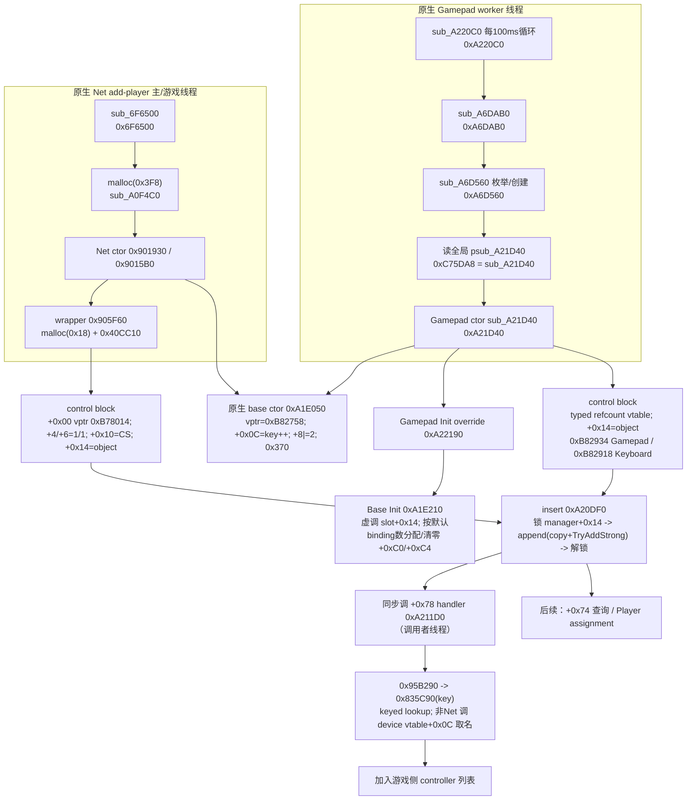
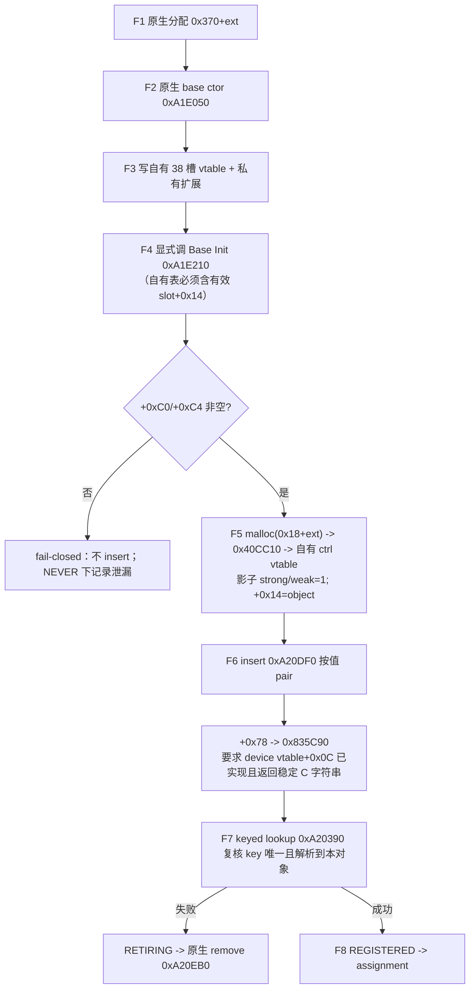
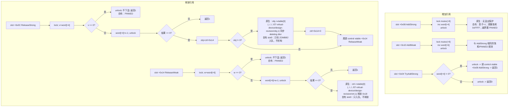
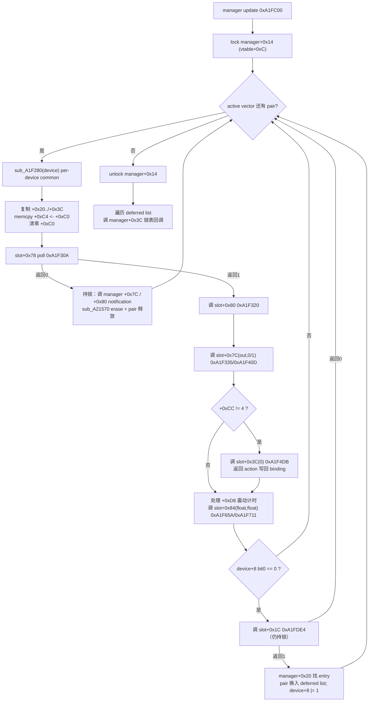
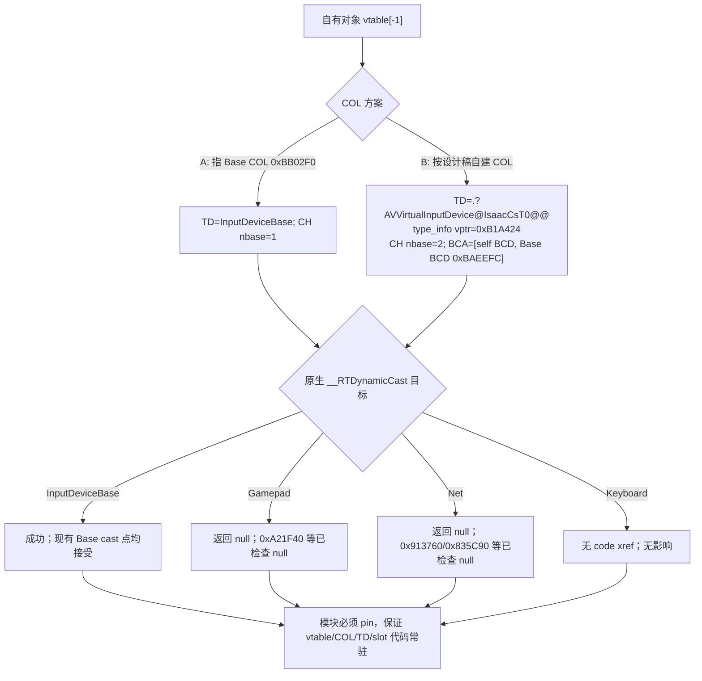
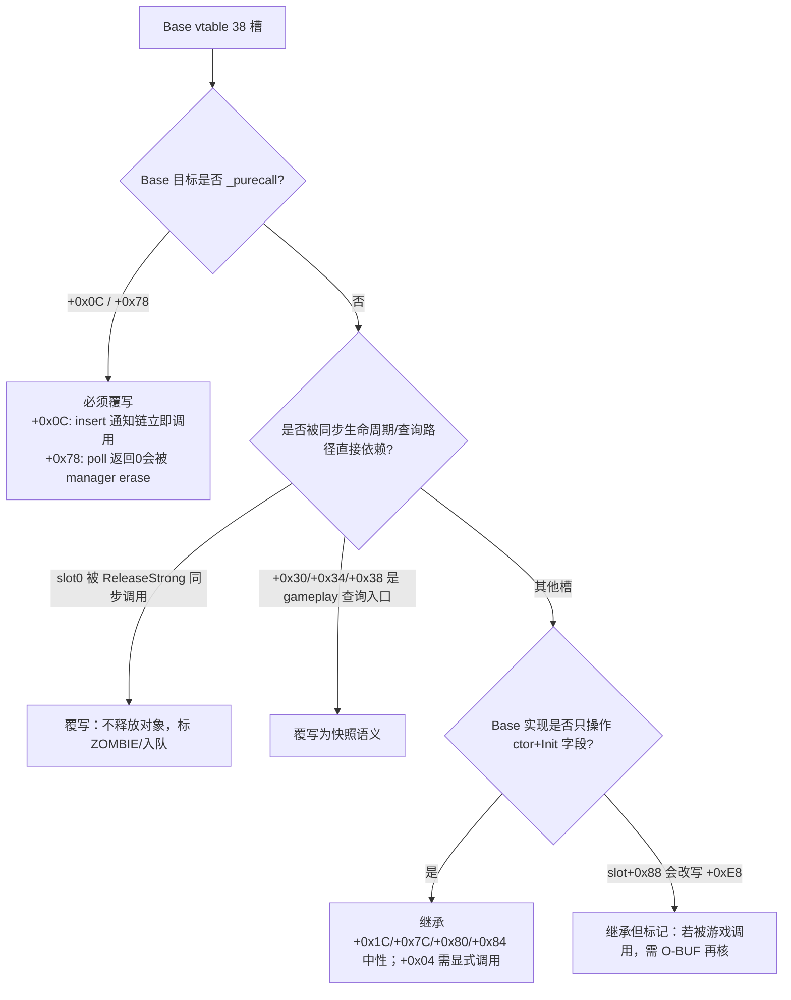

> tx-01-44 归档（2026-10-16）：本页正文中的“当前”“下一步”和旧流程只代表记录当时。执行要求以[现行项目规范](../../../../../project-conventions.md)为准；今天的功能状态见[T0-05 当前入口](../../../README.md)。归档仅调整 Markdown 链接位置，历史事实、失败、反例和证据标签保留。

# CS-T0-05-05 Virtual Device 自有 ABI 静态确认 v1（IDA-MCP）

> 2026-10-12 执行约定更新：先读[现行项目规范](../../../../../project-conventions.md)。永不设定 gate，不校验任何哈希；每次推进最小为 `tx-0x-0x`，整个目标完成后仅一次整体测试验收，探讨过程不得测试；逆向与测试可由同一智能体完成。下面旧 gate/解锁字段、哈希、预封、作者分离和多组验收流程只作历史资料，不作为当前要求；事实与未决功能如实保留。

日期：2026-10-10  
角色：单一 IDA 只读静态确认（非独立 REVERSE、非独立 TEST）  
证据等级：`IDA_STATIC_CONFIRMED`（直接读代码/数据）与显式 `STATIC_DERIVED` / `UNKNOWN`  
目标：Win32/x86 `isaac-ng.exe`，SHA-256 `1FBA9A37BCEBF9276C9A80372E8C4DCAD59C8F652D2FD41727B396DCDCD6B89C`（2026-10-10 用 `Get-FileHash` 对磁盘 PE 复核，与既有交接一致）  
IDB：`F:\SteamLibrary\steamapps\common\The Binding of Isaac Rebirth\isaac-ng.exe.i64`（1,248,28,912 bytes）  
IDA imagebase：`0x00400000`

## 0. 边界与地址约定

- 本报告只使用 IDA-MCP 的只读查询（`analyze_*`、`decompile`、`disasm`、`xrefs_*`、`get_bytes`、`py_eval` 纯读）。没有 patch、rename、set_type、define_func、IDB save，也没有启动/附加游戏、调试器、注入、IPC、Hook 或 canary。
- 本报告不替换 decision v6，不新增任何 decision 行，不提升 `promotionCount`；`formalDecision=null`、`workPackageStatus=BLOCKED_BY_EVIDENCE`、全部权限与 `t005Unlocked/t006Unlocked/csT00506Unlocked` 不变。
- **地址约定**：设计稿/旧交接中的“RVA”数值实际是带 imagebase 的 IDB 绝对地址。本报告统一写 IDA VA，因此旧文的 `0x61E050`（base ctor）在本报告为 `0xA1E050`（`VA = 旧值 + 0x400000`）。需要换算时按此规则。
- 关键全局：InputManager 单例 `0xC57B18`（其 vptr 静态值 `0xB827F4`，派生表 `0xB82950`）；device key 计数器 `0xC7362C`；Base vtable `0xB82758`；通用 `ReferenceCount<InputDeviceBase>` vtable `0xB78014`。

## 1. 对象布局兼容与原生初始化链（请求项 1）

### 1.1 原生 base ctor `0xA1E050`

`sub_A1E050`：`char *__thiscall(char *this)`，大小 `0x15E`，无失败出口，唯一 `retn` 返回 `this`。它按以下顺序写基类：

| 偏移 | 写入 | 字节锚点 |
| --- | --- | --- |
| `+0x00` | Base vtable `0xB82758` | `0xA1E084` `C7 07 58 27 B8 00` |
| `+0x08` | `word=0`，最后 `bts ax,1` → `0x0002` | `0xA1E08A`、`0xA1E173` `66 0F AB C8` |
| `+0x0C` | `dword_C7362C`（key），随后全局 `=key+1` | `0xA1E08E` `89 57 0C`；`0xA1E09B` `A3 2C 36 C7 00` |
| `+0x10/+0x14/+0x18` | 0（binding vector begin/end/cap） | `0xA1E094/0A0/A7` |
| `+0x20..+0x3C` | 0（bit 状态区，供 `+0x24/+0x28` 使用） | `0xA1E0BB..0xA1E0EE` |
| `+0x40..+0xBF` | `memset(...,0,0x80)` | `0xA1E186` |
| `+0xC0/+0xC4` | 0（当前/上一帧缓冲指针，Init 后再分配） | `0xA1E0F5/0FF` |
| `+0xC8` | `0xFFFFFFFF` | `0xA1E109` |
| `+0xCC` | `4` | `0xA1E113` |
| `+0xD0/+0xD4` | 两个 float（阈值/死区初值） | `0xA1E11D..0xA1E135` |
| `+0xD8..+0xE4` | 0 | `0xA1E13D..0xA1E15B` |
| `+0xE8..+0x36B` | `memset(...,0,0x284)`；并调用 `sub_A2C980(this+0xE8)` | `0xA1E165/193` |

`+0x04` 未被 ctor 写入；未观察到 Base vtable 方法读取该偏移，按原生未初始化/派生专用字段处理。

四个调用者（= 四条原生创建路径）：Net ctor `0x9015B0@0x9015DB`、`0x901930@0x90195D`；Keyboard ctor `0xA21980@0xA21A41`；Gamepad ctor `0xA21D40@0xA21DF2`。

**结论**：先调 `0xA1E050` 再换 vptr 是正确且必要的；key 在 ctor 内取自全局计数器，不能被“自行填一个 key”替代（否则与全局递增语义、`+0x0C` 直接读取者不一致）。

### 1.2 析构、Init、cleanup

- deleting dtor `sub_A1E1B0`：重设 Base vptr；调 `sub_A1E2C0`（cleanup）；析构 `+0x10` 处 vector（`sub_4B3950`）；若 `flags&1` 则 `operator delete(this,0x370)`。`0xA1E1CF` 字节 `68 70 03 00 00`（`push 370h`）确认对象大小 **`0x370`**。
- Init `sub_A1E210`：先 **虚调用 vtable `+0x14`**（`0xA1E21C` `FF 50 14`），再按 `((end-begin)>>4)` 计算 binding 数 n，分配 `4*n` 字节写 `+0xC0`/`+0xC4` 并 memset，最后返回 1。
  - 无 null 检查：若 n>0 且分配失败，后续 memset(NULL) 会崩；Init 没有失败返回值。设计 F4 必须在调用后自行核验 `+0xC0/+0xC4` 非空，或在构造前预检。
  - Base `+0x14`（`sub_A1E430`）会把运行期全局默认 binding 数组 `0xC799E8..0xC799EC` 拷入设备 `+0x10` vector（容量不足时 `sub_7DEFC0` 扩容）。因此“先调 Init”实际会给虚拟设备装上一份默认 binding；n 的取值依赖运行期全局，静态 IDB 中该全局为 0，运行期由 `0x4307C0` 等路径初始化（见 UNKNOWN）。
- cleanup `sub_A1E2C0`：`+0xC0/+0xC4` 非空则释放并置 0；幂等，可重复调用。
- `D2=NEVER` 下，我们的 slot 0 不调 dtor/cleanup；对象 `0x370` 内的 vector 与两个缓冲会随设备一起泄漏，为有界泄漏，符合设计取舍。

### 1.3 游戏对基类字段的直接读取（非虚调用）

| 字段 | 直接读取点 | 说明 |
| --- | --- | --- |
| `+0x0C` key | `0xA203F2` `39 79 0C`（keyed lookup `sub_A20390` 内 `cmp [ecx+0Ch], edi`） | 设备查找按 key 线性匹配 |
| `+0x0C` key | `0x95B2C2` 附近（insert 回调 `sub_95B290` 取 `*(a1+12)` 传给 `0x835C90`） | 注册通知链直接读 key |
| `+0x0C` key | `0xA21147`（Manager `+0x74` 查询分发把 `*(device+0x0C)` 写出） | key→device 解析成功后返回 key |
| `+0x0C` key | Keyboard ctor `0xA21A4C` 写 0 | Keyboard 固定 key=0 |
| `+0x08` flags | Manager update `0xA1FDD5` `F6 41 08 01`（`test byte [ecx+8],1`） | bit0 与 `+0x80` 移除清理相关 |
| `+0x08` bit1 | 所有 Base 查询入口 `test byte [this+8],2` | ctor 设置；查询前提 |
| `+0x10/+0x14` vector | Base Init/`+0x14`/查询/`0x902F10` | 元素 stride 16 |
| `+0xC0/+0xC4` | per-device common `0xA1F280` 的 memcpy/memset；Base `+0x30/+0x34/+0x38` | Init 分配的双缓冲 |
| `+0xE8/+0x368` | Base `+0x88` 批量装 binding；Base `+0x1C` 扫描 active 记录 | 0x284 字节子对象 + 计数 |

### 1.4 风险

1. **key 计数器非原子**：ctor 是 `mov edx, dword_C7362C` → `lea eax,[edx+1]` → `mov dword_C7362C,eax`，无锁。Gamepad 创建在 worker 线程（见 §5.6），Net 创建在主/游戏线程；主线程创建 virtual device 可能与 worker 创建 gamepad 抢同一个 key。设计 F7 的唯一性复核是必要但不充分的（复核通过后仍可能被后来者复用同一 key，或复核窗口外发生碰撞）。
2. Init 无失败信号、无 null 检查；默认 binding 全局与运行期值未证实。
3. `+0x04` 未初始化；若某原生路径把它当指针读取，属于未观察到但未完全排除的风险。
4. `sub_A2C980(+0xE8)`、`sub_A1E430` 的完整副作用未逐行闭合；它们都在 Base ctor/Init 内，原生四类设备同样执行，按“与原生同序”处理。

## 2. Control block 布局与 ABI（请求项 2）

### 2.1 布局与构造/析构

- 通用 vtable `0xB78014`（`ReferenceCount<KAGE::Input::InputDeviceBase>`）六槽：
  `+0x00 0x40CB50`、`+0x04 0x40C6B0`、`+0x08 0x40C690`、`+0x0C 0x4358B0`、`+0x10 0x40C610`、`+0x14 0x40C5C0`。
- ctor `sub_40CC10`：
  - `[+0]=ReferenceCountBase vtable`、`[+4]=0x00010001`（`0x40CC42` `C7 46 04 01 00 01 00`，即 strong=1 / weak=1）。
  - `[+8]=KAGE::Mutex vtable 0xB81C0C`；`[+0xC](../../../07-virtual-device/design-revision/byte)=0`；`[+0x10]=0`；随后 `sub_A15770` 分配 `0x1C` 的 CRITICAL_SECTION，`InitializeCriticalSection`，把指针写入 `[+0x10]` 并置 Mutex flag。
- dtor `sub_40CB50`：若 `[+0x10]` 非空，`DeleteCriticalSection` + 释放 `0x1C` 并置 0；清 Mutex flag bit0；若 flag bit0 则释放 control block 本体 `0x18` 字节（`0x40CB95` `push 18h`）。
- wrapper `sub_905F60`：分配 `0x18` → `sub_40CC10` → 写 vptr `0xB78014` → `[ctrl+0x14]=object` → 调 insert。若分配失败（返回 0），它仍会以 `{object, NULL}` 调 insert（`0x905FC7` 分支；`0x905FF6` `[edi+4]=esi(0)`，`0x905FFB` `E8 F0 AD 11 00` 调 `0xA20DF0`）。这就是既有交接记录的 `{object,null-control}` 发布边；自有 F5 必须显式拒绝 control=null。

### 2.2 六槽精确语义（均为 `__thiscall`）

| 槽 | 实现 | 可观察语义 | 关键字节 |
| --- | --- | --- | --- |
| `+0x00` | `0x40CB50` | `void* dtor(ctrl*, int freeFlag)`；清理 CS/mutex；flag bit0 时释放 `0x18` | `0x40CB5D` 读 `[+0x10]`；`0x40CB72` `6A 1C` |
| `+0x04` | `0x40C6B0` | 加锁；若 `word[+4]!=0`：解锁后直接调 control vtable `+0x08` AddStrong，返回 1；若为 0：解锁返回 0 | `0x40C6C8` `66 83 7F 04 00` |
| `+0x08` | `0x40C690` | 加锁；`inc word[+4]`；解锁（尾调 Mutex vtable `+0x10`）；**无溢出检查** | `0x40C69F` `66 FF 46 04` |
| `+0x0C` | `0x4358B0` | 加锁；读 `word[+4]`。为 0：解锁返回 1（**不下溢**）。非 0 则 `--word[+4]`；结果非 0：解锁返回 1。结果 0：解锁；`obj=[+0x14]`，若非空则 `obj->vtable[0](../../../07-virtual-device/design-revision/obj,1)`，再 `[+0x14]=0`；尾调 ctrl vtable `+0x14` ReleaseWeak | `0x4358BF` `0F B7 46 04`；`0x4358C9` `66 89 46 04`；`0x4358DB` `8B 4E 14`；`0x4358E6` `FF 10` |
| `+0x10` | `0x40C610` | 加锁；`inc word[+6]`；解锁；**无溢出检查** | `0x40C61F` `66 FF 46 06` |
| `+0x14` | `0x40C5C0` | 加锁；读 `word[+6]`。为 0：解锁返回 1。非 0 则 `--word[+6]`；结果非 0：解锁返回 1。结果 0：解锁；`ctrl->vtable[0](../../../07-virtual-device/design-revision/ctrl,1)` 释放 control block；返回 0 | `0x40C5CF` `0F B7 47 06`；`0x40C5F1` `FF D0` |

要点：
- strong/weak 均为 **uint16**，位于 `+4/+6`；`+0x10` 是 CRITICAL_SECTION 指针；`+0x14` 是对象指针，且 `ReleaseStrong` 在 `call obj->vtable[0]` 后清空它。
- 原生没有饱和/溢出保护；最后一次 strong 释放会**同步**调用对象 deleting dtor，最后一次 weak 释放会**同步**释放 control block。自有影子计数 + 不释放策略与原生可观察返回值一致，但必须在所有槽内维护 `+4/+6` 镜像。
- 所有槽只使用 `+0x08` 处的 Mutex（vptr + flag + CS 指针）；因此自有 control block 必须保留原生 mutex 构造后的状态，以兼容任何可能的原生 inline 加锁路径。

### 2.3 类型化 vtable 与通用 vtable 等价

- Keyboard control vtable `0xB82918`（`ReferenceCount<InputDeviceKeyboard>`）与 Gamepad control vtable `0xB82934`（`ReferenceCount<InputDeviceGamepad>`）的六槽目标与通用 `0xB78014` **逐项完全相同**；差异只在 `[-1]` COL（用于 control block 自身 RTTI）。
- 因此 control block 的布局与槽语义是类型无关的。自有 control vtable 只需保证六槽行为一致；不需要复制任何类型特定实现。

### 2.4 绕过 vptr 的内联计数普查（L1）

- 六个共享槽实现的所有 xref 均为 data（来自各 `ReferenceCount<T>` vtable）：dtor/TryAddStrong/AddStrong/ReleaseStrong/AddWeak/ReleaseWeak = `20/20/20/11/20/20`，**code xref = 0**。`ReleaseStrong` 与 `ReleaseWeak` 再次确认全部为 vtable 数据引用，没有 direct caller。
- 全映像 16-bit `+4/+6` 内存访问普查（排除上述六槽函数）得 198 个候选；逐一归类后：
  - 部分属于其他两 word 结构（`0x82DD80`、`0xAC64C0` 等）；
  - 部分属于**其他 `ReferenceCount<T>` 特化**的独立函数（如 `0x40C630`、`0x9146A0`、`0xA23E50`），它们自己也只被各自 vtable 数据引用；
  - 没有候选落在 `ReferenceCount<InputDeviceBase>` 的 pair/manager helper 族（`0x902D60`、`0x902CB0`、`0x902F10`、`0xA21570`、`0xA21630`、`0xA21800/0xA21880`、`0xA20DF0`、`0xA20EB0`）内。
- 该族 helper 的确认行为：`0x902D60`（pair copy）只通过 control vtable `+0x04` 取强引用；`0x902CB0/0x902F10`（reset）只通过 control vtable `+0x0C` 释放旧 control，再分配新 `0x18` control 并写 vptr `0xB78014`。未发现 raw `+4/+6` 访问或对 control block 的直接 free/delete。
- 结论：对 `ReferenceCount<InputDeviceBase>`，静态证据支持“计数与释放全部经 control vptr”。残余 UNKNOWN：不是全程序 points-to 证明；按 32-bit 或其他编码的内联修改、以及经计算地址的直接 free 不能凭本次扫描完全排除。

### 2.5 设计影响

- 自有 control block 前 `0x18` 字节（尤其 `+4/+6/+0x10/+0x14`）与原生一致即可让所有已确认 helper 正确工作。
- `+0x04/+0x06` 镜像必须随影子计数更新；任何自有 slot 都不得释放 control/对象。
- 必须保留 `+0x10` 指向有效 CRITICAL_SECTION、`+0x08` 处 Mutex vptr/状态，除非 O-RC-INLINE 能证明没有原生 inline lock 路径；当前证据只能证明共享计数槽没有 direct caller，不能证明 inline lock 不存在。
- `sub_902CB0/sub_902F10` 会在原生 reset 路径中创建新的 `{0,new-control}` 或 `{object,new-control}` pair（strong=weak=1）。这是另一个可产生 control block 的原生路径；若游戏把本公司对象卷入 reset（例如 `+0x7C/+0x80` 回调的重置），需要按同一 ABI 接管。

## 3. 38 槽 vtable：签名、语义、实际调用与可继承性（请求项 3）

### 3.1 四张表与覆写集合

- 四张 38 槽表：Base `0xB82758`、Gamepad `0xB82C80`、Keyboard `0xBA1678`、Net `0xB78030`；`[-1]` 分别为 `0xBB02F0 / 0xBB0460 / 0xBB191C / 0xBAEF78`。
- 逐项与设计稿附录一致。相对 Base 的覆写：
  - Gamepad 11 槽：`+0x00/+0x04/+0x08/+0x0C/+0x10/+0x78/+0x7C/+0x80/+0x84/+0x8C/+0x90`。
  - Keyboard 14 槽：`+0x00/+0x04/+0x0C/+0x10/+0x14/+0x1C/+0x24/+0x28/+0x2C/+0x3C/+0x50/+0x70/+0x74/+0x78`。
  - Net 18 槽：`+0x00/+0x0C/+0x1C/+0x20/+0x24/+0x28/+0x2C/+0x30/+0x34/+0x38/+0x40/+0x44/+0x48/+0x4C/+0x50/+0x54/+0x78/+0x84`。
- Base `+0x0C` 与 `+0x78` 都是 `_purecall`（`0xAF05D3`），Base 类不可实例化；任何可实例化派生类都必须实现这两槽。

### 3.2 Base 38 槽逐项表

“实际调用”只列本次静态确认到的 device 类型对象调用点；未列出表示本次未隔离到，不等于“永不调用”。推荐列中的“继承”指把 Base vtable 指针原样保留。

| 槽 | 偏移 | Base 目标 / 大小 | 语义（由反编译/反汇编归纳） | 已确认调用点 | 推荐 |
| ---: | --- | --- | --- | --- | --- |
| 0 | `+0x00` | `0xA1E1B0` / `0x34` | deleting dtor：cleanup + vector dtor + `delete(this,0x370)` | `0x4358E6`（ReleaseStrong 最后一次 strong，arg=1） | **覆写**（不释放，ZOMBIE） |
| 1 | `+0x04` | `0xA1E210` / `0xA1` | Init：调用 slot5，分配/清零 `+0xC0/+0xC4` | 原生创建路径直接调 Base Init（Gamepad/Keyboard 的 Init override 内 `0xA22420/0xA6C42B`）；未隔离到虚调用点 | 继承；**F4 显式调用** |
| 2 | `+0x08` | `0xA1E2C0` / `0x8F` | cleanup：释放 `+0xC0/+0xC4` | dtors `0xA1E1BC/0xA220F0/0xA6C390` 等直接调用 | 继承（NEVER 下不主动调用） |
| 3 | `+0x0C` | `_purecall` | 名称/描述 getter：`const char* __thiscall(device*)`，调用方把返回值当 C 字符串 | **insert 通知链** `0x835C90` 的 `0x835D1A` `FF 50 0C` | **覆写（硬前置）** |
| 4 | `+0x10` | `0xA1E360` / `0xAD` | action/key code → 静态字符串（`n52686` 映射到动作名） | 未隔离 | 继承（字符串表只读） |
| 5 | `+0x14` | `0xA1E430` / `0x5D` | 把全局默认 binding 数组拷入 `+0x10` vector | `0xA1E21C`（Init 内） | 继承（Init 依赖） |
| 6 | `+0x18` | `0xA1E490` / `0x19` | 写 `+0xC8=arg1`、`+0xCC=arg2`（binding index/mode） | 未隔离 | 继承 |
| 7 | `+0x1C` | `0xA1E4B0` / `0xDE` | 模拟量/状态判定；调用 `sub_A1EED0`→slot31；manager update 用它决定是否把 pair 移入延迟列表 | **`0xA1FDE4`（manager update，持锁）** | 继承；中性状态返回 0 |
| 8 | `+0x20` | `0xA1E590` / `0x77` | 状态/动作解析 helper（间接调用 slot15 `+0x3C`） | 未隔离 | 继承 |
| 9 | `+0x24` | `0xA1E610` / `0x2A` | 浮点值阈值判定（调用 slot11 `+0x2C`） | Base `+0x28` `0xA1E65F/0xA1E6CF` | 继承 |
| 10 | `+0x28` | `0xA1E640` / `0x118` | raw pressed/active 测试：按 binding 类型调 `+0x24/+0x8C/+0x90/+0x94/+0x64` | Base `+0x34` `0xA1E9EF`；Base `+0x3C` `0xA1EB2C`；callback `0xA207D0@0xA20807` | 继承 |
| 11 | `+0x2C` | `0xA1E790` / `0x13C` | 浮点 binding 值（调用 `+0x64`） | Base `+0x38` `0xA1EA91` | 继承 |
| 12 | `+0x30` | `0xA1E8D0` / `0x97` | 逻辑 action 按下（当前帧缓冲） | callback `0xA20940@0xA20977`；wrapper 族 `0xA5F230` | **覆写**（快照 pressed） |
| 13 | `+0x34` | `0xA1E970` / `0xA8` | 逻辑 action 边沿（当前/上一帧） | callback `0xA209E0@0xA20A17`；Player update `0x785DFD` | **覆写**（快照 edge） |
| 14 | `+0x38` | `0xA1EA20` / `0xAC` | 逻辑 action 浮点值（对 4 个 binding 取 max，x87 ST0） | wrapper `0xA5F370@0xA5F39E` | **覆写**（快照 value） |
| 15 | `+0x3C` | `0xA1EAD0` / `0xFC` | 物理输入→action/key 反向查找；mode0/1/2 返回 action，mode3 返回 `0xABAB+bit` | per-device common `0xA1F4DB`（under manager lock） | 继承（中性返回 -1） |
| 16 | `+0x40` | `0xA1EBE0` / `0x36` | binding 设置/读取（retn 8） | 未隔离 | 继承 |
| 17 | `+0x44` | `0xA1EC20` / `0xE1` | 模拟量计算（带 float 参数） | 未隔离 | 继承 |
| 18 | `+0x48` | `0xA1ED10` / `0x36` | binding 设置/读取（retn 8） | 未隔离 | 继承 |
| 19 | `+0x4C` | `0xA1ED50` / `0x27` | binding 索引/取值 helper | 未隔离 | 继承 |
| 20 | `+0x50` | `0xA1ED80` / `0x87` | binding 查找 helper | 未隔离 | 继承 |
| 21 | `+0x54` | `0xA1EE10` / `0x77` | binding helper | 未隔离 | 继承 |
| 22 | `+0x58` | `0xA1EE90` / `0x14` | 写 `+0xD0`（阈值 setter） | 未隔离 | 继承 |
| 23 | `+0x5C` | `0xA1EEB0` / `0x14` | 写 `+0xD4`（死区 setter） | 未隔离 | 继承 |
| 24 | `+0x60` | `0xA1EFA0` / `0x62` | flags/状态 helper | 未隔离 | 继承 |
| 25 | `+0x64` | `0xA1F0E0` / `0x77` | binding helper；Base `+0x28` fallback | Base `+0x28` `0xA1E73B` | 继承 |
| 26 | `+0x68` | `0xA1F160` / `0x88` | binding vector helper（retn 0xC） | 未隔离 | 继承 |
| 27 | `+0x6C` | `0xA1F1F0` / `0x85` | binding 数组拷贝/清零 | 未隔离 | 继承 |
| 28 | `+0x70` | `0x42C160` / `0x5` | `return 0` stub（retn 4） | 未隔离 | 继承 |
| 29 | `+0x74` | `0x42C160` / `0x5` | 同 slot28 | 未隔离 | 继承 |
| 30 | `+0x78` | `_purecall` | poll；返回值 = 设备是否存活 | per-device common `0xA1F30A`（manager update 持锁；返回 0 会被 manager update 直接 erase） | **覆写，必须返回 1** |
| 31 | `+0x7C` | `0xA1F720` / `0x1B` | 读取模拟量 pair 到 `out[2]`（retn 8）；Base 复制全局 `qword_C7B640` | per-device common `0xA1F335/0xA1F40D`；`sub_A1EED0@0xA1EEE0` | 继承（中性）；可显式覆写为 0 |
| 32 | `+0x80` | `0x709C30` / `0x3` | 返回 1（设备可继续处理） | per-device common `0xA1F320/0xA1F3F8` | 继承 |
| 33 | `+0x84` | `0x42BC90` / `0x3` | `nullsub_11`，retn 8 空实现（疑似震动/输出） | per-device common `0xA1F65A/0xA1F711` | 继承 |
| 34 | `+0x88` | `0xA1F740` / `0x1AF` | 批量装 binding 到 `+0xE8` 并 `++[+0x368]`；带线程安全全局初始化 | 未隔离 | 继承（内存安全；被调用时改写 `+0xE8`，需 O-BUF 再核） |
| 35 | `+0x8C` | `0xA1F8F0` / `0x13` | `return *p < 0xABAB`（键盘/通用 key code 范围检查） | Base `+0x28` `0xA1E671` | 继承 |
| 36 | `+0x90` | `0xA1F910` / `0x20` | key code ∈ `[0xABAB,0xABCA]`（gamepad 按钮范围检查） | Base `+0x28` `0xA1E6C9` | 继承 |
| 37 | `+0x94` | `0xA1F930` / `0x20` | key code ∈ `{0xCDCD,0xCDCE}`（keyboard 范围检查） | Base `+0x28` `0xA1E71C` | 继承 |

补充签名：
- slot 12/13：`bool __thiscall(device*, uint32 action)`，`retn 4`，结果在 `AL`。
- slot 14：`float __thiscall(device*, uint32 action)`，`retn 4`，结果在 x87 `ST(0)`。
- slot 30：`bool __thiscall(device*)`，结果在 `AL`，必须非 0。
- slot 31：`void __thiscall(device*, float out[2], int index)`，`retn 8`。
- slot 33：`void __thiscall(device*, int, float)`，`retn 8`，空实现。
- slot 15：`int __thiscall(device*, int mode)`，`retn 4`。
- slot 34：`int __thiscall(device*, void* records, int count)`。

### 3.3 游戏实际调用链与锁关系

**per-device common `sub_A1F280`**（`char __thiscall(device*)`）：
1. 把 `+0x20/+0x24`、`+0x30/+0x34`、`+0x38/+0x3C` 复制到 `+0x28/+0x2C`、`+0x38/+0x3C`；`memcpy(+0xC4,+0xC0,4*n)`；清空当前字段并 `memset(+0xC0,0,4*n)`。
2. 调 slot30 `+0x78` poll；**返回 0 立即返回 0**（manager update 将移除该设备）。
3. 调 slot32 `+0x80`；返回 1 时调 slot31 `+0x7C(out,0)`/`+0x7C(out,1)` 两路模拟量，写入方向位。
4. 若 `+0xCC != 4`，调 slot15 `+0x3C(0)`，把返回 action 写回 binding。
5. 若 `+8 & 8`，返回 1。
6. 处理 `+0xD8` 震动计时并调 slot33 `+0x84(float,float)`；返回 1。

**manager update `sub_A1FC00`**：
- 进入即锁 manager `+0x14`（vtable `+0xC`）。
- 持锁遍历 active vector（`+8..+0xC`，元素 8 字节 pair），对每个 pair 调 `sub_A1F280`。
- 若 `sub_A1F280` 返回 0：在持锁状态下直接读 manager vtable `+0x7C`/`+0x80` 并调用，然后 `sub_A21570` 原地 erase/pair 释放。**这是“poll 返回 0 → 通知在 manager 锁内运行”的路径**。
- 若 `sub_A1F280` 返回 1 且 `device+8` bit0 为 0：调 device slot7 `+0x1C`；若返回 1，则到 manager `+0x20` 原始指针数组中找该设备，把 pair 交换进延迟列表并置 `device+8 |= 1`。
- 解锁后，对延迟列表中的每个 pair 调用 manager `+0x3C` 列表中的回调（本次未在 `+0x3C` 列表发现静态注册目标；见 §5.4）。
- `+0x1C`（Base）在中性状态返回 0：它只在 `+8 bit1` 置位、`+0x20/+0x30` 为 0、模拟 pair 为 0、`+0xC0` 小于阈值 `+0xD4`、且 `+0xE8` active 记录计数 `+0x368==0` 时走 `return 0`。Base ctor 已置 bit1；Init 清零缓冲；`+0x368` 只有在 slot34 被调用后才非 0。因此“不调用 slot34”的 virtual device 不会进入延迟列表路径。

**设计影响**：per-device common 在 manager 锁内调用 slot30/31/32/15/33；这些覆写不得阻塞、不得反向获取 manager 锁、不得调用会重入 manager 的 API。slot30 必须返回非 0，否则设备会被 manager update 在锁内直接移除并触发通知，绕过 coordinator 的 remove 事务。slot7 继承 Base 时在中性状态返回 0，不会触发额外 `+0x3C` 回调；若未来通过 slot34 装入 active binding，必须重新评估。

### 3.4 覆写槽必要性（与设计 D3 对照）

| 槽 | 是否必须覆写 | 理由 |
| --- | --- | --- |
| `+0x00` | 是 | 原生最后一次 strong 释放会同步调 dtor 并 `delete(this,0x370)`；NEVER 策略必须拦截 |
| `+0x0C` | 是 | Base 为 `_purecall`；且 insert 通知链在注册时立即调用它并把返回值当 C 字符串（先于 assignment 与任何业务逻辑） |
| `+0x30` | 是 | 游戏对逻辑 action pressed 的查询入口；Base 读双缓冲，需由快照给出 B 的 canonical 状态 |
| `+0x34` | 是 | 同上，边沿语义 |
| `+0x38` | 是 | 同上，float 值语义 |
| `+0x78` | 是 | Base 为 `_purecall`；poll 返回值决定 manager update 是否直接 erase |
| `+0x7C/+0x80/+0x84` | 否 | Base 分别为“全局零 pair / 返回 1 / 空实现”，对 virtual device 均为中性安全；也可显式覆写以获得更明确的中性保证 |

其余 32 槽继承 Base 是内存安全的自洽选择：它们只访问 `[0,0x370)` 内、由 Base ctor+Init 初始化的字段，并在需要时调用其它 Base 槽；没有观察到硬件 API/系统调用或 `_purecall`（除 slot3/30）。

## 4. RTTI/COL（请求项 4）

### 4.1 四张 vtable 的 `[-1]` COL 与 TypeDescriptor

x86 VC++ COL 在二进制中的实际布局到 `pClassDescriptor` 为止（0x14 字节）；再往后的 dword 属于相邻数据，不是 x64 的 `pSelf`。四张表的 `[-1]` 都指向有效 COL，且每个 COL 的静态 xref **只有对应 vtable 的 `[-1]` 单元**（`0xB82754/0xB82C7C/0xBA1674/0xB7802C`），没有其他代码/数据消费者。

| 表 | vtable | `[-1]` COL | pTypeDescriptor | TD 名称 | pClassDescriptor |
| --- | --- | --- | --- | --- | --- |
| Base | `0xB82758` | `0xBB02F0` | `0xC5D4C0` | `.?AVInputDeviceBase@Input@KAGE@@` | `0xBAEF54` |
| Gamepad | `0xB82C80` | `0xBB0460` | `0xC5D4EC` | `.?AVInputDeviceGamepad@Input@KAGE@@` | `0xBB0474` |
| Keyboard | `0xBA1678` | `0xBB191C` | `0xC61194` | `.?AVInputDeviceKeyboard@Input@KAGE@@` | `0xBB194C` |
| Net | `0xB78030` | `0xBAEF78` | `0xC5D518` | `.?AVNetInputDevice@IsaacRepentancePlus@@` | `0xBAEF44` |

四个 COL 的前三个 dword 均为 0（signature/offset/cdOffset）；四个 TD 的 `type_info` vptr 均为 `0xB1A424`。

ClassHierarchy：
- Base `0xBAEF54`：nbase=1，base array `0xBAEED8` → BCD `0xBAEEFC`（TD `0xC5D4C0`，numContainedBases=0）。
- Gamepad `0xBB0474`：nbase=2，base array `0xBB0454` → BCD[0]=`0xBB0438`（Gamepad TD，numContainedBases=1）、BCD[1]=`0xBAEEFC`（InputDeviceBase BCD）。这就是“自定义派生类 COL”的现成模板。
- Keyboard/Net 同构：nbase=2，含自身 BCD + 同一个 Base BCD `0xBAEEFC`。

### 4.2 代码对这些 TD 的使用点与 null 处理

对四个 TD 地址做全映像 xref 普查：

| TD | code xref 站点 | 结论 |
| --- | --- | --- |
| Base `0xC5D4C0` | 17 个 code 站点，分布在 15 个函数：`0x423CC0/0x42AF00/0x6F6500/0x7B9F60/0x7BC740/0x835C90/0x8D8B00/0x8D9340/0x913760/0x934770(×2)/0x9563B0/0x95AF30/0x95B310/0x98DBA0/0xA21F40(×2)` | 全部是 `__RTDynamicCast` 的 source TD 参数；结果均被 `if(!v)`/`if(v && ...)`/三元链检查 |
| Gamepad `0xC5D4EC` | 9 个 code 站点（`0x423CC0/0x8D8B00/0x8D9340/0x934770(×2)/0x95AF30/0x95B310/0xA21F40(×2)`） | 目标 TD；全部 null-check；gamepad disconnect `0xA21F40` 路径确认依赖 RTTI 匹配 |
| Net `0xC5D518` | 8 个 code 站点（`0x42AF00/0x6F6500/0x7B9F60/0x7BC740/0x835C90/0x913760/0x9563B0/0x98DBA0`） | 目标 TD；全部 null-check |
| Keyboard `0xC61194` | 0 个 code 站点，仅 Keyboard COL/CH 自身 data 引用 | 原生代码没有对 Keyboard 的 `dynamic_cast`/TD 使用；Keyboard 身份判断若存在，应使用 vtable 指针等其他方式 |

代表性的 `__RTDynamicCast` 字节锚点：`0x9137A6` `6A 00 68 18 D5 C5 00 68 C0 D4 C5 00 6A 00 FF 75 08 E8 F5 D0 1D 00`，即 `__RTDynamicCast(obj,0,&InputDeviceBase,&NetInputDevice,0)`，随后 `test eax,eax`；`0x835C90` 中 Net cast 后 `if(!n79_1)` 转入非 Net 分支。对大型函数 `0x7BC740` 单独反汇编 `0x7BDBC2..0x7BDBD9`，同样 `push Net TD`→`__RTDynamicCast`→`test eax,eax`→`jz`。

### 4.3 设计影响

- **最小方案**：把自有对象 `vtable[-1]` 直接指向 Base COL `0xBB02F0`。所有观察到的 `dynamic_cast<InputDeviceBase*>` 成功；到 Gamepad/Keyboard/Net 的 cast 因目标不在 Base 的层次中而返回 null，且所有原生站点已处理 null。代价是 `typeid` 会把对象报告为 `InputDeviceBase`。
- **设计稿方案**：自建 COL，COL 用 Gamepad COL 的布局，ClassHierarchy 使用 `[自身 BCD, 0xBAEEFC]`，TD 使用现有 `type_info` vptr `0xB1A424`。静态上可行；Keyboard TD 的 0 个 code xref 说明“Gamepad/Keyboard/Net 都不是虚拟设备”这一目标不需要额外处理。
- **前置**：模块常驻（pin）仍必要，因为 vtable/COL/TD/slot 代码都要在整个进程生命周期有效。
- **UNKNOWN**：是否还存在直接比较 `type_info` 的 `typeid`/`operator==` 路径。本次 TD code xref 全部是 `__RTDynamicCast`，但没有单独枚举 `type_info::operator==` 调用者；若存在，Base COL 方案与自定义 COL 方案在 `typeid` 名字上会产生不同行为，需要 O-RTTI 继续闭合。

## 5. insert/remove、三个 notification 与 assignment 事务边界（请求项 5）

### 5.1 Manager 布局与关键槽

- 单例 `0xC57B18`：`+0` vptr（静态 `0xB827F4`，另有派生表 `0xB82950`）；`+8/+0xC/+0x10` = active shared pair vector（元素 8 字节 `{object,control}`）；`+0x14` = 内嵌 Mutex；`+0x20..` = 其他运行期列表；`+0x2C/+0x34/+0x3C/+0x44` = 四个 callback 链表头。
- Manager vtable：`+0x28` keyed lookup `0xA20390`；`+0x6C` insert `0xA20DF0`；`+0x70` remove `0xA20EB0`；`+0x74` key→device query dispatch `0xA20FB0`；`+0x78/+0x7C/+0x80` 三个 notification 分别 `0xA211D0/0xA212C0/0xA213B0`。
- `0xA20390`：加锁后线性比较 `device+0x0C == key`，把命中的 pair 取强引用后解锁返回；`0xA20FB0`：对 key 做 lookup → copy pair → 调调用方提供的 `a3` 回调；Devices/keys 的解析链因此依赖 `+0x0C`。

### 5.2 insert `0xA20DF0`（`__thiscall(manager*, pair)`，retn 8）

| 步骤 | 地址/字节 | 行为 |
| --- | --- | --- |
| 1 | `0xA20E27` `FF 50 0C` | 锁 manager `+0x14` |
| 2 | `0xA20E34..0xA20E47` | vector 满则 `sub_A21630` grow，否则 `sub_902D60` copy pair（内部 control vtable `+0x04` TryAddStrong） |
| 3 | `0xA20E52` `FF 50 10`（`0xA20E4C` 起） | 解锁 |
| 4 | `0xA20E5C` `8B 70 78` | 取 manager vtable `+0x78` |
| 5 | `0xA20E63` / `0xA20E6A` `FF D6` | `sub_902D60` 再 acquire 一份 pair，调用 `+0x78` notification；返回后由异常清理/调用者释放该临时 pair |

结论：vector 插入本身在 manager mutex 内；**notification `+0x78` 在解锁之后、由 insert 调用线程同步执行**；notification 收到的是按值 pair 的 acquire 副本，回调自身负责释放，不保留 pair。

### 5.3 remove `0xA20EB0`（`__thiscall(manager*, object, control)`，retn 8）

| 步骤 | 地址/字节 | 行为 |
| --- | --- | --- |
| 0 | `0xA20EE0` | 若 object==0：跳过 1–4，只做尾部 pair 清理 |
| 1 | `0xA20EF1` `8B 70 7C`；`0xA20EFF` `FF D6` | copy pair 后调 manager vtable `+0x7C` notification |
| 2 | `0xA20F08` `8B B0 80 00 00 00`；`0xA20F19` `FF D6` | copy pair 后调 manager vtable `+0x80` notification |
| 3 | `0xA20F28..0xA20F38` | 线性搜索 active vector 中 `pair.object == object` |
| 4 | `0xA20F38` `sub_A21570`，随后 `0xA20F4A..0xA20F6B` | 命中则原地 shift erase；对移出的最后 pair 取强引用释放；未命中则不做 erase |
| 5 | `0xA20F7D..0xA20F95` | 尾部再处理传入的 control pair |

关键点：
- remove **没有获取 manager mutex**；调用者（`0x906020`、`0x90A8A0`、`0xA21F40`）都在没有 manager 锁的情况下调用它。插入使用 mutex，而 remove 不使用，两者对同一 vector 的并发修改不是由统一锁保护的。
- 两个 notification 在**erase 之前**触发；即使 object 不在 vector 中也会触发。因此“重复 remove / 非成员 remove”会产生 notification，但没有 vector erase。
- remove 不消耗调用者的 pair；它只是把 pair 用于 notification/搜索，最后释放自己取得的临时副本。

### 5.4 三个 notification 的链表、目标和行为

| 槽 | handler | 链表 | 静态注册目标 | 行为 |
| --- | --- | --- | --- | --- |
| `+0x78` | `0xA211D0` | manager `+0x2C`（= `0xC57B44`） | `0x95B290`（`0x952C36` 注册，context 0） | 遍历链表；对每个 callback 先按 control `+0x04` 取强引用，再调 `fn(pair, ctx)`；`0x95B290` → `0x835C90(key)`：keyed lookup，若对象不是 `NetInputDevice` 则调 **`device->vtable[+0x0C]` 取 C 字符串名称**（`0x835D1A` `FF 50 0C`），把条目加入游戏侧 controller 列表；回调返回前释放 pair，不保留引用 |
| `+0x7C` | `0xA212C0` | manager `+0x34`（= `0xC57B4C`） | `0x913760`（`0x906E70` 注册，context 传入） | 遍历并调 `0x913760`：打印 `[Frame: %d] Input device (ID = %d) disconnected`；`__RTDynamicCast(obj,0,&InputDeviceBase,&NetInputDevice,0)`；按 object/key 重置游戏侧存储的 pair；释放 pair，不保留 |
| `+0x80` | `0xA213B0` | manager `+0x44`（= `0xC57B5C`） | 本次未发现静态注册目标（JRV2 亦记录无 `+0x44` registrar） | handler 自身：若 `device+8 & 1`，在 manager `+0x20` 原始指针数组中查找 object，命中则 `sub_902F10(entry,0)` 重置并清除 `device+8` bit0；然后仍会遍历 `+0x44` 的空链表 |

三个 handler 都会在调用回调前 acquire pair、调用后释放；它们不把 pair 存入任何长期结构。`0x95B290`/`0x913760` 的静态 xref 都只有对应注册点的一个 data xref，进一步说明它们不把 pair 长期保留。

`+0x0C` 的硬前置：`0x78` notification → `0x95B290` → `0x835C90` 在 insert 后立刻调用 `device->vtable[+0x0C]`。因此 virtual device 在**第一次 insert 之前**就必须实现 `+0x0C` 并返回稳定的非空 C 字符串；否则 Base 的 `_purecall` 会在注册路径崩溃。

### 5.5 manager update 与 notification 的第二条路径

`sub_A1FC00`（manager update）在持 manager 锁遍历 vector 时调用 `sub_A1F280`。若 poll 返回 0，manager update **在锁内**直接调用 manager `+0x7C` 与 `+0x80`，随后 erase 该 pair。这意味着：
- `+0x7C/+0x80` 并非只在 explicit remove 的“无锁、erase 前”时机运行；只要某设备的 poll 返回 0，它们会在 manager 锁内运行。自有覆写 slot30 必须返回非 0，或 coordinator 必须把“poll 返回 0”当作“原生将替我们 remove”并相应更新状态机。
- `+0x80` handler 会读 `device+8` bit0；Base ctor 只置 bit1，因此 fresh virtual device 的 bit0 为 0。若后续被 manager update 置位（只有在 slot7 返回 1 时才会置位，见 §3.3），`+0x80` 才会做 manager `+0x20` 数组清理。
- manager update 在解锁后还会为延迟列表中的 pair 调用 manager `+0x3C` 链表回调；本次未在 `+0x3C` 发现静态注册目标，但该链表是运行期可注册的，必须视为潜在通知通道。

### 5.6 线程证据

**Gamepad 的创建与移除都在一个原生 worker 线程上**（这是 `07-virtual-device` 既有“worker 线程会插入/移除”的记录在本次得到的直接锚点）：

1. Keyboard/公共初始化 `sub_A21980` 在 `0xA21B38` 起把 `sub_A220C0`、参数 `0x1000`、标志 `2` 和 `this` 交给 `[edi+0x4C]+8` 的线程启动方法：
   `0xA21B38` 字节 `57 68 00 10 00 00 6A 02 68 C0 20 A2 00 FF 50 08`。
2. 线程体 `sub_A220C0`（`0xA220C0`）：`while (dword_C57B1C & 2) { sub_A6DAB0(); Sleep(100); }`。
3. worker 调 `sub_A6DAB0`（`0xA6DAB0`），后者调用 `sub_A6D560`（`0xA6DB61`）做设备枚举/创建。`sub_A6D560` 读 `psub_A21D40`（全局 `0xC75DA8`，由 Keyboard/公共初始化 `0xA21AFF` 写为 `sub_A21D40`）；即 worker → gamepad 创建回调 → `sub_A21D40` Gamepad ctor → `0xA21F02` 直接 insert。
4. `sub_A6DAB0` 还调用 `sub_A6DA10`；`0xA6DA14` `8B 15 7C 8D C7 00` 读 `psub_A21F40`（全局 `0xC78D7C`，由 `0xA21B13` 写为 `sub_A21F40`），`0xA6DA31` `FF D2` 直接调用。`sub_A21F40` = Gamepad Disconnected → 遍历 manager 设备、RTTI 匹配 Gamepad → `0xA20EB0` remove。
5. 因此 Gamepad 设备的 `+0x78`（insert 后）、`+0x7C/+0x80`（remove 前）notification 都可能在 **worker 线程**同步运行，而不是主线程。

**Net / 其他路径**：
- Net add-player `sub_6F6500`（`0x6F6500`，主/游戏线程）：`alloc(0x3F8)` → Net ctor `0x901930/0x9015B0`（内部调 base ctor）→ wrapper `0x905F60` → insert 在 `0x6F666A`/`0x6F6717`；SetControllerId 在同一函数稍后 `0x6F68B7`。
- Net remove 路径：`0x9091A0` → `0x906020`（按 device key lookup 得到 pair，再调 `0xA20EB0`）。`0x9091A0` 有 6 个 caller（`0x8FD900/0x907830/0x908830/0x908E70/0x90F760/0x911120`），本次未逐条判定线程。
- teardown 路径 `0x90A8A0` 也调用 remove，有 13 个 caller（`0x8E8240/0x8EA3A0/0x8EE940/0x906260/0x906D60/0x908070/0x90DF40/0x90F760/0x917A50/0x951160/0x959720(×2)/0x959D00`），未逐条判定线程；至少说明 remove 不是单一线程专属。
- 结论：**insert/remove 与三个 notification 的线程 = 调用者线程**，原生不存在“统一主线程通知队列”；worker 与主/游戏线程都可能触发 manager 变更。被通知的 callback 自身（`0x835C90`、`0x913760`）也不做线程切换。

### 5.7 assignment 与 insert/remove 的事务边界

- `SetControllerId` `0x7A6450`：`void __thiscall(Player*, int controllerId, char propagate)`；直接写 `Player+0x1618`，字节锚点 `0x7A6598` `89 9F 18 16 00 00`（`mov [edi+1618h], ebx`）。其 callees 只有日志、`__RTDynamicCast` 与 `sub_9B94E0`（PlayerManager）；没有 insert/remove、manager 锁或 manager lookup。
- Net add-player 内：insert（`0x6F666A`/`0x6F6717`）与 assignment（`0x6F68B7`）在同一函数中先后发生，但 insert 的 `+0x78` notification 在 insert 内部已同步执行完；两者之间没有共同锁或事务标记。
- Disconnect/reassign：worker（Gamepad）或 Net/teardown 调用 remove，先触发 `+0x7C/+0x80`，再 erase；`sub_95B310` 中的 `SetControllerId` 调用在 `0x95B87F`（unassign）和 `0x95BCA0`（reassign），由 `sub_954CD0`（`0x954F84`）调用，和 remove 的调用栈分离。`sub_95B310` 只被 `sub_954CD0` 调用；`sub_954CD0` 的 caller 为 `0x6F7AC0` 与 `0x9AB6D0`。
- 因此：
  1. **不存在把 insert/remove notification 与 Player assignment 绑在一起的原子事务**；至少存在“已 insert、未 assignment”“已 remove、Player+0x1618 仍指向旧 key”的窗口。
  2. `+0x78` 的 controller-list 条目在 assignment 前就出现；`+0x7C` 的 disconnect 日志/Net bookkeeping 也在 Player reassign 前出现。
  3. Player 只存 controller id；消费侧要靠 keyed lookup `0xA20390` 解析具体 device。remove 后 lookup 会失败/返回空，调用方必须处理。
- 设计 F7/F8 不能假设“assignment 与注册同一事务”；必须把“注册但未绑定”“绑定但设备已移除”都当作可达状态并且 fail-closed。

## 6. 本次未闭合的 UNKNOWN / 残余风险

| ID | 内容 | 状态 |
| --- | --- | --- |
| S-1 | 全程序“没有 raw 计数修改/直接 free”证明 | 16-bit `+4/+6` 扫描为负、六槽 code xref 为零；但无 points-to，不能排除其他编码/计算地址路径 |
| S-2 | inline lock 路径 | 六槽共享实现使用原生 Mutex；未证明游戏绝不在 pair helper 外 inline lock/unlock control mutex |
| S-3 | worker/main 并发下的 vector 安全 | insert 持锁、remove 不持锁，manager update 持锁遍历；worker remove 与主线程 update/insert 的并发时序未在运行期观察 |
| S-4 | `sub_9091A0`、`0x90A8A0` 及其 6/13 个 caller 的实际线程 | 只做了调用图，未做线程/TLS 归属 |
| S-5 | 运行期 `0xC799E8/0xC799EC` 默认 binding 数量与内容 | 静态镜像为 0；运行期写入者 `0x4307C0` 等，未观察实际值；影响 Init 的 n/分配与 Base `+0x1C` 的中性判定 |
| S-6 | `qword_C7B640` 运行期是否被计算地址写入 | 静态 5,023 个 xref 全为读、0 写、值为 0；Base `+0x7C` 因此静态上是零 pair，但运行期可写路径未完全排除 |
| S-7 | Init 分配失败的后果 | `sub_A1E210` 无 null 检查、总是返回 1；失败会在 memset 处崩溃，无法通过返回值 fail-closed |
| S-8 | 自定义 COL 的现场验证 | 结构静态合法；未运行，未验证 `typeid`/`dynamic_cast` 全部消费点 |
| S-9 | `type_info::operator==`/独立 typeid | TD code xref 已全部归为 `__RTDynamicCast`；未单独枚举 typeid 比较调用者 |
| S-10 | control block 的直接 `operator delete` | 六槽数据 xref、pair/manager helper 未见直接 free；未做全映像以“0x18 分配点”为起点的完整释放配对证明 |
| S-11 | `+0x04` 等 ctor 未初始化字段 | 未观察到 Base vtable 方法读取；未证明所有原生路径不读 |

## 7. 对设计修订稿 v1 / coordinator contract v2 的直接影响

| 设计点 | 本次静态确认结果 | 建议 |
| --- | --- | --- |
| F2 调原生 base ctor `0xA1E050` 后换 vptr | 确认；ctor 无失败出口、写 key/零字段/bit1，且 key 计数器非原子 | 保持；F7 唯一性复核必须保留；若与 worker gamepad 创建并发，必须视为可发生 key 碰撞并 fail-closed |
| F4 调原生 Init `0xA1E210` | 确认必须显式调用；Init 会先虚调 slot5，再按运行期默认 binding 数分配/清零 `+0xC0/+0xC4`，无失败信号 | 保持；安装自有 vptr 必须早于 Init；Init 后检查两个缓冲非空；不要把“Init 返回 1”当成功证明 |
| D3 的 6 个覆写槽 | 确认为必要集合：slot0/3/12/13/14/30；slot3 和 slot30 是 `_purecall`；slot3 在 insert 通知中被同步调用，slot30 的返回值决定 manager update 是否 erase | 保持 6 槽；把 slot3 实现列为 **insert 前硬前置**；slot30 实现必须返回非 0 |
| `+0x7C/+0x80/+0x84` 继承 Base | Base 分别复制全局零 pair、返回 1、空实现；静态值 `qword_C7B640=0` 且全为读 xref | 继承可行；若希望不依赖运行期全局，显式覆写 `+0x7C` 返回零 pair |
| control block 自有 vtable + 影子计数 | 布局/六槽语义已确认；typed/generic vtable 的六槽完全一致；共享槽 data-only xref | 保持；所有槽维护 `+4/+6` 镜像；保留原生 Mutex/CS 状态；绝不在槽内释放 |
| L1/L2 论证 | “所有计数经 vptr”有强静态支持，但不是全程序 points-to；remove 不持锁 + worker 线程是实际并发源 | 在 L1 后补 O-RC-INLINE 的“计算地址/内联 lock”残余；在 L2 后补与原生 worker 变更的并发序列；coordinator 最好把 manager 变更收敛到单线程或 fail-closed |
| D2=NEVER | control/object 永不释放，slot0 只标记 ZOMBIE；对象 0x370 内 vector/双缓冲会泄漏 | 保持；泄漏有界；需要在 diagnostics 中记录 |
| `+0x80` bit0 行为 | Base ctor 只置 bit1；`+0x80` 只在 bit0 置位时做 manager `+0x20` 数组清理；manager update 的 slot7 返回 1 时才会置 bit0 | 保持 bit0=0；若未来 slot7 返回 1 或调用 slot34，重新评估 manager `+0x20`/`+0x3C` 路径 |
| 事务边界 | insert/remove 与 assignment 无共同事务；notification 先于/晚于 assignment 均可发生；remove 的 notification 先于 erase 且可能无 erase | 状态机必须把“注册未绑定”“绑定已移除”作为显式状态，不采用二阶段原子假设 |
| RTTI/COL | 四表 `[-1]` COL 有效且唯一引用；Base COL 模板 nbase=1；Gamepad 提供派生模板；Keyboard TD 无 code xref | Base COL 指针对现有 cast 足够；若要自有类型名，按 Gamepad 模板自建 COL/TD 并 pin 模块 |

## 8. 字节级证据锚点（IDA VA）

| 锚点 | 地址 | 字节 |
| --- | --- | --- |
| base ctor 读 key 全局 | `0xA1E07C` | `8B 15 2C 36 C7 00` |
| base ctor 写 Base vptr | `0xA1E084` | `C7 07 58 27 B8 00` |
| base ctor 写 `+0x0C` key | `0xA1E08E` | `89 57 0C` |
| base ctor 全局 key++ | `0xA1E09B` | `A3 2C 36 C7 00` |
| ctor 设 `+8` bit1 | `0xA1E173` | `66 0F AB C8` |
| dtor delete `0x370` | `0xA1E1CF` | `68 70 03 00 00` |
| Init 虚调 slot5 | `0xA1E21C` | `FF 50 14` |
| keyed lookup 直接读 `device+0x0C` | `0xA203F2` | `39 79 0C` |
| strong 初值 `0x00010001` | `0x40CC42` | `C7 46 04 01 00 01 00` |
| AddStrong `inc word[+4]` | `0x40C69F` | `66 FF 46 04` |
| AddWeak `inc word[+6]` | `0x40C61F` | `66 FF 46 06` |
| ReleaseStrong 读 `word[+4]` | `0x4358BF` | `0F B7 46 04` |
| ReleaseStrong 写 `word[+4]` | `0x4358C9` | `66 89 46 04` |
| ReleaseStrong 读对象 `+0x14` | `0x4358DB` | `8B 4E 14` |
| ReleaseStrong 调对象 vtable[0] | `0x4358E6` | `FF 10` |
| refcount dtor 读 `+0x10` / 释放 CS | `0x40CB5D` | `8B 7E 10 ... 6A 1C 57 ...` |
| wrapper 分配 `0x18` | `0x905F9A` | `6A 18` |
| wrapper null-control 分支 | `0x905FC7` | `33 F6 ... [edi+4]=esi` |
| wrapper 调 insert | `0x905FFB` | `E8 F0 AD 11 00` |
| insert 解锁后调 `+0x78` | `0xA20E4C` | `... FF 50 10 ... 8B 70 78 ... FF D6` |
| remove 调 `+0x7C` | `0xA20EEA` | `... 8B 70 7C ... FF D6` |
| remove 调 `+0x80` | `0xA20F01` | `... 8B B0 80 00 00 00 ... FF D6` |
| manager update 锁 manager `+0x14` | `0xA1FC7D` | `FF 50 0C` |
| manager update 调 per-device common | `0xA1FC97` | `E8 E4 F5 FF FF` |
| manager update 调 device `+0x1C` | `0xA1FDDF` | `8B 01 8B 40 1C FF D0` |
| per-device common 调 poll `+0x78` | `0xA1F300` | `8B 06 ... 8B 40 78 FF D0` |
| per-device common 调 `+0x80` | `0xA1F318` | `8B CE 8B 80 80 00 00 00 FF D0` |
| per-device common 调 `+0x7C` | `0xA1F335` | `FF 50 7C` |
| per-device common 调 `+0x3C` | `0xA1F4D6` | `6A 00 8B 40 3C FF D0` |
| per-device common 调 `+0x84` | `0xA1F65A` | `FF 90 84 00 00 00` |
| insert callback 注册 | `0x952C36` | `6A 00 68 90 B2 95 00 B9 44 7B C5 00 E8 ...` |
| remove callback 注册 | `0x906E70` | `56 68 60 37 91 00 B9 4C 7B C5 00 E8 ...` |
| insert 回调调 slot3 `+0x0C` | `0x835D1A` | `FF 50 0C` |
| worker 线程启动 | `0xA21B38` | `57 68 00 10 00 00 6A 02 68 C0 20 A2 00 FF 50 08` |
| gamepad create 回调指针 | `0xA21AFF` / `0xA21B09` | 写 `psub_A21D40=sub_A21D40` |
| gamepad disconnect 回调指针 | `0xA21B13` | `C7 05 7C 8D C7 00 40 1F A2 00` |
| worker 调 disconnect 回调 | `0xA6DA14` / `0xA6DA31` | `8B 15 7C 8D C7 00 ... FF D2` |
| SetControllerId 写 `Player+0x1618` | `0x7A6598` | `89 9F 18 16 00 00` |
| Net add-player insert 点 | `0x6F666A` / `0x6F6717` | `E8 ...`（wrapper） |
| Net add-player assignment 点 | `0x6F68B2` | `6A 01 56 8B C8 E8 ...` |
| disconnect reassign 调 SetControllerId | `0x95BCA0` | `E8 AB A7 E4 FF` |
| Net cast RTTI | `0x9137A6` | `6A 00 68 18 D5 C5 00 68 C0 D4 C5 00 6A 00 FF 75 08 E8 ...` |
| Gamepad cast RTTI（长函数） | `0x7BDBC2` | `68 18 D5 C5 00 68 C0 D4 C5 00 ... E8 ...` |

vtable/COL 原始指针锚点：
- Base vtable: `0xB82758` → slot0 `0xA1E1B0`；`[-1]`（`0xB82754`）`F0 02 BB 00`。
- Gamepad vtable: `0xB82C80`；`[-1]`（`0xB82C7C`）`60 04 BB 00`。
- Keyboard vtable: `0xBA1678`；`[-1]`（`0xBA1674`）`1C 19 BB 00`。
- Net vtable: `0xB78030`；`[-1]`（`0xB7802C`）`78 EF BA 00`。
- 通用 control vtable: `0xB78014` → `50 CB 40 00 | B0 C6 40 00 | 90 C6 40 00 | B0 58 43 00 | 10 C6 40 00 | C0 C5 40 00`。

## 9. 结论与后续

本次 IDA 只读确认覆盖了请求的五个问题，结论如下：

1. **对象布局兼容**：`0xA1E050` 是完整可用的原生 base ctor，写 vptr/key/flags/全字段；对象大小 `0x370`；Init 必须先于插入调用；游戏确实直接读 `+0x0C` key 与 `+8` flags。key 全局非原子，主线程创建与 worker gamepad 创建存在竞争窗口。
2. **control block 布局**：`+4/+6` uint16、`+0x10` CS 指针、`+0x14` 对象指针与原生完全一致；六槽语义已逐字节确认；typed/generic vtable 六槽等价；共享六槽零 direct caller，未发现 raw 计数旁路。原生最后一次 strong 会同步 `obj->vtable[0](../../../07-virtual-device/design-revision/1)`，控制块的释放走 weak 槽，因此自有 slot0/控制槽 0 必须拦截。
3. **38 槽 vtable**：四表 38 槽与覆写集合与设计稿一致；Base slot3/slot30 为 purecall；已确认 per-device common 在 manager 锁内调用 slot30/32/31/15/33，manager update 调 slot7 并可能调用 manager `+0x7C/+0x80`，游戏逻辑通过 callback 调 slot12/13/14，insert 通知链调 slot3。slot0/3/12/13/14/30 是必须覆写的 6 槽；其余 Base 实现只操作 `[0,0x370)` 内 ctor+Init 初始化字段，转发安全（slot34 若被调用会改写 `+0xE8`，需 O-BUF 再核）。
4. **RTTI/COL**：四张 vtable 的 `[-1]` COL 均有效且只被 `[-1]` 引用；TD/CH 结构解析完成；Base TD 有 17 个 code 使用点、Gamepad 9、Net 8、Keyboard 0；所有 Gamepad/Net cast 都做 null 检查。Base COL 直指即可满足现有消费点；设计稿的自定义 COL 可用 Gamepad COL 模板 + Base BCD `0xBAEEFC` 构造。
5. **insert/remove/notification/assignment**：insert 锁内 append、解锁后同步调 `+0x78`；remove 不锁、erase 前同步调 `+0x7C/+0x80`，且未命中也会通知；三个 handler 都不长期保留 pair；Gamepad 的 insert/remove 在 `sub_A220C0` worker 线程，Net/teardown 在其他线程；manager update 的 poll-false 分支在锁内也会调 `+0x7C/+0x80`。assignment 只写 `Player+0x1618`，与 insert/remove 无共同事务，存在“已注册未绑定”与“已移除仍持有旧 key”的窗口。

证据等级：以上均为 `IDA_STATIC_CONFIRMED`（直接代码/数据读）或文中显式标注的 `STATIC_DERIVED`/`UNKNOWN`。本报告不构成独立 REVERSE 验收，也不构成 TEST 验收；不改变 decision v6、contract v2、任何权限/解锁字段或 `formalDecision`。

## 10. 流程图（由本次静态确认事实整理）

说明：本节图由 §1–§5 的地址/字节事实整理；虚线/注释表示设计建议或尚未 runtime 验证的推断。图中地址均为 IDA VA。

### 10.1 原生创建-注册链与自有 F1–F8 对照





关键顺序约束（来自静态事实）：
- F2 之前不写对象内存；F3 必须在 F4 之前，因为 Init `0xA1E210` 会通过自有/Base 表的 slot `+0x14` 虚调用。
- F6 之前 slot `+0x0C` 必须可用，否则 insert 内的 `+0x78` 回调会在 `0x835D1A` 调用 `FF 50 0C` 进入 Base `_purecall`。
- F6 按值传 pair；insert 内的 vector append 会通过 control vtable `+0x04` 增加 strong，通知副本同样会 acquire/release，不消耗 coordinator 的 root strong。
- F7 复核通过不等于永久无碰撞：原生 key 计数器 `0xC7362C` 的递增非原子，且 Gamepad 创建在 worker 线程。

### 10.2 Control block 计数与释放路径



结论：自有实现只需在六槽中维护 `+4/+6` 镜像与影子计数，返回值与原生可观察路径对齐；任何情况下都不得在 slot 内释放对象/control。

### 10.3 Manager update / per-device common / poll 路径



设计约束：
- poll `+0x78` 返回 0 会让 manager update 在持锁状态下直接 erase 并通知；自有 slot `+0x78` 必须返回非 0，或 coordinator 必须显式处理“原生替我们 remove”。
- per-device common 在 manager 锁内，slot `+0x78/+0x80/+0x7C/+0x3C/+0x84` 的覆写不得阻塞、不得反向获取 manager 锁。
- Base `+0x1C` 在中性状态（`+0x368==0`、缓冲为 0）返回 0，不会进入 deferred list；若未来通过 slot `+0x88` 装入 active binding，需要重新评估。

### 10.4 insert / remove 的通知与锁时序

```mermaid
sequenceDiagram
    participant T as 调用者线程(worker/main)
    participant M as InputManager
    participant V as active vector
    participant H78 as +0x78 handler 0xA211D0
    participant CB78 as 0x95B290_to_0x835C90
    participant H7C as +0x7C handler 0xA212C0
    participant CB7C as 0x913760
    participant H80 as +0x80 handler 0xA213B0

    Note over T,M: insert 0xA20DF0
    T->>M: ecx=manager, pair(object,control) by value
    M->>M: lock manager+0x14
    M->>V: append copy (control vtable+0x04 TryAddStrong)
    M->>M: unlock manager+0x14
    M->>H78: 调 +0x78 (先 acquire 一份 pair copy)
    H78->>CB78: fn(pair, ctx)
    CB78->>CB78: keyed lookup(key);<br/>非Net 则调 device vtable+0x0C 取名字
    CB78->>CB78: 加入游戏侧 controller 列表; 释放 pair copy
    M-->>T: insert 返回

    Note over T,M: remove 0xA20EB0 (全程不获取 manager 锁)
    T->>M: ecx=manager, object, control
    M->>H7C: 若 object!=0, 调 +0x7C (acquire pair copy)
    H7C->>CB7C: fn(pair, ctx)
    CB7C->>CB7C: 打印 disconnect;<br/>RTDynamicCast(Base -> Net) 可空;<br/>重置匹配的存储 pair; 释放 copy
    M->>H80: 调 +0x80 (acquire pair copy)
    H80->>H80: 若 device+8 bit0:<br/>清 manager+0x20 entry; 遍历 +0x44 空表
    H80->>H80: 释放 copy
    M->>V: 线性搜索 object; 命中才 shift erase
    M-->>T: remove 返回
    Note over M,V: 未命中也会触发 +0x7C/+0x80；remove 与 insert 不共享同一把 vector 锁
```

poll 返回 0 的第二条通知路径（manager update 持锁内）：


### 10.5 线程与 assignment 事务时间线

```mermaid
sequenceDiagram
    participant W as Gamepad worker sub_A220C0
    participant M as InputManager
    participant G as 游戏侧 controller 列表 / callback
    participant U as 主/UI 或游戏线程
    participant P as Player / PlayerManager

    Note over W: Gamepad 插入（worker，100ms 轮询）
    W->>W: sub_A6DAB0 -> sub_A6D560 -> psub_A21D40 (0xC75DA8)
    W->>M: Gamepad ctor sub_A21D40 -> insert 0xA20DF0
    M->>G: +0x78 -> 0x95B290 -> 0x835C90(key) -> device vtable+0x0C
    Note over P: 此时 assignment 尚未发生（注册未绑定窗口）

    Note over U: 后续游戏流程
    U->>P: SetControllerId 0x7A6450 (可能 propagate=1)
    P->>P: 写 Player+0x1618 0x7A6598

    Note over W: Gamepad 拔出（同一 worker）
    W->>W: sub_A6DAB0 -> sub_A6DA10 -> psub_A21F40 (0xC78D7C)
    W->>M: sub_A21F40 -> remove 0xA20EB0
    M->>G: +0x7C 0x913760 (日志/Net bookkeeping; 可空 RTTI)
    M->>G: +0x80 0xA213B0 (device+8 bit0 时清理)
    M->>M: 线性搜索后 erase
    Note over U: 稍后独立的 reconnect/reassign 流程
    U->>P: sub_95B310 0x95B87F / 0x95BCA0 -> SetControllerId
    P->>P: 更新 Player+0x1618
    Note over M,P: remove 与 assignment 无共同锁/无原子事务<br/>存在“已移除但 Player 仍持旧 key”窗口
```

Net 路径对照：`sub_6F6500` 内 `0x6F666A`/`0x6F6717` insert，`0x6F68B7` SetControllerId，二者在同一函数内先后发生但无共同事务；Net remove 路径为 `0x9091A0 -> 0x906020 -> 0xA20EB0`，teardown 路径为 `0x90A8A0 -> 0xA20EB0`，线程未在本轮逐条实测。

### 10.6 RTTI/COL 决策流



### 10.7 38 槽“覆写 / 继承”决策树


