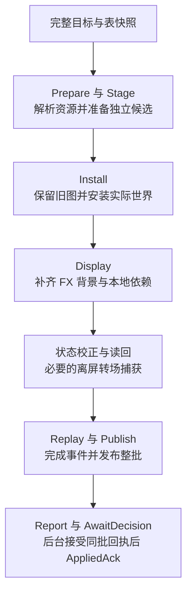

# Client 原生显示冷构建设计

**2026-11-17 最终一致修订（E1—E9 已同意，尚未实施）**：[设计文档](eventual-consistency-revision.md)、[规范第17节](../../refactor/project-conventions.md#17-原生二进制状态同步重构)。“完整目标安装、资源就绪与校验成功后才发布显示”取消；资源改为独立预载，缺资源只延后该对象，新建直接在池槽上 Init（E3、E5）。本文下列旧合同按时点保留，实施后以修订为准。

**2026-11-15 调度与热路径设计修订，尚未实施**：[增量应用与双通道](13-client-incremental-apply.md)将普通两流的准备／反馈分开，复用原生结构并合并有效检查与读回。本文冷构建职责、完整依赖、同一原生提交段和实际失败排空保持；“沿用单批事务”不再表示World准备／反馈期间占用Body通道。首次／结构joint仍独占两流，未就绪候选不暴露给普通显示。本次仅文档，未构建、未测试。

2026-11-14，用户已确认继续冷构建路线。本文规定第13步的补齐方式，并衔接第7／10／12／14步。第10节记录入口的静态核定，第11节记录布局78和安装实现，第12节记录重建依赖与原生分配预算的审阅修复。范围为官方 REPENTOGON 1.1.3、v1.9.7.12.J273、Win32 下的普通跑局及 Greed／Greedier，挑战暂缓。运行验证归第15步；本轮修复未构建、未测试。

Client 继续在自己的进程内准备资源、创建或复用原生对象、安装 Host 状态，再交给原生代码显示。补齐的重点是**让原生显示的依赖完整且可安全退休**：FX、背景 surface 等不能只安装 Host 字段就视为可用。方案沿用已有单批安装事务，不转向完整原生开局。

上级：[现行规范第17节](../../refactor/project-conventions.md#17-原生二进制状态同步重构)、[总计划](README.md)、[显示委托合同](client-display-delegation.md)。安装合同见[第12步](12-client-contract.md)、[原子安装实施说明](implementation-12-atomic-install.md)和[第13步](13-client-apply.md)。

## 1 当前问题与证据边界

Host 已能采集并发送状态，Client 已收到首帧；已有运行进入原生写入后被撤销或崩溃，最终 `client_world_applied=0`、已安装版本为0。这里的“安装”是把状态应用到 Client 原生对象，既不是 DLL 加载，也不是网络握手。Host 采集尾延迟与双端稳态仍未验收通过。

第13步实现前的源码缺口如下，历史故障的归因继续以各次运行证据为准。

| 源码位置 | 当前行为 | 本次补齐要求 |
| --- | --- | --- |
| [ClientDisplayBuildRoots](../../../mod/src/game/client/display/client_display_native.cpp) | 构造相机，加载 HUD、LightGradient／SpotLight，准备历史 surface；没有完整 FX 图和背景构图接线 | 明确每类本地资源的构造、适用条件、复用和析构责任 |
| [需求清单](../../../mod/binding/state/demand.json)中的 FXLayers／Backdrop | FXLayers 只列 `loaded`；Backdrop 表面绑定由本地冷构建承担，旧配方已退出 | Host 字段不能替代 Client 容器、图像、surface 的真实就绪 |
| [ClientBackdropBuildScope](../../../mod/src/game/client/room/client_backdrop_native.cpp) | Client 构图仍依赖旧 `ClientBackdropReplay` 轨迹上下文 | 改为消费本批权威输入的本地构图作用域，同时保留实体生成隔离 |
| [ClientDisplayInstall／Capture](../../../mod/src/game/client/display/client_display_native.cpp) | 转场模式2／3的首帧可在公开提交前调用 Room::PreRender／Render 生成 surface | 捕获前必须完成完整显示依赖，不能把捕获当作初始化手段 |
| [ClientStateApplyCoordinator](../../../mod/src/state/client_apply.cpp) | 开始写入后不能等待；取消或生命周期变化可撤销成功资格 | 冷构建遵守同一事务，区分资源失败、生命周期撤销和后台候选超时 |

堆损坏的首次非法写入位置仍未确定；网络超时也可能是原生工作停滞后的结果。完成本设计不能直接宣告首帧、崩溃或性能问题已经解决。

## 2 路线选择与职责边界

| 路线 | 收益 | 代价及适用判断 |
| --- | --- | --- |
| 受控冷构建，本次采用 | 复用原生显示与资源实现，保持 Host 唯一权威和已有安装事务 | 必须显式补齐构造依赖、混合副作用隔离和退休路径；隐藏依赖需继续核定 |
| 完整原生启动／切房 | 原生生命周期自然初始化较多对象与缓存 | 同时进入房间生成、玩家生成、规则重算及持久副作用路径，需重新处理已有同步对象和生命周期的重叠；不能只解除几个 Hook |

isaac-lan 借助原生开局和切房建立承载环境，再覆盖同步状态，并保留更宽的原生更新路径。本工程借鉴“本地原生对象负责显示”的职责划分，沿用 J273 已研究的窄入口；不照搬其 J460 启动路径或偏移。边界比较见[显示委托方案](client-display-delegation.md)，J273 冷构建职责见[RE-2](client-display-delegation/RE-2/room-init.md)。

“先正常开一局再冻结”不作为兜底：它引入完整启动的副作用，而且仍需解决后续换房、主题变化、重连和资源重建。若窄入口无法安全拆分，记录具体混合调用与缺失输入，继续解决该职责；改变整条启动路线需要另行修订设计。

| 内容 | 所有者与规则 |
| --- | --- |
| 世界权威输入 | Host 决定房间身份、descriptor／RoomConfig、几何、实体／Grid／玩家成员及关系、规则相关的最终主题和选择结果；Client 按目标安装 |
| 必需显示输入 | 保持 Q8 当前标量、Q9 SpawnSeed、Q11 转场字段、Q12 paused／分支、既定 Sprite 姿态和其它必要状态；不因本地构造而丢失 |
| 本地原生资源 | Client 持有 ANM2／图像引用、FX 容器、ray、背景与 shading surface、相机、HUD、历史 surface；走本机原生资源与分配器生命周期 |
| 本地显示缓存和推进 | Client 按既定白名单推进动画、FX、相机和缓存。Q4 允许纯外观随机差异；影响规则、实体或布局的选择仍来自 Host |

不恢复 Host FX 图、ray pose、背景 surface 或旧构图轨迹的整包传输。不传原生指针、GPU 句柄或容器内存，不通过 memcpy 接管原生所有权。保留现有 Game／Room 根，不创建第二个运行中的世界。

## 3 构建输入与本地就绪

每批从不可变目标及其表快照解析所需输入，在安装票据和资源代次下持有它们。解析结果复用现有安装计划，不引入另一套世界协议。至少明确以下依赖：

- 房间／楼层／dimension 身份，descriptor 到 RoomConfig 的绑定、形状、bounds、门位和已选背景。
- FX／shading／特殊背景实际读取的 stage、stageType、难度及房间分支输入；按第10节补原生消费者实际需要的量。
- 本地配置与文件资源、图形 context、窗口尺寸及设备资源代次。
- 真实 Player roster 和显示所读的实体／Grid 引用；不得用假玩家或空 roster 绕过教程、平均位置等消费者。
- 同批 Q8／Q11 等显示状态与资源恢复所需的 Sprite 姿态。

资源依赖使用明确值、稳定身份和代次比较，不生成或校验哈希。不得每到一个状态帧就重建全部资源。

`FXLayers.loaded` 由本机 FX 加载／清理写入，布局78已将该字段移出需求清单。

1. Client 就绪必须来自本地加载成功、容器合法、引用完整和适用分支一致，不能由 Host 的 `loaded` 覆盖。
2. 主题和其它必要分支按同批实际原生输入解析。Host 的加载状态只用于限定自身的瞬时 poop FX 取值。
3. “目标合法且不使用 FX”和“应有 FX 但构建失败”必须分别表示。不能把字段强行改成0／-1、清空全部 FX 或跳过校验来取得首帧提交。

布局78的字段变更见第11节。

## 4 接入现有安装事务

保留 `Prepare → Stage → Install → Display → Replay → Publish → Report → AwaitDecision`。下列资源职责插入现有阶段，不增加第二套提交器。

### 4.1 写入前准备

`Prepare／Stage` 先完成配置解析、文件资源准备、内存与资源额度预留，以及可以独立构造的候选对象。准备可以跨 Manager 帧等待，但不得影响当前已提交场景；首帧尚无场景时保持等待显示。

只有没有修改共享原生场景、没有进入需本批收尾的副作用前缀，才允许返回等待。阶段名字不决定是否“已写入”：相机接入 Room、HUD 重载、原生容器替换等若影响当前根，同样算写入。现有 `written` 传播必须覆盖这些操作。

文件加载尽量在这一阶段完成。无法与真实根分开的构造或构图放在同一写入窗口内执行，不能借“准备阶段”名义把半成品场景跨帧暴露。

### 4.2 安装实际世界

在旧场景仍完整时，按 Q11 保存需要的旧房间 surface。确认没有未退出的原生显示借用后，停止公开读取当前根，再进入破坏性写入。

沿用现有 writer 的依赖排序，安装房间描述、配置、几何、世界标量、实际 Player／Entity／Grid 及关系和 roster。相机构造读取最终几何；实体构造沿用已有原生工厂和受控初始化。不能调用玩法 Update 来“热身”。

不依赖玩家的资源可在条件满足时提前构造；所有读取 Player 的 FX 初态或背景收尾必须等真实 roster 和所读字段就绪。不能仅因 `BuildRoots` 已返回就放行所有显示消费者。

### 4.3 完成显示依赖

`Display` 阶段补齐 FX、Backdrop、shading、特殊背景及其它必要资源。每个入口必须使用有效图形 context、正确本机 owner 和已经解析的目标输入，详见第5节。

构图可能改变 ANM2、颜色、边界或其它已同步字段。实现时逐项标明写集：能在权威字段最终安装前完成的先完成；必须后置的，通过既有 handler 重新绑定资源并恢复目标字段，再执行读回。禁止整块覆盖原生容器，也不能让构造替换 Sprite 后留下指向旧实例的绑定。

只有实际引用、容器、资源和必要字段均完整，才允许本批的首次原生显示调用。若 FX 的首个可绘制状态还需窄初始化，核定其写集并纳入本阶段，不能默认调用整段 Room::Update。

### 4.4 转场捕获与公开提交

旧图来自覆盖前的完整旧世界，新图来自本批已经完成的目标世界。首帧加入转场而没有旧房间时，沿用现有基线策略，以完整当前房间生成所需本地 surface，不虚构旧房间状态；转场字段仍采用 Host 当前值。

必要的离屏捕获可以发生在 `Publish` 前，但必须受本批作用域约束：候选资源已完整，原生 CPU 绘制队列在作用域退出前刷新，临时引用与同步字段写入按合同处理，普通 Manager 渲染和显示推进不能读候选。不能把内部 `installed` 指针或一次捕获成功等同于公开提交。

捕获之后继续执行事件回放及最终完整性检查，再发布整批。回放可能触发生命周期变化，沿用 coordinator 的每步检查；失败保留实际回放前缀，不能重试时无条件重播已发生的事件。

公开发布、后台接受回执和发送 ACK 仍是现有的不同动作：主线程完成原生工作后提交带原票据的结果，后台核当前路由／代次和同批结果，接受后才推进确认基线并发送 `AppliedAck`。未决回执不能伪装成 ACK；若成功资格被撤销，立即停用该场景并进入排空。不得等待网络 ACK 反过来驱动主线程完成构建。

## 5 原生资源职责与接线位置

扩展现有 `ClientDisplayNative`、`ClientSceneMainPreparation` 和 `ClientBinaryScene`，由它们持有资源状态和批次关系。独立小入口的 ABI 与写集以 J273 证据为准；优先 SDK／REPENTOGON 已有接口，不从混合函数中间跳入执行。

| 职责 | 构造与消费要求 | 复用及退休 |
| --- | --- | --- |
| FX 图、层、ray 和图像 | 用已确认的选择输入运行完整窄加载职责；所读 roster／上下文有效。`loaded` 不能先行开启更新或渲染 | 按 FX 配置、房间相关输入和资源代次失效；退出更新／绘制引用后由原生清理职责释放 |
| Backdrop 地面、墙面和 surface | selected BackdropConfig、几何、真实 roster、context 就绪后构图；仅本地外观选择可自由变化 | 输入不变时复用；主题／几何变化重建相应部分，撤销所有旧图引用后释放 |
| shading、特殊地狱背景及全局 ray 图像 | 按 RE-2 对应分支分别构造；核定全局槽是借用、共享还是本批拥有 | 不把全局借用资源当成 Room 私有资源析构，不遗留旧房间回指 |
| Camera、HUD、LightGradient／SpotLight、历史 surface | 延用已有构造，补齐消费者要求的设置与归属；不能据已有入口推断所有依赖已覆盖 | 相机使用原生分配器成对释放；HUD／灯光复用与重建区分；尺寸相关目标按窗口代次处理 |
| 阴影、光照、水面、地图等渲染缓存 | 依照 RE-5 的原生 Render 写集、Q8 与 Q13 合同生成；输入和资源引用在调用前完整 | 允许原生正常生成缓存，不复制 Host 结果；退出绘制队列与临时借用后退休 |

FX 与 Backdrop 是已知缺口，不能据此假定上表已穷尽所有初始化依赖。继续从首次 `PreRender／Render` 和白名单显示更新的实际读取追溯消费者，登记新增职责。

Backdrop 的旧 replay 作用域须改接本地构图。保留并适配 `client_backdrop_graphics`、`client_backdrop_wall`、`client_backdrop_effects` 和 `client_backdrop_effect_1／_2`，同时保留墙面作用域内对 null layer 装饰生成的隔离。Host 已有装饰 Entity 从世界状态安装。纯外观 RNG 只影响本地显示。

所有 Hook 继续常驻，通过现有 Client 角色、具名作用域和调用分类逻辑启停；Host／单机路径保持各自原行为。Q6 在放行显示路径上的回调规则保持，未分类入口仍拒绝，C/S 与原版 Online／Isaac Sync 隔离保持。

## 6 复用 失败与安全退休

| 场景 | 处置 |
| --- | --- |
| 同房间普通帧，构建输入不变 | 复用本地资源，只安装同步状态并运行既定显示推进 |
| 同房间主题／配置／资源输入变化 | 重建实际受影响的资源，完成后与目标同批发布 |
| 换房／换层／dimension 变化 | 在旧世界有效时保留所需旧图；停止其消费者后替换房间资源，不能跨目标混用 |
| resize／图形资源代次变化 | 使尺寸或设备相关目标失效并重建；不把尺寸相同当作原内容仍存在，不能从半安装世界重新截旧图 |
| 写入前失败或取消 | 清理候选和预留；若旧世界未被改变，保留其正常显示 |
| 写入后失败或成功被撤销 | 立即停止普通显示，按实际写入和回放前缀排空；共享根受影响时按既有合同撤销两流基线，安全退休后才允许 base=0 恢复 |
| 无法确定对象构造状态或无法安全清理 | 停止该复制会话并保留具体原因；不能假定全量回滚成功、强制析构未知对象或继续 ACK |

退休遵守引用依赖：先禁止新的显示／事件进入，退出作用域并刷新 CPU 队列，再撤销 surface／Sprite／对象之间的借用，最后按原生 owner 释放已实际构造的资源。不得让后台线程直接析构或中断主线程正在使用的对象，也不得销毁借用的 Game／Room 根。

只要已改动共享根，就不能继续把“上一帧已提交”理解为旧原生对象仍可渲染。必要等待画面使用已有安全显示路径；不靠渲染受污染场景掩盖失败。

后台候选、进行中的安装和传输 episode 分别计时。未来候选自身过期按其所属状态处理，不能误记为当前原生构建失败；若确实触发整 episode 超时、断线、路由替换或代次变化，仍须撤销当前成功资格并由主线程收尾。不得为冷构建关闭合法取消、重复到包续命或放宽既有超时。

## 7 耗时 预算与诊断

继续采用[第9步预算](9-budget-capacity.md)：每 Peer 首次准备／恢复 episode 最多1MiB相关双向流量，8秒内收齐传输，10秒内完成整目标及 `AppliedAck`，2秒无真实进展失败。合法资源准备完成可以记进展，重复包、重复请求和候选替换不能续命。模组持续总额9Mbps、总链路10Mbps及现有共享内存额度保持。

主线程采集及动态安装既定目标仍为 p95≤2ms、p99≤4ms，Host≥50FPS。首次资源加载、冷构造、切房构图和正常热安装分别记录耗时，并同时计入实际 Manager 帧阻塞、整批成本和加入／换房总耗时；不通过改名或丢弃慢样本宣布达标。各 native 容器、surface 的 CPU 承载、暂存和候选由所属账户计费，不给每个新增组件重复领取额度。GPU／音频后端内存仍按第9步由正常后端 owner 管理，不能把 CPU 分配账冒称为全部显存统计。

把可独立准备的工作前移，缩短破坏性写入区间；依赖真实世界的构图仍在同一窗口完成。若该区间无法满足既定性能要求，记录具体调用、时长与依赖，再调整准备方式，不能隐式放宽预算或分多帧写入共享场景。

诊断记录原票据、目标版本、原生阶段、资源域、首次失败原因、写入／回放前缀及取消来源。统计 `received`、`prepared`、`native_written`、`published`、后台 accepted、`AppliedAck` 时明确它们的不同含义；以接收计数或调用次数代替已提交帧数不能证明成功。Host 尾延迟继续按[性能方案](10-native-capture-performance.md)处理，与本方案分别归因。

## 8 在现有步骤内实施

下列工作沿用0—15步骤体系，不另开 tx 或分组验收。表中先后顺序表示实现依赖，不表示新增项目流程门槛。

| 既有步骤 | 要完成的工作 |
| --- | --- |
| 7／10，必要输入 | 核定 FX 选择及 `loaded` 语义、背景／shading 等实际读取；缺失的必要输入进入正常 Host 来源，纯显示资源保持本地 |
| 12／13，准备与所有权 | 将输入、资源预留和 detached 准备接入现有计划；明确共享根第一次写入及不能等待的边界，补齐成对清理 |
| 13，原生资源 | 补 FX 和 Backdrop 窄构造，逐项覆盖其它消费者；适配旧 replay 隔离，恢复构图影响的权威字段与引用 |
| 13，首次显示与提交 | 调整首次离屏捕获时序，检查完整资源、读回、回放与最终发布；保持原票据回执和后台确认规则 |
| 12／13／14，失败与退役 | 补齐部分失败、取消和 resize／重连退休；本地 owner 接管后清理失去调用方的旧轨迹职责，保留生成隔离 |
| 15，统一整体验收 | 实现完成后继续同一第15步，失败就地修复并续测；不在前述设计、分析与修改期间另跑测试 |

## 9 第15步统一覆盖

这些用例并入[第15步](15-e2e-acceptance.md)现有首帧、资源、生命周期、漂移、显示推进和转场覆盖，不另建测试体系。

| 场景 | 需要验证的结果 |
| --- | --- |
| Client 从菜单直接冷加入 | 无需在本机先开局；完整原生资源建立，实际安装版本前进，`client_world_applied` 与对应 `AppliedAck` 成功，随后可持续应用 |
| 无 FX／有 FX，普通和特殊主题房间 | 适用性正确，FX 图／ray／shading／背景有效；Host `loaded` 不能伪造本地成功，纯外观差异不要求像素一致 |
| 教程相关显示、真实多人／多身体 roster、不同房间形状 | 构图读取真实玩家与几何，原生引用一致，无假玩家、重复 Entity／装饰物或玩法重算 |
| 首帧加入转场、连续换房与换层 | 新图捕获只读完整目标；旧图来源和缺旧图策略正确，Q11 状态不重演 FSM；普通显示不读中间态 |
| 同房主题变化、resize、资源失效及断线重连 | 按依赖重建，旧资源无悬挂引用、双重释放或持续增长，历史 surface 与窗口代次一致 |
| 各构造／绑定／捕获阶段失败，写入前后取消 | 不提前 ACK；保留真实失败及事件前缀，污染场景立即停用，安全排空后才恢复；候选年龄与真实生命周期取消分得清 |
| 原生显示对同步字段的写入 | 构造、捕获和后续显示的漂移处理正确，保留字段及引用与已安装目标一致，本地缓存按自身生命周期维护 |
| 双端持续游玩与既定性能负载 | 双端稳态、主机采集尾延迟、客机冷热成本、内存与带宽均按现行口径验收，不能以一次首帧提交替代 |

实机启动仍按项目规范提前说明用户配合操作；需要手动配合时先确认准备情况，再启动。正常测试材料用后清理，仅中途暂停时保留继续工作所需材料。当前测试暂停与历史失败事实不因本文改变。

## 10 原生入口与输入核定

2026-11-14 静态核定，范围为 J273 Win32、官方 REPENTOGON 1.1.3、原版内容的普通跑局及 Greed／Greedier。按用户指示，本轮先排除挑战。以下地址为 J273 VA，RVA 为 VA 减 `0x400000`。证据来自 J273 指令和调用关系、官方 SDK 与 wrapper、本地 `fxlayers.xml`／`backdrops.xml` 及当前安装器源码。官方版本见 [REPENTOGON 1.1.3](https://github.com/TeamREPENTOGON/REPENTOGON/releases/tag/1.1.3)。

### 10.1 FX 加载、首帧更新和退休

| 入口 | ABI 与输入 | 已核写集及完成条件 |
| --- | --- | --- |
| `0x968E10` FX 加载 | ECX 为 `Room+0x1618`。`0x7E7CCF–0x7E7CDC` 依次压入 `stageType`、`stage`、`const char*` 本地 XML 路径，正常尾 `0x96BB7C retn 0xC`。两个 stage 参数均为整数，`stageType` 不是 bool。原 caller 以 Manager `+0x2A3BC` 的文件映射解析 `fxlayers.xml`，路径持有到调用返回 | `0x96910A` 先清旧图，再打开 XML。构造 FX 图像和 0x4C 步长的层、0x2C 步长的 ray 组及其引用，设置 `+0x30` 当前组、`+0x34` 初始倒计时、`+0xB0..+0xBC` bounds、十个 vein 槽、两份 vein ANM2 与 `+0x4F8` FXParams。`0x96913C` 文件打开失败跳过成功写入。`0x96BB5B` 写 `+0x08=1`。用字段和实际资源后置条件判断结果，EAX 的值没有成功语义 |
| `0x96BD30` FX 清理 | ECX 为已原生构造的同一 FXLayers，无栈参数，`0x96BF39 retn`。原调用点为不使用 FX 的 `0x7E7D6C` 和重新加载的 `0x96910A` | `0x96BD48` 清 `loaded`，释放 ray／层子项的图像引用和子容器，清十组 vein 的 child 指针，恢复 FXParams 默认值。外层 vector 仍持有容量，两份内嵌 ANM2 仍属 Room。尤其 `0x96EA50` 以首个 vein child 判定绘制资格，单写 `loaded=0` 无法完成退休 |
| `0x96BF40` FX 初始更新 | `void __thiscall(FXLayers*, bool)`。原生切房收尾 `0x7395C0–0x7395CE` 传 `true`，Room 常规推进传 `false` | 更新 pose／parallax、倒计时和 vein。`0x96C5FC` 调真实 PlayerManager 平均位置并直接写 FX `+0/+4`，常规路径走缓存与插值。冷建参考原生切房，用 `true` 在真实 roster、实体列表及必要渲染输入安装后运行一次，再进行首次捕获。vein 分支还读实体列表中的 Type `407`、Variant `0` 及其生命状态。热帧继续现有显示调度 |

- 原生在 `0x7E7C69–0x7E7C76` 对房型 `16` 或选中背景 `18` 走清理分支。`FXLayers.loaded` 是本机完成标记，与选层、ray 选择及 FX 是否适用分属不同输入。`loaded=1` 容许合法空层和 ray 索引 `-1`，仍要核对适用分支中的图像、活动组索引、pose 容器及 vein／ANM2 引用。`room.json` 已注明该线上字段不直接安装，当前原子写入器的 `RawConversion` 却接纳 `f_x_layers_loaded_read`，须从通用写入、读回修补和根标量恢复中改交本地 FX owner。布局 77 的字段可先只作为 Host 观测，是否退出现有协议随正式 wire 变更处理。参考 [FX 字段定义](../../../mod/binding/state/room.json) 与 [当前写入器](../../../mod/src/game/client/scene/client_atomic_install.cpp)。
- Loader 依赖真实 `g_Game->_room`、Room bounds、`descriptor->Data` 的形状、`Room+0x1D18` 的已选背景 ID 和 `Game+0x25F40` 的 difficulty。普通情况使用同批 stage／stageType。stage `12` 按原 caller `0x7E7B1A–0x7E7C66` 以 `Data->StageId` 转换 FX 请求，保留 Greed 分支。`0x968F05` 用转换前的加载实参和 difficulty 查物理主题索引，`0x96A106` 读取本机 `Game+0x189D0+0xC4*主题索引` 的默认背景用于 `onlyDefaultBackdrop`；调用前须确保该配置表已由本机按原版资源加载。`0x968F69–0x968F9D` 随后还按入口 `Game+0x18304`、`0x745B10` 和 `0x748900` 改实际筛选值。`0x748900` 读取 Greed、Ascent、有效诅咒及 `0x41D030(Game,46)` 的具名状态位，命中即将 FX 背景筛选值改为 `39`。现有 wire 的 Ascent／raw curse／种子效果是部分输入，状态位 46 缺失。已选背景 `39` 与该条件有交集，尚未证明可在所有房型反推。接线按最小显示条件供应该消费，或由 Host 给不可推导的实际筛选值。
- XML 按 stage／stageType、房形、背景 ID 和 `onlyDefaultBackdrop` 筛选层、候选图片、ray 和 FXParams。权威输入是主题与必要分支结果，匹配的本地 XML 负责组装资源及基础 FXParams。房间 DecorSeed 在 `0x96A123` 与 `0x96B694` 用于同类图片候选和 ray 组选择。Q4 允许用按房间／资源代次稳定的非零 Client 外观 seed 代替这些纯外观种子，入口若仍读取 descriptor seed，只在该资源作用域借用并恢复 `+0x58`。Q9 的 SpawnSeed 是 `+0x5C`，仍使用 Host 当前值。`0x968E91` 调 `0x6EB4B0`，其本体会推进原生全局 RNG 或调用 CRT `rand`，并可能写全局随机日志。只在当前 FX 构建、该 call site 和正确 owner 下供应非零 Client 外观随机值；复用统一 `native_global_random` Hook，保留其它调用原有分类。`0x968EC6` 初始化 `0xBAC6D8` 的 FX 专用随机状态，后续 `0x96ED60`／`0x96F090` 继续消费，按本机 FX 活动期管理。

### 10.2 Backdrop 构图和现有输入缺口

- `Backdrop::Init(id, false)`（`0x917870`）使用 SDK 的 `void __thiscall(uint32_t, bool)`，读取当前 Room 的网格宽高，写 `Backdrop+0x150` ID 和 `+0x4F18..+0x4F27` 范围。完整构图 `0x917910` 以 Backdrop 为 ECX、零栈参数，走 `0x90EF10` floor 与按分支进入 `0x911310` walls。`Backdrop::Init(id, true)` 可作为 SDK 调用路径，允许官方 wrapper；当前 ID、已选配置及构图后置条件仍须核对。`Room::Init` 原路径先另写 `+0x4F28` RNG 和 `+0x4F38` seed（`0x7E7AF3–0x7E7B0F`，shift `5/9/7`），然后 Init(false)。Client 构图按 Q4 初始化自有非零 seed，两个位置在一次构建内使用同一份初始外观 seed。
- `Room` 正常构造在 `0x7E006B` 调 `Backdrop::LoadConfig`，用本机 `backdrops.xml` 填充 63 个配置项。`0x90BD90` 同时创建 Backdrop 的四个 780×468 surface（`+0/+8/+0x10/+0x18`），构图会复用它们并改写内容。首次构图须逐项核资源引用与代次。配置的 walls／floors 数量、variant 上界、图集和 ANM2 应与本地选中 ID 对应，墙数为零的执行业务分支仍可合法。Room 持有的原生 surface 与临时贴图使用 KAGE 原生强引用；`0x90C1F0` 是整个 Backdrop 析构，由真正的 Room 生命周期调用。复用 Room 时只退休本批修改或接管的引用及内容资格。
- 保留现有构图／墙面／装饰 helper scope，以及 `client_backdrop_effect_1／_2` 对 `0x91168F` 和 `0x9119E9` 的跳过。两个直接分支各补一次本地外观 RNG 的 scale 消耗。`0x915890` helper 只走 `ExpectedSkip`，旧 replay 的逐次 RNG 后态可以随轨迹退出。**墙面还有独立的 null layer 生成链** `0x917420`，在 `0x9177D2` 调全局 Random，随后 `0x9177F5` 生成 Entity `1000/121`。它绕过 helper 和两个直接分支。移除 replay 时保留现有 `ClientBackdropWallScope` 对 `_wallDetailANM2._numNullLayers` 的栈内借零和退出恢复，前面的墙层选图及绘制仍执行。官方 REPENTOGON `Backdrop::Init` 具备回调 1141／1142 与 XML 配置处理，`pre_render_walls` 有回调 1109；ANM2 Reset 与析构还会清官方附加数据。正常走 wrapper 和 Q6，不用 C++ 字节覆盖或手工析构其附加状态。参考 [Hook 清单](../../../mod/binding/hooks.json) 与 [现有墙面作用域](../../../mod/src/game/client/room/client_backdrop_native.cpp)。
- 已有同批输入包括 `Room.room_type`、descriptor `Data／OverrideData`、RoomConfig 的 `StageId／Type／Subtype／Width／Height／Shape`、楼层／dimension、背景 ID、bounds、door positions、实际 Player／Entity／Grid、Q8 当前值、Q9 SpawnSeed 和 Q11 转场量。`0x917910`、`0x90F2E0`、`0x82E960` 的已核分支直接读 `descriptor+0x10` 的 **Data**，不能用安装器通用的 `OverrideData ? OverrideData : Data` 选择替代原生实际读取。教程 `0x90F888–0x90F8A4` 要 stage `1`、stageType 非 `4/5`、当前入口等于起始房（Ascent 分支取 `84`），`0x90E3D0` 确实读 PlayerManager 第一个真实 Player 和本机控制映射。`starting_room_index` 当前没有 wire，可在 Host 取已判定的教程适用性；仍要提供真实 roster 及本地按钮层。
- 背景 `32/58`、`46/59` 使用有条件的深色 detail ANM2。`0x917910`、`0x81AF50` ray 及 `0x803E20` 光照读取 descriptor `Flags & 0x200`。`0x90EF64` 还读 `0x1000`，布局77的 flags 投影仅含原 bit `0/10/11/18/5`，两者都缺。背景 `20` 的墙面在房型 `2` 或 Greed 下读取 `Room+0x7068` 选择构图档位（`0x91147B`）。Greed 的对应 Init 值可由 stage `1..5` 取同值、stage `6` 按房型 `1` 取 `5` 否则 `1`。普通跑局另读配置中的标志和原生规则状态，由 Host 给实际档位。背景 `45` 的 walls 还检查 `Room+0x7460/+0x7464` 水流是否非零，构图前安装既有显示注入值。参考 [descriptor 字段投影](../../../mod/binding/state/level.json)和[水流显示安装](../../../mod/src/game/client/display/client_display_native.cpp)。

### 10.3 光照、特殊背景与 surface 所有权

| 职责 | 原生入口与真实依赖 | 归属和恢复 |
| --- | --- | --- |
| Shading | `0x7E7EF5–0x7E82CD` 是混合函数内的职责，拆成原生图像加载和 surface 绘制。适用条件是 `BackdropConfig+0x74` 的 `fullimage` 为 false 且 `+0x64` walls 大于 0。`0x90C3D0` 解析 XML `fullimage`，经 `0x90E080` 写配置 `+0x74`。选图读 `Data->Shape`，背景 11 有 Utero 变体，52／53 用 `Data->Subtype==10` 分别选 closet L／R | `0xBE7370` 是本机全局 shading 图强引用，原生每次先解除旧引用，再安装适用图片。`0xBE7350` 是由 `0x7E08E0` 创建的本机全局 780×468 shading target，按选图更新内容，`0x818790` 消费两个槽。切换后重新核适用性与内容代次，图形借用排空后才做强引用替换 |
| 特定全局 ray 贴图 | `0x8194D0` 在非挑战分支用当前 stage／stageType、difficulty 和 dimension；dimension `2` 为否，其余以 `0x821D00(stage, stageType, -1)==30` 判定。`0x7ED5E5` 后按 DecorSeed 选择 `fx_ray_3.png`／`fx_ray_4.png` 并设置采样；该二选一是本地外观，特殊 ray 与 FX XML ray 组是不同资源 | `0xBE7358` 是本机全局图像强引用。`0x81AF50` 还检查本机图形选项及 descriptor `Flags & 0x200`。本批在旧消费者退出后按已知 owner 替换；非适用场景禁止消费旧图区。不能把全局槽按 Room 私有字段析构 |
| Satan radial、地狱横移 | 背景 `18/28` 走 `0x7E7D7F–0x7E7EF0`，在 `Room+0x7100` 加载 `gfx/Effect_SatanRadial.anm2`，28 替换第 0 层为 UltraGreed 贴图并加载图形。`0x82E960` 为 ECX=`Room+0x776C`、零栈参数（`0x82EE8A retn`），检查其 Room 回指和 `Data->Type==16 && Data->StageId==35`，加载地狱 ANM2 并配置 0–14 层 | 均用 Room 内嵌 Sprite。地狱入口写 `active` 且把 `+0x11C/+0x120/+0x124` 置零，因此后置恢复已同步的 activity／display offset／accumulated offset，再核有效动画和引用。保持 `0x82EE90` 的混合更新隔离 |
| Camera、HUD、灯光 | Camera `0x91C730` 用 ECX=Camera、一个栈参数 `Room*`，先有 bounds、网格和门位。它还读 `Game+0x1831C` 的进入门，以及 `0x744060` 的特殊返回房／位置条件，末尾写 Room `+0x1204/+0x1208`。HUD 用 SDK `LoadGraphics`（`0x979E10`）。LightGradient／SpotLight 用已构造的 ANM2 加载，layer0 filter=`1/1`，XML 默认动画分别为 `Default`／`Idle`，LightGradient 还设置 layer0 `+0x78..+0x88` 五个 blend word 为 `(0,1,7,1,7)`（`0x7E8F52–0x7E8F88`） | Camera 用 `0xA86DE5` 分配 `0x94`，完整释放走下述原生入口。构造后重装 `render_scroll` 并读回。若要保留构造器的进房 focus，须核进入门／返回位置显示输入，当前 wire 没有。既有 HUD 退休调用 `0x97AB10` 后接 `0x979D80`，前者重置图形／玩家 HUD 资源，后者重建 HUD 槽位并恢复初始化状态。灯光跟踪本批实际加载的资源，按 ANM2 原生生命周期清理 |
| 全局缓存与转场 surface | `0x7E08E0` 在 Room 构造和 resize 创建 shadow、light、water、shading 等图形缓存，输入为本机窗口／图形配置。`0x6EFB70` 成组补 Game 图形资源，含 Hallucination Snapshot `0xBE72B4`，不只创建一张历史图。`0x823820` 以 RoomTransition 为 ECX、零栈参数，为旧／新图 `+0x28/+0x30` 重建强引用 | 全局槽由本机图形生命周期持有，`0x6EF470` 成组释放，`0x703E40` 的 resize 链按职责重建，不把全局清理用于每次换房。Transition 两槽由其对象持有，重新分配会同时丢掉旧图和新图内容。核对本地设备／窗口及捕获内容代次，旧图已失效时按第6节处置 |

`Camera::destructor` 的官方 1.1.3 SDK 声明无栈参数。其签名在当前 J273 静态映像只匹配 `0x7E03F0`。`0x7ED7C2` 先压入 Camera 指针，`0x7E0433` 以 `retn 4` 返回。此入口释放六个内部缓冲，并在 `0x7E0428` 释放 Camera 本体。当前 `ClientDisplayReleaseRoots` 调 SDK wrapper 后再调用 `free`，与该 J273 入口的栈形和释放职责冲突。后续接线须使已完整构造的 Camera 按 `0x7ED7C2–0x7ED7C3` 的调用形态走一次完整释放，随后撤销 Room `+0x11F8` 和 owner 引用。历史堆损坏仍缺少运行归因。参考 [官方 Camera 声明](../../../../REPENTOGON-1.1.3/libzhl/functions/Camera.zhl)与[当前释放代码](../../../mod/src/game/client/display/client_display_native.cpp)。

### 10.4 安装顺序与仍需核对的边界

旧图先在已提交世界捕获。准备阶段解析目标和配置并预留资源。共享根写入窗口内装好真实世界、RoomConfig、房间边界、成员和 roster，再做 Camera／灯光、FX、Backdrop、shading 和特殊背景构建。Backdrop `0x917959/0x917964` Reset 地板和墙细节 ANM2，这两处会使旧动画／图层引用失效。构图完成后复用原有 Sprite 安装 handler 恢复需要同步的资源绑定与姿态，检查目标 Sprite 的图层及回指，再恢复被构造覆盖的范围、颜色／当前显示标量和位移，做同批读回。被构造覆盖的字段应由 writer 调整安装顺序或显式重绑，避免普通漂移修补恢复旧借用。`Room+0x7100` 与地狱 Sprite 分支还要处理同房主题变化和销毁后的新实例。

只在上述资源依赖及首帧实际引用成立后进 `Capture`。以本批对象运行必要离屏绘制，完成 CPU 队列刷新后收回临时借用，走已有事件回放、发布和同票据 ACK。常规第一次捕获要覆盖 RE-5 的 shadow／光照／水面目标、实体列表和原生渲染分支。例如 `0x96CE20` 在检查 FX `loaded` 前可先绘制已安装的 `1000/166/951`，所以 FX 资源构造成功无法替代真实 Entity 及其 Sprite 就绪。退出时按第6节退休实际接管的资源。

剩余疑点包括 `0x748900` 的背景覆盖条件与 `onlyDefaultBackdrop` 的默认主题比较值是否需要 Host 显式提供、冷加入时瞬时 poop FX 的最低表示、相机特殊返回 focus 的最小输入、Backdrop 各主题实际需重绑的 Sprite 字段及 KAGE／官方 wrapper 异常清理。冷、热成本、resize 恢复、首次非法写入及撤销触发链继续由第15步统一验收。布局 77 和产品代码在本次静态核定中未修改。

相关证据：[RE-2 Room::Init](client-display-delegation/RE-2/room-init.md)、[RE-2 Room::Update](client-display-delegation/RE-2/room-update.md)、[RE-5 Render](client-display-delegation/RE-5/README.md)、[RE-9 转场](client-display-delegation/RE-9/native-transition.md)、[RE-10 调度](client-display-delegation/RE-10/audio-and-schedule.md)。旧资源配方与历史失败仍按原时点阅读。

## 11 布局78与Client接线

| Host 的同批输入 | Client 消费 |
| --- | --- |
| descriptor flags 原位9、12、2补入投影 | 分别提供深色细节／ray／灯光、Ashpit地面和祭祀房光照分支。此前投影遗漏了 `0x90EF64` 所读的 `0x1000` |
| 背景20墙面档位与本房教程资格 | 本机背景按同期 `Data`、尺寸和实际 roster 构图。教程仍由本机原生按钮层显示 |
| 游戏状态bit46、47 | 在Client角色内按位安装。原生FX筛选、特殊Boss房墙面和光照由既有 stage／stageType、诅咒、Ascent、种子效果和这两位联合决定 |
| 相机进入门、上一入口和有资格的返回位置 | 相机构造时借入相应原生标量，离栈恢复。原生相机释放入口按 `ECX=Camera` 加同一指针栈参数调用一次。构造后恢复本批 `render_scroll` |
| 瞬时poop FX计时和颜色 | 按当前相位构建本地图像与粒子。本机FX loader使用本机XML、配置和独立外观种子，`loaded` 由原生写入 |

构图在真实 Room、Grid、Entity 与 Player roster 安装后执行。Backdrop 的装饰 helper、两个直接生成分支及 null layer 仍受原生作用域隔离。局部构图走官方 `Backdrop::Init` 包装，墙面构建后用已有的 ANM2 字段安装器重绑同步的 Sprite 和姿态。选用 shading 时构建本地目标，退出时按对归还原全局资源槽。可复用的背景 surface、HUD 和本机全局图形缓存继续走其原生生命周期。首帧及重新构图在字段读回后离屏捕获，确认原生 CPU 队列已排空，再回放事件和公开发布。显示资源代次改变时撤掉旧显示资格并请求全量恢复。

旧墙面轨迹仍可用于历史观察。普通同步目标经 Client 本地构图作用域，Host 不提供轨迹。原生构图和 SDK wrapper 的失败前缀、resize 实际连续性、视觉一致性以及历史堆损坏归因继续留第15步验证。

实现位置：[Host采集](../../../mod/src/game/observation/binary_display_capture.cpp)、[布局源](../../../mod/binding/state/display.json)、[原生图形构建](../../../mod/src/game/client/display/client_display_native.cpp)、[背景作用域](../../../mod/src/game/client/room/client_backdrop_native.cpp)、[原子安装](../../../mod/src/game/client/scene/client_atomic_install.cpp)。

## 12 审阅修复：重建依赖与原生分配预算

2026-11-14，本节属于第13步及其第12步账户接线，不改布局78的线上格式。按用户要求只修改代码和文档，未运行生成、构建、游戏或测试。第10节的缺口描述保留其静态研究时点，历史首帧失败和堆损坏尚未取得新的运行结论。

### 12.1 无关资源追加不触发房间重建

Host 的 `resource_epoch` 是同 run 追加资源目录的版本；新出现的实体动画、图像或音频同样会推进它。它不是当前房间图形的内容代次。`RoomGraphicsKey` 移除该字段，SDK 显示 metadata 也不再转存这一冗余值。完整候选对资源 epoch 的一致性检查保留在原有第12步合同中。

重建仍由房间 use／shape／scope 变化、配置与实际 stage／主题／诅咒／几何／教程等输入变化，以及本机 target、尺寸或资源有效性变化触发。普通热帧仅追加无关资源时，复用已构建的 FX／Backdrop 和捕获结果，不重置 FX 相位，也不重新执行首次捕获。

### 12.2 同一 Peer 的原生 CPU 计费

新增 [client_display_memory](../../../mod/src/game/client/display/client_display_memory.cpp)。显示 owner 从目标描述取得同一个 `ClientStateMemory`，本体及原有种子树预留也改走该账户；不同账户的目标不能复用现有 owner。SDK C++17 侧只见账户前置声明和作用域接口，具体预算仍使用既有 `ChargeNative／UnchargeNative`，同时受每 Peer Values 与进程 Values 总额限制。

J273 静态导入表包含 `api-ms-win-crt-heap-l1-1-0.dll` 的 `malloc／calloc／realloc／free`（IAT RVA 依次 `0x6AA590／0x6AA594／0x6AA588／0x6AA58C`）。Camera 的 `operator new` VA `0xA86DE5` 转入 `malloc` VA `0xA8805F`；释放 VA `0xA8717B` 转入原生 `free`。四项 IAT Hook 登记在[唯一清单](../../../mod/binding/hooks.json)，生成安装规格及 manifest，ModInit 安装后常驻，只有四项完整安装才允许创建显示 owner。不改 CRT 函数正文，不在会话退出时恢复字节。

安装原生显示资源、首帧／转场捕获及后续 FX 更新期间启用本线程计费作用域。它覆盖这些调用经 EXE 四项导入产生的 CPU 分配，包括 Camera 缓冲、FX layers／ray／pose／vein、原生图像承载和构造暂存。没有作用域的新分配原样透传；已经登记的分配，即使之后在作用域外或其他线程释放，仍按原账户结算。GPU 驱动分配、显存及其他后端内部内存不在这四项 CPU 导入的统计边界内。

| 路径 | 预算与所有权行为 |
| --- | --- |
| malloc／calloc | 先收费请求字节和登记节点，再调用原生分配；calloc 先检查乘法溢出。预算不足返回空，不执行实际分配；实际分配失败归还本次预留 |
| realloc | 已登记指针沿用原账户；考虑可能搬迁，先同时预留旧块与新块。失败保留旧指针及费用；成功才替换记录并归还旧费。零大小保持 UCRT 释放语义 |
| free | 原生释放后销账；记录持有账户强引用，不借显示 owner 的裸指针 |
| Clear／换房／退休 | 不按阶段批量销账；FX Clear 留下的外层 vector capacity、全局缓存或未完成构造前缀继续占账，直到实际释放 |
| 失败 | C ABI 不传播本 DLL 异常；保留作用域拒绝标记，原生返回后也不能将被拒绝的安装发布为成功。构造异常保留 `root_uncertain` 和实际分配记录，不能假定已经释放 |

这不是按容器 `size()` 或固定“足够大”的预估收费；原生 allocator 收到的 capacity／对齐扩展请求一并计入，登记节点也先收费。底层堆元数据及驱动内存仍不冒称为所请求的 CPU 字节。共享缓存最后释放前保留其最初收费账户，重复使用不重复收费；不能以断线或 `Clear` 返回为由提前归还。

### 12.3 第15步待验证

在已有用例中补入：同房追加无关资源不重建且 FX 连续；必要输入／resize 仍重建；Camera、FX、shading 各阶段预算拒绝不发布不 ACK；构造异常和 FX Clear 保留容量继续占账；重连／换房后真正释放才归还；realloc 失败保留原块、成功迁移与零大小释放无重复退账；原版／Host 无作用域分配保持原调用行为；Hook 开销纳入原定尾延迟。这里只登记覆盖，没有执行这些用例。
