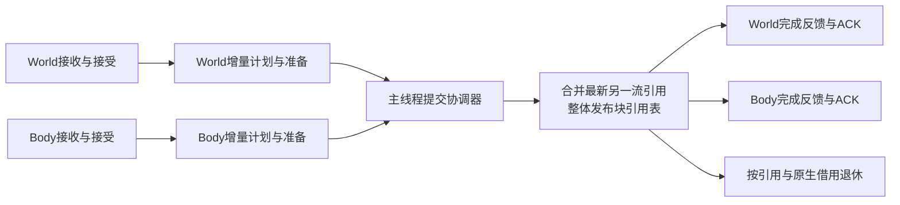

# Client 增量应用、块引用发布与双通道设计

**2026-11-17 最终一致修订（E1—E9 已同意，尚未实施）**：[设计文档](eventual-consistency-revision.md)、[规范第17节](../../refactor/project-conventions.md#17-原生二进制状态同步重构)。块引用发布、RCU 式退休、双通道在途任务与借用账目退役（E3）；按块跳过的思路并入每对象求差写入（E9）。本文下列旧合同按时点保留，实施后以修订为准。

日期：2026-11-15（Asia/Singapore）。本文衔接第 12 步解码／影子和第 13 步原生应用。增量准备、引用表、读回、双通道与诊断的源码实施见第 4.5、6.3、7.5 和 10.3 节。运行验证仍归第 15 步，位置插值继续暂缓，实机测试保持用户要求的停止状态。

上级：[现行规范第17节](../../refactor/project-conventions.md#17-原生二进制状态同步重构)、[总计划](README.md)。相关合同：[接受与恢复](9-acceptance-recovery.md)、[预算](9-budget-capacity.md)、[Client接口](12-client-contract.md)、[原生应用](13-client-apply.md)、[冷构建](13-client-cold-build.md)、[第15步验收](15-e2e-acceptance.md)。

## 1. 目标与现状

本设计落实四项改动：

1. 合并同一有效窗口内的重复检查，把完整扫描结果交给后续消费者复用。
2. 减少相同字段、相同写入结果的重复读回，保留必要后置条件与漂移修复。
3. 保留承载容器，复用结构，只准备变化的块；通过一份逻辑上的当前块引用表整体发布，延后释放旧表和旧块。
4. World、Body 各自维护应用通道，解除从接收到完成反馈的全局串行占用；原生写入继续由游戏主线程统一执行。

下表记录本轮改造前的源码行为：

| 位置 | 当前行为 | 改动方向 |
| --- | --- | --- |
| [client_shadow.cpp](../../../mod/src/state/client_shadow.cpp) 的 `MakeRecord／Build` | 未变化块已经通过不可变共享引用继承；仍构建候选状态／记录，并为完整解码重新拼接必要正文 | 保留共享能力，缓存块解码结果与结构索引，增量更新引用表和依赖事实 |
| [client_plan.cpp](../../../mod/src/state/client_plan.cpp) 的 `Records／Build` | 每批展开所需完整记录，复制块、生成字段／路径／绑定；共享服装还补齐配对流投影 | 长期保存结构计划，每批只生成变化值及受影响依赖的操作 |
| [client_preparation.cpp](../../../mod/src/game/client/scene/client_preparation.cpp) | `FieldsReady／VisitObjects／VisitFields／HoldInstallation` 等路径反复检查对象、字段和资源 | 通过有明确失效条件的检查结果传递资格 |
| [client_atomic_install.cpp](../../../mod/src/game/client/scene/client_atomic_install.cpp) | 描述／安装／发布有多轮检查；`ClientAtomicWriteApply` 内读回后，安装尾部和发布仍可能再次读取 | 按实际写集、回调副作用与最后写入点安排一次有效读回 |
| [client_receive.cpp](../../../mod/src/state/client_receive.cpp)、[acceptance.h](../../../mod/src/state/acceptance.h)、[client_apply.h](../../../mod/src/state/client_apply.h) | 接收 `busy`、接受 `inflight_`、应用 `batch_` 均为单槽；World 占用时普通 Body 被丢弃 | 接收、接受、准备、完成反馈均按通道分开，不能只拆接收队列 |
| [client_binary_scene.cpp](../../../mod/src/game/client/scene/client_binary_scene.cpp) | 单个 pending；最新批次承接完整服装与租约 | 稳定场景 owner 管理对象、容器、两流发布和退休，不再靠历史安装器链承载当前世界 |

第15步已观察到接收约 World 30／Body 60 包每秒、渲染约60FPS，但实际两流应用约18—20次每秒。有限批次约6—10ms的总成本包含准备、Stage、安装，**没有独立测得其中重复检查的占比**。最后一轮的 `display_world_not_current` 首个失效对象／资源仍未定位；本设计不能替代故障定位，也不能通过取消检查掩盖它。

## 2. 稳定承载与不可变块

### 2.1 稳定对象的含义

| 层次 | 生命周期与复用规则 |
| --- | --- |
| 场景状态 owner | 在同一有效会话／场景代次内保持身份，持有当前发布入口、成员索引、两通道状态和退休队列；切房、停止时正常撤销资格 |
| 成员／字段承载 owner | 同一 member、实例、use／shape 下保留；普通数值更新不新建 Player、字段容器 owner 或重新交接整个容器 |
| 原生容器 | 结构不变时复用现有元素和后备存储，更新已变化的合法值；真实增删、换型或容量不足时，按原生 ABI 调整受影响结构 |
| 不可变块 | 新收到且确有变化的块产生新版本；未变化块沿用同一引用，发布后不原位改写块内容 |
| 块引用表 | 场景 owner 始终保留一个逻辑上的 `current` 入口；准备新的表版本，整体替换入口，旧表由旧读者继续持有 |

“承载容器始终保留”不要求成员被删除后泄漏其原生对象，也不要求动态数组扩容时内存地址永远不变。它要求**正常更新保留 owner 和可复用结构，变化定位到块或实际结构范围**。成员重生、use／shape 更换、换房等会撤销旧代资格，不能为了保地址而把新身份伪装成旧对象。

块引用表不是逐槽原子写的可变数组。一份表代表一个完整版本；即使只改两个槽，也先准备新表版本，再一次发布。表的元数据可以复制，未变化的块正文与成员子表共享。外层稳定 owner 的身份不变。

引用表采用“顶层两流引用＋按成员共享的块表”，更新只复制受影响成员的表元数据，避免每帧复制全场景索引。读者一次持有表／操作作用域，不为每个标量另取强引用。成员之间的逻辑引用用稳定身份／数字索引表达；允许图中的环与别名，但不能用相互持有的强引用把整图变成无法退休的引用环。

### 2.2 内部数据职责

以下为拟定内部概念，不表示已存在这些类型，也不新增线格式。

| 数据 | 内容与所有者 |
| --- | --- |
| `BlockVersion` | 不可变正文、数字解码视图、块号／版本、所属流、精确成员／资源引用及语义事实；由自有内存承载 |
| `BlockRefTable` | 路由／场景代次、World／Body 各自版本、成员子表与块引用；成员子表使用有界索引，结构未变则共享 |
| `StructurePlan` | 布局、数字路径、条件分支、容器形状、字段归属、依赖反向索引和操作模板；不保存跨线程原生地址 |
| `NativeBindingSet` | 主线程持有的对象／容器地址、实例代次、资源 owner 和有效范围；结构／地址变化时局部撤销 |
| `ApplyPatch` | 原协议目标／base、变化块、结构意图、受影响检查／写集、依赖版本与租约；每通道一个在途任务 |
| `PublishedView` | 一次完整的两流组合、块引用表及必要原生保管租约；由主线程唯一发布者完成发布 |
| `RetiredEntry` | 被移除的表／块／原生存储、尚存读者和借用、最后使用批次及析构责任 |

结构缓存以精确身份、布局整数、use／shape、条件分支、数量／顺序／稳定元素身份及实际依赖版本为依据。地址与 count 相等不代表结构内容不变；例如服装内容在相同地址／数量下变化仍须识别。缓存不生成或校验哈希。

### 2.3 三块示例

```text
稳定容器 C，发布前：C.current → T0 = [块1,  块2, 块3]
收到变化的块1′、块3′：准备     T1 = [块1′, 块2, 块3′]
原生应用成功后：    C.current → T1
旧读者仍持有：                 T0
旧读者／计划／借用退出后：回收 T0 及不再被引用的块1、块3
```

块2既不迁移也不重新准备；T0、T1引用同一块2。一次读操作只取得一份表，并在整个操作期间持有它，不能先从T0读块1、再重新加载 `current` 从T1读块3。

## 3. 借鉴 RCU 的发布与退休

借鉴的是“先发布新引用，旧读者继续使用旧版本，最后回收旧数据”的职责划分。Linux RCU 文档区分移除引用与实际回收，并允许使用引用计数承接更长期的引用；本工程采用适合现有 C++ 租约与主线程 owner 的方式，不直接移植内核 RCU API。[参考：What is RCU?](https://docs.kernel.org/RCU/whatisRCU.html)

### 3.1 初次实现方式

- 块、表版本和结构计划继续使用不可变强引用／租约，先复用现有分配记账能力；不先引入自制无锁回收器。
- 后台与主线程通过有界邮箱传递持有式引用；接收方获得引用后才读取，发送方不能先释放。发布与接收使用已有正确的 release／acquire 交接。
- 主线程维护自己的当前发布入口，Render／显示推进在同一线程边界固定一次视图。后台维护自己的已接受入口。跨线程访问通过持有式交接，禁止对裸指针执行“先load、随后再加引用”的不安全取得方式。
- 如以后改用原子共享指针或 epoch 读侧机制，必须保持取得引用与保护寿命的一体性；不以“一个指针是原子的”推导整张表、引用取得或原生世界可并发修改，也不宣称共享指针实现天然无锁。

### 3.2 区分三个状态

| 状态 | 允许行为 |
| --- | --- |
| 已准备候选 | 后台／主线程准备可持有新块和新表；普通显示与确认基线仍使用此前成功状态 |
| 原生已发布 | 主线程完成应用与必要读回，以完整新表替换当前显示入口，并上报原票据；该状态还不等于后台已接受 |
| 后台已接受 | 后台核对同一 route、ticket、通道、目标及完成结果后，更新该流的确认基线并发送 `AppliedAck` |

两个入口使用同一种不可变引用模型，但不能混成一次网络接收时的指针交换。未成功应用的块不能进入已接受基线；原生已发布而尚未反馈的块仍须持有，不能因网络侧尚未确认而回收。

### 3.3 原生世界的边界

RCU式块引用发布保护的是自有不可变数据。原生 Player／Room、容器、资源和原生显示写入仍由主线程管理。原生代码不会自动识别块引用表，也不能靠交换表指针完成原生安装。

准备阶段允许跨帧，只能修改自有或 detached 承载。真正写入开始前退出普通显示借用，在同一不可穿插的主线程提交段内完成写入、必要显示／事件职责、检查和发布。不能写一半等待资源或让另一通道插入，然后让 Render 读取混合状态。

旧表依然有效不表示旧原生内存还能显示：原生写入后的失败按第9节排空，不能仅把 `current` 指回T0就宣称回滚完成。

### 3.4 释放条件

旧数据同时满足以下条件才释放：

1. 已不再是当前已接受／已发布版本，也不再被未决候选或另一通道的配对依赖引用。
2. 所有读操作、准备计划、完成反馈及长期租约都已退出。
3. 原生容器／Sprite／渲染队列／事件回放没有旧存储借用；涉及后端资源时由对应 owner 确认可退休。
4. 原生对象或存储在正确主线程和原生分配器下析构；纯值块才可按纯值寿命释放。

不以“经过两个渲染帧”、收到ACK或只观察一个 `use_count` 数字替代完整退休条件。引用计数释放纯值不代表原生可释放，反之亦然。退休字节仍占用预算，只有实际释放才销账。

## 4. 结构复用与增量准备

### 4.1 变化集合

收到帧后仍验证封套、大小、route、流、版本／base和实际携带块的合法性。变化集合来自协议块标记与已验证的base；必要时对自有规范字节做相等比较，不扫描原生内存寻找网络差异。

`value_dirty` 表示值确实变化；`structure_dirty` 表示成员、分支、数量／顺序、类型、关系或资源绑定变化；`dependency_dirty` 表示块正文未变但其依赖事实变化；`native_dirty` 表示本地显示／回调改变了权威字段。四者分开记录。

只对变化块分配新正文和解码结果。未携带块必须能从准确成功base合法继承；零值、清空容器、条件缺席、删除关系也是更新，不能被当作“没有变化”跳过。块缺失、引用失效、use／shape不匹配仍按现行合同处理。

### 4.2 增量校验

每个已验证块保存局部事实，成员／容器保存计数、唯一性索引和必要聚合。变化块只更新受影响事实，再沿反向依赖检查实际消费者。例如成员被移除时，即使引用它的块未在本包出现，也必须撤销或重验该引用。

不能用“本包未携带”证明块的语义依然成立。首次加入、完整恢复、布局／shape变化执行相应完整检查；资源目录无关追加不使所有旧块失效，但协议要求的表epoch、真实引用内容和本地资源代次仍分别验证。

### 4.3 热更新与结构更新

| 更新类型 | 工作范围 |
| --- | --- |
| 同结构标量／定长值改变 | 复用数字路径、目标绑定、容器与操作模板，只替换变化值，产生连续合法写段 |
| 同结构 Sprite 姿态改变 | 复用已就绪动画资源和容器，调用已核定的窄应用职责，不重建服装目录 |
| 部分元素值变化 | 复用未变元素；按元素身份和字段语义更新变化部分，不以数组下标推断身份不变 |
| 增删、换型、条件臂变化 | 撤销受影响路径和依赖，准备该子结构；必要时为真实扩容准备新后备存储 |
| 成员／房间／绘制拓扑变化 | 进入结构协调或joint路径，重建所需结构计划和绑定；其余不相关资源继续按实际依赖复用 |

wire块与原生容器不是一一对应：一个块可以涉及多个容器，一个容器也可能由多个块贡献。增量单元由字段owner及真实依赖划定；不能把网络块直接 `memcpy` 为原生容器，也不能把整个容器替换作为普通值更新的默认实现。

### 4.4 原生结构与恢复快照

现有 `ClientStagedFieldAttach` 的整header交接仅保留给真正需要更换后备存储的结构路径。稳定热路径不再构造同形临时容器、替换header、转移完整租约。

会话结束需恢复的借用原生状态由稳定owner保存首次接管值，热帧不能覆盖该快照。单次安装需要的原值／undo记录只覆盖实际写集，在最后一个可能改变原值的准备／回调之后取得；不得拿较早快照替代真实写入前状态。

undo与退休必须核对字段的最近写入序号和当前保管owner。旧任务失败／销毁时不能恢复一个已经被新任务接管的header或标量；已发布任务的撤销由稳定owner按依赖统一处理。会话原状态只在两通道和原生借用实际排空后恢复，不能把每批的历史undo依次执行来模拟正常退休。

### 4.5 稳定承载与引用表的当前实现

- 影子按块持有正文、数字路径、字段边界和引用事实。合并目标时直接读各块，复用通过精确引用与根条件核对的解码结果。同一记录的共享存在位消费者重新解析，防止同样的正文被旧配对条件误读。无关表追加保留一致块，同一成员表复用查找索引。后台仍核对引用类型、闭包、两流拓扑与原有 codec 访问预算。
- 数字计划、场景发布和各读者持有同一形式的 World／Body 引用表。普通记录和原样写入借块正文，转换值与事件保留独立存储。主线程在安装、读回、显示和事件职责完成后替换整个引用表；后台成功确认仍由原票据与回执驱动。Render、显示推进和漂移检查在各自用途内固定一份表。
- 同成员实例、规范路径和实际父容器下，既有原生字段承载可跨批借用。键、文本和未声明可原位更新的容器要求相关块一致；标量 vector 按位置更新，服装 vector 在 World 目录一致时复用既有元素并更新 Body 贡献。原生晚绑定路径和身份、结构或关系变化按原有构造接入处理。
- 暂存槽持有原生存储，完成接入的安装器另持有 header 用途。旧安装器退出时只减少自己的用途；真正替换或最后一个用途退出时才拆除 header，最后一个存储持有者在主线程和原生排空边界完成析构。纯值块由当前表、候选、计划、读者和原有后台回收索引共同保管。
- World 成员组、格子和 roster 与实际次序完全匹配时沿用现有容器；等价房间几何和过程配置表沿用现有承载。普通 Body 沿用未变直属值的原规则。共享 World 根按值、结构和依赖三类掩码与[回调写集](13-client-apply-frequency.md#b3-回调写集)逐操作判断直属定长字段和保留容器元素。2026-11-16 任务二第 2 步将回调写集资格与固定叶地址配方分开。第 3 步在独占实体和格子根上加入片段，省略符合资格的未变块固定叶指令。滚动漂移同时校正片段和当前操作，均按最新发布表取正文。联合、base=0、显示重建及未知写集仍走完整安装。见 [M1b 实施](13-client-world-cadence.md#m1b-未变的块不生成操作)。
- 块正文与结构模板分别持有。标量字节变化但路径、字段定界、条件臂、元素位置与原生字段定义一致时继续共享模板。每个安装记录登记值、结构和引用变化的掩码；相同已接受块复用引用检查。反向表用完整成员身份或资源键索引到消费者的根块，表项改义才传播到相关块，提交也通过它定位另一流仍引用的成员。原生写入器继续使用按批压平的数字索引，以便完整回读和滚动漂移修复。
- World 的 Room／Level／描述符和 Grid 投影借对应不可变块。Grid 显示所需的格位和裁剪位在同路由、同成员及实际块一致时复用已验证描述；变更仍走原校验。文本及有完整构造输入的键值容器按实际输入核复用，原生回调写集未知的路径保留完整检查。
- 后台从精确已接受计划借用相同记录的数字片段，重新定位路径、字段和引用下标。场景按流共享稳定原生内嵌字段的相对模板及执行／读回顺序。构建出场景索引的工作票据与原生承载在原有保管区内按既有租约排空。[B4／B5 实施记录](13-client-apply-frequency.md#顺序-4-实施记录)

## 5. 合并重复检查

检查由建立事实的owner执行一次，结果带有效范围交给下游。拟定 `ValidationStamp` 包含 route／scene、通道票据、结构修订、实际资源／容器代次、主线程窗口及副作用序号；后台纯值检查不持有原生地址，主线程检查结果不跨线程使用。

| 检查 | 执行与复用范围 | 必须重做的情况 |
| --- | --- | --- |
| 报文定界、数量、规范编码、值域 | 每份新输入／变化块一次；结果随不可变块持有 | 新正文、布局变化或继承关系不合法 |
| 引用、条件与跨块语义 | 变化块及其依赖闭包；复用未失效的事实 | 被引用成员／资源／拓扑变化，包含同地址同count的内容变化 |
| 结构、路径、字段归属、写区重叠 | 首次建立或结构变化时；缓存合法操作模板 | 条件臂／元素身份／顺序／布局／目标映射变化 |
| 对象、资源和字段就绪 | 一次取得本批所需集合的检查结果，供Visit／Describe／Hold复用 | 准备有进展、owner换代、回调写集影响该集合或跨窗口 |
| 页面可读写、连续原生地址 | 只在无副作用的纯拷贝片中复用同一页／区间结果 | 原生调用、容器重绑定、地址变化、窗口退出 |
| route／取消／scene／线程／提交资格 | 每阶段和纯拷贝片边界做轻量核对；有界工作片及时观察取消 | 原生回调后立即重核；真实失效立即停止 |

不能把一个全局 `ready=true` 作为所有检查的替代。不同检查结果有不同依赖，失效只传播到受影响范围；无法确定回调写集时，保守撤销其可能影响的域，必要时整个场景资格。

`Current()` 不再在每个标量上递归遍历整个对象／资源图。纯拷贝片入口取得有效资格，片内执行已定界操作，出口核对轻量代次；跨原生调用后重建相应资格。线程约束、route、取消、实际生命周期变化及非法内存保护保留。

## 6. 减少重复读回

### 6.1 区分目的

原值快照用于退休／失败处理；提交读回证明最终安装结果；漂移读回用于本地显示写入后的恢复。三者不能互相冒充，也不应因多个层次都要求“检查”而重复读取同一结果。

拟定 `ReadbackStamp` 绑定字段owner、块版本、地址／容器代次和最后写入序号。后续阶段只消费仍有效的结果；任何覆盖相关字段的操作都会撤销它。

| 操作 | 提交读回规则 |
| --- | --- |
| 无回调的连续值写入 | 合并相邻且语义兼容的范围，完成整段写入后读回一次；同窗口无后续写入时，安装尾部／发布复用结果 |
| masked字段 | 只比较负责的有效位；保留其他owner位，不为合并扩大写区 |
| 引用 setter、容器接入、特殊handler | 在该职责完成后核对引用／header／必要后置条件；允许职责内部提供可复用结果，不再外层重复同一检查 |
| 后置Display／Replay／Publish有写入 | 根据声明写集撤销相关读回结果，在最后一次可能写入之后重新核对 |
| 无新值且依赖／原生状态未失效的块 | 普通安装不复制、不写、不做提交读回；仍受既定漂移规则管理 |

不能从未声明写集的回调推导“它没有改过值”。原生调用后的就绪、生命周期和副作用检查保留；对未知写集采用保守检查，待真实证据明确后再缩小。

### 6.2 漂移与独立通道

保留已有按块、有工作量上限的滚动漂移检查，并优先处理本地已知写脏的权威字段。原生本地缓存、允许的外观差异和临时修改后恢复的字段继续按显示委托合同处理。

漂移目标从稳定owner的**最新已发布块引用表**取得，不能从旧World或旧Body安装器读取旧目标。某块没有新网络值但本地已写脏时，仍须恢复；“只处理变化值”不等于停掉漂移恢复。E2E可启用完整对照，生产默认不启用逐consumer全图扫描。

### 6.3 检查与读回的当前实现

- 主线程在对象和字段暂存完成后扫描一次实际对象、资源及字段 owner。安装描述、显示绑定与租约预留共用该次结果，范围由同一个候选票据、route／scene、准备 owner 和 Manager 窗口限定。跨窗口、取消、资源装载、旧房离屏捕获以及进入原生安装或退休时撤销对应资格；描述已保留的对象或资源换址时拒绝本批。纯复制片最多 128 项，片边界核生命周期，原生调用后重核并丢弃页区缓存。
- 暂存预检核地址和 ABI，首次接管的根标量另存会话原值。普通字段紧贴实际写入取本批撤销快照，masked 字段使用该快照保留其他位，容器附件由自身 owner 保存被接替的 header。
- 普通字段在最终发布前读回，连续且兼容的字节合并，masked 字段只比较其负责的位。引用 setter 和附件接入保有各自的即时后置检查。重建后的离屏捕获保有绘制前修复；后续 Display／Replay 可能改写字段，最终发布重新核对。发布已读回的 header 在同一主线程保管交接中复用，交接仍核登记与前一租约。
- 滚动漂移检查保留原探测预算。场景按当前流发布的索引选择读回组，原生保管以精确影子目标和当前根实例定位地址。发现失配才核完该块，并按实际失配修复。原生引用 setter 写集未知时重验整块。修复后的 `FinishFields` 同样按该流筛选，定位地址前排除旧 joint 中已被后续发布替换的另一流。正常安装仍传入本批完整流掩码，joint 检查两流。第 15 步统一验收待执行。

2026-11-15 静态审阅修正：资源装载前逐一撤销两条 `Work` 的 `inspected_window` 并记录 `after_resource_load`，修复双槽拆分后遗留的未定义成员访问，同时保留回调后的复查职责。本次修正未构建或运行测试。

## 7. World 与 Body 独立应用通道

### 7.1 分拆范围

两条通道分别拥有候选接纳、在途票据、增量计划、准备进度、完成反馈和失败状态。普通World准备或等待后台接受时，不占用Body槽位；反向同理。共用路由、成员／资源服务、稳定场景owner、内存预算和唯一原生提交者。



这不要求开两个写原生内存的线程。后台可在同一worker以有界工作片交错完成纯值计划；World的长计划也必须能让出处理机会，否则只拆状态槽仍会阻塞Body。需要原生对象／图形context的准备仍由主线程按两条进度分别调度。

`Prepare／Stage` 可交错，`Install → 必要Display／Replay → Publish` 的实际写入段不可交错。`Report／AwaitDecision` 只占用所属通道，不再占用全局原生提交资格；发布资源由稳定owner保管到反馈与退休结束。

### 7.2 接受与票据

- `ClientStateAcceptance` 从单个 `inflight_` 改为两条普通流的独立在途记录，加一个独占两流的joint状态；`ClientStateShadow／Receiver／ApplyCoordinator／Scene` 同步改造。
- 每条流最多一个尚未完成接受的任务；同流下一目标仍须按真实成功base接纳，不能在本地虚构ACK或把未接受候选作为基线。
- 票据保持route与不回绕serial的唯一性，并登记所占流和目标。完成反馈按票据查找对应通道，不以“全局最后serial”拒绝另一通道较早开始、较晚完成的合法回执。
- 后台接受只更新票据覆盖的流。普通Body成功不推进World版本／事件水位；普通World成功不推进Body确认。joint仍共同确认，保持现行线格式。
- 两条反馈顺序可以不同，完成邮箱应在接纳新包前及时消费。同一通道未接受前的其他普通Body仍按现行规则丢弃，不借分通道增加Body等待队列。

### 7.3 主线程提交调度

一个 Manager 边界先处理取消、反馈和可回收租约。对已就绪的普通任务，按发布期限和距上次成功的年龄选择，平局优先 Body。两条通道各自推进准备，主动结束工作片的任务可在共享 8ms 窗口内续做，片间先处理已就绪的提交。因外部借用等原因阻塞的任务在后续 Manager 重试。窗口内有时间且另一任务已就绪时，可依次完成两次完整写段。

准备任务未就绪不持有原生提交资格。不可分割的原生调用或提交段仍会占用主线程，这部分成本不会因分通道消失；若超出热安装预算，继续缩小实际工作，而不是跨帧暴露半成品或宣称Body不受任何影响。

原先普通World完成后人为让出一个Body周期的补偿调度，在双通道接通后退出正常调度职责，由期限／年龄调度取代；它不能成为新增固定延迟。

### 7.4 一次发布如何保留另一通道的最新值

主线程是唯一发布者。准备完成时保存的是本流的patch和明确依赖，不能保存一份稍后无条件覆盖当前世界的旧完整组合。

例如World在 `[W5, B10]` 下开始准备，Body先发布为 `[W5, B11]`。World提交前重新核对其真正依赖：

1. 如果变化仅涉及World独占字段，提交W6，发布 `[W6, B11]`；B11的块、原生值和租约保持。
2. 如果涉及共享容器但结构兼容，使用最新B11贡献更新必要组合，仅写World负责的值；不能把准备时的B10内容写回。
3. 如果Body变化使World所需条件失效，在写入前重做受影响准备，或进入协议规定的结构／joint处理；不盲目替换整体。

后台接受回执时也只合并该流的新引用，保留已接受的另一流最新版本。不得把旧候选携带的整个两流表赋给当前表，避免反馈顺序造成版本回退。

组合发布只更新已准备的小型表元数据和持有引用，所需空间在原生写入前预留。若需要重做配对解码或构造，回到准备阶段，不能在提交段临时进行完整计划构建。保留另一流“已发布但未接受”的引用不授予其网络base资格；若本批实际依赖该发布的结果，登记依赖票据。后台接受按必要依赖先后处理，普通不相关更新不等待整条另一流，前驱被撤销时连同依赖者处理。

### 7.5 双通道的当前实现

- Receiver、Acceptance、Shadow 和主线程场景分别保存 World／Body 票据。普通任务各占一个槽，联合或 base=0 批次取得两槽后才进入准备。联合到达时只撤回尚未取得写入资格的普通票据，已进入写段的任务按原回执继续。应用交接采用每通道一个槽的 SPSC 邮箱，总容量仍为两票；主线程按通道保管未接入的原票据，本流收尾／退休不挡住另一邮箱。joint／恢复仍核两路占用；关闭时重新接回收尾期间腾槽后可取的票据，实际排空后才结束场景。完成和排空回执沿原反向邮箱交付，普通 Body 仍直接处理或丢弃，不增加接收等待位。本段分邮箱修正为 2026-11-15 静态审阅后的源码修改，运行验证仍待第 15 步。
- 两套原生准备进度共用同一场景 owner、资源服务和原生保管区。Manager 优先消费回执并退休可释放的旧批，再分别推进准备。已就绪的写段按期限和上次发布年龄调度，年龄相同优先 Body。一个写段内完成安装、显示职责、事件回放和发布，剩余窗口允许时可再执行另一写段。
- 串行写段入口重新核对本流实际发布 base 和另一流的有效依赖，预留表元数据后以当前发布版本合成完整新表。普通批仅生成自身的字段操作。P6 负责服装目录，P0 负责姿态，两者独立借同一服装 vector 的 header；目录、映射、拓扑或真实承载不匹配时走联合协调或拒绝候选。Player 主 Sprite 的普通 Body 动画切换在独立暂存中取得 selector，再转交动画字段及 selector 所有权，World 的图层及地址不随动画切换。需要换文件时由联合批次负责。
- 主线程报告与后台接受按 ticket 匹配，后台只提升目标覆盖的流。Game 帧号及事件水位只随 World 推进。原生写入后失败会撤销共享显示，实际排空两路借用后再接入恢复批。已公开但待反馈的另一流只提供通过精确依赖核对的承载，仍以后台已接受版本作为网络 base。
- 后台先处理已到达的 Body，再从原等待槽推进 World／joint。影子按成员和 wire 记录续跑，校验及数字计划按最多 128 个节点或命令推进，显示描述按投影、格子和描述符续跑。工作片约两毫秒检查一次让出条件，下一轮先消费反馈并轮询 UDP，再从原游标继续。单条 codec 记录、单次资源图闭包和房间最终绑定仍按各自原有上限完成，不在内部借用失效时中断。游标留在原槽，同一进程仍串行借用大型工作区。候选原期限、ACK 和 Body 零等待语义保持。

## 8. 共享容器与结构协调

[client_plan.h](../../../mod/src/state/client_plan.h)已明确P6目录和P0 Sprite共用同一原生vector。因此，独立应用通道必须同时明确共享字段与结构职责。

| 范围 | 责任 |
| --- | --- |
| World独占字段与Body独占字段 | 各通道更新自己的变化值；操作模板记录实际写区，不能跨域覆盖 |
| 同一容器中的不同贡献 | 稳定字段owner登记唯一的结构管理责任、两流贡献和最新块版本；两流借用同一承载，不各自保存完整可回滚header |
| 容器结构／拓扑改变 | 由结构协调路径准备；撤销受影响绑定和已准备patch，提交前检查所需配对投影 |
| 没有明确唯一归属的重叠写区 | 不能同时授予两通道普通写资格；先归并为具名共享职责，不能依赖最后写入者偶然正确 |

普通World不能用旧Body配对投影重建整个服装容器；普通Body也不能在更新姿态时覆盖World目录。相同拓扑下复用容器，只更新所属贡献；真实拓扑变化沿现行P6／P7与P0配对合同执行。

首次加入、base=0恢复、协议要求共同提交的成员／结构变化进入joint协调：停止接纳会冲突的新普通任务，让正在写入的提交正常收尾，取消或撤销尚未写入且依赖旧结构的准备，等待实际借用退出，然后独占两流完成joint。不能通过逻辑清空busy强杀writer。

普通World等待无关资源时，依赖当前已提交兼容结构的Body仍可推进；当场景／拓扑已经撤销、共享根已污染或joint开始提交时，旧Body不再具备该资格。不得把任意两个最新单流包拼成协议joint，也不增加所有Body对完整World版本的强依赖。

帧号方案B保持：World提交时写Host `game_frame`，Body单独提交不擅自推进Game帧号。事件仍由World按连续前缀回放，Body不能重播或确认World事件。

## 9. 失败、取消与恢复

| 情况 | 处理 |
| --- | --- |
| 新块或纯值检查失败，尚未写原生场景 | 按现行错误类别拒绝／恢复；释放候选，未受影响且依赖成立的另一流可以继续 |
| 另一流推进使准备依赖过期 | 写入前局部重新准备或取消；不得重写base／目标版本，也不延长原候选期限 |
| route／scene／成员代次变化 | 撤销两通道相关资格；过期反馈不ACK，已进入writer的任务正常收尾排空 |
| 已写原生内存后失败 | 停止消费受污染场景，按实际写入／事件前缀排空；共享根或影响范围不明时共同撤销两流成功资格 |
| 已发布任务被后台撤销 | 主线程撤销发布资格并处理依赖它的后续工作；不能因另一流已有更新而忽略旧任务失败 |
| 旧表／块被长期持有，内存不足 | 按原预算限制新工作并记录真实占用；不提前释放、不无限积压、不增加每通道独立额度 |
| 原生构造／析构状态未知 | 停止复制并保留首因，不猜测清理成功，不强制释放仍被使用的块或对象 |

即使能够保留另一通道，也必须由已知写集、依赖及真实owner证明隔离；不能仅因网络流名称不同就把原生失败局限在单流。完整恢复仍需安全排空后按base=0进行。

## 10. 容量、耗时与观测

### 10.1 容量变更

当前源码允许**普通 World 与 Body 各最多一个准备／发布待接受任务，或一个独占两流的联合／完整恢复任务**。实际执行的原生提交段始终最多一个。

普通 World 有 1 个候选槽及 1 个可替换的原始报文位，两者按 `world_wait_ms`（100ms）记期限，原始报文转入候选时沿用首次入位期限。普通联合候选 1 个／500ms，base=0 受原 episode 限制。普通 Body 的可替换报文位见 10.4。完成与退休登记在接纳前预留，反馈必须保留到取走。

Values512MiB／Wire128MiB／Workspace128MiB及逐Peer额度保持，表快照每类最多5份保持，同进程最多一个大型编解码工作保持。两条通道共享现有预算；两个在途任务需要的不同表版本可能触及5份上限，应按原等待／丢弃／预算恢复规则处理，不能静默扩大快照数。

新块、表元数据、结构缓存、反向依赖、两路工作区、反馈保管及退休积压都计实际capacity；共享块只收一次实际分配，不能每个引用重复计费，也不能漏算保留的旧版本。达到上限不阻塞主线程等待读者；先收集可回收项，再按现有错误合同处理。

### 10.2 指标与诊断

保持动态安装p95≤2ms、p99≤4ms及既定30／60Hz目标，带宽、期限和必要内容不放宽。需要分别统计：

- 每流接收、接纳、准备完成、原生发布、后台接受／ACK的次数及实际间隔。
- 丢弃／等待的具体原因：本流忙、结构依赖、资源、容量、过期；普通另一流忙不得再单独成为丢弃原因。
- 解码与语义检查、结构重建／缓存命中、原生准备、写入、读回、反馈等待的成本；包括两路合计Manager阻塞及准备到应用的端到端时延。
- 每批变化／依赖失效／漂移块数、检查项与读回字节、新建原生容器／结构重建次数、当前／候选／退休占用。
- 首个失效对象、字段、资源或容器代次，以及导致检查结果失效的回调／结构变化，便于定位 `display_world_not_current`。

纯位置或同结构姿态更新应观察到结构复用与变化工作集收缩；没有该证据不能只凭“用了RCU式发布”宣称优化完成。接收60包/s、渲染60FPS、版本号增长均不能替代实际应用频率，也不能由静态设计保证所有场景达到60次/s。

### 10.3 当前诊断入口

- 现有 `stream client 0` 和 `stream client 1` 分别在 `stream.binary.world.*` 和 `stream.binary.body.*` 输出阶段次数、间隔、耗时、等待原因、变化／复用／漂移块及承载构建次数。安装、Manager 和端到端耗时记录直方桶，并单列越过 2ms／4ms 的样本数。通用读回字节和专用 handler 的检查次数分别计量。
- 应用频率顺序 3 增加已提交批次的 `pure_write_bytes`、`publish_readback_bytes` 和 `unchanged_world_bytes`。原 `readback_bytes` 继续包含滚动漂移等其他读回。
- 应用频率顺序 4 增加 `plan_reused_records`、`native_reused_templates` 和 `native_reused_order`。前两项计后台沿用的记录和主线程复用的相对操作模板，后一项计排序及分组结果沿用的描述批次。
- 2026-11-15续验补充：`main_objects`／`main_fields`／`atomic_describe`分别量原生对象、字段暂存与安装指令构图；`seal`／`native_write`／`native_publish`量封存、写入与发布子阶段。`main_queue`量后台交票至首次主线程准备，`commit_queue`量准备完成至首次进入提交；它们是墙钟等待，不与嵌套计时相加冒充CPU占用。`wait.old_base`与`wait.duplicate`区分旧基线新目标和已接受目标的重发，周期ACK不计入两者。第15步的实际续验进度见验收页，尚未通过30／60Hz与移动连续性。
- 同一 Peer 的 Values、Wire、Workspace 输出实际分配总额；分别显示后台和主线程的持有数量。显式请求采样时，后台按不可变正文 owner 去重，分别报告已接受、候选及退休正文容量和采样时刻。样本与 Peer 总额口径不同，避免将共享正文或原生及工作区费用重复计入。
- 首因保留票据、成员、字段、资源及触发复查的阶段。显示资格还单独记录 Game／Room／描述符、相机、帧号、Backdrop 目标、HUD、FX 等首个失配项及现场值，供第 15 步复现 `display_world_not_current` 时定位。静态实施未确定历史失败首因。

### 10.4 普通Body单槽等待与前代解码基线（2026-11-15用户采纳）

本次接受语义变化按版本策略递增整数78→79，拒绝混用旧版本；线字段形状不变。第15步实测Body在本流忙和旧基线拒绝间持续丢包。用户授权先完善本设计再实施续验；以下仅改变普通非零base的Body，不改变World、joint、完整恢复及事件语义。第9／12步原严格base合同在此限定范围内由本节覆盖。

1. **等待位与期限**：后台增加一个原始Body报文位，Wire池按capacity扣账；不预建第二个Body应用票据，不在主线程等待网络。新目标严格更新时可替换尚未开始处理的报文；相同目标内容冲突仍失败，重复／更旧目标不覆盖。等待最多一个Body发送周期（60Hz时向上取整16667µs），从该槽首次收包算起，替换不续期。过期只丢弃普通Body，不触发完整恢复。原有准备完成后的一个Body周期应用期限保持，不因替换或重试延长；新增等待可能增加至多一个周期的接收延迟，必须实测端到端延迟。联合候选／恢复／关闭立即清空该位。缺资源仍按普通Body丢弃，无可靠重传或资源等待扩容。
2. **保留基线**：只在普通Body真实成功接受后，保留刚被替换的一个Body纯值根作为前代解码基线；再次成功即替换，joint／base=0／Body恢复／关闭清空。它必须属于当前 route／scope。布局82起，允许与报文使用不同的目录代次。前代和当前 Body 的每个实际根及成员引用仍须在报文目录保持同一编号及完整身份，实际消费的资源键须仍可解析。仅当前根或该精确前代可用于解码；不搜索更早的退休集合，不使用未成功候选，不增加历史链。所有共享块和快照仍按原预算记账，表快照每类最多5份；不复制原生owner。额外引用不能绕过实际退休借用。
3. **解码与应用分离**：原wire target、base、正文及ACK身份保持不变。解码器仅用指定成功基线重建完整新目标，再相对于当前已接受Body产生值、结构、依赖差异；不得把旧base的delta直接应用到当前原生对象。沿用成员引用、资源、投影和两流共享拓扑的完整检查。当前另一流推进时仍重新核配对资格，缺少历史基线或不兼容就拒绝，不能混合为joint。
4. **票据与提交**：每流仍最多一个在途；Begin另行封存该票据的实际应用基线版本。进入主线程写段和后台Success接受均核它仍等于当前版本；target必须严格前进。允许前代wire base不代表允许应用基线漂移。只有全部原生写入／发布成功才发原target的AppliedAck，写后失败仍共同恢复。默认接纳上下文不授予前代资格，只有持有精确成功历史的shadow可提供该能力。
5. **调度与失败**：接收先消费真实完成反馈；同轮UDP先更新Body等待位，再在有空闲Body票据且无joint时消费它，随后推进World等待工作。实际解码／准备沿现有后台路径，唯一原生提交者和共享8ms窗口保持。新增槽分配失败、超额、源失效沿既有错误合同处理；普通包过期、旧基线缺失、更新目标替换各有独立聚合计数，不能计为成功发布。

第15步必须覆盖的失败方式：等待位重复包续命／旧目标覆盖／同目标冲突；上一批成功前后到包；保留基线缺失、超过一代、epoch变化、缺共享拓扑；目标重建后与当前相反的值变化（包括恢复为基线值）；joint抢占、取消、恢复、关闭；容量不足和历史实际释放；迟到Success及写段前实际base变化。正向覆盖持续移动、双通道交错和结构复用，分别观察接收／等待／应用／接受／ACK、实际间隔与端到端延迟。设计不承诺单槽即可保证60Hz，也不启用位置插值。

**普通 World 前代（2026-11-16，P6—P12 已实现）**。普通 World 真实成功后保留刚被替换的纯值根一代，下次普通 World 成功时替换。联合或 base=0 成功、World 进入恢复或路由关闭时清空。旧 base 要求同 route／scope、版本精确命中且报文的两类表快照仍可借用。前代成员目录允许有进出，以前代与目标目录核继承块和依赖，以当前已安装根核成员与值的应用差异。重建结果复用语义相同的已安装块，成员闭包逐项等价且目录改绑成功时，前代可借新成员表。Begin、写段前及后台 Success 沿用本节的应用基线合同。

本流解码、准备或在途期间，最新 World 报文保留在唯一原始报文位，等本流空闲后接入候选槽。报文位从首次入位计时，严格较新目标可替换，重复与替换均沿用原期限。原始报文位过期只丢该包，联合候选、恢复或关闭时清空。读数和覆盖见 [World 节奏续验条目](13-client-world-cadence.md#6-第-15-步补充覆盖)。

## 11. 实施范围与顺序

以下为同一二进制重构目标内的实施顺序，不是新增步骤编号或独立验收任务。

| 顺序 | 内容 | 主要落点 |
| --- | --- | --- |
| A | 先登记字段写集／共享归属和检查失效关系，补足首因诊断；对既有显示资格失效保留定位事项 | `client_atomic_bindings`、`client_display_native`、稳定owner职责 |
| B | 建立稳定状态承载、不可变块引用表、持有式发布和有界退休；迁移确认基线与发布视图，保持现有线格式 | `client_shadow`、`client_memory`、`client_binary_scene` |
| C | 拆分结构计划与每批patch，建立反向依赖，复用原生容器；将服装配对整容器替换改为明确贡献更新 | `client_plan`、`client_validation`、`client_preparation`、`client_field_staging` |
| D | 合并重复检查和读回，按副作用重新校验必要范围；漂移修复改读最新发布表 | `client_atomic_install`、native writer、bindings及display职责 |
| E | 同步拆分接收、acceptance、shadow、准备、应用与反馈状态；增加主线程提交调度及joint协调，处理乱序反馈 | `client_receive`、`acceptance`、`client_apply`、邮箱、`net/live`、`client_binary_scene` |
| F | 静态审阅各项不变量、容量、恢复及文档一致性；完整实现后按用户安排进入第15步续验 | 本文、第9／12／13／15步与实际实现记录 |

每路准备拥有独立进度、安装计划和回执。原生保管与串行提交由场景 owner 统一协调。新数据结构、核心函数和功能实现须写中文注释。实现位置与运行验证边界见第 4.5、6.3 和 7.5 节。

## 12. 第15步补充验收设计

以下仅登记未来同一整体验收的覆盖项，当前均未执行。已有停止记录、失败记录与尚未完成的场景全部保留。

| 场景 | 必须观察的结果 |
| --- | --- |
| 角色持续移动，结构／资源稳定 | World与Body分别推进，Body不因World准备／反馈等待被丢；实际应用间隔、FPS、端到端延迟及主线程成本分别记录 |
| 三块只变1、3；全部不变；值归零／容器清空 | 未变块与结构复用，必要变化完整应用，引用表没有半新半旧；旧读者能完成，旧块在最后使用后释放 |
| World先准备、Body先完成及其反向顺序 | 发布保留另一流最新内容；确认版本不倒退，旧配对内容不覆盖新值 |
| World无关资源延迟、Body所需依赖已就绪 | Body持续推进；World获得后续机会，无饥饿；不增加Body等待槽或放宽原期限 |
| 相同count／地址下服装内容改变、服装增删、资源／shape／条件臂变化 | 识别真实结构／依赖变化，撤销相应缓存，P6／P0配对合法，原生容器不悬空 |
| Init／Display／Replay／原生回调改变目标字段或生命周期 | 相关检查／读回资格失效并正确重做；非法或过期状态不因复用被接受 |
| 无新网络块但本地显示写脏权威字段 | 按最新已发布目标恢复，不被旧安装器或另一流的旧配对状态覆盖 |
| 两路回执交错、重复／迟到反馈、取消与disconnect | 按票据处理，ACK仅覆盖真实成功流；旧route不复活，事件不重播，实际writer正常排空 |
| joint／换房／恢复与普通任务相遇 | 按依赖撤销和安全交接，共同提交完整目标，无半安装显示，无任意单流包拼joint |
| 长期读者、退休积压、表快照及内存上限 | 有界持有、不提前释放、不重复析构、不扩大预算；正常停止恢复原状态并真实销账 |
| 完整原版内容及多人／多身体 | 保留第15步原范围、输入和隔离要求；优化不能以漏字段、漏关系、漏事件或减少必要内容换取性能 |

正式续验先追查已有 `display_world_not_current` 首因，再核对新调度、共享结构和性能；不把删除相关检查作为修复。用户尚未恢复实机，本次只进行文档静态审阅。
