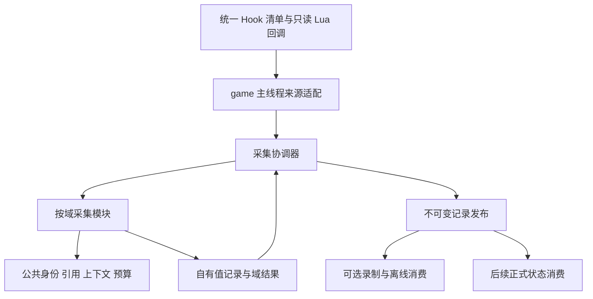

# 按观测域拆分的详细设计与迁移边界

日期：2026-10-30，Asia/Singapore。范围：tx-04-10—tx-04-14 的共用设计细化。状态：设计已整理，公共接口、目录和迁移步骤均待实现；本次只修改文档。tx-04-09 的四参与者／多身体交付沿用[既有实现与结果](four-participant-implementation.md)，不由本文重新验收。

实现进展（2026-10-30）：tx-04-10/11已接入Entity/Grid，tx-04-12已接入Room/Level及完整分层上下文并通过统一E2E 5/5；具体来源、schema、失效、预算与实际覆盖见[实现及验收](tx-04-12-implementation.md)。下文未实现描述保留原设计时点，13/14等域仍按对应tx继续。

采用统一采集协调器、按域组织的模型与采集模块、共用上下文和跨域引用合同。Entity 与 Grid 首先迁移，房间、楼层、探索、离房保存、跨房玩家、整局、随机、HUD 和 Mod 随对应 tx 接入。各域可以使用 native 或只读 Lua 来源，也可以按不同阶段和频率采集；只有同一有效窗口的数据才能声明为同一完整快照。

本设计服务于[完整观测计划](README.md)及后续[整局可玩路线图](../state-synchronization-roadmap.md)。观测模型不是网络 ABI；tx-04-15 起再选择复制状态、表现事件、房主独占和客户端本地数据。执行流程以[现行项目规范](../../refactor/project-conventions.md)为准，不设 gate、不校验哈希、不要求独立角色或逐模块测试。

## 1. 当前实现与拆分目标

### 1.1 当前代码依据

| 现有位置 | 当前职责 | 拆分需要解决的问题 |
| --- | --- | --- |
| [collector.h](../../../mod/src/world/collector.h)、[collector.cpp](../../../mod/src/world/collector.cpp) | 主线程阶段、Authority 凭据、对象枚举、字段复制、RNG 窗口、身份事件、引用、完整性和提交 | Entity／Grid 规则与公共流程混合；增加新域会持续扩大协调器 |
| [identity.h](../../../mod/src/world/identity.h)、[identity.cpp](../../../mod/src/world/identity.cpp) | Entity／Grid 分域身份、地址复用、birth/use/revision、读取资格及 membership | 可复用对象身份机制，但房间、保存项、随机流不能全部套用地址身份 |
| [model.h](../../../mod/src/world/model.h)、[model.cpp](../../../mod/src/world/model.cpp) | min-read-v1 字段 profile、RawObject／RawBatch、事件、预算及状态枚举 | 当前固定对象字段结构不能作为所有未来域的统一容器 |
| [observe.h](../../../mod/src/world/observe.h)、[observe.cpp](../../../mod/src/world/observe.cpp) | 19 项观察语义的进入／返回、线程与异常通知 | 保持轻量；不在 wrapper 内堆积领域采集或直接写盘 |
| [world_bridge.cpp](../../../mod/src/game/world_bridge.cpp) | 主线程、Hook 通知、阶段／tick、Player 锚点、录制上下文接线 | 当前通过 WorldRecording 取得 Collector，采集生命周期与录制 owner 有耦合 |
| [world_layout.json](../../../mod/binding/world_layout.json)、[hooks.json](../../../mod/binding/hooks.json) | 目标布局、来源、RTTI 与统一 Hook 清单 | 保持唯一 native 点位来源；按域建立引用索引，不能复制安装所有者 |
| [storage.h](../../../mod/src/world/storage.h)、[writer.cpp](../../../mod/src/world/writer.cpp) | 槽、后台值复制、有界队列、编码与文件生命周期 | 通用传递／写盘与旧对象格式编码需要分开 |

截至本次阅读，tx-04-09 已扩展四参与者和多身体；旧七类 Entity、Grid 公共字段和 78 字段 profile 仍不等于完整世界观测。后续迁移必须以工作区当前实现为起点，不能拿旧双人源码覆盖现有控制组和身体锚点逻辑。

### 1.2 本次确定的边界

1. 协调器只组织采集，不继续承载各域全部字段、对象类型和编码分支。
2. 域拥有其规范模型、字段目录、采集与变化规则；多来源对应同一规范事实，不产生第二份真值。
3. 共享身份、上下文、资源值类型、引用解析、预算、有效性和发布设施；不复制两套世界采集状态机。
4. 正式纯值采集与调试录制独立。输入与后续同步不依赖录制启用、日志或磁盘成功；生产默认关闭 world_record 和逐 tick/query 明细。
5. 本次仅确定设计；实现从 tx-04-10 开始，tx-04-11—14 按领域内容继续。公共拆分不新增一次提前验收，也不缩小各 tx 的完整目标。

## 2. 模块结构与依赖方向

以下是目标组织方式，不表示目录已存在。每个域按实际体量拆文件，不为尚未实现的域创建空类、空 Hook 或假成功回调。

```text
mod/src/world/
  collector.h/.cpp             统一采集协调器及对 game 桥的入口
  common/
    context.h                 上下文、阶段、scope 和事件顺序
    domain.h                  领域描述、能力和调用接口
    reference.h/.cpp          SubjectKey、引用状态及解析
    coverage.h/.cpp           覆盖范围、缺口、有效性与预算结果
    value.h                   标量、集合、资源／Sprite 等共用值合同
    identity.h/.cpp           对象身份设施，承接现有 identity 的公共部分
  domains/
    entity/                   Entity 公共／派生字段、关系与生命周期
    grid/                     Grid／门、槽位、字段与生命周期
    room/                     当前房间身份、构建、进度与环境
    level/                    楼层／维度、描述集合与连接结构
    exploration/              发现／访问／地图状态与历史
    room_save/                非活动房间保存集合及恢复来源
    player/                   控制关系、跨房连续性与备份／恢复关系
    run/                      整局规则、进度、概率条件及各类时钟
    random/                   随机流、池状态、实际消费和选择结果
    presentation/             HUD、独立 Sprite、音画状态与瞬时事件
    mod/                      具名 Mod 适配、对象图与自定义 schema
  storage.h/.cpp              有界存储、槽和不可变值传递
  writer.h/.cpp               可选录制消费端及文件生命周期
  compatibility/
    min_read_v1.h/.cpp         旧 profile／编码投影与兼容规则

mod/src/game/
  world_bridge.*              主线程阶段与生命周期接线
  world_sources/              native／Lua 来源适配，按实际需要拆文件
```

每个实际接入的域通常包含 `model.h`、`schema.*`、`collect.*`；事件逻辑或编码较多时增加 `events.*`、`encode.*`。公共模型只收纳多个域确实共用的类型，不能把域字段表集中搬进新的万能头文件。现有 observe、binding 和统一 Hook 注册入口继续存在；迁移不要求纯粹为了目录一致重命名全部公共文件。

正式只读 Lua 观测模块独立于 `ui/isaac-cs-ui` 与 `tests/e2e-mods`，其内部也按相同域名组织。具体安装目录及 Lua 注册接线在 tx-04-10 实现时确定，不能把 E2E 夹具作为正式数据来源发布。



依赖必须保持以下方向：域依赖公共值合同和窄的读取服务；公共模块不依赖具体域；域 A 不包含域 B 的采集实现、不调用域 B 的采集器。需要关联的数据通过身份／引用服务或已封存的值视图取得，由协调器安排实际调用顺序。

game 适配层掌握 SDK、Lua 和游戏对象访问。公共值合同及领域规范模型不包含 `runtime.h`、SDK 类、`lua_State*`、userdata 或 Win32 句柄；既有 native 内存复制能力通过受限读取接口接入，不因新公共头文件而扩大调用权限。

## 3. 各域职责与唯一归属

| 域 | 负责的规范事实 | 引用其他域的内容 | 首次完整交付 |
| --- | --- | --- | --- |
| entity | 活动及已观察 Entity 本体、全部派生／专用字段、短命对象事件、Entity-owned Sprite／资源姿态、父子／所有者等关系 | 房间 membership、participant/control group、随机流、Mod 命名空间 | tx-04-10 |
| grid | 活动 Grid、Door 本体、槽位／索引、初始化资格、公共／派生字段、当前 Desc／保存描述、资源姿态和同格替换 | room／level、随机流、离房保存项 | tx-04-11；tx-04-10 先迁移旧范围 |
| room | 活动房间身份、形状／边界／构建、进度／奖励状态、环境与实际门槽 membership | Entity／Grid 本体、Level 描述、配置资源 | tx-04-12 |
| level | 楼层实例、各维度、房间描述、结构／连接图和结构变化 | room 实例、run、配置资源 | tx-04-12 |
| exploration | 发现／访问／清理和地图知识、揭示／隐藏关系、探索历史 | level／room descriptor、HUD 地图显示 | tx-04-13 |
| room_save | 非活动房间的 Entity／Grid／装饰保存项、集合版本、离开与恢复来源边 | descriptor、活动对象和回访实例 | tx-04-13 |
| player | participant—control group—身体历史、跨房连续性、活动／备份／替换及资源共享关系 | EntityPlayer 全部本体字段、tx-04-09 控制事实、room_save | tx-04-13；前置引用从 tx-04-10 接线 |
| run | 难度／模式／挑战／进度、全局 flags／计数、概率修正及条件、具名时钟与 Seed Effects | level、player、随机流与实际生成结果 | tx-04-14 |
| random | 随机流身份／用途／当前可读状态、具名种子关联、选择池、真实调用／消费和结果 | 流 owner、实际生成对象／奖励和 Mod 来源 | tx-04-14；旧 RNG 窗口先保留 |
| presentation | HUD／PlayerHUD、独立 Sprite、持续音画状态、一次性音效／提示／绘制事件 | player、Entity-owned Sprite、世界探索状态 | tx-04-14 |
| mod | 适配声明、命名空间、只读自定义状态、有界表图、Mod 事件和寿命 | 世界对象、随机流、资源和表现 | tx-04-14 |

边界补充：

- Player 身体复用 Entity 身份和字段。player 域提供关系与历史，不复制心量、装备、充能等第二套本体状态；tx-04-09 的控制模型仍由输入层负责，观测只读其值。
- Door 本体由 grid 管理；room 管实际门槽，level 管结构目标／邻接。允许门槽、实际门、候选连接和可进入条件分别表达。
- grid 管当前对象的保存描述；room_save 管离房保存集合及其版本，不将保存项自动视为仍存活的 Grid。
- exploration 管世界已知信息；presentation 管 Minimap 的显示姿态和本地展开偏好。相同公开成员只登记一个规范字段，另一个域引用。
- Entity／Grid-owned Sprite 的状态跟随 owner 所在域。通用资源／姿态值结构共用；独立 HUD Sprite 在 presentation 中建立身份。
- run 管种子用途和整局条件，random 管随机流及消费；seed 相同不能证明流身份、进度或结果相同。
- Mod 扩展表归 mod 的命名空间，不覆盖基础字段。Mod RNG 在 random 下登记来源，Mod HUD／事件通过 presentation 的共用合同关联。

## 4. 公共数据合同

### 4.1 观测域与身份空间分开

`DomainId` 表示哪个模块拥有记录，`IdentitySpace` 表示记录中主体的身份类型。它们不能复用同一个枚举：player 域的关系可以指向 entity 空间，room_save 中的保存项必须具有自己的身份空间。

主体键 `SubjectKey` 的逻辑组成是 `(session_key, observation_epoch, identity_space, local_id)`。同一身份空间的 local_id 由唯一身份服务分配，不能由每个域自行从 1 递增后不带命名空间发布。它只保证本次会话／观测 epoch 内的关联，不是未来网络 ID，也不证明跨进程对象相同。

`observation_epoch` 属于采集服务生命周期；`recording_generation` 属于可选录制消费端。停止／重新开始录制不能重置仍在使用的正式采集身份。采集完全停用期间无法观察的生命周期，在重新启用时建立新 epoch 或明确重新观察，不跨空档猜测连续性。旧 v1 的录制本地 ID 通过兼容映射处理。

身份目录至少区分 Entity、Grid、Run、Floor、Dimension、RoomDescriptor、RoomInstance、SaveEntry、Participant、ControlGroup、RandomStream、独立表现对象、资源描述和 ModGraphNode。实现时按接入范围分配稳定代码并版本化；不能修改旧 `ObjectDomain::Entity/Grid` 数值来容纳新空间。

### 4.2 采样上下文

| 成员 | 合同 |
| --- | --- |
| session／epoch | 会话及观测实例身份；不得用原生指针或目录名替代 |
| run／floor／dimension | 各层级的主体键、代次和有效状态；尚无来源时明确未知 |
| room descriptor／room instance | 逻辑房间描述与本次活动实例分开，回访可能有新实例 |
| scope_id／parent_scope_id | 唯一采样窗口与嵌套来源关系；不按帧号推造父子关系 |
| phase | OrdinaryPost、PlayerPost、Lifecycle、Transition、Render、ActualCall 等实际来源阶段 |
| authority_tick | 可空；仅在已有原生 Authority 凭据时填写，pending 时另标候选与提交结果 |
| outer／owner token | 既有普通 owner／Room／尾部配对凭据，适用时保留 |
| observation_seq | 主线程观察顺序；用于来源排序，不冒充玩法 tick 或跨线程因果 |
| mutation／lifecycle revision | scope 前后稳定性和缓存失效依据 |
| source_id／source_version | native Hook、Lua 回调、公开查询、缓存版本等来源说明 |
| correlation／event watermark | 关联实际事件、前后态及已覆盖事件范围；关联不等于同时采样 |

上下文字段有“已知值、未知、不适用”三种存在性，不用 0 同时表达全部情况。tx-04-10 只能发布已具备依据的上下文；floor／descriptor 等尚未由 tx-04-12 完整接入时保留缺口，不能把房号包装成完整楼层身份。

### 4.3 记录与字段目录

发布单位 `ObservationEnvelope` 由上下文、域 ID、schema 标识／版本、记录类型、不可变 payload、覆盖结果和事件水位组成。记录类型至少区分 State、Event、Relation、Coverage、Gap、Catalog；不强迫它们共享 RawObject 内存布局。

字段的全名为 `(schema_namespace, schema_version, field_id)`。目录记录类型、单位、来源成员、查询参数域、适用类别／变体、寿命、采样阶段、只读／事件属性及实现状态。继承或同义来源映射到同一规范字段，保留各来源及观察时刻；出现差异时保留差异，不能在编码器中悄悄选一个覆盖另一个。

支持标量、结构、可变集合、对象引用、资源引用和有界图。各域采用自己的类型化模型和编码器；公共层只规定这些值的存在性、引用及所有权，不引入每个字段均动态反射的通用引擎。native 临时地址只留在主线程关联和显式 diagnostics 中；后台禁止解引用。

### 4.4 覆盖与有效性

`DomainResult` 同时报告本次尝试状态、范围、原因集合和预算使用量。至少区分：

- Complete：对声明的范围和 scope 已完成，不代表任意对象、变体或全部未来域都已覆盖。
- Partial／Failed：保留实际成功部分，列出字段、对象、来源或集合的具体缺口。
- NotApplicable：本场景确实不适用并有依据，例如无本类 owner；未知类别不能归入此项。
- NotScheduled：本阶段不轮询，需关联仍有效版本或说明当前无样本，不能声称获得了新完整状态。
- Disabled／Unsupported：消费计划未启用，或 schema／来源未实现；二者都不能解释为空集合。

字段层继续区分 Value、Null、Empty、NotApplicable、Unavailable、NotCaptured、ReadFailed、Nonfinite、Truncated 等语义；集合还要报告枚举范围／数量及是否完整。具体编码可复用现有状态，但新语义必须显式扩展，不能重新解释旧枚举值。

完整性分为“域 scope 完整”和“所声明组合完整”。组合必须列出要求的域、schema、范围、scope 及允许引用的有效版本。一个域缺失会使包含它的组合不完整，但不会把另一个独立 scope 已观察到的事实删除。旧 min-read-v1 的 `complete` 仍按旧范围和原规则计算，不升级成“所有域完整”。

## 5. 公共调用接口

本节是接口合同伪代码，不是已存在的 C++ API 或可编译补丁。注释和实现中的核心函数／数据结构均使用中文说明。实现应保留窄接口，按实际需要确定类型布局，不为预期中的任意第三方采集插件构造复杂继承框架。

### 5.1 协调器对 game 桥

```cpp
// 接收已准备好的模块和预算；仅在已理解的主线程边界激活。
ActivateObservation(prepared_domains, capture_plan);
AttachConsumer(prepared_consumer);
DetachConsumer(consumer_id);
UpdateCapturePlan(requested_plan);

// 帧、Authority 和生命周期仍以真实游戏边界为依据。
BeginOuter(outer_context);
EnterStage(stage_context);
LeaveStage(stage_context, returned_normally);
ObserveEvent(actual_event, callback_context);
PrepareScope(scope_context);
CommitScope(scope_id, scope_outcome);
Invalidate(change_notice);
RequestStop(stop_reason);
```

现有 `WorldFrameBegin/WorldNativeReturned/WorldPreparePostState/WorldPublishPostState` 先适配到上述职责，不在文件拆分时改变 Authority-pre、输入调度、clock.Complete 或 ACK 的次序。没有 Authority 的过渡／render／实际调用记录走独立 scope，不为复用接口制造 tick。

采集计划 `CapturePlan` 显式描述启用域、schema／对象范围、阶段／触发条件、变化采集频率、缓存策略、预算和消费端需求。编译时描述表负责哪些域已实现；未实现的域不注册假成功。运行时计划可以逻辑启停，不能执行 Hook 安装／卸载，也不能在读取过程中变更本次计划版本。

Attach／Detach／Update 请求只在正常主线程边界生效；准备文件、队列和自有存储由后台完成。协调器合并有效消费端的必要采集需求，同一 scope 只读取一次；关闭 Recorder 只移除它的额外需求，不停止其他消费者仍需的域。无任何消费需求时不执行全世界扫描；必要控制安全检查沿用输入层，不因采集停用消失。

`scope_outcome` 区分 AuthorityCommitted、IndependentPublished、Cancelled、Invalidated。普通后态必须走真实 Authority 提交；render／事件等无 Authority 的独立 scope 只能按自己的来源资格发布，不借 IndependentPublished 绕过普通窗口判据。各请求和域入口返回明确的接受／拒绝及原因，不以进程异常表达普通准备失败或容量不足。

### 5.2 协调器对域模块

```cpp
// 域描述只含静态能力、schema、来源需求和预算；不负责安装 Hook。
DescribeDomain() -> DomainDescriptor;

// 准备自有存储和模块状态；禁止后台读取游戏／Lua。
PrepareDomain(preparation_options, domain_budget) -> PreparedDomain;

// 以下入口仅在主线程，服务／writer 只在当前调用内借用。
OpenScope(context, read_services, domain_state, scope_writer);
Enumerate(context, read_services, domain_state, scope_writer);
CaptureState(context, read_services, domain_state, scope_writer);
OnEvent(context, actual_event, read_services, domain_state, event_writer);
ValidateScope(context, read_services, domain_state, scope_writer)
    -> DomainResult;
// 接收最终提交或取消结果，只更新自有缓存、membership 等观测状态。
FinishScope(context, scope_outcome, domain_state);
Invalidate(change_notice, domain_state);
Retire(domain_state);
```

`DomainDescriptor` 至少声明 domain/schema 版本、支持的 phase、状态／事件／枚举能力、必要上下文、来源、引用空间和预算。使用静态注册表及显式调用表即可；没有该能力的方法可以缺省，但必须由描述表说明，不用一批空实现掩盖未实现范围。

`DomainState` 仅由所属模块修改，包括本域缓存、固定工作表和生命周期跟踪；不能取得整个 Collector 的可写引用。公共身份变更通过身份服务完成。`OpenScope` 保存窗口起始见证；`Enumerate` 登记主体和 membership；`CaptureState` 写类型化值；`ValidateScope` 执行相应来源前后复核，结果由协调器封存。

`FinishScope` 对每个已打开的域 scope 恰好调用一次，包含取消、异常收束和失效路径；仅在允许的提交结果下更新该 scope 的已提交 membership／缓存版本。临时批次索引、候选值与已提交版本分开，取消后不能遗留“已完成采集”。真实生命周期／事件身份变更是已观察事实，不随后态取消回滚；不能因此让已销毁对象复活。重入事件使用独立 parent_scope／call 栈，不复用正在写的状态批次。

调用不能抛异常穿过原生 Hook。Lua 错误在来源适配层转为有来源的失败；游戏原始异常继续原样展开，观察层只标记异常 scope。主线程域入口不等待网络、writer 或磁盘；内存从已准备且记账的有界存储取得，耗尽必须返回明确结果。

### 5.3 公共服务的权限

| 服务 | 允许能力 | 禁止能力 |
| --- | --- | --- |
| MainThreadReadServices | 当前调用有效的有界内存读取、已声明只读 Lua 查询、当前对象资格检查 | 创建／修改／销毁游戏对象，随机抽取、写存档、任意 Lua 执行器 |
| IdentityService | 按空间登记观察事实、复用现有身份、出生／退休／修订、临时地址关联 | 凭地址、索引或 seed 相等强认同一逻辑对象 |
| ReferenceService | 登记待解析关系，按 namespace、代次、目标资格解析 | 为满足引用而调用另一个域采集器或偷偷启动采集 |
| ScopeWriter／EventWriter | 写本域记录、覆盖缺口、关系；申请本域已预算容量 | 写别的域字段、直接修改完整性总结果、文件 I/O |
| DomainValueView | 读取已封存值及其来源 scope／有效期 | 借此重新读取旧对象或把旧值当成本次 fresh sample |

读取服务内部可以短暂持有游戏对象，但 token 必须绑定当前 epoch、代次和 callback/scope。域不得把 SDK 指针、userdata、read_services 或 writer 存入后台队列或跨 callback 缓存。需要长期保留时复制为值，并保存主体键和有效性。

### 5.4 发布与消费

```cpp
// 完成引用、复核和提交后封存；发布后 payload 只读。
SealScope(scope_id, domain_results) -> OwnedObservation;

// 消费端取得自有不可变值的所有权或受控共享引用；主线程不等待。
TryEnqueue(owned_observation_ref) -> Accepted | Backpressure | Closed;
```

封存记录使用预备存储的所有权转移或有界共享引用。多个消费端共享同一份值，不重新读取游戏；每个消费端有独立队列、预算和失败状态，不因为录制阻塞阻断正式状态消费。后台释放的只能是自有值，不得触发游戏／Lua对象释放。

Accepted 表示消费端已取得受控引用；Backpressure／Closed 不取得引用，发布者仍负责归还该次所有权并报告受影响消费端的损失。Recorder 不得长期持有公共 WRITING／PREPARED 采集槽；其独立存储配额／保留额度耗尽后应拒收或按录制故障结束，不能占满正式消费所需的最低存储。共享不可变块的额度、最慢消费端滞留量和归还路径也计入预算，不能仅凭“独立队列”就声称实现了隔离。

Recorder 负责 manifest、编码、写盘和录制结果；其 FileError 终止受影响录制，不能传播为输入会话失败。生产必需的采集若失败，则正式消费端得到明确 unavailable／gap，并按自己的恢复合同处理；不得借“录制是可选”隐瞒正式状态缺失。后续网络消费接入留给 tx-04-15 及以后，本文不新增协议或写世界行为。

## 6. 采样时序与提交

### 6.1 普通 Authority 后态

现有完整普通窗口保持：同一 outer/token 下普通 owner、Room、标准尾部正常返回，在 coop TopExit 前复制；同一 token 的真实 Authority 凭据是必要时序依据。

协调器在该窗口依次完成：

1. 固定本次 CapturePlan 和上下文，记录 root／mutation／事件水位等起始见证。
2. 为启用域开启 scope；旧 Entity/Grid RNG 复制窗口保留其完整集合与前后状态。
3. 先枚举需要的主体和 membership，再采集字段，避免以“先采哪个域”决定引用是否可解析。关系扩展枚举有界，深度／数量不足明确报告。
4. 统一解析跨域引用；目标未调度、未实现、旧代或未解析分别保留原因。
5. 各域复核来源／槽位／容器及自身读取资格，公共层复核 root／代次／mutation；保留当前全复制窗口复核，不能用单字段前后相同替代。
6. 形成 PREPARED 结果；只有 Authority 提交成功，才通过 FinishScope 提交观察侧 membership／缓存，并把这份普通后态发布为已提交 tick 的记录。失败时同样通知 FinishScope 取消，撤销 pending 快照并记录实际原因；真实事件不随之回滚。

同一次同步执行的只读 Lua 查询，只有已接入该主线程窗口且生命周期／来源复核成立，才能纳入这个 scope。由另外一个回调获得的 Lua 值保持独立 scope，不能仅按 FrameCount 相同合并。

### 6.2 其他来源阶段

| 阶段／触发 | 主要内容 | 提交与关联 |
| --- | --- | --- |
| PlayerPost／odd-only | Player 更新读取资格、局部字段与关系 | 保留实际 Authority kind；旧完整世界仍为 OddOnly gap，局部新记录不改写旧结论 |
| Lifecycle／Transition | 创建／Init／Morph／Restore／Remove、切房／换层前后 | 进入立即污染受影响旧窗口，发布真实事件；稳定新 scope 另行采样 |
| Render | HUD、独立 Sprite、绘制参数、加载期表现 | 带 pass／来源／scope，tick 可空；与最近已提交状态只有显式关联关系 |
| ActualCall | RNG 消费、选择结果、音效／提示等短时事件 | 原调用 exactly-once，保存实际参数／结果及可得前后状态，不二次调用验证 |
| 结构／状态变化 | 楼层生成、描述集合、探索／保存集合变化 | 产生带 revision 的新状态版本；失效通知到达后旧版本不可继续表示当前有效 |

事件不必等待后态中仍存在对象。原生事件确实发生而后态提交失败时，事件事实仍保留，关联 tick 标为候选／未提交或无 tick；不能把它挂到上一次 completed tick，也不能随快照取消而删掉真实事件。事件有独立序号、call/parent、进入／返回／异常、来源与损失水位。

### 6.3 多频率与版本复用

逐 tick、变化触发、生命周期触发和 render 触发由字段目录和 CapturePlan 明确选择。查询参数域需要完整安排，不能只扫默认参数或轮流扫部分字段却宣称每个 tick 全量完成。

缓存记录保存主体、schema、revision、来源 scope、采样序号、失效条件和“当前仍有效”的依据。只有变化通知可覆盖且有效性可判定的状态才能按变化缓存；否则按所需频率重新读取，或明确旧值及 freshness 未知。缓存命中表示引用旧版本，不改写其采样时间。

各域声明有界工作量及失效关系：room instance 改变使其 Grid／房间环境缓存失效；floor／run 变化进一步失效描述／探索／保存数据；控制组变化撤销相关 Player witness。Entity 和 Player 是否跨房仍存活根据其实际生命周期判断，不能随 room 失效批量销毁全部对象。

## 7. 跨域身份与引用解析

### 7.1 引用结构与解析结果

`ObservationReference` 至少包括源主体、关系类型、目标身份空间、目标键（若已知）、观察 scope／序号、依据和解析结果。未有目标键时可以保留本地主线程的临时关联 token；发布前只能转为规范键或明确 unresolved，原生地址不能成为正式引用键。

结果区分 Null、KnownCurrent、KnownHistorical、Unresolved、NotCaptured、UnsupportedTarget、Retired、AmbiguousReuse、CrossEpoch。零地址对应 Null，不可读地址对应失败；目标本次未采集不等于已销毁。KnownCurrent 必须满足身份连续性和本次读取资格；已知历史主体可以被历史关系引用，不伪装成仍活动。

同一 scope 内先登记主体再解析关系。对不同 scope 的引用保留目标版本和其有效依据；事件中的身份以事件发生时为准，不能用落盘时最新身份回填。晚到的解析可用追加关系记录指向原事件／scope，不原地改写已发布值。

### 7.2 生命周期与逻辑归属

| 情况 | 处理 |
| --- | --- |
| Entity／Grid 地址复用 | 继续现有 local_id/use/birth/revision 规则，旧对象与新对象分开 |
| Grid 同格重新生成 | room instance＋index 是槽定位；旧退休、新对象有独立身份，不能仅靠同 index 合并 |
| Player 跨房 | 身体仍具实际连续性时保留 Entity 身份，只变 membership 和控制关系版本 |
| 回访房间 | descriptor 可以关联相同逻辑房间；活动 RoomInstance 及运行对象按本次实际生命周期确定 |
| 离房保存／回访恢复 | SaveEntry 独立身份；通过 SavedFrom／RestoredFrom 等有依据的来源边关联，seed／索引相等不自动沿用运行对象 ID |
| 备份／替换身体 | 与原身体分开表达，沿用 tx-04-09 控制组事实；不占额外参与者名额 |
| RNG 流 | owner、用途、参数域与生命周期共同确定；seed 是状态，不能单独作为流 ID |
| Mod 图节点 | namespace/schema＋图生命周期和节点 ID；Lua 地址不跨启停、跨 run 保证身份 |

run/floor 的 generation 由实际开始、重置、换层等边界建立；镜像／其他维度不能仅靠房号区分。tx-04-12 补全这些上下文后，通过引用和版本增加信息，不重写旧录制中的身份事实。

### 7.3 前置域尚未接入时

tx-04-10 的 Entity 可以登记 owner-qualified RNG 关联或 Mod 命名空间入口，但 random/mod 未实现时，目标保留 UnsupportedTarget／NotCaptured 和负责 tx。不能创建一个空的 random/mod 完整状态来消除缺口。

tx-04-10 的 grid 模块只具有旧范围能力；同样通过 descriptor 声明范围，不能因分目录就声称 tx-04-11 完成。后续版本接入时复用规范身份，新增 schema 和有效来源，不修改旧字段含义。

## 8. 来源适配与只读约束

优先查[原版本地 Wiki](F:/projects_isaac/IsaacDocs/docs)和[REPENTOGON 本地 Wiki](F:/projects_isaac/REPENTOGON-1.1.3/docs/docs)，来源可为公开字段、Getter、容器、回调或已核定 native 读取。只有具体版本、副作用、生命周期疑问才查绑定源码，对公开接口不足的具体需求补必要研究。

来源描述包含目标版本、只读／实际调用属性、可用阶段、参数域、生命周期条件和失败语义。`Get...` 名字不构成只读依据：ItemPool 抽取、RNG Next/Random、`RandomCoinJamAnim`、可能创建表的 GetData 类接口不能放入无副作用轮询。读取已有数据与真实调用见证分开；`pcall` 不能撤销副作用。

统一 Hook 清单仍是所有 native Hook 的唯一注册与安装 owner。各域描述自己需要哪些观察语义，清单／生成器提供唯一 wrapper；多个域可以消费同一个通知，不能各自安装同地址 Hook。Hook 启动安装后常驻，采集服务和 recorder 仅逻辑启停，原调用始终按观察合同 exactly-once。

Lua 正式观测模块只调用声明的只读操作，禁止通过 Update／Render／Load／Init／Spawn 或写持久状态补信息。Lua table 复制处理循环、共享引用、稀疏键、非有限值及不支持的函数／线程／userdata；按节点、深度、字节预算报告截断，不能无限遍历 `_G`。

停用期间 wrapper 原样透传；必要线程、生命周期和控制安全检查仍存在。后台网络、原始复制与编码线程不得触碰游戏或 Lua。遇到错误线程，只发原子故障通知；下一已理解主线程边界收口，不在错误线程调用域接口或修改身份表。

## 9. 预算 失败与正常停止

准备阶段分配模块状态、临时工作表、payload 存储、事件环与必要控制记录。预算包括总量和各域份额，不能让每个域都认为自己独享旧 256 MiB。新可变集合、Sprite、楼层图和 Mod 图接入时重新核算；旧 `kFieldBudget`、448 格、八门槽等只描述旧格式／旧来源，不是新域的完整范围上限。

主线程不为避免 gap 等待消费端。数量／字节／深度超限时保留已取得值及具体 Truncated／Budget 原因；不能删掉昂贵类别、Mod 键或未知对象换取 Complete。需要跨多个片段传递时，各片段标同一采样 scope、片号和最终覆盖结果，不把跨帧重新读取的数据说成同一快照。

| 故障 | 传播范围 |
| --- | --- |
| 单字段或域查询失败 | 标记对应结果，组合完整性按其声明范围归约，保留独立有效事实 |
| root／代次变化或生命周期污染 | 撤销受影响 scope 和缓存资格；禁止发布伪完整后态 |
| 事件丢失 | 记录损失序号／范围，撤销依赖完整历史的连续性；不能沿用旧缓存当作未变 |
| 录制 FileError／队列关闭 | 停止该录制消费端并报告原因，正式状态消费和输入不依赖其成功 |
| 公共身份冲突、错误线程、原生异常 | 停用或撤销受影响采集能力，保留实际首因；不为继续采集猜测对象关系 |

如果连损失控制记录也无法可靠发布，通过独立有界健康状态／故障序号让消费端识别历史断裂；必要时停用该采集 epoch。不能静默丢事件，也不能把诊断故障扩散成新的输入或世界写入行为。

正常停止：关闭新 scope 和发布入口，等待当前 callback 在正常主线程边界退出，处理或撤销 pending，封存各域退休与消费端结束状态，再由后台 drain／释放自有存储。Hook 保持常驻；不恢复原生字节、不强制卸载，不将 borrowed 服务或 Lua 引用留给 drain 线程。停止 recorder 与停止采集服务为两个操作；仍有正式消费需求时只关闭前者。

## 10. 记录格式与旧 profile 兼容

### 10.1 新记录合同

扩展域采用独立标识的 `isaac.cs.observation` v2 记录合同，包含第 4 节 envelope、域 schema／字段目录、主体／关系、状态、事件、覆盖和 gap。这里选定格式名与主版本，不冻结未来网络字节布局。具体 JSONL 文件分组、类型编码和离线 reader 在 tx-04-10 实现时一并交付，并由后续域各自增加编码器和读取支持。

manifest 发布格式版本、schema 目录、实际启用域／来源、CapturePlan、预算和已实现／未实现范围。未知 schema 的 reader 应报告 Unsupported，保留可读取部分的边界；不能忽略未知域后宣称全域重放／比较完整。状态比较按域语义处理，地址、线程和本地序号不直接作跨进程相等键。

writer 核心只负责队列、文件、通用 envelope 和结束状态。域提供其 payload 编码／解码规则，静态注册；加入新域时不继续扩展一个覆盖所有类型的大 switch。编码器只读自有值，不能通过 getter 补字段，也不能改变采样有效性来“修复”记录。

### 10.2 min-read-v1 保留方式

旧 `isaac.cs.world-record` v1、旧字段 ID／来源编号／原因编号及已有 reader 保持原解释。compatibility 模块保存旧 profile、布局适配和编码投影；历史结果与原始失败不重写。

需要旧录制时，从**同一次有效采集**投影旧范围，保留原普通窗口、读取依据、RNG 前后、membership、事件和完整性规则。不能为了同时输出 v1/v2 再读一遍游戏、执行两次 Getter 或双跑生命周期状态机。新数据不能精确投影时报告兼容输出不可用／不完整，不补零、不删掉必要 gap。

旧、新记录使用独立格式标识及输出位置，不能把 v2 payload 混入旧 captures 后仍标 v1。旧本地 ID 与新主体键采用显式映射；不要求新内部布局逐字节等于旧 RawBatch，也不借映射伪造跨录制连续身份。v1 格式名称与 min-read-v1 profile 版本分别解释，冻结既有含义。

兼容是可选输出能力，不是正式采集的运行前置。新功能必须在新域 schema 中完整表达，不能因旧 `RawObject` 容不下就省略 Bomb／Laser／Slot、房间、HUD 或 Mod 数据。

## 11. 现有 Entity 与 Grid 的迁移方案

迁移纳入 tx-04-10 完整目标，结构重排与公共接口先完成，再补全 Entity；统一在该 tx 整体验收。tx-04-10 同时把旧 Grid 代码迁出，但其完整扩展及对应场景仍归 tx-04-11。

### 11.1 现有职责的目标位置

| 现有逻辑 | 目标位置与迁移要求 |
| --- | --- |
| BeginOuter、Enter/LeaveStage、NativeReturned、Prepare/PublishPostState、EndOuter | collector 协调层；保持当前阶段和提交次序 |
| ReadRoots、game frame 等 | game 读取适配＋公共 context；room／level 模块逐步补全规范身份，不能假造尚无来源字段 |
| Classify | entity/grid 各自分类；共用已核定 layout 访问，不复制 RTTI 数值 |
| CopySource | 公共有界容器读取＋域内来源解释；EntityList／roster／关系与 Grid／door 的不同语义分开 |
| CopySources、Add | 域枚举主体／membership，公共身份登记和批次索引服务共用；去重保留来源 membership |
| CopyFields | 通用原始位复制／有限值处理下沉；Entity／Grid 派生规则和适用性留在本域 |
| CopyObject 的 Grid ready／index 判断 | grid 域；保留初始化字节、实际槽与 index 一致性 |
| ResolveReferences | 公共 reference 服务；旧同域引用按原语义投影，新跨域引用独立版本化 |
| BeginRngWindow／EndRngWindow | 提取共用复制窗口见证设施，保留现有 Entity/Grid 集合与四字前后状态；tx-04-14 接入统一 random 模型 |
| ObserveEnter/Leave、NativeEnter/Leave | 公共 call/parent／原生到达配对；Entity/Grid 事件处理按域路由，共用一次原调用通知 |
| CreationOwner、CompleteOwner、Birth | 公共身份变更设施＋域内 owner 判定；不能仅靠移动函数改变出生资格 |
| AnchorPlayer、PlayerReturned、RevokePlayer | Entity 读取资格与 game 控制快照接线；保留 tx-04-09 全部身体锚点和变化撤销顺序 |
| model profile、writer 的对象字段编码 | compatibility/min_read_v1 和 entity/grid schema／encoder；storage 只负责有界值所有权 |
| WorldRecording 持有 collector | 分离采集服务 owner 和录制消费端 owner，后台准备与主线程激活仍明确配对 |

### 11.2 实施顺序

1. **冻结语义映射。** 对照当前函数、布局和 tx-04-09 交付建立搬迁表，保留现有本地身份、锚点容量、PlayerUpdate witness、removed_by_factory 当前字节资格、Grid 原生到达与槽位见证。这里是静态阅读，不运行旧实现生成“基线测试”。
2. **建立公共值和接口边界。** 明确 context／subject／reference／coverage，提取协调器与窄读取服务；现有接口可作为薄适配继续调用，不能把 Collector 的全部可写成员暴露给新模块。
3. **迁出旧范围 Entity/Grid。** 按域拆模型、枚举、字段／事件规则和编码；保留统一 phase、RNG 窗口、mutation、引用、预算和提交 owner。native 清单与目标版本偏移仍集中管理。
4. **分离录制与正式采集。** 采集服务按实际消费需求启停，Recorder 成为可选订阅者；身份 epoch 与 recording generation 分开，输入侧控制组仍使用自身必要拓扑与生命周期，不反向依赖 recorder。现有 WorldEntityLocalId 等桥调用逐个明确用于诊断还是必要身份，不直接删除或用空值替代。
5. **建立新 schema 与兼容投影。** 完成公共 envelope、Entity/Grid 旧范围 schema、域内编码器、v2 离线读取和可选 v1 投影；完整实现各自失败／停用边界。
6. **继续完成 tx-04-10 Entity 目标。** 按[Entity 计划](entity-observation.md)补全公开接口和关联数据，接入正式只读 Lua 来源、资源姿态及缺口目录。其他域只声明未来归属，不创建伪完整结果。
7. **全目标完成后统一 E2E。** 把结构迁移、采集启停、录制隔离、兼容和完整 Entity 一起验收；失败在同一 tx 修复续测。tx-04-11 再在既有 grid 模块中补全部子类、保存描述和资源等，不重新搭一套采集框架。

### 11.3 不能退化的既有行为

- 原 Hook 调用次数、call/parent、原生 body 到达／正常返回与异常事实保持；不得用 wrapper 返回替代 native witness。
- FIRST_OBSERVED、观察到出生、Init、创建 owner 完成、PlayerUpdate 读取资格分别表达，不能在迁移中统一为一个 ready 布尔量。
- 普通完整窗口、odd-only gap、root／来源前后复核、mutation 污染和提交后发布保留。旧 profile 的非有限值与未解析关系不能因新编码“宽容”而改判。
- 同一对象来自多个 Entity 容器只登记一个身份并保留多来源 membership；Grid/door 同对象同槽映射不得丢失或重复出生。
- 四参与者不等于四身体，不能恢复双人常量或把锚点槽当 participant ID；保留实际控制组事实、身体资格和换代撤销。
- 请求参数与实际 Grid 结果分开；同格删除重建仍为旧退休→新对象，variant 不因夹具预期被覆盖。

## 12. 后续 tx 的接入与交付

| tx | 架构接入工作 | 内容交付仍按原计划 |
| --- | --- | --- |
| 04-10 | 公共合同、协调器／消费分离、Entity 和旧 Grid 迁移、域 schema／编码、v1 投影 | Entity 全部公开／派生／专用接口、关联数据及完整 E2E |
| 04-11 | 扩展 grid，不修改 Entity 采集规则；复用资源／随机引用合同 | 全部 Grid 类型／子类、当前保存描述、门本体与生命周期 |
| 04-12 | 加入 room／level，补全 floor／dimension／descriptor／instance 上下文与失效通知 | 房间构建／进度／环境和楼层结构；引用 Entity/Grid，不复制本体 |
| 04-13 | 加入 exploration／room_save／player，建立历史关系和保存项独立身份 | 探索、离房保存、回访来源及多身体跨房连续性 |
| 04-14 | 加入 run／random／presentation／mod，事件／render／Mod 图和 schema 适配 | 整局、随机与池、HUD 音画和真实 Mod 适配；统一跨域目录及缺口 |

每次新增域至少提交：唯一归属、字段／事件目录、身份寿命、来源能力、采样阶段／频率、失效条件、跨域引用、预算、schema／编码／reader、失败／停用和实际 E2E 范围。一般只需新增域代码和显式接线表；确实共用的新能力才扩展 common，不能为了“零公共改动”绕开必要合同演进。

## 13. 统一验收设计与失败情形

本轮文档只做一次整体静态审阅。未来每个实现 tx 都在全部内容完成后执行统一 E2E；下列为需纳入相应 tx 的情形，不是提前单测、probe 或分模块试跑安排。

| 需要识别的失败 | 对应可观察结果 | 主要 tx |
| --- | --- | --- |
| 文件拆开但出现两套 ID／双次读取／双 Hook | 同一对象多来源关联一致，原调用一次，v1/v2 来自同一采样 | 10 |
| v2 缺字段却宣称全域完整，旧原因值被换义 | 目录／scope／范围可追溯，旧记录仍按旧合同读取 | 10，后续各域 |
| recorder 关闭／错误使输入、身份或状态消费失效 | 采集与录制启停独立，磁盘失败只关闭录制消费端 | 10 |
| 多身体锚点迁移成单 Player 或关系串组 | 四参与者／多身体及换代撤销保持既有语义 | 10、13 |
| 同格重建／地址复用被合并 | 旧退休、新身份及实际槽位／生命周期一致 | 10、11 |
| 新楼层混入旧房字段，缓存失效后继续复用 | scope／代次明确，受影响结果不完整，缓存不伪装新采样 | 12、13 |
| SaveEntry 强认原 Entity，回访身份无依据延续 | 保存项与运行对象分开，通过有依据来源边关联 | 13 |
| render 与后态拼成原子快照，事件错误挂旧 tick | 独立 scope、可空 tick、实际 call／commit 关联可见 | 14；10 先交付合同 |
| 为观测重抽随机、创建表、推进动画或写存档 | 观测仅取得现有状态／实际调用值，生命周期和消费顺序保持 | 各域，14 汇总 |
| 预算／队列／Mod 图超限被静默忽略 | 缺口、截断和事件损失明确，主线程不等待消费端 | 各域 |
| 停用后后台触碰游戏对象或旧事件复活 | 所有后台材料为自有值，callback／pending 正常收口、旧 epoch 不复活 | 各域 |

一次整体 E2E 可覆盖必要的多次启动与场景；默认在同一 tx 连续修复续测，不为修复另换编号。每次实机启动前说明配合方式和停止手动操作时机，需要手动配合先确认已准备。E2E 默认不保留 artifact，正常临时材料用后清理；必要中断才保存恢复材料。实现后不补写单元测试，不运行哈希校验，不进入原版 Online／Isaac Sync。

## 14. 尚待实现时确定的具体项

领域归属、接口职责、scope／引用规则、录制分离及迁移顺序按本文执行。以下细节需要对应实现中的实际字段／回调支撑，不能在本次设计中伪造完成：

- tx-04-10：公共类型物理布局、静态描述代码、payload 池与队列容量、Lua 注册／返回值接线、v2 文件分组与 reader 命令。每项明确预算和来源，不沿用旧总量而遗漏新增存储。
- tx-04-11—12：各 Grid 来源适用范围，楼层／维度／descriptor／room instance 的具体公开身份依据和变化通知；不足时列具体缺口。
- tx-04-13：保存项／备份身体实际可证明的来源边和寿命；不能承诺仅靠保存 API 恢复全部引擎私有状态。
- tx-04-14：各 RNG 原生／Lua 实际消费覆盖、HUD render 来源、声明 Mod 的适配函数与有界图 schema；未观察来源仍列 UNKNOWN／未完成。

这些是实现内容和实际依赖，不是另设批准、解锁或流程门。接口变化须同步本文及受影响计划，保持旧 schema 解释和真实未完成状态。
