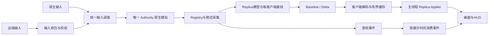

# Isaac 服务端权威状态同步设计

日期：2026-10-22；tx-03-09。状态：用户已采纳模型与首版范围，设计文档完成后用于后续实现；**Replica、baseline/delta apply 尚未实现**。本次只迁移与编写文档，不构建、不操作游戏、不运行代码测试。

tx-03-10补充：首项[更新与展示分派静态研究](../research/tx-03-10-replica-update-presentation-boundary.md)已形成实际指令、ABI和调用链记录；原生安全展示边界仍未闭合。该推进没有实现Replica，也没有展开其余逆向任务。

tx-03-11补充：[实体绘制与动画事件分离](../research/tx-03-11-logic-presentation-separation.md)已进一步区分绘制 pass、目标帧、自主推进和原生事件消费者；静态追到 `Shoot` 事件的 Type=9／Game::Spawn 路径。保留 renderer 也保留条件 Lua 与未知动态调用；该结果仍是静态研究，未实现 Replica。

tx-03-12补充：[派生绘制与 Sprite 资源](../research/tx-03-12-derived-render-sprite-lifecycle.md)已定位 NPC／Tear／Projectile 的独立 render Lua 入口及附加显示依赖，并追到可独立构造的 Sprite、共享 ANM 数据／图像引用和 Reset／析构。独立 Sprite 路线是受限支持集合的进一步适配候选；不能 raw-copy Sprite，不能以 IsLoaded 标志代替资源完备，尚未实现 adapter。

tx-03-13补充：[Sprite 图像资源研究](../research/tx-03-13-sprite-image-resources.md)已解释 ImageBase control 正常计数、两个图像缓存与最后释放，PNG 加载／sampler／析构直接进入 GL。资源加载与退休需安排在已解释的 renderer 线程／context 内；不能因计数有锁或 loaded 为真就转交网络线程。具体 owner 边界、热替换、失败恢复仍待研究，尚未实现 adapter。

tx-03-14补充：[renderer 与 context 生命周期](../research/tx-03-14-renderer-context-lifecycle.md)已连接正常 `_main` 同步初始化／帧循环、WGL make-current 和本线程 TLS，并复核资源缓存先于 context／窗口删除的正常顺序。普通主循环 render 附近是进一步适配候选，加载循环另有绕过该 callsite Hook 的绘制；实际 thread ID／HGLRC、失败切换、其它入口与在途资源寿命仍未验证，尚未实现 adapter。

tx-03-15补充：[Sprite 换图、Reload 与 ANM 引用](../research/tx-03-15-sprite-replacement-reload.md)已区分实例路径变更、逐层图像处理和默认 layer 重建，补齐实际 Lua closure、正常失败不回滚及条件性引用／借用风险。资源描述与原生 pair 必须分开管理，不能把重复 Reload 或整体 IsLoaded 当成功／恢复契约；尚未实现 adapter，下一项研究最小展示字段及特殊视觉标志。

tx-03-16补充：[独立 Sprite 展示字段](../research/tx-03-16-independent-sprite-display-fields.md)已明确 main／overlay 与逐 track key 索引、具名 setter、变换／颜色和条件 draw 依赖。提出固定姿态、无本地 Update／native 事件消费的有限支持描述；它不等同完整 Entity 外观，也未成为已采纳 wire schema。资源准备—姿态应用—失败退休 owner 路径仍待下一轮研究。

tx-03-17补充：[独立 Sprite owner 生命周期](../research/tx-03-17-independent-sprite-owner-lifecycle.md)已解释构造／copy／swap 的字段合同、native 与 userdata GC 的清理区别，提出未发布新候选准备完成后切换自有显示关联的正常顺序。失败不推进 AppliedAck；共享 cache、context 与引用查找的稳定窗口仍需约束。该顺序是设计候选，readiness／pose adapter／registry 均未实现。

tx-03-18补充：[最小单 Sprite 适配合同](../research/tx-03-18-single-sprite-adapter-contract.md)已定义最终 pair 的有限原生 loaded 语义、64 项 layer 映射边界、reset 后完整 key 向量及 Prepare／Inspect／Publish／Retire 合同。候选不推进动画／事件，未解决 GPU／像素、实际线程／context、资源清单或高频 live pose 写回；这些接口、registry 与 adapter 均未实现。

tx-03-19补充：[独立 Sprite 实际绘制窗口](../research/tx-03-19-sprite-render-entry-window.md)已定位最终 pre-present callsite，解释主循环／加载入口区别、loop owner 与 TLS／WGL guard 数据来源、batch 图像强引用及 shader／uniform 状态。该窗口仅为屏幕叠加设计候选，不提供房间内遮挡或 GPU／像素保证；Hook、guard 与 adapter 未实现。下一项为具体资源与连续姿态采集／应用闭环。

tx-03-20补充：[具体资源与连续姿态闭环](../research/tx-03-20-sprite-resource-pose-closure.md)已收敛一个现成单层 Poof／RGBA8 PNG 的支持声明，定义 render 前同 Authority 完整采集、同 descriptor 的完整 key／外观原地提交，以及资源／descriptor 变更的候选路线。XML keys 不替代 native parser 后态；fixture 不新增 Effect Entity 支持。建议直接实现最小独立 Sprite adapter／本地 fixture，实际命中、context/pass、像素及正常停用由实现后的整体 E2E 回答，尚无 Replica 或新 wire。

tx-04-02补充（2026-10-24）：项目转向[REPENTOGON 适配](repentogon-refactor.md)，目标为官方 REPENTOGON 与 v1.9.7.12.J273。本文第1节中“ISCS protocol5/ABI5、七项Lua API、channel0/0xFD保持独立”的兼容约束已不再延续，只保留不触及原版联机与 Isaac Sync 的隔离。第15、17节中的“Hook恢复”改按Hook常驻、逻辑启停理解。本文其余模型与首版范围不变，原文保留。

用户决定：**完整基线＋增量状态＋表现事件；首版单房间、无预测，切房、插值和预测作为后续扩展。** 执行约束以[现行规范](../refactor/project-conventions.md)为准；本文确定新状态同步路线的首版范围，旧[总体规划](../refactor/isaac-cs-architecture-plan.md)中扩大到完整RNG/任意房间的baseline草案不自动进入首版。

## 1. 目标和当前事实

房主真实 `isaac-ng.exe` 是唯一 Authority 模拟器，同时为房主渲染。远端客户端发送输入意图，接收服务器结果，维护只负责展示的 Replica。A/B 输入使用同一codec、sequence、调度、去重、Resolve及apply；Authority日常推进不等待所有客户端。

目前已有：Authority tick/统一输入、owned virtual B、生命周期观察、七类Entity及Grid的最小只读采集、独立IPC/UDP研究链。T0-06通过只代表声明profile内的采集与比较；tx-03-07 Host+VM P1/F0正式通过只覆盖10,000tick ACK/Gap STATE、输入和正常停止/恢复。当前远端worker不写游戏世界；T0-09-C observer设计不等于Replica实现。

本文消息名、状态字段和组件名是**新设计草案**，不是现有wire ABI。当前Kind::StateHash只有PartialValues/Gap、最多24值，不计算状态哈希，不能扩名后宣称已支持snapshot。既有ISCS protocol5/ABI5、七项Lua API、原版channel0和Isaac Sync channel0xFD保持独立。

## 2. 三种消息的职责

| 层 | 表达 | 负责 | 不承担 |
| --- | --- | --- | --- |
| Baseline | 某个已完成采样时刻的完整Replica模型 | 初次构建、重新同步、恢复已声明状态 | 全引擎内存存档、服务器接管或rollback |
| Delta | 从明确基线B到目标快照T的完整差异 | 属性变化、实体创建/移除、分类和引用变化 | 客户端自行计算缺失游戏结果 |
| PresentationEvent | 某时某地发生的一次可展示过程 | 命中闪光、音效、已证明纯展示的粒子等 | 扣血、拾取、掉落、库存或世界真相 |

“完整”以协商的Replica schema和支持类别为界：足以从零重建该模型，不意味着任意原生字段、全部角色/Mod/武器已覆盖。持久结果必须能在没有旧表现事件时恢复。Create/Remove可采用操作式编码，但属于可由baseline恢复的状态语义。

事件也分命令与结果。客户端输入是意图；服务器发送的表现事件是已裁决结果的展示通知。首版不让客户端通过“开火/受伤/拾取”命令重执行规则。若给事件携带最终HP等值，它已经承担状态更新，应并入状态协议并遵守版本规则。

## 3. 首版范围和支持声明

首版在已知构建、固定单房间、固定A/B与明确角色/武器/实体集合内实施。实现任务选择具体supported variants并公开记录，不能从已读取Tear/NPC头部推断所有变体可玩。初始房间和资源如何建立必须有明确native adapter，不能依赖客户端把相同输入重放到相同世界。

首版包含：输入上行、权威推进、完整基线、增量重建、创建/更新/移除、必要引用与UI状态、无预测画面、少量表现事件、丢包后恢复及正常停止。可以先实现完整快照的应用，再用同一模型增加delta编码。

首版不承诺切房/换层、late join、重连、任意Mod兼容、全武器、客户端gameplay预测、rollback、host migration或Dedicated Server。协议保留代次与恢复结构，不能把这些结构存在写成上述能力完成。若首版出现真实房间过渡，退休当前Replica并明确报告不支持，等待后续任务处理。

## 4. 所有权与架构



Authority裁决碰撞、伤害、死亡、拾取、生成、删除、RNG及gameplay Lua副作用。Replica保留本地输入采样、相机、窗口、已证明纯展示的动画/HUD和插值缓存。房主使用Authority世界本身，不在同进程再维护一份Replica，不因房主本地输入绕过队列。

推荐内部组件：`AuthorityRegistry`、`ReplicaCaptureAdapter`、`SnapshotStore`、`PerPeerReplicationState`、`StateCodec`、`ReplicaWorldAdapter`、`PresentationEventQueue`。先形成可说明的职责，再选择代码目录；不要求改造旧Lockstep对象承载这些状态。

## 5. 身份和代次

每包至少绑定`session_id`、`run_epoch`、`room_epoch`与schema版本。Authority为逻辑实体分配单调、不复用的`entity_id:u64`，对象域用`domain`区分Entity与Grid。网络key为`(run_epoch,domain,entity_id)`，session在包上下文冻结；room_epoch限定本次房间视图和消息有效性。

原生地址只用于主线程Registry临时映射，不进入wire。PlayerIndex、Entity.Index、seed、vptr、设备key和平台handle均不充当网络实体ID。各端不需要碰巧按相同顺序调用Spawn。启用前对象可以从Authority当前有效来源登记为FIRST_OBSERVED并分配网络ID；不补造出生历史，也不要求客户端拥有同一历史才能接收baseline。

| 原生变化 | Registry处理 | Replica处理 |
| --- | --- | --- |
| 同一逻辑使用的普通字段变化 | 保留ID，更新状态revision | 新版本覆盖字段 |
| 已确认Morph | 保留逻辑ID，增加shape_revision，记录实际分类/seed | 若形状不兼容则在安全窗口重建本地对象，再应用完整该实体状态 |
| 池槽被重新取得 | 旧逻辑实体退休，分配新ID | 旧ID不能因地址复用而复活 |
| 重复Init/Publish | 按创建上下文和membership合并 | 不重复生成 |
| Remove到提交摘表 | 分别记录请求、关系和成员状态 | 以声明的存在性模型提交，不能把一次缺枚举当物理析构 |
| 玩家Restore/Replace | 保留原事实，更新mutation/关系，必要时使采样作废 | 依明确网络状态重建，未支持路径报告不支持 |

后续persistent对象跨房若维持同一逻辑身份，可保留entity_id并建立新room membership；room视图换代不等于全部原生对象已析构。序号/代次耗尽前结束相关session，不回绕成旧身份。

## 6. Replica状态模型

正式wire采用显式字段，不发送C++对象内存、padding、vtable或原生指针。当前min-read-v1是研究输入，不直接成为可写回网络schema。

| 模块 | 首版目标状态 | 现有基础与待补范围 |
| --- | --- | --- |
| Room/Grid | 声明房间身份、必要资源/门/Grid存在性及状态 | 448Grid＋8门、别名与生命周期已知；完整房间构建/耐久/派生表现仍需补充 |
| Entity公共 | 网络ID、分类、存在/可见、位置/速度、必要展示属性与引用 | 公共字段和生命周期可读；安全写回、sprite/渲染属性不完整 |
| Player | 角色外观、位置/朝向、心量、资源、装备与所需HUD结果 | hearts、ordinal、关系已知；库存/武器/动画的完整展示schema待补 |
| NPC | 分类、位置、必要姿态/动画、服务器生命与状态表现 | 少量state/timer已有布局，不等于全部AI状态已恢复 |
| Tear/Projectile | 实际生成参数、位置、必要轨迹展示、flags、存在性 | flags宽度已知；高度、轨迹、颜色等按支持变体补齐 |
| Pickup/Familiar/Effect | 分类、owner、位置、必要专用状态和表现 | 最小专用字段已有；全variant支持不外推 |
| Bomb/Laser/Knife/Slot等 | 对被选场景确实使用的类别提供专门schema | 仅RTTI/部分入口或字段；不能默认为已支持 |

所有关系以NetEntityKey表达，NULL、已知目标、暂未解析与冲突分开。服务器不得把未解析裸地址变成0。需要而未能确定的字段使该scope不可发布为完整快照；客户端不能用默认值偷偷补全。可以明确降低到另一个协商profile，但不能逐帧临时删字段来得到“完整”。

纯展示Replica不执行gameplay RNG，因此首版不复制服务器全部AI/RNG内部对象。可能影响可见结果的随机选择在Authority完成，复制实际结果。以后若增加本地gameplay预测、rollback或接管，再研究完整依赖状态、RNG和可撤销副作用；不把首版baseline当作可继续权威模拟的存档。

## 7. 采样时序与版本

`authority_tick`由实际有效模拟提交推进，包含已理解的普通及odd Player路径；不等于渲染帧、墙钟或原版onlineFrame。`snapshot_seq`只在有效完整普通采样模型提交时递增。`packet_seq`、输入sequence、snapshot序号和表现event序号分别计数。

完整世界采样沿用同一outer token内普通owner/Room/tail均正常返回、generation与root/room稳定的已知阶段；在coop TopExit之前、render之前复制。odd-only记录保留为gap，不伪装成完整世界快照，也不要求每个Authority tick发送一次snapshot。后续如支持独立Player增量，必须另标scope和capture kind，不能与完整房间样本混用。

读取/初始化不足、身份歧义、来源变化、错误线程、预算或背压产生显式gap。Authority按自身健康状态继续正常模拟，复制器不能为了凑快照等待全员，也不能把旧采样标成新tick。完整快照缺口期间客户端保持最后已确认状态；超出可配置展示时限后进入显式恢复/停显。

首版不在本文硬编码30/60Hz、snapshot频率、量化精度、MTU或插值延迟。实现任务根据采样能力和一次整体验收确定参数，manifest记录实际设置及范围。

## 8. Baseline建立和恢复

Baseline携带`baseline_seq/snapshot_seq/server_tick`、schema、支持类别/资源标识、room_epoch、完整实体集合及显式关系，以及表现事件watermark。它是自包含的Replica模型，不依赖此前的增量或旧事件。

1. Authority在稳定采样点T生成不可变模型，按总长/分块数上限发送。
2. 客户端仅在自有内存重组、解码并建立候选DTO；检查版本、有限浮点、唯一ID、资源和引用依赖。完整数据前不修改原生世界。
3. 在已理解主线程窗口停用客户端gameplay consumer与副作用回调，然后由adapter准备资源、对象和关系，应用声明状态。
4. 全部必要状态成功、当前代次仍一致后，发布`AppliedSnapshotAck`，启用此Replica的展示。失败保留原始原因，停显并正常清理/恢复或请求新baseline。
5. 后续delta引用客户端仍持有的明确基线；重新同步切换baseline后，旧room/session或过期基线消息丢弃。

原生世界不具备已证明的任意事务回滚。这里的“提交”是逻辑发布与显示资格：DTO可先完整stage，原生apply仍可能部分失败。实现必须在失败时阻止半套世界被渲染/继续gameplay，不能假称写内存天然原子，也不预设可以在同一游戏进程维护第二个完整原生世界。

Authority可在发送baseline期间继续模拟；缓存有界，溢出则放弃旧候选、从新采样生成baseline或停止该peer复制。不能无限积压历史，也不能把可靠传输阻塞变成Authority全员等待。

## 9. Delta的精确定义

对客户端确认持有且仍在保留窗口内的基线`B`和目标快照`T`：

```text
Delta(B,T) = Create(T中有而B中无)
           + Remove(B中有而T中无)
           + Update(两者均有但字段/关系/shape不同)
TargetModel = Reconstruct(ImmutableBaseline[B], Delta(B,T))
```

首版变化字段发送最终值，如`HP=7`、`position=(104,80)`；“只发变化字段”与“数值再作差分压缩”分开。相对坐标、量化、bit packing及优先级调度后置，不能先改变正确性语义。

每个delta是从指定B到T的**完整差异**，不是“上一发送包之后刚变化的字段”。客户端先在自有模型从B重建完整目标，再在主线程按新版本应用；不能把Δ(B,T)直接当成对当前任意状态的patch。例如B的HP=10，T1为7，T2又为10时，Δ(B,T2)可能省略HP，但目标重建必须回到10，不能让当前T1的7残留。

丢包示例：D(B,101)丢失，仍收到D(B,102)，只要持有B就可直接重建102。若服务器发D(101,102)而客户端没有101，则不能应用，必须补基线或请求恢复。客户端ACK不等于UDP收到：另有传输收包进度，`AppliedSnapshotAck`只在模型已重建并成功提交后发送；首版服务器以该确认选择delta基线。

旧包不能覆盖新状态；去重后同一版本payload冲突视为协议错误。某对象最后一次移动、HP变化或删除，必须在未确认基线对应的差异中持续被包含，直到新基线确认或完整恢复覆盖它。Remove是明确删除或完整集合差异，不靠“本包没提到”猜删除。实体创建/移除在依赖基线的逻辑目标中幂等，不发生重复生成。

基线保留有数量、字节和时间上限；引用被淘汰的基线时请求全量恢复。首版完整delta重建成功才能更新AppliedAck；未来若按对象分包/不同频率调度，必须引入明确的对象级基线/确认，不沿用“一个包ACK表示所有对象最新”的假设。

## 10. 客户端原生应用与表现分离

网络线程只解析、限额和排队；原生创建、对象字段、资源、引用及Lua全部在已理解主线程窗口操作。adapter每一类操作列出准确调用点/ABI、资源依赖、所需字段、允许副作用、失败与恢复路径，证据入口见[模块点位目录](../hooks/README.md)。

推荐一次提交顺序：确认session/run/room与目标版本 → 准备全部实体壳/资源 → 建立ID到本地对象映射 → 应用标量与展示属性 → 解析并应用关系 → 提交成员/移除并清理引用 → 发布已确认模型与展示资格。实际native操作顺序以其真实生命周期要求调整，不能强制套用Entity顺序到Grid或Player。

原生Spawn/Init/Remove可能触发Lua、RNG、掉落或其它对象变更。禁止直接复制服务器内存、直接写vptr，或调用Damage/Pickup/UseItem来得到想要的最终状态。字段setter若有副作用也需专门适配；当前只读offset没有自动获得写回资格。

客户端必须停用实际gameplay路径：AI、伤害/碰撞裁决、拾取、掉落、gameplay RNG与副作用回调；同时明确保留相机、HUD、动画和渲染。不是“把输入清零”就等于停止gameplay，也不能依据函数名Interpolate认定只读。现有slot4会写当前位置，特殊FSM也可更新Player，属于首批补充逆向内容。

## 11. 表现事件

事件最小草案：`session/run/room`、`event_id`、`server_tick`、`kind`、可选source/target网络ID、世界位置及明确的展示参数、`required_state_version`、过期时间。仅发送受支持kind；任意native函数名或参数不作为通用RPC开放。

- 事件按展示时间而非到包顺序消费；版本依赖未满足时有界等待，超时过期，不无限阻塞。
- 同一event_id最多产生一次展示；重同步baseline中的event watermark禁止重播旧音效/闪光。
- 短命对象已经删除时，事件可以用自包含位置/展示资源播放；不能因此重新创建gameplay对象。
- 丢失可选命中特效不改变HP/库存/门状态；如果一条“事件”不能丢且影响持久结果，应属于状态或可靠控制事务。
- 不同时由原生副本回调与网络事件播放同一效果；每种表现确定唯一触发owner。

受伤例：Authority确定NPC HP从10变7；delta复制HP=7，事件只播放命中闪光/音效。Replica不再扣3点、不触发本地死亡或掉落。泪弹在两次采样之间出生并消失时，后态可只剩受伤结果和表现事件；不能为补全过程重放整个攻击规则。

## 12. 输入、回执与客户端时间

复用现有统一输入意图语义，但新复制session、协议对象和缓存独立。A/B共用canonical转换、校验和scheduler；连续量、exactly-once边沿、generation、lead与缺输入策略保留当前规则。输入ACK与snapshot AppliedAck分开；`last_processed_input`表示服务器已处理进度，不表示客户端已经显示该结果。

首版远端玩家会感受到输入lead、网络和状态发布延迟；不以客户端提前执行gameplay来掩盖。房主看到Authority世界，无网络下行等待，Listen Server的天然延迟差异如实保留。协议不承诺竞技级公平，也不让房主绕过统一输入。

## 13. 传输和消息边界

| Lane | 建议性质 | 内容与失败行为 |
| --- | --- | --- |
| Input | sequenced、可带冗余 | 沿现行输入身份/去重；晚到按窗口处理 |
| Control | 可靠、有序、有界 | 握手、schema、资源/支持范围、session/恢复请求与终态 |
| Recovery | 可靠分块、有总长上限 | baseline；完整重组且apply后才确认 |
| State | 不可靠sequenced、可替换 | 完整Δ(B,T)；缺基线不解码，不等丢失旧包 |
| Presentation | 不可靠、带tick/去重/过期 | 可选瞬时展示，不承载持久结果 |

不同lane之间不假定到达顺序。Create与属性/引用按目标模型依赖处理；事件携带状态依赖。分包重组需限制总长/片数/并发候选/等待时间；半个快照不发布、不ACK为已应用。需要完整性校验时使用协议已有CRC一类包检查；**本项目不计算或校验任何哈希**。

状态同步使用独立协议版本/消息域；严格长度、kind、flags、reserved、范围、finite float、schema/代次及预算。新消息不能偷偷塞进现有ISCS/CustomFrameOp或复用原版FrameStore。未来是否复用T09传输接口由实现任务决定，现行T0 StateHash报文不直接变成公开Replica格式。

## 14. Lua、持久副作用和支持边界

Authority保持既有gameplay规则；Replica只允许明确的presentation逻辑。首版禁用未知gameplay Mod；资源一致性通过可读版本/清单及支持声明表达，不使用哈希。普通Mod不能假定两端都执行相同副作用回调。

新Replica adapter须避免客户端save、achievement、unlock、统计或额外持久写入；只有任务实际授权的动作可执行。不能以结束时dirty=0代替整个操作窗口的副作用理解。lua_close、run teardown使旧generation退休；常驻DLL和owned设备仍按现行NEVER策略管理。

## 15. 故障与恢复

| 情况 | 客户端行为 | Authority行为 |
| --- | --- | --- |
| 丢失/乱序可替换状态 | 保持已确认模型，接受可重建的新目标 | 继续模拟，按已确认基线发送 |
| 缺基线或schema不兼容 | 请求baseline/拒绝该schema | 有界恢复或结束该peer |
| 引用/类别/资源不支持 | 不猜目标，不发布半套世界 | 记录具体scope/实体/字段；恢复或结束复制 |
| native apply失败 | 停显该Replica，禁止gameplay继续，记录已执行前缀并正常清理 | 不回滚已完成的Authority tick |
| 输入缺失 | 展示服务器最终中性策略结果 | 日常不等待全员，按现行缺输入规则 |
| 缓冲/预算耗尽 | 关闭候选或请求新基线，不无限积压 | 只停相关peer复制或按已知失败处理 |
| room/run/session变更 | 拒绝旧epoch消息，首版退休 | 保持真实生命周期，后续再实现切房事务 |
| Hook恢复不确定 | 停止修改，不强卸载或盲目重注入 | 沿单一owner的恢复事务处理 |

## 16. 后续扩展

插值：保留两个已确认快照，沿服务器展示时间插值所支持运动字段；新增缓冲延迟需实际测定。传送、出生/删除、换形不能统一按线性插值。

切房/换层：后续以可靠低频事务描述目标资源和room_epoch，旧房间退休、新baseline提交后展示；有超时/断开策略，不恢复逐tick全员等待。

预测：先研究有限本地展示反馈，之后才讨论本地移动gameplay预测。完整reconciliation/rollback需要确定相关世界、RNG、Lua和副作用依赖；不得只回滚Player位置就宣称整个房间正确。late join、reconnect和Dedicated Server仍是独立后续能力。

## 17. 实施次序与验收规划

建议依次完成：Replica gameplay/presentation边界及最小安全apply研究 → 单房间声明schema/ID Registry → 完整baseline应用 → 输入到权威结果的双端闭环 → Δ(B,T)/ACK/恢复 → 表现事件 → 进一步压缩与插值。当前T0-09-C/D脚本比较保留为历史研究任务，不作为本路线开始的流程前置条件。

每次推进以独立实质目标的tx编号说明范围。分析/逆向/修改期间不运行测试；整个目标完成后只执行一次统一E2E，失败保留、不自动重跑。不新增实现后的单元测试。本文是设计与迁移任务，最终仅进行一次整体静态文档审阅。

未来一次整体E2E应保存可重复artifact：目标/参数/支持范围、双端原始输入与包、baseline/delta及ACK、各代实体ID和关系、实际apply顺序与前缀失败、逐字段再采集比较、事件去重/过期、丢包/缺基线恢复及Hook恢复记录。只比较声明profile和明确tick配对；不可读/未知不算相等，不计算状态或文件哈希。

## 18. 尚需补充的实际逆向

1. 每类Replica创建/更新/移除及引用重建的安全native路径和可接受副作用。
2. 停止所有必要gameplay consumer后仍可维护动画/render/HUD的真实边界。tx-03-10已补充[循环分派层实际静态研究](../research/tx-03-10-replica-update-presentation-boundary.md)：普通owner、driver staged恢复、odd/FSM和render内Room/Lua调用必须分别处理；该研究不代表完整安全展示边界或Replica实现已经完成。
   tx-03-11的[进一步静态研究](../research/tx-03-11-logic-presentation-separation.md)补齐基类绘制与动画事件依赖；后续须按首版支持类追派生绘制、Sprite 资源生命周期和残存事件消费者，不能由动画推进器存在推导安全展示层已经完成。
   tx-03-12已补充三类[派生绘制及 Sprite 资源链](../research/tx-03-12-derived-render-sprite-lifecycle.md)；下一项具体缺口为图像 control／释放线程、支持视觉集合与独立对象应用，Player 组合绘制仍单独未决。
   tx-03-13已补充[图像 control、缓存退休及 PNG 后端](../research/tx-03-13-sprite-image-resources.md)；control 正常路径已解释，实际线程／context、ReplaceSpritesheet／重载、支持资源应用与失败退休仍未完成。
   tx-03-14已补充[正常 renderer／context 生命周期](../research/tx-03-14-renderer-context-lifecycle.md)，下一项具体研究为 ReplaceSpritesheet／Reload／LoadGraphics 的替换和缓存引用；运行时 context／重入及失败恢复仍不因正常静态路径成立而获得证明。
   tx-03-15已补充[换图、重载及 ANM 引用](../research/tx-03-15-sprite-replacement-reload.md)，记录正常路径与条件失败反例；当前具体下一项为独立 Sprite 最小展示字段、目标帧／overlay 和特殊标志的支持边界，再研究资源应用及失败退休。前述历史“下一项”保留其当时语境；资源 adapter 和完整 Replica 仍未实现。
   tx-03-16已补充[最小展示字段与支持描述](../research/tx-03-16-independent-sprite-display-fields.md)，当前具体下一项为独立 Sprite 正常创建、资源 staging、姿态应用及失败退休的 owner 顺序；固定姿态 schema 和 adapter 均尚未实现。
   tx-03-17已补充[正常 owner 顺序与失败退休](../research/tx-03-17-independent-sprite-owner-lifecycle.md)，当前具体下一项为收敛可读资源清单／固定姿态 profile，定义资源就绪检查、实例关联和正常退休接口，再实现最小单 Sprite 适配；保留异常、并发与热重载未知。
   tx-03-18已补充[资源就绪与最小单 Sprite 合同](../research/tx-03-18-single-sprite-adapter-contract.md)，上述接口已形成静态设计，具体资源清单和实现仍未完成。当前下一项为实际绘制接入窗口、加载绘制旁路、runtime thread/context guard 及 caller 参数／pass 恢复；之后选择资源实现最小适配。
   tx-03-19已补充[具体绘制接入与批次寿命](../research/tx-03-19-sprite-render-entry-window.md)，收敛最终 pre-present 的屏幕 Sprite 候选与 guard／状态限制。当前下一项为选择可信具体 ANM／PNG 清单、Authority 同窗口姿态采集，以及已发布实例连续姿态／资源变更的应用和失败顺序；随后进入最小 adapter 实现。
   tx-03-20已补充[具体样本、采集和更新合同](../research/tx-03-20-sprite-resource-pose-closure.md)，当前建议进入受限独立 Sprite adapter／本地 fixture 实现；保留实际资源加载、native shape、context／pass／像素和生命周期的运行未知，不再重复拆解已解释基础链。完整 Entity 外观、Room／Grid apply、异常与热重载仍各有范围。
3. Player装备/武器、各类sprite/轨迹/高度/资源的最小展示字段和生命周期。
4. 对支持范围内Spawn/Init/Remove、Lua及Grid/Room操作的副作用隔离与失败停显。
5. baseline原生应用部分失败后的清理与恢复路径；不预设全引擎事务。

这些是具体工程依赖与未知，不另设gate、哈希或角色分离要求。现有字段偏移和T0 PASS不替代它们。

## 19. 资料

- [Hook与逆向模块索引](../hooks/README.md)、[Entity](../hooks/entity.md)、[Player](../hooks/player.md)、[循环](../hooks/game-loop.md)、[Room/Grid](../hooks/grid-room.md)。
- [现行规范](../refactor/project-conventions.md)、[当前采集实现范围](../refactor/cs-t0/t0-06/tx-01-73-implementation.md)、[生命周期与原生诊断](../refactor/cs-t0/t0-06/tx-01-71-lifecycle-and-native-records.md)、[P1/F0正式记录](../refactor/cs-t0/t0-09/tx-03-07-live-f0-formal-acceptance.md)。
- [Snapshot Compression](https://new.gafferongames.com/post/snapshot_compression/)：明确基线及确认；[Snapshot Interpolation](https://gafferongames.com/post/snapshot_interpolation/)：服务器模拟、客户端基于快照重建展示；[Epic RPC说明](https://dev.epicgames.com/documentation/unreal-engine/remote-procedure-calls-in-unreal-engine?lang=en-US)：瞬时表现补充状态复制。外部资料为模型参考，不作为Isaac原生ABI证据。
