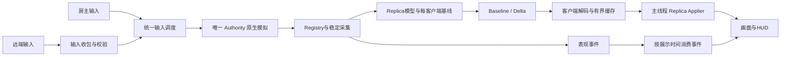

> **tx-04-21 I36—I38（2026-11-05）**：[全窗口隔离、全链静态主审、逐项18—20回归及P2→P4唯一入口](tx-04-21/tx-04-21-isolation-orchestration.md)已接入。真实网络Client隔离起点、纯值调用见证、交互桌面远端节点、精确画面中性段与同tx恢复／环境还原已编写；无需新增逆向。未构建／测试／部署／启动游戏；I39全P2→全P4和I40仍待执行，未声明实时指标或网络验收通过。

> **tx-04-21 I31—I35（2026-11-05）**：[双配置构建部署、完整E2E子用例、真实UDP损伤、同版本原生对照与性能归约](tx-04-21/tx-04-21-e2e-components.md)已编写并完成主智能体静态复读。本轮复用既有已核原生检查，无新增逆向需求；未构建／测试／部署／启动游戏。I36—I38继续集成，I39仍须先P2全E01—E26及子用例通过后再P4全套，未声明实时指标或网络验收通过。

> **tx-04-21 I21—I25（2026-11-05）**：[正式路由准备、网络冷构建、同Scene动态／结构安装和精确原生Applied ACK](tx-04-21/tx-04-21-installation.md)已实现，必要逆向由GPT-6 Luna max研究并经主智能体复读。Release纯编译／链接通过；未运行测试或启动游戏。29/38单侧身体快源因跨身体消费而报告gap，沿合格ordinary组合；频率与性能未实测。I26—I40及I39的P2全E01—E26及子用例→P4全套待继续；以下旧记录保留原时点事实。

> **tx-04-21 I01—I05（2026-11-05）**：[基础实现与边界](tx-04-21/tx-04-21-foundation.md)已接逐成员实时目录、R01—R09采用合同与主审、不可变范围模型、v2严格schema／Live小消息及正式consumer3。未构建／测试／启动游戏；I06—I40及I39统一验收待继续。频率、性能、世界传输和ACK运行结果尚未取得。下方初版规划与历史记录保留。

> **tx-04-21实施规划（2026-11-05，仅文档）**：[详细任务](tx-04-21/tx-04-21-implementation-plan.md)及[网络合同](tx-04-21/tx-04-21-network-contract.md)明确分层完整状态、60／30 Hz目标、10 Mbps总上行与7.5 Mbps持续预算、真实ACK和21／22边界；[统一E2E](tx-04-21/tx-04-21-e2e-plan.md)先两人通过再四人。未写代码、构建或测试，不宣称实时性能已成立。

> **tx-04-15 已完成（2026-10-31）**：[全域复制模型、稳定身份、逐成员归属与ICSR v1可执行协议合同](tx-04-15.md)，统一E2E 4/4组通过。模型能力与原生应用器分开声明；真实Client、下行与原生应用仍按16—22推进。

> **tx-04-10 观测交付（2026-10-30）**：[公共边界、录制分离、Entity／旧 Grid 拆分及 Entity 实现与结果](observation-expansion/tx-04-10-implementation.md)统一 E2E 5/5 PASS。正式纯值采集不依赖 Recorder 成功；世界状态下行、Replica 和客户端写回仍未实现。

# Isaac 服务端权威状态同步设计

> **2026-11-01 R6源码与接口归并**：[模型、角色与原生应用器](tx-04-17/tx-04-17-model-role-applier-integration.md)已对照15／16源码形成B→T／A→T、Scope／输入换代、原生结果／ACK／事件完成及域责任合同。R1—R6指定静态文档结果均已形成，原生前置和新增接线仍有具体未决项，尚未实现原生Client世界。本轮只改文档，无新增逆向、代码、构建或测试。

> **2026-11-01 原生客户端世界决定的原时点记录**：按[tx-04-17现行设计与R1—R6研究计划](tx-04-17/tx-04-17-workflow.md)，Client在原生Game／Room／Grid／Entity／Player／Camera／HUD上承载服务器状态，保留create／remove／change、稳定身份及Baseline／Delta。纯值模型用于目标恢复与规划，不另建完整第二运行世界；原生构建、状态应用、展示维护和玩法模拟分别管理。旧独立场景／仅自有Sprite的设计结论被替代，静态事实和UNKNOWN保留。该次只修订文档，当时补充研究、代码及验收尚未开展；后续R1—R6文档进度以上方归并为准。

> **2026-10-30 当前目标与执行入口**：用户要求完整推进流程全部完成后交付**整局可玩的四人联机模组**。见[完整推进流程：tx-04-09—tx-04-34](state-synchronization-roadmap.md)：09—14输入／完整观测，15—22真实游戏Client与状态闭环，23—29整局世界与内容，30—34重连／Continue／性能／产品发布及整局联合验收。单房间仅为中间交付。本轮只修订文档，未启动实现、构建或测试。

> **当前执行规则**：遵循[现行规范](../refactor/project-conventions.md)。进入统一整体验收前不预跑测试；验收发现问题在同一tx修复续测，默认连续完成。tx及E2E默认不留artifact，只有必要中断且需要恢复信息时保留必要材料；schema、产品存档、发布包和功能文档正常交付。不设gate，不计算任何哈希。

> **观测先行**：[tx-04-09—tx-04-14](observation-expansion/README.md)保持原范围和次序，不在其中提前实现世界复制。公开Wiki／Lua优先；完整观测与用于Replica的状态选择分开。当前运行代码的双人、七类最小观测和无Replica限制不会因本文规划而变成已完成能力。

> **观测模块共用设计（2026-10-30）**：[按域拆分与迁移边界](observation-expansion/domain-observation-architecture.md)明确公共接口、域归属、采样scope、引用、录制隔离和旧格式兼容。tx-04-09当前四人／多身体结果见[实现说明](observation-expansion/four-participant-implementation.md)，上方“双人”描述保留原时点；10—14的观测扩展及本次公共拆分仍待实现。后续复制消费自有值，不依赖调试录制，也不直接沿用观测内存布局为网络ABI。

> **2026-10-30 范围澄清**：用户要求后续恢复最多四名参与者，本轮先回答现状和明确设计，不改运行代码。后续不再沿用下文首版固定A/B的双人上限；参与者与Player实体分开，多身体控制组不能占用额外参与者名额。当前DLL仍仅Authority加一个Rust输入远端，无Replica/状态下行；min-read-v1不覆盖整个世界，Slot/Machine尚无专用schema。详见[四人、世界覆盖与多Player归属](four-participant-state-sync-scope.md)。历史研究与tx-04-08验收范围不追溯扩大。

原始设计日期：2026-10-22，tx-03-09；当前整局路线修订日期：2026-10-30。原用户采纳的Baseline＋Delta＋表现事件模型保持，最终范围由本次整局目标扩展；**Replica、baseline/delta apply 尚未实现**。下列tx-03系列说明保留其历史研究状态，不代表新实现的完成或强制重复研究。

tx-03-10补充：首项[更新与展示分派静态研究](../research/tx-03-10-replica-update-presentation-boundary.md)已形成实际指令、ABI和调用链记录；原生安全展示边界仍未闭合。该推进没有实现Replica，也没有展开其余逆向任务。

tx-03-11补充：[实体绘制与动画事件分离](../research/tx-03-11-logic-presentation-separation.md)已进一步区分绘制 pass、目标帧、自主推进和原生事件消费者；静态追到 `Shoot` 事件的 Type=9／Game::Spawn 路径。保留 renderer 也保留条件 Lua 与未知动态调用；该结果仍是静态研究，未实现 Replica。

tx-03-12补充：[派生绘制与 Sprite 资源](../research/tx-03-12-derived-render-sprite-lifecycle.md)已定位 NPC／Tear／Projectile 的独立 render Lua 入口及附加显示依赖，并追到可独立构造的 Sprite、共享 ANM 数据／图像引用和 Reset／析构。独立 Sprite 路线是受限支持集合的进一步适配候选；不能 raw-copy Sprite，不能以 IsLoaded 标志代替资源完备，尚未实现 adapter。

tx-03-13补充：[Sprite 图像资源研究](../research/tx-03-13-sprite-image-resources.md)已解释 ImageBase control 正常计数、两个图像缓存与最后释放，PNG 加载／sampler／析构直接进入 GL。资源加载与退休需安排在已解释的 renderer 线程／context 内；不能因计数有锁或 loaded 为真就转交网络线程。具体 owner 边界、热替换、失败恢复仍待研究，尚未实现 adapter。

tx-03-14补充：[renderer 与 context 生命周期](../research/tx-03-14-renderer-context-lifecycle.md)已连接正常 `_main` 同步初始化／帧循环、WGL make-current 和本线程 TLS，并复核资源缓存先于 context／窗口删除的正常顺序。普通主循环 render 附近是进一步适配候选，加载循环另有绕过该 callsite Hook 的绘制；实际 thread ID／HGLRC、失败切换、其它入口与在途资源寿命仍未验证，尚未实现 adapter。

tx-03-15补充：[Sprite 换图、Reload 与 ANM 引用](../research/tx-03-15-sprite-replacement-reload.md)已区分实例路径变更、逐层图像处理和默认 layer 重建，补齐实际 Lua closure、正常失败不回滚及条件性引用／借用风险。资源描述与原生 pair 必须分开管理，不能把重复 Reload 或整体 IsLoaded 当成功／恢复契约；尚未实现 adapter，下一项研究最小展示字段及特殊视觉标志。

tx-03-16补充：[独立 Sprite 展示字段](../research/tx-03-16-independent-sprite-display-fields.md)已明确 main／overlay 与逐 track key 索引、具名 setter、变换／颜色和条件 draw 依赖。提出固定姿态、无本地 Update／native 事件消费的有限支持描述；它不等同完整 Entity 外观，也未成为已采纳 wire schema。资源准备—姿态应用—失败退休 owner 路径仍待下一轮研究。

tx-03-17补充：[独立 Sprite owner 生命周期](../research/tx-03-17-independent-sprite-owner-lifecycle.md)已解释构造／copy／swap 的字段合同、native 与 userdata GC 的清理区别，提出未发布新候选准备完成后切换自有显示关联的正常顺序。失败不推进 AppliedAck；共享 cache、context 与引用查找的稳定窗口仍需约束。该顺序是设计候选，readiness／pose adapter／registry 均未实现。

tx-03-18补充：[最小单 Sprite 适配合同](../research/tx-03-18-single-sprite-adapter-contract.md)已定义最终 pair 的有限原生 loaded 语义、64 项 layer 映射边界、reset 后完整 key 向量及 Prepare／Inspect／Publish／Retire 合同。候选不推进动画／事件，未解决 GPU／像素、实际线程／context、资源清单或高频 live pose 写回；这些接口、registry 与 adapter 均未实现。

tx-03-19补充：[独立 Sprite 实际绘制窗口](../research/tx-03-19-sprite-render-entry-window.md)已定位最终 pre-present callsite，解释主循环／加载入口区别、loop owner 与 TLS／WGL guard 数据来源、batch 图像强引用及 shader／uniform 状态。该窗口仅为屏幕叠加设计候选，不提供房间内遮挡或 GPU／像素保证；Hook、guard 与 adapter 未实现。下一项为具体资源与连续姿态采集／应用闭环。

tx-03-20补充：[具体资源与连续姿态闭环](../research/tx-03-20-sprite-resource-pose-closure.md)已收敛一个现成单层 Poof／RGBA8 PNG 的支持声明，定义 render 前同 Authority 完整采集、同 descriptor 的完整 key／外观原地提交，以及资源／descriptor 变更的候选路线。XML keys 不替代 native parser 后态；fixture 不新增 Effect Entity 支持。建议直接实现最小独立 Sprite adapter／本地 fixture，实际命中、context/pass、像素及正常停用由实现后的整体 E2E 回答，尚无 Replica 或新 wire。

tx-04-02补充（2026-10-24）：项目转向[REPENTOGON 适配](repentogon-refactor.md)，目标为官方 REPENTOGON 与 v1.9.7.12.J273。本文第1节中“ISCS protocol5/ABI5、七项Lua API、channel0/0xFD保持独立”的兼容约束已不再延续，只保留不触及原版联机与 Isaac Sync 的隔离。第15、17节中的“Hook恢复”改按Hook常驻、逻辑启停理解。当时保留其余模型和首版范围；最终产品范围现按2026-10-30整局修订执行。

历史范围（2026-10-22）：完整基线＋增量状态＋表现事件，先以单房间、无预测建立闭环。当前决定（2026-10-30）：**保留状态同步架构，最终交付扩展为整局可玩**；切房、换层、原版完整内容、插值、重连、Continue与产品流程均已进入[完整路线](state-synchronization-roadmap.md)，不能再作为未排期扩展。gameplay预测／rollback、host migration和Dedicated Server另属非必需扩展。

## 1. 目标和当前事实

房主真实 `isaac-ng.exe` 是唯一 Authority 模拟器，同时为房主渲染。一至四名参与者使用同一输入语义、调度、去重、Resolve及apply；远端真实游戏客户端发送意图，接收结果，维护只负责展示的Replica。一个参与者可关联多个Player身体，不以身体数代替参与者数。Authority日常推进不等待所有客户端。

目前已有：Authority tick/统一输入、owned virtual B、生命周期观察、七类Entity及Grid的最小只读采集、独立IPC/UDP研究链。T0-06通过只代表声明profile内的采集与比较；tx-03-07 Host+VM P1/F0正式通过只覆盖10,000tick ACK/Gap STATE、输入和正常停止/恢复。当前远端worker不写游戏世界；T0-09-C observer设计不等于Replica实现。

本文消息名、状态字段和组件名是**新设计草案**，不是现有wire ABI。历史T0中的Kind::StateHash只有PartialValues/Gap、最多24值，不计算状态哈希；当前DLL输入协议也没有世界基线／Delta，不能扩名后宣称已支持snapshot。新C/S协议与原版Online、Isaac Sync隔离，不沿用已取消的旧ISCS兼容要求。

## 2. 三种消息的职责

| 层 | 表达 | 负责 | 不承担 |
| --- | --- | --- | --- |
| Baseline | 某个已完成采样时刻的完整Replica模型 | 初次构建、重新同步、恢复已声明状态 | 全引擎内存存档、服务器接管或rollback |
| Delta | 从明确基线B到目标快照T的完整差异 | 属性变化、实体创建/移除、分类和引用变化 | 客户端自行计算缺失游戏结果 |
| PresentationEvent | 某时某地发生的一次可展示过程 | 命中闪光、音效、已证明纯展示的粒子等 | 扣血、拾取、掉落、库存或世界真相 |

单个Baseline的“完整”以明确scope、schema及其版本引用为界，足以从零重建对应模型；产品最终的“完整”则必须覆盖目标原版整局内容，不能靠协商成几个类别缩小最终目标。它不意味着复制所有私有内存或任意未知Mod。持久结果必须能在没有旧表现事件时恢复。Create/Remove可采用操作式编码，但属于可由baseline恢复的状态语义。

事件也分命令与结果。客户端输入是意图；服务器发送的表现事件是已裁决结果的展示通知。展示型客户端不通过“开火/受伤/拾取”命令重执行规则。若给事件携带最终HP等值，它已经承担状态更新，应并入状态协议并遵守版本规则。

## 3. 整局最终范围与中间交付

最终产品为官方REPENTOGON1.1.3／J273环境下的Listen Server联机模组：最多四参与者，含多身体角色；普通／困难、Greed／Greedier、挑战及可用种子规则；原版全部角色／物品／武器／敌人／Boss／机器／Grid、楼层与特殊路线；真实切房回访、换层／维度／世界重构、死亡复活／结局、重连／Continue、完整HUD音画、安装连接与正常退出。每日规则体验为非排行榜联机，不伪造官方资格或上传成绩。详细范围与账号／外部资源条件见[推进流程第1节](state-synchronization-roadmap.md#1-最终产品与完成定义)。

tx-04-21以完整Baseline和分层完整状态建立单房间实时闭环，先两人验收通过再四人；21完成必要传输与同连接恢复，22增加对象／字段Delta、每Peer基线保留／轮换和更系统的恢复。这些中间交付可明确类别／变体范围；后续必须由23—29补齐整局及全部内容，再由30—34完成恢复、持久、性能与产品交付。不能从七类采集、一个Sprite或一次普通房间成功外推最终完成。

最终范围不要求四人分散在不同房间同时模拟，使用Authority原生多人房间裁决。任意未适配第三方Mod、其他游戏版本／平台、自动NAT穿透／公共中继服务、gameplay预测／rollback、host migration和Dedicated Server不是本流程承诺；可达公网和局域网游戏属于交付。临时不支持的正常过渡可以在中间阶段显式处理，但最终产品不能遇到过门或特殊角色就结束复制。

## 4. 所有权与架构



Authority裁决碰撞、伤害、死亡、拾取、生成、删除、玩法随机结果及gameplay Lua副作用。Client使用原生世界承载Replica状态，按create／remove／change进行受控原生构造、最终值／关系应用与退休，保留必要本地输入采样、窗口、相机、显示维护、动画／HUD和插值缓存。允许的构造／表现写入与本地玩法模拟分开，不通过后者计算缺失的服务器结果。房主使用Authority世界本身，不在同进程再维护一份Replica，不因房主本地输入绕过队列。

推荐内部组件：`AuthorityRegistry`、`ReplicaCaptureAdapter`、`SnapshotStore`、`PerPeerReplicationState`、`StateCodec`、`ReplicaWorldAdapter`、`PresentationEventQueue`。先形成可说明的职责，再选择代码目录；不要求改造旧Lockstep对象承载这些状态。

## 5. 身份和代次

协议按消息scope携带必要的`session_id`、`connection_epoch`、`run_epoch`、`floor_epoch`、`dimension_id`、`room_id/room_epoch`、`scene_revision`及schema版本，不要求输入包重复全域对象。Authority为逻辑实体分配单调、不复用的`entity_id:u64`，对象域用`domain`区分Entity与Grid；Player身体复用Entity身份。网络key为`(run_epoch,domain,entity_id)`，session在包上下文明确；场景字段限定视图和消息有效性，不能用房间索引复用旧世界。

原生地址只用于主线程Registry临时映射，不进入wire。PlayerIndex、Entity.Index、seed、vptr、设备key和平台handle均不充当网络实体ID。各端不需要碰巧按相同顺序调用Spawn。启用前对象可以从Authority当前有效来源登记为FIRST_OBSERVED并分配网络ID；不补造出生历史，也不要求客户端拥有同一历史才能接收baseline。

| 原生变化 | Registry处理 | Replica处理 |
| --- | --- | --- |
| 同一逻辑使用的普通字段变化 | 保留ID，更新状态revision | 新版本覆盖字段 |
| 已确认Morph | 保留逻辑ID，增加shape_revision，记录实际分类/seed | 若形状不兼容则在安全窗口重建本地对象，再应用完整该实体状态 |
| 池槽被重新取得 | 旧逻辑实体退休，分配新ID | 旧ID不能因地址复用而复活 |
| 重复Init/Publish | 按创建上下文和membership合并 | 不重复生成 |
| Remove到提交摘表 | 分别记录请求、关系和成员状态 | 以声明的存在性模型提交，不能把一次缺枚举当物理析构 |
| 玩家Restore/Replace | 保留原事实，更新mutation/关系，必要时使采样作废 | 依明确网络状态重建，未支持路径报告不支持 |

persistent对象跨房若维持同一逻辑身份，可保留entity_id并建立新room membership；room视图换代不等于全部原生对象已析构。participant、控制组代次、Player角色／备份状态和网络连接分别管理；重连不复活退休对象，Continue重建新session并恢复语义关联，不恢复指针。序号／代次耗尽前结束相关session，不回绕成旧身份。

## 6. Replica状态模型

正式wire采用显式字段，不发送C++对象内存、padding、vtable或原生指针。当前min-read-v1是研究输入，不直接成为可写回网络schema。

| 模块 | 最终模型必须表达的状态 | 观测／主要落地任务 |
| --- | --- | --- |
| 整局 | 模式／挑战／规则／时间／Seed Effects／概率／显示知识、终态与保存归属 | 14→25、28、31 |
| 楼层／地图／离房世界 | Stage／路线／Dimension、连接图、探索／诅咒／揭示、非活动房间保存与回访结果 | 12、13→24、26 |
| Room／Grid | 房间身份／布局／资源／环境／进度、全部Grid和门／机关状态、保存结果 | 11、12→18、23、26 |
| Entity公共 | 身份、分类／存在／Morph、空间／姿态／资源／颜色／引用及生命周期 | 10→19、21、22 |
| Player | 四参与者／多身体、角色形态／组合外观、心量／资源／槽位／装备／充能／武器／临时效果、备份／替换 | 09、10、13→20、28 |
| NPC／Boss／专用扩展 | 分类／阶段／部件、必要姿态和可见状态、权威生命／效果及实体关系 | 10→19、29 |
| Tear／Projectile／Bomb／Laser／Knife | 实际生成和轨迹／高度／曲线／挂载／范围／计时／外观及专用状态 | 10→19、29 |
| Pickup／Familiar／Effect／Slot | 价格／选项／所有者／持续范围／机器奖品与阶段等完整专用结果 | 10→19、25、29 |
| HUD／独立表现／声明Mod | HUD／地图表现、音效／音乐／提示、独立Sprite／资源、声明状态与事件 | 10、14→27、33 |

所有关系使用相应域的稳定key表达，NULL、已知目标、暂未解析与冲突分开。服务器不得把未解析裸地址变成0。需要而未能确定的字段使该scope不可发布为完整快照；客户端不能用默认值偷偷补全。中间阶段可以明确选择较小profile，但不能逐帧临时删字段，最终也不能靠缩小profile绕开原版必需内容。

运行时可按整局／楼层／房间／Player／表现划分低频和高频scope，但目标模型必须引用明确的其他scope版本。初期使用完整逻辑模型再分块；若后续独立调度，必须实现scope级基线／依赖／ACK，禁止把不同采样时刻的碎片拼成没有说明的原子世界。

Client不自行进行玩法随机裁决，因此不复制服务器全部AI／RNG内部对象。决定玩法可见结果的随机选择在Authority完成，复制实际结果；必要的原生初始化／表现随机计算按17说明局部状态、用途和消费者，不替代服务器状态或推进后续本地玩法。凡展示仍需的权威状态均须在模型中表达。以后若增加gameplay预测、rollback或接管，再研究完整依赖状态、RNG和可撤销副作用；不把展示baseline当作可继续权威模拟的存档。

## 7. 采样时序与版本

`authority_tick`由实际有效模拟提交推进，包含已理解的普通及odd Player路径；不等于渲染帧、墙钟或原版onlineFrame。`snapshot_seq`只在有效完整普通采样模型提交时递增。`packet_seq`、输入sequence、snapshot序号和表现event序号分别计数。

完整世界采样沿用同一outer token内普通owner/Room/tail均正常返回、generation与root/room稳定的已知阶段；在coop TopExit之前、render之前复制。odd-only记录保留为gap，不伪装成完整世界快照，也不要求每个Authority tick发送一次snapshot。后续如支持独立Player增量，必须另标scope和capture kind，不能与完整房间样本混用。

读取/初始化不足、身份歧义、来源变化、错误线程、预算或背压产生显式gap。Authority按自身健康状态继续正常模拟，复制器不能为了凑快照等待全员，也不能把旧采样标成新tick。完整快照缺口期间客户端保持最后已确认状态；超出可配置展示时限后进入显式恢复/停显。

2026-11-05的[21网络合同](tx-04-21/tx-04-21-network-contract.md)已为中间交付明确30／60Hz调度目标、1200字节UDP payload和10 Mbps预算，但这些仍是待实现／验收的设计值，逐身体来源资格与实际频率另报。21须完成自身实时闭环所需成本控制；tx-04-32继续量化、插值及最终产品性能／网络工作档。参数与使用范围进入产品配置／说明，不要求另存测试manifest或artifact。

## 8. Baseline建立和恢复

Baseline携带`baseline_seq/snapshot_seq/server_tick`、schema、类别／资源描述、对应场景代次、整局／楼层／房间／玩家上下文或明确版本引用、完整成员集合及关系、表现事件watermark。初次加入／重连／切场景必须能取得所有必要引用域，不能要求Client拥有旧事件或本地同seed历史。

1. Authority在稳定采样点T生成不可变模型，按总长/分块数上限发送。
2. 客户端仅在自有内存重组、解码并建立候选DTO；检查版本、有限浮点、唯一ID、资源和引用依赖。完整数据前不修改原生世界。
3. 在已理解主线程窗口停用客户端gameplay consumer与副作用回调，然后由adapter准备资源、对象和关系，应用声明状态。
4. 全部必要状态成功、当前代次仍一致后，发布`AppliedSnapshotAck`，启用此Replica的展示。失败保留原始原因，停显并正常清理/恢复或请求新baseline。
5. 后续delta引用客户端仍持有的明确基线；重新同步切换baseline后，旧room/session或过期基线消息丢弃。

原生世界不具备已证明的任意事务回滚。这里的“提交”是逻辑发布与显示资格：DTO可先完整stage，原生apply仍可能部分失败。实现必须在失败时阻止半套世界被渲染/继续gameplay，不能假称写内存天然原子，也不预设可以在同一游戏进程维护第二个完整原生世界。

Authority可在发送baseline期间继续模拟；缓存有界，溢出则放弃旧候选、从新采样生成baseline或停止该peer复制。不能无限积压历史，也不能把可靠传输阻塞变成Authority全员等待。

## 9. Delta的精确定义

对客户端确认持有且仍在保留窗口内的基线`B`和目标快照`T`：

```text
Delta(B,T) = Create(T中有而B中无)
           + Remove(B中有而T中无)
           + Change(两者均有但字段/关系/shape不同；旧文档称Update)
TargetModel = Reconstruct(ImmutableBaseline[B], Delta(B,T))
```

create／remove／change是状态和对象应用语义；15当前线格式仍以component最终值replace／remove表达Delta，不因此新增对象RPC或opcode。收到目标T后，以最后成功应用状态A与T的差异规划原生操作；原生实例有效性另行检查。Morph保留逻辑身份，可在change内部替换本地实例；remove按对象存在性或scope成员关系区分，不把离房、一次缺枚举或物理释放等同于对象死亡。

初期变化字段发送最终值，如`HP=7`、`position=(104,80)`；“只发变化字段”与“数值再作差分压缩”分开。相对坐标、量化、bit packing及优先级调度在32落地需要的优化，不能先改变正确性语义。

每个delta是从指定B到T的**完整差异**，不是“上一发送包之后刚变化的字段”。客户端先在自有模型从B重建完整目标，再在主线程按新版本应用；不能把Δ(B,T)直接当成对当前任意状态的patch。例如B的HP=10，T1为7，T2又为10时，Δ(B,T2)可能省略HP，但目标重建必须回到10，不能让当前T1的7残留。

丢包示例：D(B,101)丢失，仍收到D(B,102)，只要持有B就可直接重建102。若服务器发D(101,102)而客户端没有101，则不能应用，必须补基线或请求恢复。客户端ACK不等于UDP收到：另有传输收包进度，`AppliedSnapshotAck`只在模型已重建并成功提交后发送；首版服务器以该确认选择delta基线。

旧包不能覆盖新状态；去重后同一版本payload冲突视为协议错误。某对象最后一次移动、HP变化或删除，必须在未确认基线对应的差异中持续被包含，直到新基线确认或完整恢复覆盖它。Remove是明确删除或完整集合差异，不靠“本包没提到”猜删除。实体创建/移除在依赖基线的逻辑目标中幂等，不发生重复生成。

基线保留有数量、字节和时间上限；引用被淘汰的基线时请求全量恢复。完整delta重建成功且实际应用提交后才能更新AppliedAck；若按对象／scope分包或不同频率调度，必须实现对应基线／确认，不沿用“一个包ACK表示所有对象最新”的假设。

## 10. 客户端原生应用与表现分离

2026-11-01起，原生Game／Room／Entity／Player本身承载客户端状态。17负责受控初始化、三类操作公共机制、必要原生维护／绘制及失败退休；18—20负责逐类应用。Start／Room setup是否整体或分段复用由17的R1确定，不一概禁止，也不在尚未解释副作用前放行。独立Sprite用于UI及明确辅助表现，不另建独立世界替代原生对象体系。

网络线程只解析、限额和排队；原生创建、对象字段、资源、引用及Lua全部在已理解主线程窗口操作。优先查公开Wiki／Lua的状态与应用语义；只对真实副作用、版本疑问或公开接口缺口补源码／必要native研究，不逐字段强制逆向。adapter逐类说明调用／公开接口、资源依赖、所需字段、允许副作用、失败与恢复；已有研究入口见[模块点位目录](../hooks/README.md)。

推荐一次提交顺序：确认session/run/room与目标版本 → 准备全部实体壳/资源 → 建立ID到本地对象映射 → 应用标量与展示属性 → 解析并应用关系 → 提交成员/移除并清理引用 → 发布已确认模型与展示资格。实际native操作顺序以其真实生命周期要求调整，不能强制套用Entity顺序到Grid或Player。

原生Spawn/Init/Remove可能触发Lua、RNG、掉落或其它对象变更。禁止直接复制服务器内存、直接写vptr，或调用Damage/Pickup/UseItem来得到想要的最终状态。字段setter若有副作用也需专门适配；当前只读offset没有自动获得写回资格。

客户端必须停用实际gameplay路径：AI、伤害／碰撞裁决、拾取、掉落、gameplay RNG与副作用回调；同时明确保留相机、HUD、动画和渲染。不是“把输入清零”就等于停止gameplay，也不能依据函数名Interpolate认定只读。既有研究指出slot4与特殊FSM仍可能更新Player，应纳入17的具体边界，不因此重新逆向全部公开接口。房间遮挡、Player组合绘制、激光曲线、动态贴图等最终都需落实，不能用一个独立屏幕Sprite代替世界应用。

## 11. 表现事件

事件最小草案：`session/run/room`、`event_id`、`server_tick`、`kind`、可选source/target网络ID、世界位置及明确的展示参数、`required_state_version`、过期时间。仅发送受支持kind；任意native函数名或参数不作为通用RPC开放。

- 事件按展示时间而非到包顺序消费；版本依赖未满足时有界等待，超时过期，不无限阻塞。
- 同一event_id最多产生一次展示；重同步baseline中的event watermark禁止重播旧音效/闪光。
- 短命对象已经删除时，事件可以用自包含位置/展示资源播放；不能因此重新创建gameplay对象。
- 丢失可选命中特效不改变HP/库存/门状态；如果一条“事件”不能丢且影响持久结果，应属于状态或可靠控制事务。
- 不同时由原生副本回调与网络事件播放同一效果；每种表现确定唯一触发owner。

受伤例：Authority确定NPC HP从10变7；delta复制HP=7，事件只播放命中闪光/音效。Replica不再扣3点、不触发本地死亡或掉落。泪弹在两次采样之间出生并消失时，后态可只剩受伤结果和表现事件；不能为补全过程重放整个攻击规则。

## 12. 输入、回执与客户端时间

复用现有统一输入意图语义，但新复制session、协议对象和缓存独立。一至四参与者共用canonical转换、校验和scheduler；连续量、exactly-once边沿、generation、lead与缺输入策略保留当前规则。命令按参与者提交一次，各身体按已核定角色规则消费。输入ACK与snapshot AppliedAck分开；`last_processed_input`表示服务器已处理进度，不表示客户端已经显示该结果。

远端玩家会感受到输入lead、网络和状态发布延迟；不以客户端提前执行gameplay来掩盖。房主看到Authority世界，无网络下行等待，Listen Server的天然延迟差异如实保留。32必须提供实际可玩的插值／发布节奏／网络档，不能把“无预测”当作明显不可玩延迟的豁免。协议不承诺竞技级公平，也不让房主绕过统一输入。

玩法中的选项／指向／交互和产品菜单分开。UI控制消息携带参与者权限、上下文、序号和代次，由Authority验证并按原生规则裁决，不开放任意函数RPC或地址写入。暂停／过门／开始／结局等以Authority状态为准；客户端本地打开联机界面只屏蔽自己的输入，不能自行暂停房主。房主原有菜单／ImGui引发的原生屏蔽语义保持，必要新流程在33接线。

## 13. 传输和消息边界

| Lane | 建议性质 | 内容与失败行为 |
| --- | --- | --- |
| Input | sequenced、可带冗余 | 沿现行输入身份/去重；晚到按窗口处理 |
| Control | 可靠、有序、有界 | 握手、schema、资源/支持范围、session/恢复请求与终态 |
| Recovery | 可靠分块、有总长上限 | baseline；完整重组且apply后才确认 |
| State | 不可靠sequenced、可替换 | 完整Δ(B,T)；缺基线不解码，不等丢失旧包 |
| Presentation | 不可靠、带tick/去重/过期 | 可选瞬时展示，不承载持久结果 |

不同lane之间不假定到达顺序。Create与属性/引用按目标模型依赖处理；事件携带状态依赖。分包重组需限制总长/片数/并发候选/等待时间；半个快照不发布、不ACK为已应用。需要完整性校验时使用协议已有CRC一类包检查；**本项目不计算或校验任何哈希**。

状态同步使用独立协议版本/消息域；严格长度、kind、flags、reserved、范围、finite float、schema/代次及预算。新消息不能偷偷塞进现有ISCS/CustomFrameOp或复用原版FrameStore。未来是否复用T09传输接口由实现任务决定，现行T0 StateHash报文不直接变成公开Replica格式。

## 14. Lua、持久副作用和支持边界

Authority保持既有gameplay规则；Replica只允许明确的presentation逻辑。正式只读观测Lua、纯界面Lua、E2E夹具与声明的Mod适配分别登记；未知gameplay Mod不自动兼容。资源一致性通过可读版本／资源清单和能力声明表达，不使用哈希。普通Mod不能假定两端都执行相同副作用回调。27交付实际声明适配链，29闭合原版全部内容；不能把Mod边界用来排除原版特殊资源。

新Replica adapter须避免客户端save、achievement、unlock、统计或额外持久写入。31落实房主的原生合法保存／Continue、会话身份元数据和各端进度归属：访客不镜像房主存档／解锁／统计，不回放服务器成就；房主按其原生规则保存，测试写入仍服从实际会话授权，不由本文推导授权。产品存档不是测试artifact；也不能通过关闭所有保存来逃避整局Continue交付。

不能以结束时dirty=0代替整个操作窗口的副作用理解。lua_close、run teardown使旧generation退休；常驻DLL和owned设备仍按NEVER策略。重连保留有效对象与中性控制组、恢复连接代次，不复活已退休K；Continue以新session重建关联，不持久化指针。房主退出可正常保存／结束，不承诺host migration。

## 15. 故障与恢复

| 情况 | 客户端行为 | Authority行为 |
| --- | --- | --- |
| 丢失/乱序可替换状态 | 保持已确认模型，接受可重建的新目标 | 继续模拟，按已确认基线发送 |
| 缺基线或schema不兼容 | 请求baseline/拒绝该schema | 有界恢复或结束该peer |
| 引用/类别/资源不支持 | 不猜目标，不发布半套世界 | 记录具体scope/实体/字段；恢复或结束复制 |
| native apply失败 | 停显该Replica，禁止gameplay继续，记录已执行前缀并正常清理 | 不回滚已完成的Authority tick |
| 输入缺失 | 展示服务器最终中性策略结果 | 日常不等待全员，按现行缺输入规则 |
| 缓冲/预算耗尽 | 关闭候选或请求新基线，不无限积压 | 只停相关peer复制或按已知失败处理 |
| room／floor／scene变化 | 拒绝旧epoch，按场景事务退休旧视图、准备新基线 | 保持真实原生过渡，慢Peer独立恢复，不逐tick等全员 |
| Peer掉线／重连 | 旧连接失效，新连接认证并取得必要全域基线 | 保留期内中性，过期正常退休；其他人继续，不接管他人对象 |
| Continue／新run | 新session／连接代次，重建上下文和实体映射 | 合法保存状态加载，不恢复旧裸指针／旧输入 |
| Hook／生命周期状态不确定 | 停止相关逻辑，不强卸载或盲目重注入 | 单一owner正常停用，Hook常驻，不恢复字节 |

## 16. 整局场景事务、恢复与可选扩展

切房、换层、维度切换及世界重构是最终必需能力，由23—26实现。可靠事务描述目标资源与scene revision、旧状态退休范围、跨场景持续对象、新Baseline及显示资格。新增楼层／布局必须换代，不能只在旧场景上增删Entity。普通门、传送、特殊入口、Ascent、世界重置等各自映射到真实Authority生命周期。

慢Peer不阻塞Authority日常模拟；无法准备新视图的客户端明确加载／停显并恢复，不能继续操控旧世界。重构／换层期间的输入与过期事件按代次处理，不让上一房间的攻击或音效在新房间复活。

插值是32的必需工作：保留明确版本快照、沿服务器展示时间处理可插值字段，并为传送／出生删除／Morph单独切换，测定新增缓冲延迟。Late join／reconnect由30落地，合法Continue由31落地，不再作为未排期扩展。

gameplay预测、rollback、host migration和Dedicated Server保持可选；若未来开展，需另外恢复AI／RNG／Lua及可撤销副作用依赖，不能只回滚Player位置便称整个房间正确。它们不是34整局最终验收的隐含条件。

## 17. 实施次序与验收规划

完整执行入口为[整局可玩联机模组推进流程](state-synchronization-roadmap.md)，包括每个tx的目标、直接交付、依赖、整体验收及跨域责任表。

tx-04-17采用[原生客户端世界与状态应用公共运行时](tx-04-17/tx-04-17-workflow.md)。2026-10-31的ST1—ST8指定静态研究、主审纠错与UNKNOWN保留；2026-11-01新路线依次补充R1初始化、R2操作生命周期、R3维护绘制、R4资源借用、R5失败退休／持久整链、R6模型角色接线。R1—R4已形成静态合同，本轮[R5失败／退休／菜单交还](tx-04-17/tx-04-17-failure-retirement.md)明确部分写入前缀、正常Room重建→Player／HUD清理、菜单后态及保护的结束位置；含原版Online的菜单helper不整体采用。完整可调用编排、取消／LuaImage GC／异常仍有UNKNOWN；本轮[R6源码与接口归并](tx-04-17/tx-04-17-model-role-applier-integration.md)已明确15／16到公共applier、Scope／输入、提交与ACK的责任，R1—R6指定文档结果均已形成，新增接线尚未实现。优先公开接口／源码，仅补所选路径的J273缺口，不重做全部ST。复用15／16实际交付，扩展原生场景状态及安全退休；旧方案禁止原生承载的设计结论不再执行。准备至安全退休保持访客进度归属，Exit(false)、readonly、write=false和early unload均非现成完整保护。全目标实现后统一E2E，本次只修订文档，不改变既有功能／验收状态。

| 编号 | 完整交付范围 |
| --- | --- |
| tx-04-09—14 | 四人及多身体实际输入；Entity／Grid／房间楼层／探索跨房玩家／整局随机HUD和Mod完整观测 |
| tx-04-15—17 | 全域复制模型与协议；真实游戏Client；玩法隔离与资源／展示运行时 |
| tx-04-18—20 | [18 Room／Grid计划](tx-04-18/tx-04-18-implementation-plan.md)、[I01—I06已实现基础及主审](tx-04-18/tx-04-18-foundation.md)、[全部Grid待实施任务](tx-04-18/tx-04-18-grid-application.md)；19非Player Entity、20四人多身体Player的实际客户端应用 |
| tx-04-21—22 | 四个真实游戏实例的单房间Baseline闭环、Delta／每Peer确认与恢复；属于中间交付 |
| tx-04-23—26 | 切房回访、楼层地图与离房世界、整局规则及随机结果、换层／维度／世界重构 |
| tx-04-27—29 | 完整HUD音画与声明适配、角色生命周期及结局、原版全内容与模式专用差异闭合 |
| tx-04-30—33 | Late join／重连、保存Continue与进度隔离、平滑性能网络档、完整UI与发布工程 |
| tx-04-34 | 由实际发布包完成真实跨设备四端整局联合验收，修复至完整可玩并交付 |

每次推进以一个实质tx完整目标为单位，分析／设计／实施前期不预跑。全目标接线完成后进入统一整体验收，发现问题直接修复并在同一tx续测，覆盖修复影响与未完成用例；不新增实现后的单元测试，不为续测改编号。必要中断遵循实际用户操作授权和现行规范。

tx和E2E默认不留artifact，仅在必要中断且需要恢复信息时保留必要材料。测试过程中按需观察输入／包／Baseline／Delta／ACK、对象身份／关系、实际应用与可见结果、事件／场景／恢复、副作用与资源健康；临时数据用后清理，最终说明实际覆盖、失败与修复及未决问题。不可读／未知不当相等，不计算任何哈希。

最终验收必须通过正常安装与UI，在真实游戏Client上至少完成一局从开局到正常通关结局的连续游玩，另覆盖Game Over；含四人多身体、实际房间与楼层过渡、互斥模式／路线的必要多局、网络恢复、合法保存Continue和正常退出。辅助Lua场景、Rust远端或离线比较只能补充，不能替代整局自然游玩或用开局团灭充当通关。本轮仅文档任务，最终一次静态审阅，无代码／游戏测试。

## 18. 公开接口优先与具体实现缺口

1. 先查原版Wiki与REPENTOGON Wiki，直接利用公开Lua／容器／回调的明确语义；只对创建／更新／移除／引用重建的实际缺口和副作用研究补源码或必要native路径。不以本节历史研究为逐成员强制逆向要求。
2. 停止所有必要gameplay consumer后仍可维护动画/render/HUD的真实边界。tx-03-10已补充[循环分派层实际静态研究](../research/tx-03-10-replica-update-presentation-boundary.md)：普通owner、driver staged恢复、odd/FSM和render内Room/Lua调用必须分别处理；该研究不代表完整安全展示边界或Replica实现已经完成。
   tx-03-11的[进一步静态研究](../research/tx-03-11-logic-presentation-separation.md)补齐基类绘制与动画事件依赖；后续须按首版支持类追派生绘制、Sprite 资源生命周期和残存事件消费者，不能由动画推进器存在推导安全展示层已经完成。
   tx-03-12已补充三类[派生绘制及 Sprite 资源链](../research/tx-03-12-derived-render-sprite-lifecycle.md)；下一项具体缺口为图像 control／释放线程、支持视觉集合与独立对象应用，Player 组合绘制仍单独未决。
   tx-03-13已补充[图像 control、缓存退休及 PNG 后端](../research/tx-03-13-sprite-image-resources.md)；control 正常路径已解释，实际线程／context、ReplaceSpritesheet／重载、支持资源应用与失败退休仍未完成。
   tx-03-14已补充[正常 renderer／context 生命周期](../research/tx-03-14-renderer-context-lifecycle.md)，下一项具体研究为 ReplaceSpritesheet／Reload／LoadGraphics 的替换和缓存引用；运行时 context／重入及失败恢复仍不因正常静态路径成立而获得证明。
   tx-03-15已补充[换图、重载及 ANM 引用](../research/tx-03-15-sprite-replacement-reload.md)，记录正常路径与条件失败反例；当前具体下一项为独立 Sprite 最小展示字段、目标帧／overlay 和特殊标志的支持边界，再研究资源应用及失败退休。前述历史“下一项”保留其当时语境；资源 adapter 和完整 Replica 仍未实现。
   tx-03-16已补充[最小展示字段与支持描述](../research/tx-03-16-independent-sprite-display-fields.md)，当前具体下一项为独立 Sprite 正常创建、资源 staging、姿态应用及失败退休的 owner 顺序；固定姿态 schema 和 adapter 均尚未实现。
   tx-03-17已补充[正常 owner 顺序与失败退休](../research/tx-03-17-independent-sprite-owner-lifecycle.md)，当前具体下一项为收敛可读资源清单／固定姿态 profile，定义资源就绪检查、实例关联和正常退休接口，再实现最小单 Sprite 适配；保留异常、并发与热重载未知。
   tx-03-18已补充[资源就绪与最小单 Sprite 合同](../research/tx-03-18-single-sprite-adapter-contract.md)，上述接口已形成静态设计，具体资源清单和实现仍未完成。当前下一项为实际绘制接入窗口、加载绘制旁路、runtime thread/context guard 及 caller 参数／pass 恢复；之后选择资源实现最小适配。
   tx-03-19已补充[具体绘制接入与批次寿命](../research/tx-03-19-sprite-render-entry-window.md)，收敛最终 pre-present 的屏幕 Sprite 候选与 guard／状态限制。当前下一项为选择可信具体 ANM／PNG 清单、Authority 同窗口姿态采集，以及已发布实例连续姿态／资源变更的应用和失败顺序；随后进入最小 adapter 实现。
   tx-03-20已补充[具体样本、采集和更新合同](../research/tx-03-20-sprite-resource-pose-closure.md)，当前建议进入受限独立 Sprite adapter／本地 fixture 实现；保留实际资源加载、native shape、context／pass／像素和生命周期的运行未知，不再重复拆解已解释基础链。完整 Entity 外观、Room／Grid apply、异常与热重载仍各有范围。
3. Player装备／武器、各类Sprite／轨迹／高度／资源的完整必要展示字段和生命周期，落实到19、20、27、29，不以最小样本替代全内容。
4. 对Spawn／Init／Remove、Lua及Grid／Room操作的副作用隔离与失败停显，落实到17—20、23、26，避免重复奖励与持久写入。
5. baseline原生应用部分失败后的清理与恢复路径；不预设全引擎事务。

这些是有明确负责tx的工程依赖与未知，不另设gate、哈希或角色分离要求。现有字段偏移和T0 PASS不替代它们；未知不得被写成已完成，也不成为永远停留在研究文档的理由。

## 19. 资料

- [Hook与逆向模块索引](../hooks/README.md)、[Entity](../hooks/entity.md)、[Player](../hooks/player.md)、[循环](../hooks/game-loop.md)、[Room/Grid](../hooks/grid-room.md)。
- [现行规范](../refactor/project-conventions.md)、[当前采集实现范围](../refactor/cs-t0/t0-06/tx-01-73-implementation.md)、[生命周期与原生诊断](../refactor/cs-t0/t0-06/tx-01-71-lifecycle-and-native-records.md)、[P1/F0正式记录](../refactor/cs-t0/t0-09/tx-03-07-live-f0-formal-acceptance.md)。
- [Snapshot Compression](https://new.gafferongames.com/post/snapshot_compression/)：明确基线及确认；[Snapshot Interpolation](https://gafferongames.com/post/snapshot_interpolation/)：服务器模拟、客户端基于快照重建展示；[Epic RPC说明](https://dev.epicgames.com/documentation/unreal-engine/remote-procedure-calls-in-unreal-engine?lang=en-US)：瞬时表现补充状态复制。外部资料为模型参考，不作为Isaac原生ABI证据。
