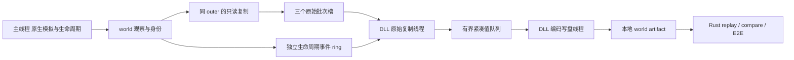

# tx-04-08：world_record 迁移设计

> **2026-10-30 V12专项完成**：[第三轮结果](../../../artifacts/repentogon/tx-04-08-v12-e2e-03/README.md)。V12 PASS，其它V/L本次NOT_RUN。补齐Host停止后的真实退出持久调用/窗口、专项evidence目录、日志并发与存档稳定性区分、顺序启动静稳等待，以及加载期未知consumer上下文查询的实际透传值见证。338条上下文UNKNOWN保留，逐条实际值为零；3710 tick/104 Ack与六组文件窗口通过，两进程正常退出，既有D18/D20/D27不变。两次失败及第三档同步提示/尾字段事实按原报告保留，不用新PASS改写。

> **2026-10-30 V1/V10专项完成**：见[本次结果](../../../artifacts/repentogon/tx-04-08-v1-v10-e2e-01/README.md)。V1接入/真实Off与Closed透传、482组原生四边界配对通过；V10的L1–L5生产CLI与源只读核对通过。两次游戏退出0、无新增crash、环境恢复无报错。联合场景为`tools/harness/scenarios/tx-04-08-v1-v10.json`；其它V项与L6/L7本次NOT_RUN，旧失败和下方历史待实施状态保留原语境。

> **2026-10-29 当前稳定段规模**：用户要求将采集窗口从 240 秒缩为 30 秒，并同步缩减目标。当前主进程 250 份、对照32份，沿用完整普通样本、odd-only 与中断定义；实时计数和最终全量归约均读取本次冻结 scenario。原 U3/U4 的2,000/256次决定及 e2e-08 按旧目标超时失败保持历史语境。本次修改后只纯编译，不自动重跑。

> **2026-10-29 开局记录时机修复**：见[修复说明](tx-04-08-early-recording-fix.md)。primary/comparison 在第二档角色页等待真正 Recording，随后才 New Run、seed 重开和 Host；初始化事件的观察提前，完整样本条件不变。e2e-07 失败原始记录保留，本轮不启动实机测试。

> **2026-10-29 Grid与全量核对更新**：见[实现说明](tx-04-08-grid-and-fullscan-fix.md)。Grid登记扩至根+17派生类，主智能体复读指定Luna/max逆向结论；全量报告改为分组索引查找，保留重复/顺序/字段条件，不采样。完整DLL与Rust纯编译成功，尚未部署或运行本修复的整体验收，原e2e-06失败与停止事实保持不变。

> **2026-10-28 剩余工程更新**：见[本轮实现/主审](tx-04-08-defg-implementation.md)。完整复制 RNG 见证、统一 main 退出补丁/后台收口、V1–V12实际证据归约和真实L7材料已接入；特殊 Player Replace 已核定限定自然 Item 路径并启用 Continue 后场景，原生成功和旧 Player 保留须实际观察。完整DLL/Rust纯编译成功，产物已更新。未部署/测试；唯一整体E2E等待逐次启动准备确认，下方各阶段早先状态保持原语境。

> **当前待实施工程任务（2026-10-27）**：后续按[现阶段任务清单 A–G](tx-04-08-current-engineering-tasks.md)推进，逐项给出目标、涉及文件、交付内容和真实缺口，包含 RNG 已有布局依据与新增窗口复核范围。Lua/harness 主体已编写不等于完整判定完成；V1/V4/V5/V6/V7/V9/V12 尚无完整 PASS 路径，V8 固定 NOT_RUN。原工程顺序和下方历史完成状态保留原语境，不能解释为只剩最后测试。

> **2026-10-27 Lua / 统一 harness 工程更新**：已接通 tx08 F8 扩展、两次顺序启动的独立人工检查点、真实关闭/Host 继续、保存/Continue、稳定段/阶段文件归约与 L1–L7 生产 CLI 编排，见[实现和具体缺口](tx-04-08-harness.md)。补充实际 gap 线程与 capture 阶段诊断；默认场景保留未知参数、缺少的故障入口、RNG 前后见证和直接退出覆盖，不将它们标为通过。仅纯编译，没有部署或运行任何测试，完整 tx-04-08 尚未验收。下文历史时点保留。

> **2026-10-27 离线工程更新**：`tools/harness/src/world/` 和 world-replay/world-compare 分派已编写，见[实现说明、CLI 与对齐格式](tx-04-08-world-offline.md)。保留旧域的显式导入、全量文件重编码、事件/记录索引与分层比较；失败录制的终态另存，未知不标相等。仅纯编译，不运行局部 replay/compare；统一 E2E 的 L1–L7 尚未执行。下文早先状态保留原时点。

> **2026-10-27 cs world 工程更新**：四项命令和后台准备/关闭已编写，见[实现与接线](tx-04-08-world-commands.md)。新增 128 项有界 checkpoint 环，标记通过 writer 写入 diagnostics；run 清队列保留独立 world 请求，关闭等待真实后台线程退出后才归还上下文。最终源码完整 DLL 纯编译链接成功，见[记录](../../../artifacts/repentogon/tx-04-08-world-commands/README.md)。未部署、运行游戏或测试，不表示整个 tx-04-08 已通过；下文早先状态保留原时点。

> **2026-10-27 后续构建修复**：Host/Odd 的 SDK 依赖通过现有 C++17 桥接接口隔离，完整 DLL 已在新构建树完成编译与链接，见[修复及构建记录](../../../artifacts/repentogon/tx-04-08-sdk-build-fix/README.md)。旧 `friend static` 失败和局部纯编译记录保留，整体 E2E 仍未执行。

> **2026-10-27 工程进度更新**：collector、主线程桥与 post-state 已编写，见[实现说明](tx-04-08-collector-bridge.md)。同清单新增 19 个内层 body witness 后为 79/96 行；配置已接通但命令与后台准备编排仍未实现。仅纯编译，没有整体 E2E；`InitUnknown` 保持 UNCONFIRMED，完整样本限制和剩余事项见说明。下文早先阶段的状态与计数保留其历史语境。

日期：2026-10-26，Asia/Shanghai。状态：设计完成；**ST1–ST8 静态核验及主审完成；第一项代码改动（纯值模型/身份/缓冲和 writer）已编写并在临时构建目录完成纯编译，其余功能实现和整体 E2E 尚未完成**。见[ST1 主审报告](../../research/tx-04-08-st1-static-confirmation.md)、[ST2 主审报告](../../research/tx-04-08-st2-static-confirmation.md)、[ST3–ST5 字段/来源/分类身份报告](../../research/tx-04-08-st3-st5-static-confirmation.md)、[ST6–ST8 owner/生命周期/工程边界报告](../../research/tx-04-08-st6-st8-static-confirmation.md)及[world 核心实现说明](tx-04-08-world-core.md)。具体初始化、保留资格、Replace 夹具、B 失效通知和退出协调的缺口与运行 UNKNOWN 按各报告保留，不以静态工作或纯编译代替功能完成。本文中的新文件、接口、命令和格式均为 `DESIGN`；引用当前源码的行为标为 `CURRENT_SOURCE`。初始设计任务采用一次整体静态文档审阅；后续静态研究没有构建、运行离线工具或游戏，ST2 的额外格式校验偏差另记；第一项代码改动只做了纯编译，没有运行测试或启动游戏。

执行要求见[现行规范](../../refactor/project-conventions.md)。上层范围来自 [REPENTOGON 适配设计](../repentogon-refactor.md) D6、D24；tx-04-07 已按 D31 由用户正式接受完成，其原始自动失败、未执行项和限定实测事实保持原样。

## 1. 完整目标与用户决定

把原型 world_record 的只读采集、生命周期与本地身份、固定字段、异步产物和离线重放/比较迁入官方 REPENTOGON 1.1.3 / `Repentance+ v1.9.7.12.J273` 路线。产物由 `zhlIsaacCS.dll` 内的采集与文件线程生成，Rust harness 负责 E2E 和离线工具。完成后的结果是可追溯的 Authority 只读记录，不是可应用的 Replica 模型。

2026-10-26 用户在本会话确认，合并登记为上层 D32：

| 项目 | 决定 |
| --- | --- |
| U1 迁移范围 | 完整保留原型 `min-read-v1`：七类 Entity、Grid/门、生命周期、身份、字段和离线重放/比较 |
| U2 数据用途 | DLL 内只读采集并写本地 artifact；不增加世界状态下行、Replica、baseline/delta 或 Client 角色 |
| U3 稳定区间 | 连续 **2,000 次**普通完整采集；明确的 odd-only gap 按现行规则保留、跳过计数且不打断区间。历史 10,000 次清单及结果不改写 |
| U4 整体 E2E | 一次统一入口，**两个游戏进程顺序启动**。第一进程完成 2,000 次和生命周期；第二进程采集较短的同 seed/input 对照；最后统一离线比较。每次启动前分别提示 |

初始设计会话的授权仅为编写设计，当时未启动静态逆向工程、实现、部署或 E2E。2026-10-26 后续会话中，用户先后明确要求开始 ST1、ST2，再要求开始 ST3–ST5；每个 ST 均指定一个 GPT-6 Luna / max 子智能体逆向、主智能体审阅，现已按[ST1 报告](../../research/tx-04-08-st1-static-confirmation.md)、[ST2 报告](../../research/tx-04-08-st2-static-confirmation.md)和[ST3–ST5 报告](../../research/tx-04-08-st3-st5-static-confirmation.md)执行。未来实机动作须按规范说明所需配合并确认准备状态，不从这份设计推导已经取得所有运行时操作授权。

ST2 过程偏差另记：代理额外运行过一次 JSON 语法校验，违反分析期间不运行校验脚本的要求；[命令和输出](../../../artifacts/repentogon/tx-04-08-static/st2-agent/process-deviation.md)保留。没有运行游戏、构建或功能测试，不将这次额外校验当作整体 E2E，也不以改名掩盖偏差。

2026-10-26，用户进一步要求启动 ST6–ST8，每个 ST 各用一个 GPT-6 Luna / max 子智能体逆向并由主智能体审阅；现已完成[三项静态报告](../../research/tx-04-08-st6-st8-static-confirmation.md)。该次授权仅涵盖静态逆向、资料编辑与主审，没有执行夹具或取得新的实机动作授权；实现和未来整体 E2E 的边界保持上述规定。

## 2. 迁移基线与当前工程缺口

| 资料或代码 | 可保留的内容 | 必须改变的内容 |
| --- | --- | --- |
| `cs-t0/native/src/world_record.cpp`、对应头文件 | 身份状态、阶段判据、字段状态、只读复制、来源/别名、引用与 gap 语义 | 旧 RVA、偏移、RTTI、入口桥、Helper 和 mapping 访问全部换成目标版本适配 |
| `cs-t0/src/world_record.rs` | 字段 ID/宽度、严格解码、canonical 顺序、显式对齐、分层比较、1 MiB 缓冲 I/O | 解耦旧 AppError/CLI/live mapping；新 domain 和 manifest；保留旧格式的显式离线导入 |
| `cs-t0/src/world_record_live.rs` | 及时复制、归还生产槽、编码/写盘分离与队列包含在途项的计费原则 | 不把旧 130 MiB mapping 和外进程 256 MiB 队列直接搬进游戏；改用进程内有界存储 |
| `mod/src/core/tick_pipeline.*` | `NativeReturned → AwaitPostState → FinishPostState → PublishCompleted` | 当前 `PostStateStatus` 只有 `Disabled`，尚无世界记录接线 |
| `mod/src/game/tick.cpp`、`consumers.cpp` | 主线程、Room/Odd、A/B 代次、Player body 到达证据、TopExit 和退休顺序 | 增加内部观察通知；不改变输入、六 tick Shooting 恢复规则和 K 的 NEVER 策略 |
| `mod/binding/hooks.json`、`gen_binding.py` | 单一 Hook 清单、ZHL 链和生成 wrapper | 增加可独立关闭的 `world` 能力与观察作用域；原型 19 项是观察语义，不是必须新增 19 个独立安装器 |
| 历史 T0-06 清单与结果 | 已解释的字段/失败方式、只读证据边界和离线工具经验 | 不继承累计 PASS、70 槽恢复、控制器失联恢复或原版 Online 实机项目 |

`CURRENT_SOURCE`：现有清单有 41 行 Hook；待注册表固定为 64 项，超出时会静默忽略。若 19 项全部需要新增，算术上是 60 行；实际数量须由新清单列出，并让生成和注册明确报告容量不足，不能以安装数量写死为 60 或 70。该项属于清单完整性，不要求扩大既有 Hook 机制。

原型的累计验收完成见 [tx-01-88](../../refactor/cs-t0/t0-06/tx-01-88-e2e-results.md)，它只覆盖旧版本和声明 profile。新版本不能沿用这些运行 PASS。

## 3. 模块、线程与所有权

### 3.1 组件边界

| 拟建或修改位置 | 职责 |
| --- | --- |
| `mod/src/world/model.h`、`identity.*` | 纯值类型、字段/原因枚举、地址 radix 关联与对象/use/出生/revision 状态；不包含 SDK 对象方法 |
| `mod/src/world/collector.*` | 主线程阶段记录、只读批次、生命周期事件、采集状态；独立错误状态 |
| `mod/src/world/storage.*`、`writer.*` | 槽所有权、通知、原始值队列、JSONL 与终态报告；线程只处理自有内存 |
| `mod/src/game/world_bridge.*` | 将现有 owner、Authority、A/B 绑定、PlayerUpdate、加载和退休事实转换为内部值通知 |
| `mod/src/binding/world_layout.*` 与可读布局清单 | 目标版本字段、来源、分类/RTTI、初始化依据、Grid 上限和静态出处；不散落在复制逻辑内 |
| `mod/src/game/bridge.h`、`mod/tools/gen_binding.py` | SDK-facing 的 C++17 接口与 wrapper 接线；核心与文件实现仍可用 C++20 |
| `tools/harness/src/world/` | 严格文件模型、legacy 导入、replay、compare；无进程内存访问依赖 |
| `tools/harness/src/tx08/`、场景 JSON、测试 Lua mod | 单一整体 E2E、场景/故障编排、证据归约 |

主线程是身份、阶段和原始批次的唯一生产者。网络 worker 保持既有职责，不接触 world 记录器的对象指针或文件内容。原始复制线程和文件线程均不得解引用记录中的地址、调用游戏、Lua、getter、Spawn、RNG 或 setter。地址在 DTO 中只作为诊断整数。

### 3.2 录制状态独立于 C/S 会话

`Off → Preparing → Recording → Closing → Closed`；任何自有故障转入 `Faulted → Closing → Closed`，终态仍保留失败原因，不能用 `Closed` 覆盖失败。

录制有独立 `recording_id` 和单调 generation；一个进程同时只允许一个尚未 Closed 的录制上下文。它可以在 A 已存在、Host 尚未发起时开启，以观察 B 的真实创建；因此 `WorldArmed` 不等同 `game::Armed()`。生命周期观察资格是配置开启、world 能力可用、录制已准备、主线程且自有上下文健康。完整世界样本另外要求有效 Authority 凭据。

Preparing 的目录创建和大块存储准备在自有后台完成；主线程只在后续 Manager 边界接收 Ready，不等待磁盘或线程。尚未开始录制的事件不补造。新 start 在 Preparing/Recording/Closing 时返回 busy；已故障的录制必须先真实收口，显式 start 才建立全新观察域，不自动恢复旧连续性。

## 4. Hook 与目标版本静态确认

### 4.1 观察语义清单

以下名称沿用旧 Hook 枚举。旧地址见原型 `Prepare` 的 19 项数组；本文不把它们写成新版本地址。

| 语义 | 需要记录的边界 | 新版本核对重点 |
| --- | --- | --- |
| Factory | 返回的 Entity 分配/池取得结果 | factory 类型、池复用、返回值、实参 |
| Init | 基 Entity Init 的进入与正常返回 | 基 Init 和派生 owner 完成分开 |
| Publish | 实体加入列表 | 实际 Entity 参数；发布不抢先确认外层 Spawn |
| Remove | 移除请求 | 与列表退出、清引用及物理销毁分开 |
| ClearReferences | 清引用 | vtable 槽/具体目标与 revision |
| Destroy | 物理析构 | dtor/删除包装的区别、参数及返回 |
| PlayerCtor | Player 构造 | 物理对象代次；失败不假报正常构造 |
| PlayerCreate | 普通 Player 创建 owner | 与现有 Join 创建点共用真实 owner，不二次创建 |
| ManagerRestore | PlayerManager 的 Restore owner | 不是已有 `Game::RestoreState` 的别名；含加载/保留 Player |
| Replace | PlayerManager 替换 | manager 不是 Entity；两侧 Player 参数及成员变化 |
| PlayerRestore | Player 当前状态恢复 | 撤销不成立的出生/连续性依据 |
| NpcMorph | NPC Morph | 正常返回、分类/revision、Init 模式 |
| PickupMorph | Pickup Morph | 参数宽度、owner 完成及分类变化 |
| GridFactory | Grid 分配 | 官方声明使用 fastcall，不能套所有参数都在栈上的 thiscall 模板 |
| GridInit | Grid 初始化 | 与 GridFactory、Room 发布分开 |
| GridSpawn | Room Grid 创建完成 | bool 返回值、实际槽以及替换前后关系 |
| Door | 门创建/替换 | door slot 与 Grid 别名；不重复计出生 |
| GridFree | Grid 释放/替换观察 | 请求不等于已释放；同指针保留不猜测退休 |
| Spawn | `Game::Spawn` 完整 owner | 实际返回 Entity、八个参数、嵌套/后处理、REPENTOGON 链 |

首选已存在的 ZHL 定义，缺定义时使用已核对 ABI 的自有地址定义。已有同地址 wrapper 直接增加观察通知；不得建立第二套入口补丁 owner。非标准寄存器、返回值和浮点 ABI 必须被真实 ArgData 或受限 shim 表达，不能沿用当前生成器按逗号计数、每参一个栈 word 的假设。

### 4.2 原调用与故障隔离

观察 wrapper 的原调用保持 exactly-once，参数、返回值和原生异常传播保持原样。正常返回才登记完成；异常作用域只撤销本次观察资格，不伪造返回。关闭录制后仅透传；Hook 按统一清单常驻，不恢复字节。

`CURRENT_SOURCE`：`CallScope` 的非主线程分支调用 `game::ForeignCall()`，异常分支调用 `game::ContextFault()`，后者会进入会话失败路径。新增 world 专用入口不能直接套用这些失败策略。清单增加明确的 `world_observation` 策略，或生成等价的专用作用域：只递增该 Hook 统计和原子 world 故障标志，主线程再收口，不从错误线程读写身份表，不调用 `FailRuntime/ContextFault/StopSession`。原先 Authority Hook 的真实错误策略继续有效。

阶段观察加入现有 Manager/Game/Room/tail/Player/Restore wrapper 内，不另建会影响游戏的 owner 栈。world 自有 token 配对错误只停 world；既有 owner 本身损坏则由既有运行时按真实故障处理。两种原因分开记录，不能承诺在原生异常或真实 Authority 故障时会话仍继续。

### 4.3 后续静态工作 ST1–ST8

| 编号 | 具体问题与交付 |
| --- | --- |
| ST1 | **静态登记与主审完成**，见[报告](../../research/tx-04-08-st1-static-confirmation.md)与[代理笔记](../../research/tx-04-08-st1-agent-notes.md)。19 项目标 VA/RVA、原始指令、ABI、this/参数/返回、owner、ZHL/缺定义与共享关系已登记；Publish 返回意义、派生覆盖及实际链行为等 UNKNOWN 保留 |
| ST2 | **静态核验与主审完成**，见[报告](../../research/tx-04-08-st2-static-confirmation.md)与[代理笔记](../../research/tx-04-08-st2-agent-notes.md)。目标普通 Game→Room→标准尾部→Manager 返回顺序、低数 priority 外层、1026 跳过 Room/tail、1160 跳过 Player 派生更新与 TopExit 接线已核对；同优先实际链和运行 callback 状态等 UNKNOWN 保留，不迁移旧 return address |
| ST3 | **静态字段登记与主审完成**，见[78 项旧→新字段表](../../research/tx-04-08-st3-agent-notes.md)与[主审第 2 节](../../research/tx-04-08-st3-st5-static-confirmation.md#2-st3字段布局与初始化)。核对七类/Grid 的偏移、宽度、构造/Init 写入与派生字段；Player 多项重排、Game frame 改为 `+25A70`；通用 HP 假设、额外 State/Timeout 与未观察 owner 的读取依据保留 |
| ST4 | **静态来源核验与主审完成**，见[笔记](../../research/tx-04-08-st4-agent-notes.md)与[主审第 3 节](../../research/tx-04-08-st3-st5-static-confirmation.md#3-st4来源边界与别名)。八 EL、roster、Esau、四类保留关系、descriptor、448 Grid 与 8 门/别名及原生坐标公式已核对；来源出现不自动提供 active/出生/保留对象读取资格 |
| ST5 | **静态分类与身份规则主审完成**，见[笔记](../../research/tx-04-08-st5-agent-notes.md)与[主审第 4 节](../../research/tx-04-08-st3-st5-static-confirmation.md#4-st5只读分类与身份规则)。目标 RTTI/COL/继承、派生删除包装/基析构、非析构池复用已核对；分类只读，不按 Type 范围猜 NPC，不调用 dynamic_cast/getter。完整 owner/Hook 与异常覆盖留 ST6/ST8 |
| ST6 | **静态核验及主审完成**，见[报告第 2 节](../../research/tx-04-08-st6-st8-static-confirmation.md#2-st6对象完成必须归属真实外层-owner)和[代理笔记](../../research/tx-04-08-st6-agent-notes.md)。确认 Spawn/Init/Publish、Morph、Restore/Replace、Grid/门的嵌套与完成边界，以及公开 Spawn/Grid 夹具参数和副作用；受限 Replace 可信触发动作及特殊角色覆盖保留 UNKNOWN，不授权任意指针直调 |
| ST7 | **静态核验及主审完成**，见[报告第 3 节](../../research/tx-04-08-st6-st8-static-confirmation.md#3-st7读取依据与-tx-04-07-生命周期对齐)和[代理笔记](../../research/tx-04-08-st7-agent-notes.md)。对齐加载、B 死亡/复活、首次菜单 Preserve 和 run teardown；当前 metrics 不是 world witness。主审确认 B 某些 Invalidate 返回分支没有共同撤销动作，world 必须独立撤销，不冒称动态输入泄漏 |
| ST8 | **静态核验及主审完成**，见[报告第 4 节](../../research/tx-04-08-st6-st8-static-confirmation.md#4-st8hook预算与退出)和[代理笔记](../../research/tx-04-08-st8-agent-notes.md)。确认 41 行/40 RVA、pending64/静默溢出、同址 GridFactory 两定义与 priority；登记不等于安装。核对预算算术、PE32/LAA、纯构建入口及 Shutdown 后无 Manager 窗口；实际资源/安装和完整退出协调仍待实现与运行证据 |

这些是实现所需的具体资料，结果直接写明确认项和 UNKNOWN；不增加角色分离要求或强制子智能体。ST1–ST8 均按用户明确要求分别分工，主智能体已独立取证审阅。ST1/ST8 确认 GridFactory 同址两份官方定义的 ArgData 差异，优先采用 ECX/EDX 的 `Isaac::CreateGridEntity`；Publish/Replace 缺官方定义。ST2 的阶段位置和短路见下节；字段/来源/身份及 owner/工程规则不表示实际 Hook 链或采集已运行。原型入口、偏移和运行 PASS 不因此恢复适用。

`STATIC_CONFIRMED / CURRENT_SOURCE`（ST4）：官方 `Room.zhl` 的 `_gridEntities[0x1BF]` 声明长度为 447，但目标 `GetGridEntity/SpawnGridEntity/RemoveGridEntityImmediate` 均接受包含式最大 index `0x1BF`，直接访问 `Room+24+index*4`；Room 构造还清零 `[+24,+744)` 共 `0x720` 字节。交叉证据确认 **448 Grid 槽 `[+24,+724)`，另有 8 门槽 `[+724,+744)`**，SDK 长度少一项。layout manifest 应登记 count=448/maxIndex=447 并保留声明差异；门与 Grid 同指针保留双 membership，不重复出生。原生 `GetGridPosition` 公式已确认，height 不是该公式的检查条件，不能按 `width*height` 缩减固定来源。详见[主审](../../research/tx-04-08-st3-st5-static-confirmation.md#3-st4来源边界与别名)。

## 5. 完整阶段、tick 与发布顺序

### 5.1 同一观察窗口

Manager 最外层进入时分配 world `outer_token`，记录当时 mutation、run/room epoch 和候选根关联；位置在 `FrameBegin` 内、`game::BeginManager` 之前，覆盖其 PollPeer/RefreshLifecycle/DrainPeer 及随后会话命令可能引起的变更。嵌套 Manager 不新建完整采样窗口。Game 普通 owner、Room 和标准尾部各记录进入、正常返回以及所属 token。内部 Start/Restore/Door/Lifecycle/Join 的 Room 调用只保留来源，不计普通完整阶段。

完整采集要求：同一 outer 的普通 owner、Room、tail 各一次且按已核对顺序正常完成；Manager 正常返回；本轮有且只有一个 StandardRoom Authority 候选；其 Room/scope 与阶段一致；没有生命周期污染或未配对观察；复制前后 root、Room、来源描述符、mutation 和 recording generation 稳定。根与描述符复读是变化检测，不宣称提供跨线程内存锁。

OddPlayer 已完成真实 Player 模拟，但没有完整 Room 更新，必须输出 `ODD_PLAYER_ONLY` gap。暂停、控制台、跳帧、加载、主菜单或无 Authority 时记录明确 gap/unavailable，不沿用最近 completed tick。普通 tick 中 Player 子类被测试回调跳过，按既有规则仍可提交 tick；它不给该 Player 新的当前字段读取依据，字段不足时采集保持不完整。

`STATIC_CONFIRMED / CURRENT_SOURCE`（ST2）：目标 VA `0x6F78DF` 调普通 Room，返回后还有 Game 后处理，`0x6F7A34` 再调标准尾部 `0x846C90`。官方 `MC_PRE_UPDATE`（1026）在 `0x6F77A4` 处可直接跳到 `0x6F7A39`，Game 正常返回却未经过 Room/tail；跳过处理仍可清实体/排序/HUD，不能记作零变更。没有显式 skip 观察时只记录阶段缺失，不猜 callback 结果。tail 未启用 Lua 分派仍可正常完成；其内部错误处理也不保证向 wrapper 传播异常，故阶段 normal 不承诺所有 Lua callback 成功。

官方排序为低数 priority 外层、返回时最后退出。当前 Manager `-10000` 包住已检阅的官方 Manager Hook；Game 与两个官方 Game Hook 同为 `0`，相对顺序不写死，Game owner 返回不能代替整链返回。完整采样等待 Manager 下游链正常结束。ZHL 桩另有 call，运行配对用 outer/owner/scope 通知，不比较 wrapper 的 `_ReturnAddress()` 与上述原生续点。目标指令、源码证据及限定见[ST2 报告](../../research/tx-04-08-st2-static-confirmation.md)。

### 5.2 TopExit 接线

1. 原生 Room/Odd 正常返回仍由现有 `NativeReturned` 提交 previous，pipeline 进入 `AwaitPostState`；world 收到只含值的候选 `{loop, outer_token, candidate_tick, kind, room_scope}`。
2. Manager 原函数正常返回后，FrameEnd 在调用 `game::EndManager` 之前，完成 world 阶段收束和只读复制。此时尚未执行 EndManager 的 B/K 退休、清理和 completed/Ack 发布。
3. 批次留在 `WRITING/PREPARED`，尚不对后台可见；桥把同一候选的 post-state 值交给 `FinishPostState`。core 不读取原生对象、不等待写盘。
4. 原有 clock 正常提交 completed 后，world 才将对应 pending 批次 release 为 READY；core 原有 `PublishCompleted`、tick trace 和输入 Ack 继续进行。世界数据能否落盘不决定输入回执成功。
5. core 因自身原因未提交时，取消该 pending 批次，记录未提交原因；不能留下带新 Authority tick 的完整世界样本。异常返回不进行新世界复制。

拟扩展 `TickPostState`：`Disabled / Complete / Gap / Backpressure / Unavailable / Faulted`，携带 `reason、tick、attempt_seq、capture_seq、recording_generation、outer_token`。Receipt 保存本轮值，但不增加 UDP Ack 字段或网络消息。

桥验证 post-state 是否属于当前候选；采集器缺失、故障或凭据不匹配时停用 world，并为真实当前 tick 提供 `Unavailable/Faulted`，原有 completed 收束照常执行。采集错误不能沿现有 `InvalidSource → Abort` 分支误停 Authority。真正的 loop/clock/原生返回错误继续按 core 原有规则处理。

### 5.3 各序号含义

`outer_token` 数主线程观察窗口；`attempt_seq` 数每次收束尝试，包括没有批次槽的尝试；`capture_seq` 数实际完成的复制批次，保留其 complete/reason；`event_seq` 数生命周期事件；`authority_tick` 来自真实本轮提交；`complete_capture_count` 只数完整普通样本。上述序号不混用，也不把 `capture_seq` 当未来 Replica 的 `snapshot_seq`。耗尽不回绕，停用当前录制。

没有数据槽时，独立固定容量的 gap 控制记录保留 attempt、原因和范围；该控制记录也无法可靠交付时停用录制，并在终态报告最后确认序号与未交付范围。不能为了“显式 gap”在已经满的批次队列中继续丢失且不说明。

## 6. 字段、来源、身份和引用

### 6.1 固定读取 profile

保留旧 `min-read-v1` 的字段 ID、位宽和语义。新偏移只能来自 ST3/ST4；下表不提供可直接用于新版本的内存地址。

| 类别 | 字段 ID 与内容 |
| --- | --- |
| Entity 公共 | `0001–001e`：Index、分类、64 位 flags、五个单字节有效/表现/生命标志、位置/速度、通用 HP/maxHP、seed、四个 RNG 原始 word、四个引用、spawner 分类、出生计数、Game frame 和派生 frame_count |
| Player | `0101–0110`：角色/索引、伤害冷却、各类心量、sub-player/twin/backup/replaced；专用字段须有当前初始化/读取依据 |
| NPC | `0201–0204`：state frame、state、projectile cooldown/delay |
| Familiar | `0301–0303`：Player 引用、fire cooldown、state |
| Effect | `0401–0403`：state、timeout、lifespan |
| Pickup | `0501–0503`：timeout、wait、state |
| Tear | `0601`：128 位 tear flags |
| Projectile | `0701`：64 位 projectile flags |
| Grid | `0801–0811`：独立 Desc/初始化/种子/index/frame/RNG/collision 与派生位置；不套 Entity HP 或 flags |

通用 Entity HP 表示生命仍是历史用户采纳的假设，Player 心量独立保存。Player/Tear/Projectile 的未确认 State/Timeout 继续列入 manifest，不加默认零。ST3 已提供[78 项旧→新字段表](../../research/tx-04-08-st3-agent-notes.md)，须采用目标偏移和初始化依据；原生注册补证的 FireCooldown/Wait/Pickup State/ProjectileFlags 与 getter 仅作静态语义证据，不在采集时调用。Sprite/资源/动画采集和新实体类别专用 schema 不进入本轮。Bomb/Laser/Knife/Slot 等在已确认基类可读时输出 UnknownEntity 头部及原因，不伪装为受支持类别，不删除它们来制造完整样本。

来源 ID 保留：八个 EL 视图，roster、Esau、Player 保留关系、Grid、door，以及两个 reserved。Reserved 明确 `NOT_APPLICABLE`；空来源与读取失败分开。每批按 `(domain,address)` 合并别名并保留所有 `(source,index)`；模板、暂存、保留 Player 不自动等于 active 世界。来源完整覆盖后才更新 membership 观测，成员集合为空不等于物理销毁。

复制只使用已理解布局的有界原始读取，不调用 Lua 查询、EntityPtr getter/setter、虚 getter、RNG 推进器或原生记录生产函数。Field 状态保留 `VALUE/UNCONFIRMED/NOT_APPLICABLE/NOT_READY/READ_FAILED`。无法识别、字段不足或非有限值均保留原始值/原因，使样本不完整或对应比较区域不可比较。

### 6.2 本地身份

分别保存 `local_id、use_generation、birth_event、revision、origin、readiness、lifecycle、memberships`。地址仅是当前录制中的临时 radix 关联；不是网络 ID，也不是跨进程 key。不同 domain 的同地址不合并。

Factory 重新取得池对象增加 use；已确认物理重构/复用产生新的物理身份。每次 Init 不自动增加出生；外层创建 owner 正常完成后才冻结出生描述，重复 Publish 不重复确认。已知 Morph 保留出生/use，当前分类与 revision 单列；未知 Init、Restore/Replace 撤销不成立的连续性。Remove、清引用、成员退出与析构分开。

启用前已存在对象记 FIRST_OBSERVED，不补造历史出生。A/B 锚点来自当前 exact-pair 绑定和 participant generation，不能来自 roster 下标、Index 或 seed。按现行规范第 11 节，跨一次有效 Authority 窗口内的原生 PlayerUpdate 正常返回、native body 到达且 exact pair/代次复读一致后，可记依据 `3/USER_ACCEPTED_CURRENT_PLAYER_UPDATE_WITNESS`。失效立即撤销该依据；它不改 FIRST_OBSERVED，不给予缺失出生历史。

### 6.3 生命周期与引用

录制独立维护 run/room/mutation epoch。真实生命周期进入立即污染当前 token，即使退出后地址相同也不恢复。嵌套房间信号合并同一 episode，明确迁移结束后才换观察域；不会每个回调重复加 room epoch。物理保留 Player 可以延续 local_id，但旧房间成员和输入绑定不能延续。

B ghost/复活沿用既有身份与重绑事实，不为采集再次 Join 或创建 K。Game Restore 与 PlayerManager Restore 分别记录；首次菜单 Host/Continue 不被 world 观察误退休。run teardown 退休本 run 的关联，录制上下文可以保留到本次 E2E 的后续场景，旧 run 引用不得复活。

引用状态保留 `NULL / KNOWN_CURRENT / UNRESOLVED / RETIRED / AMBIGUOUS_REUSE`。只有目标同代、连续性充分且当前候选唯一时才给出已解析 local target；未知地址不能填 NULL。不能用“本批同时出现”消除原型保守规则下的复用风险。跨进程比较时，再通过显式出生/A/B 映射得到比较 key；本地身份不是未来 NetEntityKey。

## 7. 缓冲、预算、文件和停止

### 7.1 有界存储

| 项目 | 设计上限/默认值 |
| --- | --- |
| 单批对象 / memberships / 单对象字段 | 16,384 / 65,536 / 52 |
| 身份 / Player 关系工作表 | 32,768 / 64 节点 |
| 原始批次槽 / 生命周期 ring | 3 槽 / 65,536 事件 |
| 原始复制后队列 | 64 MiB 且最多 64 项，两个条件同时成立；计入 reader 预留、排队、writer 在途、事件 |
| JSONL I/O | captures 与 events 各 1 MiB 缓冲；单条解码上限 128 MiB |
| world 自有动态存储总预算 | 256 MiB，包含批次、队列、身份/radix、控制记录、I/O 与管理开销；实现记录实际分配，超出则准备失败 |
| 主线程停止等待 | 0；每轮仅作有界状态推进 |
| 正常关闭后台期限 | 默认 10 s 墙钟，仅用于收口，不推进 Authority；超时保留 incomplete |

旧 Shared 本身为 136,316,688 bytes，不能再额外照搬旧外进程的 256 MiB 队列。新布局无需兼容其 C++ padding；保留功能上限不要求大小相同。所有大数组放堆上，不在游戏线程栈上构造。分配失败只关闭 world；32 位地址空间实际承受能力仍为运行未知，不能因预算声明就保证成功。

槽按 `FREE → WRITING/PREPARED → READY → READING → FREE` 转移。主线程仅写自有 WRITING；raw reader acquire 最早 attempt，复制实际有效前缀后立即 release 归还槽；编码和文件 I/O 在之后进行。reader 队列不足时可以等自有 writer 释放预算，游戏生产者不等待，记录背压。writer 只持 compact owned values，不持游戏地址或生产槽。

生命周期 event_seq 与 batch 的 event watermark 允许两份文件关联，不依赖线程写入交错推断全序。事件溢出、身份连续性丢失、文件错误或通知失败使 world 失效；背压本身可以是 gap，但不能丢生命周期后继续宣称身份完整。终态错误、最后生产/消费序号及缺口范围使用独立固定诊断存储，不依赖已失败的 ring。

### 7.2 本地产物格式

新 domain 为 `isaac.cs.world-record`、文件 schema version 为 `1`、profile 为 `min-read-v1`，与旧 `isaac.cs.t0.world-record` 明确区分。此 domain 只用于文件，不增加网络消息域。

| 文件 | 内容 |
| --- | --- |
| `manifest.json` | domain/schema/profile、recording、游戏/REPENTOGON 版本、布局声明及证据、字段/来源/预算、假设/未知、实际 Hook 清单引用；不写死 70 槽 |
| `captures.jsonl` | 完整或不完整 capture、gap；scope/epoch、Authority 有无/kind/tick、attempt/capture、字段、来源与诊断 |
| `lifecycle-events.jsonl` | event_seq、call/parent、进入/正常返回/异常、对象/use/出生/revision、membership 及 recording/run/room 归属 |
| `diagnostics.jsonl` | gap 控制记录、背压范围、准备/关闭、实际耗时/内存/队列与自有故障；与常规 trace 分离 |
| `result.json` | capture 终态、逐原因统计、生产/复制/写入数、未交付范围、callback/worker/drain/flush 状态；不是整体 E2E PASS |

所有 u64 使用规范十进制字符串；raw32/raw64 固定宽十六进制，其他字节按 bytes_le。浮点保留原始位，比较视图只归一化 ±0；其他 finite 精确比较，无 epsilon；NaN/Inf 不可比较。地址/vptr/线程/容器描述符/墙钟只进入 diagnostics，不影响比较 key。

输出目录由配置固定根目录和受限 ASCII label 组成，使用 create-new，不覆盖已有产物。后台成功显式 flush 后才能报告 files_flushed/写入完成；flush 仅表示交给文件系统。写失败不能补成功 result；已写前缀及诊断保留，harness 在缺终态时输出 incomplete，不假定崩溃后的完整性。

### 7.3 逻辑停止和退出

stop 在主线程边界关闭新观察/新样本；已进入 callback 只做必要配对收束，不启动新复制。等待 callback=0 后固定最后序号，由 raw reader 和 writer 有界 drain。若当前已完成原生模拟仍待 core 收束，提供本 tick 的实际 post-state 或不可用原因，不能中止 completed。

普通 world stop 不停止 Host、不移除 B/K，也不恢复 Hook。Host/peer 结束使有效 Authority 样本停止，但录制可以继续记录退休并等待显式 world stop；新 Host 的 session generation 分开。run teardown 只退休 run 域。

正常进程退出须在已理解的主循环关闭窗口先停止并 drain；不在 DllMain/loader lock 中 join、写大文件或释放在途上下文。超时或原生崩溃保留 incomplete，后台仍持有的内存不能提前释放，不强制终止线程或卸载 DLL。world 自有存储在明确无引用后可释放；K 的 NEVER 策略不因此改变。

ST8 静态补充：`Isaac::Shutdown VA 0x982C90 / RVA 0x582C90` 在 main 离开 Manager 循环后才被调用，后续即析构/平台清理，没有后续 Manager 更新。当前清单没有该 Hook。显式 stop 并真实 Closed 后再退出是可明确安排的健康路径；终端 Shutdown 通知本身不保证 10s 排空窗口。所有直接退出路径的完整协调仍是实现缺口，不能以阻塞主线程、DllMain join 或伪造 Closed 消解，也不以该健康路径替代 V9 的全部退出要求。详见[主审第 4.3 节](../../research/tx-04-08-st6-st8-static-confirmation.md#43-正常退出窗口的实际限制)。

## 8. 配置、命令和离线入口

配置增加独立 `world_record` 段：`enabled=false`、`output_dir="isaac-cs/world"`、上述有界预算及 `close_timeout_ms=10000`。配置只在启动读取；`enabled` 表示允许录制和注册 world 能力，不自动开始录制。顶层 C/S 关闭时不注册这些 Hook。普通状态只给简短值快照，避免超过控制口响应容量。

| 拟定命令 | 行为 |
| --- | --- |
| `cs world start <label>` | 入现有有界命令队列，异步准备并于主线程边界启动；返回 request/recording 标识，不冒报已录制 |
| `cs world stop` | 幂等关闭，返回 Closing/Closed；Host 继续 |
| `cs world status` | 读已发布快照：状态/首因、generation、attempt/complete/gap/背压、worker/flush、目录 |
| `cs world checkpoint <label>` | 主线程写只含值的场景标记与序号 watermark，不清身份/计数，不读取额外游戏字段 |
| `harness world-replay --capture <world-dir> --artifact-dir <new-dir>` | 严格解析、验证和 canonical 重编码所有记录，不访问游戏 |
| `harness world-compare --left <dir> --right <dir> --alignment <json> --artifact-dir <new-dir>` | 显式 scope/tick/出生/Player 对齐后的结构化比较 |

命令走 Lua/控制台/既有测试控制口桥，真正变更仍在主线程执行。不提供上传任意文件、网络直接开启录制或旧共享内存接口。测试故障命令只在显式 E2E 配置和本次 token 下开放，不进入玩家界面；具体故障见 [E2E 方案](tx-04-08-e2e-plan.md)。

旧格式仅经显式 `--legacy-t0` 离线导入，保留其 domain/版本/旧事实；旧 runtime、Helper 和 mapping 不参与新采集。replay 可处理历史文件。compare 默认要求双方目标构建、layout/profile 和采样语义相容；跨旧/新版本没有本轮确认的逐字段语义映射时拒绝兼容比较，不因 profile 名相同就宣称相等。

对齐文件保留原型语义：左右 run/room scope，严格递增的一对一 tick pairs，一对一出生事件映射和冻结 A/B ordinal 映射。映射必须附实际输入/场景/出生记录依据；不自动按地址、seed、位置或最近 frame 配对。输出 `comparisons.jsonl、key-collisions.jsonl、result.json` 及对齐依据。

结果仍为 `DIFFERENT / EQUAL_WITHIN_PROFILE / INCOMPARABLE`；未知、相同缺项和相同错误不等于 equal。已知字段差异可以与更早未知范围同时存在，使用 first_observed_difference/earlier_coverage_unknown。compare 正常退出只表示工具成功完成，不表示两份世界相等。按文件位置索引逐对读取，不把所有世界放内存。

## 9. 实现前列明的失败方式

| 编号 | 失败方式 | 设计响应 |
| --- | --- | --- |
| F1 | 旧偏移/ABI、错误 Grid 上限、RTTI 或读取宽度 | 对应 world 能力不可用，记录具体 layout/entry，不猜读 |
| F2 | 普通/内部 Room 混淆、跨 token 拼阶段、odd 当完整 | 输出明确 gap，拒绝完整资格 |
| F3 | 世界批次早于 completed 可见，或贴最近 tick | pending 批次与本次候选配对，core 未提交则撤销 |
| F4 | world 错线程/异常配对误停 Host | 专用观察策略只停 world；真实原生/Authority 故障单列 |
| F5 | Spawn 未结束就确认、重复出生、同址旧引用复活 | 外层 owner 完成、物理/use/revision 分开及保守引用 |
| F6 | Player 仅外层 wrapper 返回就被标可读 | 原生 body、同 Authority、exact pair/代次前后复核；失效撤销 |
| F7 | 背压/预算被静默丢弃，或游戏等 writer | 独立 gap/终态范围，有界队列，生产者零等待 |
| F8 | 事件溢出后继续延续身份 | 当前录制故障收口，新录制重新 bootstrap |
| F9 | 大数组在栈上或进程内照搬旧双份大队列 | 堆上预分配、总预算、准备失败只停采集 |
| F10 | 文件线程解引用地址、调用 getter/RNG/Lua | 线程只接收 owned values，主线程只读路径有实际记录 |
| F11 | write/flush 失败仍出成功，重放弱化字段/未知 | 显式 flush、严格文件模型、完整重编码与反例覆盖 |
| F12 | seed/Index/地址强配，比较把未知算相等 | 显式映射、冲突组、分层未知与首次已观测差异 |
| F13 | stop/退出释放在途数据，或恢复 Hook 字节 | callback/drain 分阶段、常驻 Hook、超时 incomplete |
| F14 | 生命周期 fixture 产生未允许的持久修改 | 只按实际授权动作；D18/D20/D27 文件/窗口证据，不翻 readonly、不回滚存档 |

## 10. 工程顺序与验收边界

当前具体待实施内容以[现阶段工程任务 A–G](tx-04-08-current-engineering-tasks.md)为索引：A 字段读取依据、B 故障入口/编排、C 具体场景和生命周期、D RNG 前后证据、E 直接退出、F 完整归约与报告、G legacy 材料。它们是同一 tx-04-08 内的后续工作，不拆分新增测试批次。下文按日期保留原设计和分项交付记录。

2026-10-27 ABC续作：A的+177初始化漏项与当前值/撤销规则、B的11类受限故障及独立录制/归约、C的可核定参数和原生episode索引已编写，见[实现与主审](tx-04-08-abc-implementation.md)。特殊Player Replace资格仍UNKNOWN/禁用；实际复用/重复发布不得预记。Rust与完整DLL纯编译成功，未部署、启动游戏或测试。D–G与整体E2E仍未完成。

本轮交付是本文、[E2E 方案](tx-04-08-e2e-plan.md)、入口/决定同步和一次[静态文档审阅记录](tx-04-08-design-review.md)。它不等于整个 tx-04-08 功能完成。

后续实现按同一个 tx-04-08 完整目标推进：ST1–ST8 与 layout
/Hook 清单 → 纯值模型/身份/缓冲和 writer → 主线程桥与 post-state → 命令/离线工具 → Lua 夹具与统一 E2E 归约 → 必要纯编译链接 → 一次整体 E2E。分析、逆向、修改期间不运行测试，不新增实现后的单元测试，不先跑 replay、probe 或局部场景。核心函数、数据结构和功能注释用中文。

2026-10-27 按用户指示先完成第二项代码改动（`mod/src/world/` 的纯值模型、身份表、槽/队列/事件环与 writer）。实现范围、值布局、线程与关闭契约、文件格式、失败归属和给后续项的接口约定见[world 核心实现说明](tx-04-08-world-core.md)；主线程桥、命令、harness 与 E2E 仍未实现。本轮只做新静态库的纯编译，没有运行测试、没有启动游戏，也没有完成 DLL 整体链接（原因见实现说明第 7 节）。

2026-10-27 同一目标内继续完成 layout/Hook 清单与生成器（实现顺序的“ST1–ST8 与 layout/Hook 清单”项）。唯一清单 `mod/binding/hooks.json` 升级为 schema 2：41 条既有行不变，新增 19 项 `world_observations`（逐参数 ABI、完成含义、SDK 元数据交叉校验）；新增 `mod/binding/world_layout.json` 登记 78 项字段偏移/证据、15 个来源、10 个 RTTI 类与目标版本常量。`mod/tools/gen_binding.py` 生成 wrapper、容量常量、布局表与 machine-readable 清单，生成期与编译期都会拒绝 ABI、容量、字段或几何关系不一致；`mod/src/binding/world_layout.*` 提供只读访问，`mod/src/world/observe.*` 提供 world 专用观察策略（不进入会话失败路径）。待注册行数 **60/64**（既有 41 + world 19，distinct RVA 59）。world 组当前**不安装**（`WorldObservationArmed()` 固定 false），桥接项接入配置后再启用。本轮只做纯编译与一次临时目录生成，没有运行测试、没有启动游戏；DLL 整体链接仍被既有 `ASMPatch` 头的 `friend static` 与 C++20 组合挡住，且本轮确认 `host_patch.cpp` 不能整体降级到 C++17，留给“必要纯编译链接”项。详见[布局与 Hook 清单实现说明](tx-04-08-layout-hook-manifest.md)。

一次 E2E 可以包含两个顺序进程、同进程内多个录制上下文和离线 CLI 子命令，但都由一个统一入口执行并汇总；失败保留已采证据，不自动重启、补测或重跑。2,000 次仅属于 U3 的新目标，绝不把历史阈值改成通过。本次静态文档审阅与未来实现完成后的 E2E 类型、对象不同，不在设计期间消耗或预记运行结果。

## 11. 事实来源与未完成项

- [原型采样设计](../../refactor/cs-t0/t0-06/tx-01-71-sampling-design.md)、[生命周期与原生记录](../../refactor/cs-t0/t0-06/tx-01-71-lifecycle-and-native-records.md)、[实现说明](../../refactor/cs-t0/t0-06/tx-01-73-implementation.md)。
- [即时消费改造](../../refactor/cs-t0/t0-06/tx-01-75-immediate-consumer.md)、[原型 replay 修复](../../refactor/cs-t0/t0-06/tx-01-88-replay-performance.md)、[当前累计结果](../../refactor/cs-t0/t0-06/tx-01-88-e2e-results.md)。
- [REPENTOGON 目标点位](../../hooks/repentogon-binding.md)、[tx-04-05 静态确认](../../research/tx-04-05-static-confirmation.md)、[tx-04-07 静态确认](../../research/tx-04-07-static-confirmation.md)。
- 本地目标 SDK：`F:/projects_isaac/REPENTOGON-1.1.3/libzhl/functions/` 的 Entity、EntityPlayer、EntityList、EntityList_EL、PlayerManager、Game、Room 和 GridEntity 声明。初始设计只阅读本地源码；后续 ST1–ST8 已读取目标 IDB/PE 与当前源码，证据按各报告登记，未访问互联网。
- [后续状态同步设计](../state-synchronization.md)：world_record 的本地记录不自动获得 Replica、网络 ID、资源/动画完整性或写回资格。

已完成：[ST1 的 19 项入口/ABI 静态登记及主审](../../research/tx-04-08-st1-static-confirmation.md)、[ST2 的普通阶段/Hook 次序/短路与复制位置静态核验及主审](../../research/tx-04-08-st2-static-confirmation.md)、[ST3–ST5 的字段/来源/分类身份静态核验及主审](../../research/tx-04-08-st3-st5-static-confirmation.md)、[ST6–ST8 的 owner/生命周期资格/Hook/预算/退出静态核验及主审](../../research/tx-04-08-st6-st8-static-confirmation.md)，保留具体 UNKNOWN 和实现缺口。尚未完成：工程实现（含完整 Player witness/撤销、Hook 容量报告和退出协调）、实际安装/内存与时延、原生调用保持、文件失败/退出、2,000 次和双进程比较。历史 PASS 与静态资料审阅都不补足这些运行未知。
