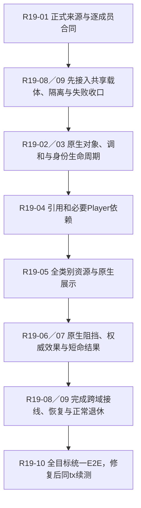

# tx-04-19：复用原生机制的非Player Entity状态应用

> **2026-11-01 实施更新**：路线前5项R19-01—05已完成实现，生产DLL已编译、链接；未部署、启动游戏或运行测试。当前代码、逆向主审及剩余范围见[第14节](#r19-first-five-progress)。第13节保留首次停在草案时的历史缺口；下文原“仅文档／未启动”保留设计时点。整个19尚待R19-06—10完成及统一E2E，不预记运行通过。

日期：2026-11-01，Asia/Singapore。状态：**实现设计与整体验收计划，尚未实施／验收。** 用户本轮只要求编写文档，不修改代码、不构建、不部署、不运行游戏或测试。本文中的模块划分、入口与用例是后续交付要求，不代表已有能力。

执行规范见[现行项目规范](../../refactor/project-conventions.md)，任务关系见[完整路线图](../state-synchronization-roadmap.md)，模型与版本沿用[15合同](../tx-04-15.md)和[状态同步设计](../state-synchronization.md)。配套文件为[统一整体验收计划](tx-04-19-e2e-plan.md)。

实现任务及建议顺序见[第10.1—10.4节](#101-实施路线与依赖)。当前10项实现工作均未实施，E2E代码及实机验收也未开始；任务编号仅用于本文组织，全部工作仍属于同一tx-04-19。

## 1. 完整目标与用户确定的原则

在18已建立的活动原生Room中，将真实Authority的全部非Player Entity按create／remove／change应用到正确的原生对象，恢复当前状态、资源选择、关系与姿态，并由游戏原有机制维护和绘制。Authority仍是唯一玩法模拟器。

用户随后明确并澄清：**无论飞行还是非飞行，阻挡及不阻挡的判定与响应都由Client原生应用处理；其他效果由Authority裁决。** Authority同步飞行、碰撞类别、Grid等所需状态，Client由游戏原生机制据此处理空间阻挡，不额外等待Authority逐次发送是否放行的裁决。具体边界见第7.2节。

2026-11-01用户明确：**尽量复用游戏原生机制，只补实际缺失的状态和接线。** 本tx按以下顺序实施：

1. 优先使用语义适用的原生创建、初始化、发布、引用管理、资源维护、移除及绘制路径；公开Lua／REPENTOGON接口优先，有具体缺口才补SDK或J273窄适配。
2. 恢复Authority已经确定的最终状态及必要依赖，让现有原生机制继续工作。原生初始化不能再次决定玩法结果；seed只是具名初始化参数，不能替代当前后态。
3. 分类、排序、遮挡、阴影、深度与多pass由原生Room／Entity绘制链负责。它们是接入正确性和画面验收内容，不预设为需要重新实现的功能。
4. 只有静态分析或本tx最终整体验收确认：玩法更新隔离确实连带缺少某项状态／维护，才补充对应恢复值、必要原生维护调用或接线。不得因此整体放开AI／Game／Room／Entity玩法Update。

不另建Entity世界绘制器，不传输Authority像素、最终顶点或绘制批次。Laser曲线的语义采样点等对象状态可以传输，不能将其扩大为GPU几何重放。

## 2. 范围、事实与后续任务边界

### 2.1 当前可依赖的事实

| 来源 | 已有事实 | 对19的含义 |
| --- | --- | --- |
| [10实现与结果](../observation-expansion/tx-04-10-implementation.md) | Entity公共／派生、关系、Sprite及生命周期已有正式纯值观测；NativeDummy等实际未观察项仍保留限制 | 复用目录和来源；观测完成不等于原生应用完成，也不能把未观察路径写成通过 |
| [15合同](../tx-04-15.md) | 稳定key、shape revision、完整目标重建、归属和事件合同已实现 | 不新增另一套网络身份，不将观测Getter等同Client RPC |
| [18原生实现与验收](../tx-04-18/tx-04-18-native-state-plan.md) | Room／Grid原生应用已完成，图形窗口调用原生PreRender及Room:Render | 继续使用同一原生场景；19不重做Room／Grid渲染 |
| 当前[原生Room实现](../../../mod/src/game/native_room_grid.cpp)的`Check`／`NativeRoomGridDraw` | 18检查Entity视图为空，绘制和退休围绕该范围实现 | 将空集合约束调整为核对实际受管成员，接入Entity寿命；不能直接删除检查后默认一切成立 |
| [Text／Dummy及接口补充](../observation-expansion/entity-native-supplements.md) | 有J273只读分类／来源与具体接口副作用记录 | 只读偏移、RTTI和Getter并不自动获得安全创建／写入资格 |

旧tx-03研究可作为问题索引；其版本、地址和旧独立Sprite方案不自动成为J273应用事实。本文不声称已经发现原生阴影、排序或多pass缺失，也不要求预先逆向整个renderer。

### 2.2 本tx与相邻任务的责任

| 内容 | 本tx责任及边界 |
| --- | --- |
| 活动房间非Player对象 | 全部类别的存在性、状态、必要专用路径、引用与原生展示在19完成 |
| 必需Player依赖 | 仅对初始化／引用／原生展示确实需要EntityPlayer的类别，纳入必要的最小合法载体和共享引用桥接；具体规则见第6节 |
| 完整Player应用 | 四参与者控制组、全部身体、装备／属性／武器／服装及完整角色状态仍由20完成 |
| 网络世界闭环 | 19提供生产来源与应用器；21—22负责真实四端持续Baseline、每Peer传输／Applied ACK和恢复 |
| 切房与整局 | 19保证自身对象随场景退休并拒绝旧代次；23—26负责连续切房、离房、楼层与世界重构事务 |
| 瞬时表现 | 19完成Entity存在性与必要短命可见结果的衔接；完整HUD／音画及声明Mod适配由27扩展 |
| 内容覆盖 | 19完成所有类别及其必要专用应用路径；全部原版特殊变体与角色／武器／模式组合闭合由29完成，不能借29推迟本tx必需类别 |

19的域成功不发送整世界Applied ACK，不把同房间域投递写成整局、四端网络或完整Player已通过。任意第三方gameplay Mod兼容、预测／rollback、Dedicated Server和host migration均不由本tx引入。

## 3. 正式来源、逐成员应用合同与预算

### 3.1 来源和身份复用

从正式观测consumer取得同一有效Authority窗口的Entity与必要Room／Grid上下文，经15的Registry、DTO与codec进入应用器。录制、测试控制口及截图不作为生产来源；Recorder关闭或写盘失败不得阻断正式纯值消费。

18与19使用同一run下协调持有的身份Registry和scope分配，不能每个域各建Registry、因分配次序不同给同一主体生成不同网络key。现有18私有来源接线如需共享，在19内做必要调整；不为此再全图采集一次。

Entity component包含Player公共部分。19只拥有其中非Player主体的原生应用；Player保留同一Entity key并交给相应owner，不把过滤后的非Player集合重新标成整个Entity域Complete，也不因未应用Player而删除Player主体。完整普通目标与独立Lifecycle／Render／ActualCall来源继续保留各自capture kind、watermark和required revision，不能拼成虚假的同tick完整世界。

### 3.2 逐成员应用表

以[Entity观测目录](../observation-expansion/entity-catalog.md)、[Entity范围](../observation-expansion/entity-observation.md)和15的`replication-catalog.json`为输入。后续实现须交付可维护的逐成员应用表，至少列明：规范成员、适用类别／变体、归属、来源版本、原生恢复入口或决定其值的状态、必要刷新／引用依赖、读回方法、未实现项及对应验收场景。

| 成员性质 | 应用规则 |
| --- | --- |
| ReplicatedState最终值 | 使用语义适用的公开字段／setter或必要native恢复，保留精度、单位与适用域 |
| 只读派生量 | 找到决定它的状态和原生维护条件，作为实际读回约束；不虚构通用setter |
| AuthorityOnly | 玩法操作、裁决、随机内部历史与持久操作留在Authority，不作为Client可执行请求 |
| ClientLocal／原生管理信息 | 本地地址、vptr、容器节点、池元数据、原生借用和资源owner由本方原生机制管理；不照抄远端Index或内存块 |
| 状态未知／缺失 | 保留Unknown、Null、NotApplicable、NotCaptured、ReadFailed、Truncated等区别；缺失必需状态不能补零、默认资源或假null后报成功 |

flags按实际64／128位宽处理，不经浮点截断。出生帧、FrameCount、Timeout等按照各类真实语义恢复，不以Client创建时刻、墙钟或渲染帧替代Authority时间。Slot的Timeout／Touch／TriggerTimer等按机器变体解释，不能统一当普通倒计时。

沿用现有观测、模型、队列和原生容量约束，分别记录实际字节／节点／主体／依赖／事件上限及耗尽行为。共享场景总预算必须计入Room／Grid、Entity、资源与在途退休；不得按每域上限简单叠加后声称仍有界。预算不足明确拒绝或恢复，不通过裁掉某类别宣称完整。

## 4. 全类别的原生应用内容

下表是应用主题，不替代逐成员表。每类首先核对现有原生入口是否已完成所需工作；只有具体缺项才补实现。

| 类别 | 必需状态／关系和原生机制复用 | 整体验收重点 |
| --- | --- | --- |
| 公共Entity | 正确派生对象、成员、存在／死亡、位置／速度／大小、实际GridCollisionClass及飞行／穿墙等状态、血量、flags、状态效果、计时、颜色／偏移／缩放 | 飞行和非飞行均由Client原生机制判定并处理空间阻挡；其他效果只应用权威结果；位置按第7.2节区分目标与本地空间约束结果 |
| NPC | 状态／阶段／计时、冠军、Boss、部件／目标及所需专用状态 | 普通NPC、冠军、分节／多部件Boss；初始化不补生成Authority未给出的部件 |
| EntityDelirium | 共用NPC能力并补公开专用状态及真实形态／资源依赖 | 形态变化与引用正确，不能仅靠公共NPC字段宣称支持 |
| Tear | flags、伤害状态、尺寸、高度／下落、旋转、附着／目标、专用外观 | 飞行中恢复、落地前后及多层外观，不本地重做命中 |
| Projectile | flags、轨迹／高度／下落／加速、目标和专用状态 | 不同轨迹当前后态；只应用结果，不在Client重新推演路径 |
| Bomb | 计时／阶段、flags、伤害／范围、附着、尺寸／闪烁 | 临爆后态及消失后的Authority结果；不本地引爆补结果 |
| Laser | 类型、角度／起止／长度／半径／宽度、实际曲线样本、父子／跟随及存续 | 直线、圆环、sample／曲线的原生显示；不靠整段Update重算玩法 |
| Knife | 所有者／挂载、距离／角度／旋转、投掷／返回／蓄力阶段和专用姿态 | Player依赖成立，当前阶段可直接恢复；不调用Shoot重放攻击 |
| Pickup | 当前内容／循环内容、价格／商店／选项组、等待／开启／拾取及隐藏状态 | 物品与价格显示、箱子和Morph；不本地付费／拾取／抽池 |
| Familiar | 所有者、跟随／环绕／队形／附着、计时及专用状态 | 同类不同Owner、不同行为阶段和队形；不靠本地AI寻找主人 |
| Effect | 类型、存续／范围／计时、地面／持续状态和关联对象 | 有玩法作用的Effect仍隔离玩法；持续对象不因Type=1000被降成可丢事件 |
| Slot | 机器／乞丐变体语义、State、DonationValue、PrizeType／Collectible、奖品Sprite及适用专用字段 | 真实奖品、接触／工作／损坏／卡币后态；不开奖、不付费、不掉第二份奖品 |
| NativeText | 正确原生类别、文本、寿命及必要公共／外观状态 | 正文与寿命实际读回、自然显示和正常退休 |
| NativeDummy | 正确原生类别、公共状态及实际原生依赖 | 独立类别和寿命路径；没有额外派生字段时不虚构字段，也不伪装为NPC |

必要专用路径不能由“同属NPC／Effect”自动推定已支持。正向场景以Authority实际返回类型／变体为准；Client请求后必须核对实际派生类型，不能用请求值覆盖实际结果，也不能修改期望使错误创建看似成功。

## 5. 身份、三语义、Morph与原生寿命

客户端先由指定B重建完整T，再从最后成功目标C调和到T。15现有component替换／显式删除编码继续使用；不要求本tx重做wire或提前实现22的稀疏增量。

- create表示该key以完整当前状态存在。建立合法原生对象并恢复后态，不重演出生以来的动作。
- remove表示该主体不再属于目标。优先由适用原生路径完成引用解除、摘表和退休，顺序按真实owner核对，不先手工重复其内部清理。Remove标志、清引用、摘表、池可复用和析构可能是不同阶段，必须处理客户端不运行玩法Update时的实际完成条件；不能为清理而推进整间Room。
- change保留逻辑key，覆盖最终状态并完成实际必要维护；字段回到基线值仍须恢复，不重复完整Init。
- Morph保留逻辑key并推进shape revision。若原生类型／资源无法安全原地恢复，可内部重建载体，重新绑定全部引用；不只改Type、强转派生指针或替换vptr。
- 相同地址、池槽、Index、seed均不等同同一主体。新use换key；过期映射不能指向复用后的对象。
- dead、exists、可见、待移除和完整成员缺席分别解释。死亡动画仍存在时继续应用，不能按HP=0或某个State猜删除。Partial、独立事件缺席和本包未提及均不构成remove。

EntityFactory、池、EntityList和Room必须有明确的统一owner及借用范围。优先沿原生owner创建／发布／退休；如需本方载体，核对其依赖和正常释放入口。不得将不明归属的factory指针塞进Room，或将virtual device的NEVER回收策略套用到所有Entity。池满时不能无声驱逐仍在映射中的主体；需要提前容量保护或适用的原生策略，耗尽保持有界失败。

重复目标不再次生成或释放；旧目标不覆盖新目标，同版本不同内容拒绝。完整空非Player目标清理本域主体，但保留其他owner管理的Player及必要本地资源。

## 6. 引用、初始化依赖与Player桥接

引用沿用规范key、目标component／required revision和真实状态。Parent、Child、Target、Spawner、Owner以及Entity到Grid／Player的关系均需要实际解析；原生指针只存在于当前主线程、当前原生generation的映射内。

先建立依赖计划，再选择适合该类别的原生初始化顺序。普通可后绑关系可以在主体建立后统一绑定；原生Init已要求Owner／Parent存在的对象必须先满足前置依赖，不能强行用null创建。循环关系需要已核定的两阶段初始化／恢复能力，不能仅以图排序成功代替原生可创建性。

对尚未到达的合法目标，有界等待并请求必要目标；显式Null才恢复为空。未知／跨epoch／已退休／同key不同shape依赖分别处理。可选关系只有逐成员合同明确允许时才能暂缺；影响初始化或展示的必需引用未成立时，该候选不获得成功／显示资格。20尚未实现不能成为19吞掉Familiar／Knife等类别的理由。

本方案将以下最小配套责任纳入19，不提前实现完整20：

- 仅当真实原生类别确实需要EntityPlayer时，为Authority已声明身体提供合法的最小载体／引用桥接，使用与后续20相同的身体key；不另造网络Player身份，不借用其他进程指针或把所有Owner指向一个本地默认玩家。
- 初始化和展示必需的Player上下文按实际读取补齐；不擅自执行角色装备setter、属性重算、道具生成、输入模拟或玩法更新。若某路径需要更完整的Player状态，明确列出必要最小状态并在本tx补齐依赖，不假称null等价。
- 载体交由共享场景及明确Player owner管理，20在同一对象身份合同上接管／扩展；重建和退出时通知所有非Player借用，防止双重创建、析构和跨身体串绑。
- 验收覆盖多个参与者、同一参与者的不同身体所拥有的实体，核对实际Owner目标；这只证明19的归属依赖，不替代20的八身体完整状态验收。

目前具体Player载体创建／恢复入口仍为实现时要解决的UNKNOWN；本轮未核定新的调用ABI，也不以这段设计宣称已经能安全构造。必要入口未完成时如实报告19未完成，不用假对象通过验收。

## 7. 复用原生资源、维护与绘制

### 7.1 原生资源与绘制

Entity正确发布到所属原生场景后，继续使用现有Room.PreRender／Room:Render及其Entity分派，保持原生分类、排序、阴影、遮挡和多pass。网络不发送本地列表节点或排序容器；本地成员／必要缓存交给适用原生入口维护。若某种稳定排序实际依赖未恢复状态，补该状态或必要映射，不能直接抄远端Index作为本地池索引。

Sprite首先复用原生类别初始化得到的资源和关联。对无法由当前状态唯一确定的选择，补充Authority实际资源路径／内容版本要求、main／overlay／layer、替换贴图、颜色、变换及必要连续姿态。17／18已处理的资源、轨道和context寿命能力优先复用，不为每类重建通用资源框架。

必要维护的记录格式为“具体缺失状态或依赖 → 受影响类别／场景 → 可复用原生入口 → 实际副作用及隔离 → 原生读回／可见结果”。尚未确认缺失的排序、阴影、深度等不建立自有算法。实现期仅做资料／代码／静态分析；运行证据在最终统一E2E中取得，不能为填表提前probe。

原生render允许缓存和临时写入，但不得改变权威玩法语义或对象存在性。姿态恢复、播放或维护产生的动画事件位不能再被gameplay消费者用于发射、伤害、生成和掉落。初版按Authority姿态展示；需要的表现时间按明确语义处理，跨端平滑和插值仍由32扩展。

### 7.2 Client原生空间阻挡与Authority效果裁决

这是2026-11-01用户对碰撞职责的进一步决定及澄清，替代此前将全部碰撞一概归为Client禁止项、或将飞行的不阻挡单列为Authority裁决的表述。**飞行和非飞行采用同一职责：Client原生机制根据已同步状态完成空间阻挡判定与响应，包括原生规则下的不阻挡。** Authority本身仍按原生规则模拟、同步所需状态，并负责其他效果的裁决；Client不请求或等待逐次阻挡／放行决定。

| 内容 | Authority责任 | Client责任 |
| --- | --- | --- |
| 几何与碰撞所需状态 | 同步实际Room／Grid状态、实体碰撞大小／采样点、GridCollisionClass及飞行／穿墙等状态 | 在这些状态和依赖版本成立后，由原生机制判定阻挡／通行并执行位置约束，保持原生墙边／障碍处理 |
| 飞行与非飞行的阻挡 | 同步真实飞行／碰撞状态及其变化，不另提供逐次是否阻挡的裁决 | 两者均进入Client原生机制，由该机制按实际状态处理应阻挡与不应阻挡的情况，不按飞行拆分到不同端 |
| 伤害与其他效果 | 裁决伤害、状态效果、减速、击退／反弹、命中消失、机关触发、Grid破坏、爆炸、奖励、掉落及随机结果 | 恢复最终字段、存在性、Grid变化和必要表现，不因本地接触再次执行这些效果 |
| 位置与版本 | 拥有最终权威位置／速度及位移语义 | 保留不可变权威目标和版本；原生空间约束仅形成当前本地应用结果，不改网络基线或向房主提交本地坐标 |

`Entity.GridCollisionClass`、`GridEntity.CollisionClass`和Room碰撞／路径数据是不同层次，须分别恢复。飞行状态、地面效果免疫与几何阻挡也不能混为一个bool：本地[碰撞类别枚举](F:/projects_isaac/IsaacDocs/docs/enums/EntityGridCollisionClass.md)区分GROUND、NOPITS、WALLS和NONE等；BULLET明确为检测solid但不修正位置。[REPENTOGON NPC](F:/projects_isaac/REPENTOGON-1.1.3/docs/docs/EntityNPC.md)还允许FlyingOverride改变IsFlying／creep适用性。Client将已同步的实际状态应用到原生对象，由原生机制决定其空间阻挡行为；不手写另一套飞行／障碍规则，不增加Authority逐次放行消息。BULLET等仅检测路径不能被强行改为普通移动体的位置修正，更不能在检测后自行销毁弹体。

本tx先将空间阻挡限定在**状态应用引起的普通位移**，不按本地输入、墙钟或渲染帧在两次快照之间积分移动。32若引入展示插值，再沿同一职责扩展；Player自身完整运动接线仍由20负责。原生约束可以处理阻止穿入障碍所必需的位置／法向运动分量及临时缓存，滑墙等沿用适用原生语义；不能借此推进AI、重力、蓄力、伤害击退、反弹或其他玩法计时。

应用顺序为：先建立目标版本的Grid几何／碰撞及Entity大小、碰撞类别、飞行等状态，再执行适用原生空间约束，最后应用／核对Authority裁决的效果。传送、出生、场景重建及明确权威重定位使用相应恢复语义，不从旧位置跨整间房扫掠阻挡；普通位移与这些语义不能仅按距离猜测。必要位移语义或原生输入缓存若尚未由现有来源表达，作为实际缺口补入来源／应用合同，不捏造移动历史。

逻辑T和最后成功逻辑目标C保持Authority原值。原生位置／必要运动分量若被允许的空间约束修改，单独记录其实际结果、Grid依赖版本及原因；不得覆盖T／C后让读回自证相等。验收分别检查权威值保真、原生约束结果、禁止效果未触发和后续权威校正收敛；持续差异不能用宽容差掩盖，须定位碰撞状态、位移语义、缓存或版本不一致。相同目标和相同依赖不重复推进／漂移；Grid、飞行或碰撞状态改变时，不能仅因Entity revision未变跳过必要重新应用。

优先寻找可单独复用、没有其他效果裁决的原生阻挡入口；混合路径须明确只允许的空间写入和被抑制的效果。当前J273具体调用入口、输入缓存、原生位置修正阶段及副作用边界仍为UNKNOWN，需后续静态核对和同一tx统一E2E解决，不因公开字段存在就假定Room:Render或字段赋值会自动执行阻挡。不放开整段Entity／Room Update，也不直接编写另一套碰撞算法代替原生机制。

整体验收按[E2E第5.1—5.4节](tx-04-19-e2e-plan.md#51-entity与grid交互的共同判据)将E19-27—32展开为41个交互子用例，关联全部27种非空Grid和各非Player类别的实际适用路径。包括双向作用、八种碰撞类别、飞行／落地、地面效果、破坏／连锁／产物、搬起／填坑／机关、同槽替换、跨域依赖与失败恢复；每项分别检查Client原生空间结果、Authority效果结果和副作用隔离，不以直接Destroy或字段改值代替真实交互。

## 8. 短命对象与表现事件

目标时刻仍存在的对象始终按Entity完整状态恢复，Effect、激光或爆炸外观不能仅按类别名称自动变成可丢事件。

同一采样间隔内出生又移除的对象，通过已有生命周期来源保留事实；它在T中已经不存在时，不为了补齐历史而在Client重新执行一次完整出生／死亡。若需要短命可见结果，Authority提供15已有PresentationEvent合同允许的自包含结果、event id、水位、required state和expires tick，Client只执行明确的表现适配。

同一效果的持久Entity与瞬时事件必须有明确分工／关联，避免两条路径重复生成；创建一个Entity也不能顺带重放其历史音画。迟到／重复／过期／旧scene事件按合同抑制，事件丢失不能改动当前玩法状态。19负责必要Entity可见结果及这些衔接语义；27扩展完整音画清单，不能把关键短命对象完全不可见留到27。

## 9. 主线程事务、隔离与恢复

### 9.1 一次目标应用

1. 后台仅处理自有纯值；准备完整T，检查scope／revision、成员完整性、能力、资源、预算和引用依赖。主线程之外不持有／解引用原生Entity、Player或Lua对象。
2. 在已核定主线程图形／应用窗口确认共享scene和原生generation，进入本方复制应用上下文，暂停该场景展示与消费。所有原生写入开始前的失败保留未改动健康场景。
3. 根据初始化依赖清理失效引用、退休不再需要的对象，建立必要载体／主体；工厂返回后核对实际类别和归属。
4. 恢复公共与专用最终值、关系、必要资源和姿态，通过适用原生机制完成发布及具体维护；按第7.2节恢复飞行／非飞行及碰撞所需状态，由Client原生机制判定和处理普通位移的空间阻挡，再核对Authority效果结果。不能让初始化额外出生的玩法主体混入目标。
5. 检查实际原生主体、关键字段、成员、必需引用和空间约束合同成立后，提交本域逻辑目标C／revision及依赖凭据；本地阻挡结果与权威目标分别保存。重建完成、排队完成与实际提交分别报告；整世界ACK仍由21—22协调。
6. 退出上下文、恢复具名Game／Room借用，再开放与依赖版本相符的原生展示；异常也必须收口。

Room／Grid与Entity共享真实场景。19不能每次应用Entity便无条件重建Room／Grid，也不能因某域单独成功就展示依赖不一致的组合。18内部重建载体即使逻辑scene不变，也要通知Entity撤销全部旧原生借用并重新恢复；保持每域逻辑revision与本地原生generation分开。

### 9.2 副作用隔离

Host／Off继续原样运行，Client仅在明确复制上下文内开放必要原生初始化／恢复／资源维护及第7.2节的空间阻挡。既有Game／Room／Entity／Player玩法、gameplay Lua和访客PGD／Continue／成就／统计／Mod持久保护继续生效；隔离策略须区分纯空间阻挡与其他碰撞效果，不能仍以“所有碰撞禁止”实现本合同。观测wrapper保持original exactly-once；主动阻断的玩法入口不伪造原调用已执行。

Damage、Kill、Pickup、UseItem、付费、爆炸、Slot开奖和随机掉落不得作为状态恢复动作。必要初始化若内部涉及随机，具体区分资源／表现选择与玩法结果：恢复Authority已选后态，或使用明确隔离的本方表现初始化；不能推进共享玩法流，也不能先做玩法随机再回滚历史掩盖副作用。沿用10已确认的接口限制，不为读回主动调用LootList或具有随机路径的GetBombFlags等接口。

### 9.3 失败、恢复与停止

原生修改中途失败后，保留最后成功版本和冲突／过期判定凭据，但将物理场景标为不可信并停显，不提交成功。能明确隔离的失败按其实际影响退休；影响共享Room／Factory或归属不确定时，退休整个受影响场景，再以包含必要Room／Grid／Entity／Owner依赖的完整目标恢复。不能声称DTO替换意味着原生原子回滚，也不能只重试剩余几条写入。

同版本、同内容的最后成功目标，在原生载体失效后可以用于完整恢复；不能因duplicate判断跳过必要重建。较旧目标仍不得覆盖更高成功版本。清理和恢复自身失败时保持停显／隔离，报告具体原因，不盲目重注入、卸载或继续写未知对象。

停止先关闭新目标／输入发布，收口在途调用，解除引用和原生成员，等图形队列不再借用后按原生owner退休对象／资源。复用17／18的图形线程、context、CPU队列及必要GPU退休规则，不逐实体无条件等待GPU。正常结束回到透传，Hook仍常驻；测试夹具不进入正式发布包。

## 10. 工程落点与实施内容

以下文件名为建议，尚未创建代码。保持现有职责边界，不引入另一套世界／渲染框架：

| 落点 | 交付职责 |
| --- | --- |
| `replica/native_entity.*` | SDK无关的完整目标解析、能力／逐成员合同和C到T调和计划；不持有原生对象 |
| `game/native_entity_plan.cpp`或同等边界 | 从正式consumer及共享Registry投影目标，使用15模型／codec，保留来源、依赖和域结果 |
| `game/native_entity.*` | 主线程原生创建／恢复／发布／引用／移除和实际读回；与18共享载体owner |
| 现有18／17运行时 | 扩展空Entity检查、载体generation通知、必要Owner上下文和停止恢复接线；继续原生Room绘制 |
| 统一Hook清单／binding | 仅登记确实需要的新入口；J273目标核定，无重复owner、按会话卸载或旧J460偏移照搬 |
| 逐成员应用资料及统一E2E | 应用合同、实际覆盖、失败修复与未知；生产读回和测试编排分开，生产默认关闭详细诊断 |

先按本地[原版Entity](F:/projects_isaac/IsaacDocs/docs/Entity.md)及各派生页、[REPENTOGON Entity](F:/projects_isaac/REPENTOGON-1.1.3/docs/docs/Entity.md)、[Slot](F:/projects_isaac/REPENTOGON-1.1.3/docs/docs/EntitySlot.md)、[Laser](F:/projects_isaac/REPENTOGON-1.1.3/docs/docs/EntityLaser.md)核对具体接口。仅对公开入口不能表达的恢复、混合副作用、owner／ABI或生命周期疑问查官方源码和必要静态逆向；不要求全部公开成员双实现比对或全量重逆向。

实施时优先解决：原生factory／发布／退休的合法owner、必需Owner初始化、只读派生状态的恢复途径、停止玩法Update后实际必要维护、跨域引用及共享场景失败恢复。功能、核心函数和数据结构按项目要求编写中文注释。全部内容完成后再进入[同一tx的统一E2E](tx-04-19-e2e-plan.md)，不逐类别提前自测。

空间阻挡还需核定最小原生入口与混合效果隔离、Authority位移／飞行及碰撞状态来源、同版本Grid先行及原生结果读回；这些属于19实际应用工作，不以留给32或只读CollisionClass替代。后续Player接线复用此合同，完整Player受伤／状态效果结果仍由20及后续联合场景验收。

### 10.1 实施路线与依赖

日期：2026-11-01。状态：**路线整理完成，以下均为待实现任务。** 按下列10项任务组织；实际代码顺序按共享载体、身份、引用和原生调用的依赖安排。运行时隔离与失败处理从首次原生修改起接入，不能等其他功能写完才补；统一E2E的场景与读回代码随相关合同编写，运行验收只在19全目标完成后进行。

这条路线是代码／数据依赖，不要求先把所有未知和全部逆向收齐再开始实现。可以先推进语义已明确的共用部分，具体原生缺口随所涉任务解决；不得用早期试跑判断路线或提前分别验收类别。原生对象、引用及资源的真实初始化顺序仍以已核定owner要求为准，不强制照图按对象类别逐个创建。

### 10.2 十项实现任务

| 任务 | 具体实现内容与落点 | 应形成的行为／交付 | 统一E2E对应范围 |
| --- | --- | --- | --- |
| R19-01 正式来源与应用合同 | 在正式consumer与`replica`层接入Entity及必要Room／Grid来源，共享15／18的Registry和scope；建立逐成员应用表、能力、依赖、预算及目标解析 | 同一来源主体跨域同key，完整T可供应用；缺项／Partial显式处理，Recorder关闭或故障不影响正式消费 | E19-19、20、25、26 |
| R19-02 全部非Player类别应用 | 在主线程`game`适配器复用原生Factory／Init／Publish／Remove及合法owner；实现第4节所有类别的公共与专用状态恢复 | 正确派生对象以当前后态存在，成员、字段和必要资源真实成立；旧主体实际退休，初始化不重做玩法结果 | E19-01—13、22、24 |
| R19-03 身份、Morph与版本 | 实现SDK无关的C到T计划及其原生执行，处理create／remove／change、Morph、载体重建、地址／池槽复用与版本高水位 | 逻辑身份与本地载体分开，Morph不换key，新use不复用key；重复／旧／冲突目标行为明确，部分成员不误删 | E19-14、19、20、21、32 |
| R19-04 引用与必要Player依赖 | 实现Parent／Child／Target／Spawner／Owner与Grid／Player依赖解析，按真实Init需求排序或分阶段恢复；补必要最小合法Player载体 | 实际引用指向当前generation和正确身体；迟到有界等待，删除／重建撤销借用，不以null或默认Player凑齐 | E19-07、09、15、16、32 |
| R19-05 原生资源与展示 | 在R19-02各类别上恢复资源选择、Sprite主／overlay／layer、动态换图、连续姿态及专用外观；继续使用原生Room／Entity绘制 | Laser曲线、Knife姿态、奖品Sprite、Text等按真实状态显示；原生排序／遮挡／阴影／多pass继续工作，只补实际缺失维护 | E19-06、07、11、12、18、22 |
| R19-06 Client原生阻挡 | 复用可隔离其他效果的原生空间入口，补实际所需位移／碰撞状态与缓存；先应用同版本Grid，再处理Entity普通位移 | 飞行与非飞行的阻挡／通行均在Client原生机制完成；区分BULLET等检测语义与位置修正，传送／重建不沿旧路径扫掠，不改T／C／基线 | E19-27—29、32及其子用例 |
| R19-07 Authority效果与短命结果 | 应用Authority伤害、状态、减速、反弹、机关、Grid破坏、爆炸／产物等结果；接入生命周期与必要表现事件去重／依赖／过期 | Entity、Grid和产物的权威后态一致，Client接触不重复施效；同间隔出生移除可表达，持续Entity与短命事件不双重生成 | E19-05、10、11、17、30、31 |
| R19-08 17／18配套接线 | 扩展18空Entity约束、共享scene及generation通知、必要Game上下文和Client角色分派；所有新增Hook走统一清单 | Entity真正进入所属Room管理，载体重建撤销旧借用；保留原生绘制、输入上行和Host／Off透传，玩法／Lua／持久隔离贯穿应用 | E19-22—25、27—32 |
| R19-09 失败恢复与正常退休 | 在创建／写入／引用／资源／阻挡阶段接入失败收口，管理总预算、在途队列和原生owner退休，完成stop／代次变化／正常退出 | 预检拒绝不破坏健康场景，部分修改失败停显并完整恢复；恢复幂等，资源与引用有界退休，无旧代次复活 | E19-20、21、24、26、32 |
| R19-10 统一E2E实现与验收 | 编写计划中的`scripts/accept-tx-04-19.ps1`、Authority夹具、真实Client生产投递、实际原生读回及结果归约；不另写测试专用应用器 | 一个入口覆盖32个主场景组，其中6个交互组展开为41个子用例，关联27种非空Grid；按实际结果连续修复续测，记录实际覆盖和未决问题 | [整份统一E2E计划](tx-04-19-e2e-plan.md) |

R19-02的全类别范围为NPC／EntityDelirium、Tear、Projectile、Bomb、Laser、Knife、Pickup、Familiar、Effect、Slot、NativeText及NativeDummy，不能以几种公共Entity创建成功替代全部专用应用。R19-04准备好相应引用后回到R19-02补齐依赖它的类别；R19-05／06／07产生的具体状态缺口也回补R19-01的正式合同，不能由夹具私有数据绕过生产来源。

R19-08／09按两次着手顺序表示同一任务贯穿实现：先提供首次原生操作所需的最小安全接线，随后覆盖全部类别与交互的异常和退出。不是两轮验收，不另外保留各项artifact。R19-10的测试代码可随数据合同和场景编写，但不得在其他任务未完成时运行其局部入口。

### 10.3 随实现解决的原生入口与缺口

| 当前未核定项 | 归属任务与需要解决的内容 | 完成时应能说明的事实 |
| --- | --- | --- |
| EntityFactory／EntityList合法创建、发布及退休 | R19-02、03、08、09：明确Game／Room／Factory／池的owner，选择适用创建入口，补齐停用玩法Update后的成员和清理路径 | 实际类别、初始化／发布顺序、映射失效、池复用和正常退休；不依赖未理解的裸指针拼装 |
| 必要Player载体创建／恢复 | R19-04、08、09：只实现Familiar／Knife等真实依赖的最小合法身体与上下文，沿用20未来接管的同一key和owner合同 | 多Owner与同参与者多身体不串绑，借用和重建可撤销；不额外增添会话参与者，不触发装备运算、玩法或持久副作用 |
| 可独立复用的原生阻挡入口 | R19-01、06、07、08：核定真实位移输入／缓存、原生阻挡阶段、允许的空间写入及其他效果隔离 | 飞行／非飞行均由Client原生处理；实际阻挡与通行可读回，其他效果只来自Authority，不靠render或字段赋值推定已执行 |

其他未公开派生恢复、只读派生量、资源选择和特殊引用缺口按具体成员归入R19-01／02／04／05处理，不把目录里全部公开接口重新逆向作为额外工作。已核定入口尽量复用，新的J273绑定仅登记必要内容，功能／核心函数／数据结构使用中文注释。

### 10.4 全目标接线与验收收口

实现时持续将R19-01—09的真实代码位置、已完成能力和剩余UNKNOWN更新到本文相应任务，不能只按文件已经创建或构建成功写成“功能通过”。当前这些任务均未实施，本节不包含新的完成声明。

统一验收时，正式来源、目标重建、原生执行、引用／资源／阻挡、Authority效果与事件、失败恢复及退出应使用同一生产链路。R19-10的实际读回与可见结果覆盖这条链路，并按任务表关联场景；所有必需类别与交互完成后才能说明19目标完成，域成功仍不等于整世界Applied。

完整Player状态归20，真实四端持续网络闭环与每Peer恢复归21—22，连续切房／换层归23—26，全部原版内容组合归29。19仍须完成其必要Player依赖、活动房间非Player应用、Client原生阻挡与Authority效果衔接，不能因这些后续任务存在而跳过本tx必要功能。

本轮仅把既定实现任务整理为实施路线并同步入口，不执行上述代码工作、构建或测试。后续全目标完成后按统一E2E计划连续修复续测，每次实机启动的配合提示／准备确认及临时材料清理遵循现行规范。

## 11. 实现前失败模型

这些失败方式在代码前明确，用于统一E2E设计，不在本轮执行隔离测试或实验。

| 编号 | 失败方式 | 计划覆盖 |
| --- | --- | --- |
| F01 | 创建只有类型／seed，当前阶段、派生状态或姿态仍是初始值 | E19-01—13、18 |
| F02 | 原生工厂返回错误类别／变体，或Init额外生成玩法对象／奖励 | E19-01—13、23 |
| F03 | 只置Remove标志，旧列表／引用／绘制借用未退休；池复用串key | E19-14、15、24、26 |
| F04 | Morph只改Type／vptr，旧派生资源或入向引用残留 | E19-02、08、14、18 |
| F05 | Owner迟到／删除／多身体映射错误；把未知关系补null | E19-07、09、15、16、20 |
| F06 | B到T直接patch到C，回基线值残留；Partial误删或旧版本覆盖 | E19-19、20 |
| F07 | 为初始化／清理／外观放开完整Update，重复AI、伤害、爆炸、拾取或开奖 | E19-05、08、11、23 |
| F08 | 发布／必要维护缺失导致原生绘制漏对象或顺序错误；误以自有算法补整套renderer | E19-18、22 |
| F09 | 连续render改掉目标姿态，动画事件被玩法消费者再次使用 | E19-18、23 |
| F10 | 同间隔出生移除被强行重放；Entity与事件双重表现，迟到事件复活 | E19-10、17、19 |
| F11 | 资源缺失却仅凭IsLoaded接纳，换图／overlay／曲线状态不完整 | E19-06、11、18、20、21 |
| F12 | 原生半途失败仍提交／显示，误把DTO替换当回滚；duplicate阻止完整恢复 | E19-21 |
| F13 | Room重建后Entity仍指向旧载体，恢复或退休破坏已成功Grid／门 | E19-15、21、22、24 |
| F14 | 每域Registry／来源窗口各异，跨域key错连；录制失败阻断正式来源 | E19-15、16、25 |
| F15 | 构造／render／退出产生gameplay Lua或未授权持久副作用，事后清dirty掩盖 | E19-23、24 |
| F16 | 主线程或context错误、池／队列／依赖耗尽、退休无界增长或Host／Off受影响 | E19-20、23、24、26 |
| F17 | 只写碰撞字段未执行原生阻挡，或阻挡夹带伤害、反弹、弹体消失、机关和掉落 | E19-27、29、30、31 |
| F18 | 将飞行／非飞行的阻挡职责拆到不同端、等待Authority逐次放行，或手写飞行规则导致原生语义错误 | E19-28、29 |
| F19 | Entity先应用到旧Grid、飞行／碰撞状态变化被duplicate略过，普通位移与传送混淆，重建沿旧位置扫掠 | E19-27、28、32 |
| F20 | 本地阻挡覆盖权威目标／基线，重复目标持续位移，持续纠正不收敛，靠本地tick自行推进 | E19-27、32 |
| F21 | 只验普通岩石／单个碰撞类别便宣称全部交互覆盖，漏掉轴向／PITSONLY、特殊Grid和无作用对照 | 27-A—H、28-A—E、29-A—F、31-H |
| F22 | 直接Destroy／改State／补生成产物冒充真实碰撞或效果，或将未接触误判为免疫／无效果 | 30-A—F、31-A—H及E2E第5.1节 |
| F23 | 搬起／投掷载体仍保留伪Grid成员，按同槽／位置猜历史来源；机关生成与事件重复创建 | 30-D—F、31-D、32-A、32-G |
| F24 | 延迟／冷却／连锁多次施效或漏后态，效果与空间速度写入混淆，按名称误分类特殊Grid／地面Effect | 29-B—E、30-C／D、31-A—H、32-D／E |

## 12. 完成说明与本轮文档状态

19完成时须分别说明：逐成员合同与类别实现、实际运行覆盖、未观察变体、必要native补充、17／18受影响路径、失败及修复、资源／引用／副作用与正常退出、尚未完成项。所有必需类别、正常应用和Owner依赖均需实际成立；未支持项目不能静默忽略或改判为29已接手。

本轮仅编写本实现设计、配套E2E计划并同步规范与入口；最终采用一次整体静态文档审阅，不生成运行结果，不新增tx artifact。后续统一E2E默认连续修复续测；正常临时材料用后清理，只有必要中断才保留恢复所需材料。每次实机启动前单独提示配合及停止手动操作时机，需要手动配合时先确认准备好；本文不扩大实际操作授权。

## 13. 首次实施中断的历史记录（已由第14节后续实现覆盖）

本节记录2026-11-01启动实现后的实际状态，便于在同一tx继续，不是原生应用完成说明。按用户要求，静态逆向交由GPT-6 Luna／max子智能体，主智能体复读官方源码及关键函数反编译，纠正了退休／释放、Text分支地址和内部Lua通知的过宽推论。全部观察均为资料阅读／静态分析，没有运行游戏或测试。

### 13.1 已写入代码的范围

| 路线 | 已有代码 | 尚未完成 |
| --- | --- | --- |
| R19-01 | `game/native_room_grid_plan.cpp`新增`CaptureNativeSceneSource()`，复用18同一个Registry和scope分配；只取正式consumer已发布的同窗口Entity／Room／Grid纯值，不重复采集，不依赖Recorder；检查run／room／epoch／tick／outer／owner／mutation。网络run独立单调分配，避免重建观测epoch后本地run token重复使旧key复活。`tools/native_entity_contract.py`随复制目录生成逐成员入口、归属、依赖、读回与未实现状态 | 合同仍有明确的`FieldNeedsReview`、原生恢复及派生读回缺口；原生内存、资源、退休总预算尚未接通，不能把32MiB单包／24MiB Entity序列化上限当作总物理内存预算 |
| R19-02 | 仅完成类别／Type预检；原生应用前明确返回`native_entity_backend_not_ready`，保持此前健康场景 | 全类别合法建体、Init与当前后态恢复、发布、退休均未接通 |
| R19-03 | `replica/native_entity.{h,cpp}`提供SDK无关完整目标和C→T计划；保留完整Entity component及Player主体，区分非Player create／remove／change／重建、shape回退／冲突、重复／旧目标、失败后全量恢复；目录字段完整性、精确整数／128位flags、Text字节预算、引用key／shape及初始化依赖排序在原生写入前解析。Room/Grid事务携带同一Entity计划 | 计划未由原生执行器消费，没有实际对象、Morph或池复用的运行证明；初始化依赖当前是保守候选，仍须与真实类别Init合同闭合，不能将计划成功当作可原生创建 |
| R19-04 | 收集Entity／Grid关系及必要Player身体key，区分显式Null、未到达、错误shape和初始化环；没有创建默认Player或把Owner补null | 最小合法Player载体、原生指针映射、真实关系写入／撤销和迟到等待尚未完成 |
| R19-05 | 共享18的资源schema和原生文件／Sprite预检可覆盖带Entity component的目标；目录草案列出主／overlay／layer、专用Sprite及派生状态责任 | 各类别实际Sprite／曲线／附属资源、连续姿态和必要原生维护尚未接通，未改变原生Entity绘制接线，也未通过画面验收 |

`Entity.Index`、`Entity.GetHitListIndex`及各Entity的`GetHitList`按本端列表／碰撞索引标为ClientLocal；不将Authority槽号写入本地池或命中表。该调整只是传输归属，不代表Client已获得Entity gameplay执行权。完整Player私有状态继续留在模型中，由20负责；19的依赖解析不借此扩成背包／历史等完整Player应用。

目前含Entity component的候选会在首次原生变更之前明确拒绝，不会把Room／Grid的应用成功作为Entity域成功，也不会发整世界Applied ACK。原18的两域目标路径保留；所有新增代码及受影响旧路径都尚未构建／验收。

### 13.2 已复核的J273原生事实

以下均为VA，imagebase=`0x400000`；与RVA之间差`0x400000`。不是跨版本保证，也没有进行哈希校验。

- `Game::Spawn 0x6FA210`调用预生成／类型改写，`0x6FA2D3`将最后参数bit0传给`EntityFactory::Create`，再设Spawner／位置／速度、虚派发Init、分配本地Index并在`0x6FA3B3`调用`EntityList::Add 0x413D00`。后半还会根据Spawner施加状态／颜色／缩放及访问Player；不能直接当无裁决恢复函数。
- `EntityFactory::Create 0x6EC540`只取池槽，不完成Init／发布。池耗尽时`force=true`返回null，`false`可以驱逐已有槽；应用不能采用会覆盖其他主体的行为。Type=9001的Text分支在`0x6ED32B`，128槽、步长`0x530`。`0x6ECF09`是Type=8分支，不能作为Text证据。默认分支`0x6ED1C6`返回NPC池，步长`0xF60`，没有Dummy分支。
- 原生Factory构造`0x6EEE60`由Game在`0x6EE541—0x6EE55B`申请`0x6AA660`字节后调用；SDK头公开的`sizeof(EntityFactory)=0x695C60`与J273实际不符，不能按该头大小分配私有Factory。Dummy池为`+0x675650`、128槽、步长`0x410`；构造`0x6A3570`、析构`0x6A35C0`，Init `0x6A35D0`仅转发基类Init。
- Game析构`0x6EF470`按12池逆序析构后释放Factory；它还销毁其他Game状态，不能整体调用以退休一个私有Factory。原生12池`offset/count/stride/dtor`依次为：`0/1024/0x4C0/0x5CCFD0`、`0x130008/64/0xF30/0x6070F0`、`0x16CC10/64/0x9D8/0x69D630`、`0x194218/512/0x478/0x64F4A0`、`0x223220/512/0x848/0x662E20`、`0x32C228/128/0x568/0x945C50`、`0x357630/512/0x6F0/0x6DD6A0`、`0x435638/128/0x550/0x659A70`、`0x45FE40/512/0xF60/0x6B48A0`、`0x64BE48/128/0x530/0x5CC250`、`0x675650/128/0x410/0x6A35C0`、`0x695E58/64/0x520/0x939C20`，合计3776槽。私有owner及其全局资源依赖尚未实现／验收。
- 官方`EntityManager.cpp:94—143`中，停用Update后的commit先从update／render／wisp摘除已不存在对象，再对main／persistent owner成员做Delete通知、ClearReferences及`_valid=false`；只有Player且先前有效时才`Free(1)`，非Player不Free。单独Remove不会摘表。`ASMCallbacks.cpp:68—76`在原生跳过Update路径显式调用该commit及render_sort，证明不必为退休放开整间Room.Update，但它不是SDK已公开的独立调用入口。
- `EntityManager.cpp:177—181`的Entity析构通知不是自动等同gameplay回调的证据。主审复读`resources/scripts/main_ex.lua:2189—2220`与`entity_save_state_manager.lua:157—179`：通知只进入ESSM按本地masked key维护有效表及本主体Mod数据；未知key的Delete直接返回。原生Game析构本来就逐槽执行相同通知。仍需审阅私有owner的真实地址归属和派生析构依赖，不能仅因存在Lua内部通知就宣称禁止，也不能跳过必要生命周期通知。
- Effect／Familiar／Pickup派生析构中的三处全局间接调用，子智能体进一步对应到末次引用清理：`ReferenceCounter.zhl:2—8`的虚表`+0xC`为`DecrementReference()`；调用前先判断该结果及全局指针非空。对应静态全局为`0xBEBDE8`／`0xBEBDB4`／`0xBEBDE0`，本IDB初值均0、未见赋值xref；这支持可选清理钩子的解释，但不能据静态0推定运行时恒0，也不能凭间接调用推断会写持久状态。实际函数目标／运行时赋值来源仍UNKNOWN，不将猜测当作安全性或危害事实。

### 13.3 仍需解决的实际依赖

`PlayerManager::SpawnCoPlayer2 0x990250`会分配Player、修改roster／RNG、调用`Player::Init 0x74F6A0`再发布，不能直接作为19所需最小身体桥接。Player构造`0x74DC70`主要建立资源／容器，不等于所有可读标量及角色依赖都已初始化。没有把“ctor已返回”改写为最小载体已合法。

Familiar Init `0x607AA0`会选择Owner并按变体读取Player属性／Sprite／costume条目、写Owner引用；variant240还经`0x424340`生成Effect并立即解引用返回值。统一屏蔽嵌套Spawn后返回null不是安全恢复方法。`Room::RestoreState 0x7E6250`仍先调用Spawn／Init，再进入`restore_entity 0x7E5730`；`EntitySaveState`的`0x78`字节持久房间保存结构不是完整任意Entity当前态，不能用它冒充绕过初始化的通用恢复方案。

继续时须先完成适用的原生owner及其正常退休、必要Player最小状态与各类别实际Init依赖，再实现逐成员和资源恢复及受管成员检查。按现行规范第7节，未知ABI／对象关系未理解时停止相关原生写入；本次没有以猜测的构造、借用访客Player、修改vptr或省略类别绕过缺口。R19-01—05未全部完成，因此未提交“已完成”commit；19全目标完成前不运行局部测试。

## 14. R19-01—05最终实现范围（2026-11-01）

用户要求继续完成前5项、缺口继续逆向并直接提交。后续静态逆向仍交由GPT-6 Luna／max；主智能体逐项复读官方源码、J273反编译及Lua注册表，纠正结论后完成代码。以下是**代码实现完成**，没有把静态结论或编译成功写成运行验收通过。第13节所记首次停在草案的事实不变。

### 14.1 实际接通的五项

| 路线 | 交付实现与代码位置 |
| --- | --- |
| R19-01 正式来源／合同 | `game/native_room_grid_plan.cpp::CaptureNativeSceneSource`读取正式consumer已经发布的同窗口Entity／Room／Grid，复用18的Registry和单调scope，不再重复全图采集，不依赖Recorder。`replica/native_entity.cpp`解析完整目标、类别、真实pool容量、字段集合、精确整数／128位flags、引用shape、资源和场景关系。`tools/native_entity_contract.py`与生成目录／执行白名单共源，区分本地索引、Authority操作、具名原生恢复及派生读回。 |
| R19-02 全类别应用 | `game/native_entity_owner.inc`以游戏CRT和实际大小建立私有原生Factory，复用12类pool构造、取槽及析构；`native_entity_state.inc`完成公共及专用后态、实际发布／成员检查和退休。覆盖NPC／Delirium、Tear、Projectile、Bomb、Laser、Knife、Pickup、Familiar、Effect、Slot、NativeText、NativeDummy。移除了`native_entity_backend_not_ready`拒绝占位。只调用公共被动Init；NPC混合配置／颜色初始化在私有Native窗口隔离，最终状态与Sprite明确恢复，不重演派生AI、随机形态、掉落或攻击。 |
| R19-03 身份／Morph／版本 | `replica/native_entity.{h,cpp}`的C→T计划由生产执行器实际消费。普通change保持载体；remove、Morph、必要Player依赖变化及Isaac's Body存在性变化通过共享Scene正常退休、重建后保持逻辑key。拒绝shape回退、同版本异内容及非法身份变化，重复／旧目标幂等，部分包不解释成空成员。失败后从最后完整目标重建，部分原生修改不发成功回执。 |
| R19-04 引用／必要Player | 先构造全部主体，再以本方key／shape解析公共EntityPtr、专用NPC／Pickup／Familiar／Knife、GridStatue展示实体、Weapon各类引用及搬起GridDesc。普通Parent／Target环不误作派生Init依赖。必要Player使用原生完整构造与公共Init，恢复公共状态、最小战斗／显示量、原生背包计数容器及Sprite；roster顺序、4个Esau备用槽取自正式来源，只在本次Binding替换，退出即还原访客。未到依赖保留一个有界候选、120个绘制窗口等待，暴露明确dependency request；不补默认Player或把缺失改null。 |
| R19-05 资源／原生展示 | 共享18的Sprite／LayerState恢复及资源预检，新增连续动画时钟、playing、layer／null帧和真实事件mask。恢复Tear三类额外Sprite、Bomb五层costume、Pickup价格／alternate pedestal、Slot奖品、Familiar48的5份Body Sprite和4层ID、Familiar231两组Abyss Sprite、Familiar240真实子EntityPtr、Laser两组原生曲线vector、Knife投掷状态及私有排序Z、Text正文／计数／KColor。仍由原生Room／Entity多pass绘制与`render_sort`处理；补源排序片段及输入次序，完整Index与pool槽保持本端身份。 |

`native_entity_lua.inc`只调用本地白名单中的可写字段及已核定的最终值Setter，ColorParams分别恢复两个时钟；不接受远端任意方法。资源最后覆盖Init／Setter产生的临时姿态。Familiar的真实weapon由原生工厂建立，恢复当前公开状态及各具体类EntityPtr槽；退休前先解除这些槽再调用原生Destroy，避免ClearReferences重演移除子实体。Urn构造／清理中的全局StopSample仅在私有Native窗口隔离。REPENTOGON Familiar倍率恢复真实EntityFamiliarPlus缓存与本方Owner，不调用装备重算，不伪造Getter。

必要Player沿用已有身体key和正式Player来源预算（至多256个已观测关联身体，活动roster至多8），不增加会话参与者，也不发布为19的完整Player画面。完整Player玩法、装备／costume、历史、角色生命周期仍由20接管同一owner。`GetPlayerTarget`经主审确认是有副作用的目标选择，改为Authority实际调用归属；普通采集不再调用它，Client只恢复已经裁决的公共Target，不用其返回值覆盖Target。

### 14.2 原生owner、隔离与预算

`Scene`独占Room、Factory、最小Player、引用映射及游戏CRT缓冲；每次Binding只替换已核定的Game上下文头，离开即恢复访客Room／Factory／roster。创建、原生状态及Lua只在主线程窗口运行。统一Hook清单新增4处常驻Hook，只有私有Native上下文逻辑生效；非激活路径原样透传。私有Create／Init／Add／退休不进入Authority观测身份登记。嵌套玩法Spawn仍禁止，一次Factory票据只授权本方指定type的一次`force=true`取槽。

正常退休先解除Weapon、Entity及Statue借用，撤销8个本方EntityList视图，再按原生Room与12池顺序释放；Player走自己的原生析构。它们不是virtual device，不套用NEVER。原生析构的ESSM内部通知正常保留，不把“内部Lua通知”等同玩法回调。可识别析构失败隔离该owner，不盲目重试已经部分析构的对象。

资源及状态按共享候选计数：模型32MiB、Entity component 24MiB、引用131072、源主体16384并进一步限制到实际3776非Player池槽；Sprite4096、layer总32768、资源文件4096／总128MiB／单文件32MiB。图像按实际原生pad尺寸计RGBA（单轴16384，总256MiB）；自有native vector另计32MiB。拒绝绝对路径、冒号、反斜线、`..`及NUL。正常健康场景、一个待应用／等待候选及正在排空的旧owner有明确生命周期；引擎全局缓存、驱动开销和完整OOM闭包不冒充这些预算可硬限制的物理总量。

`NativeEntityReadback`是显式主线程诊断，读取实际本方对象的公开Getter／原生Text值，比较真实引用借用和成员视图；默认正常帧不重复全图读回，不进行任何摘要校验。E2E控制口新增`scene-source-<name>`（等待新鲜正式窗口）及`entity-readback`，不是正式来源的替代实现。21网络传输尚未接线，现有整世界能力声明和Applied ACK没有提前提升。

### 14.3 主审纠错与补充静态事实

以下为J273静态事实，VA的imagebase为`0x400000`；它们不等于实机结果。

- Factory实际大小`0x6AA660`、Knife真实pool步长`0x520`；不能采用旧SDK的Factory／Knife sizeof。`force=true`耗尽返回null，Dummy没有Create分支，必须取原生已构造的专用Dummy pool。公共Init不写`valid+170`，所以发布前的保留标记有效；发布交回原生Add管理。
- NPC虚表`0xB187D0+0x60`指向`ResetColor 0x6BD290`，`+0x64`指向混合配置加载`0x6B7730`；子智能体曾颠倒两槽，主审直接复读纠正。私有配置走公共加载`0x6A4F30`，不能进入随机Champion初始化；最终Champion、Boss、颜色／再生状态按来源恢复。
- 原版Knife Lua注册表`0x851D8E`将`IsFlying`绑定到`0x606C10`，读取`+0x464`；子智能体仅从REP扩展源码推断继承公共判定，主审纠正。它与公共`Entity.IsFlying 0x6A7C90`及相邻swinging字节不同。Knife原生排序使用`+0x434`，Laser使用`+0x358`；其他基类排序在特定房间／sorting layer使用Index低10位。Hook暂替换该片段后仍调用原生key函数，随后还原完整本地Index，不复制Authority池槽。
- Familiar48的原生Body布局为`0x578`字节、vtable RVA `0x714F84`、5个`ANM2(0x114)`及4个层ID；Familiar231为`0x58`字节AbyssData、vtable RVA `0x71510C`、合法空树sentinel和两组Sprite vector。原生智能引用helper `0x430E40`管理其owner。Familiar240 `+0xDAC`是EntityPtr，不是需触发一次Init／Spawn的bool。
- FamiliarPlus官方Win32前缀的倍率optional在`+0x10`、Player key在`+0x18`；只按当前官方布局复制这两个已核定字段。直接包含官方EntityPlus头曾引入`optionsPath/GetUserPath`全局初始化链接依赖，已改为具名缓存布局及编译期尺寸约束，不把REP配置全局引入C/S DLL。
- 原生Weapon Create／Destroy `0x9CADB0/0x9CADE0`、具体类ClearReferences及GetMainEntity已复读；Urn清理停止的是声音22／23，子智能体早期给出的534／535已纠正。两组Laser样本原有公开来源已经完整，新增的是原生容器恢复，不重复发明捕获点。MSVC大块vector使用游戏CRT及32字节对齐的原始分配指针，不能交由DLL STL析构。
- `GetPlayerTarget 0x6BA580`不是纯Getter：Type53会构造候选并用原生RNG选择；普通路径通常直接返回`0x702380`结果，仅部分条件缓存，友军分支甚至可在已有Target时重新选择。子智能体最初“非空立即返回、空时总缓存”的概括错误。主审未用此错误结论扩大最小Player字段或伪造Target；已在产品目录标为AuthorityOnly，普通状态只复制公共Target，旧错误采集分类已修正。其目标筛选还读内部Player形态及条件关系，不能把它等同公共`GetPlayerType`。
- Text真实`+0x410/+0x414`计数／寿命、`+0x418`至多255字节正文、`+0x518`的20字节KColor（含第5个原值word）已恢复；未读取未初始化尾部。Statue `+0x154`是借用EntityPtr，移除Grid前需显式撤销；搬起GridDesc归Effect136所有，不强行塞入活动Grid槽。

### 14.4 编译结果与剩余目标

生产构建命令为`cmake --build build/repentogon --config Release --target zhlIsaacCS`，已成功生成`out/repentogon/zhlIsaacCS.dll`。中途修正了RapidJSON字符串比较编译错误及上述官方头引入的链接依赖。构建只选择生产DLL，没有运行测试目标、游戏、Lua脚本或E2E；没有部署到游戏目录。临时构建输出不作为tx artifact保留。

R19-01—05的代码实现至此完成，可按本次用户要求提交。R19-06原生空间阻挡、R19-07 Authority效果与瞬时结果、R19-08／09剩余整体验证及恢复隔离收口、R19-10统一入口／全部场景仍需继续；本次为前5项提前实现了它们所必需的owner、隔离及正常退休接线，不据此标记其全部完成。19全目标完成后，按同一tx统一E2E连续修复、续测，结果仍需覆盖全部类别／变体、画面、关系与生命周期；当前没有任何新的运行PASS声明。
