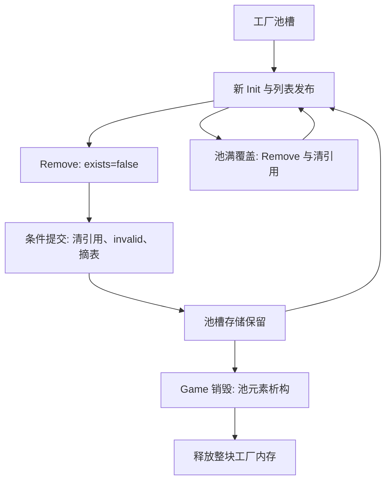

# tx-01-63：T0-06 操作 1，房间实体容器与生命周期定位

日期：2026-10-17。范围：只完成[任务书 T0-06](../isaac-cs-t0-task-plan.md#9-t0-06实体枚举临时身份和-canonical-state-hash)操作 1 的静态定位，不进入操作 2–9。遵循[现行项目规范](../../project-conventions.md)，本次唯一整体验收为文档静态审阅；不运行游戏、构建、注入、调试器或代码测试。

## 1. 结论与证据边界

`STATIC_CONFIRMED`：当前目标中的主链已定位为：

```text
Game root slot → Game + 0x18300 → Room
                              ├─ +0x1218 EntityList → 多个 Entity* EL
                              └─ +0x0024 GridEntity* 槽位，448 槽

动态实体：Spawn → 工厂选取池槽 → 虚 Init → 分配房间序号 → EntityList 发布
          Remove 标记 → Update 条件提交 → 摘表、ClearReferences、valid=false
          普通池槽保留；Player 在特定提交路径 Free(1)
          Game 销毁 → 逐池元素析构 → 释放整块 EntityFactory

Grid：独立工厂 → 旧槽对象 Free(1) → 写新槽 → Grid Init
      Immediate remove / Room 销毁 → 虚析构及物理释放
```

`Remove()`、`_exists=false`、失去 EL 成员资格、`_valid=false`、受追踪引用归零、C++ 析构和释放分配内存是不同事件。当前本体确实存在同一内存地址被直接复用的路径。

本次没有新的 `RUNTIME_OBSERVED` 结论。静态入口定位完成不等于已具备安全 capture、全部生成入口覆盖或稳定实体身份。

## 2. 指定会话的吸收与版本处理

已阅读本地会话 `01a149e2-a48c-7cc2-883e-fd04d14e964d` 的完整一轮对话，包括用户补充“这个仓库对应游戏版本落后于最新版本”。该会话工作目录为 `D:\projects\REPENTOGON`，主要资料为：

| 参考文件与位置 | 本次用途 |
| --- | --- |
| `libzhl/functions/EntityList.zhl:19`、`EntityList_EL.zhl:19` | 多视图容器与 16 字节 EL 的候选布局 |
| `libzhl/functions/Game.zhl:29`、`:261`；`Room.zhl:175`、`:184` | Spawn 接口、Room 和 Grid 候选关系 |
| `libzhl/functions/EntityFactory.zhl:4` | 内嵌实体池线索；不直接沿用旧偏移或大小 |
| `repentogon/Patches/EntityManager.cpp:94`、`:146`、`:287` | 标记、提交、通知、玩家特殊处理，以及迟移除补丁的动机 |
| `repentogon/Patches/EntityPlus.cpp:22` | 构造、每次 Init 与最终析构不同；对象扩展随逻辑使用重建 |
| `repentogon/LuaInterfaces/LuaIsaac.cpp:68` | 旧版 GetRoomEntities 使用 updateEL；在当前本体另行定位 |

可复用的是生命周期分层、对象池和多 EL 的认识。REPENTOGON 的 `NotifyNewEntity`、`NotifyDeleteEntity`、ESSM、`s_stagedRemove`、补偿提交与 ASM 补丁是其源码行为，不能写成当前原版游戏已安装的功能。`HookTest.cpp` 中被注释的日志 Hook 不作为实际运行证据。没有把这些补丁复制到本项目。

当前 IDA 数据库的目标名为 `isaac-ng.exe`，image base `0x00400000`；启动横幅字符串为 `Binding of Isaac: Repentance+ v1.9.7.17.J460`（VA `0xB7E1B4`）。同时存在 `1.9.7.16` 字符串，不能凭任意一个旧字符串独立命名构建。磁盘输入 PE 的描述元数据为 Machine `0x014C`、TimeDateStamp `0x69E6E3A7`、SizeOfImage `0x008FE000`。没有进行文件或 IDB 哈希校验；结论适用于本次打开的 IDB，不外推其它版本。

| 旧源码资料 | 当前 IDA 直接确认 | 处理 |
| --- | --- | --- |
| Pickup 池 `+0x357630` | `+0x357C30`，元素步长 `0x6F0` | 使用当前构造与销毁指令 |
| EntityFactory 大小 `0x695C60` | 分配及释放大小 `0x6AAC60` | 不复制旧结构整体大小 |
| Grid 声明 `[0x1BF]` | Get 接受 `0..0x1BF`，Room 析构循环 448 次 | 容器有 `0x1C0` 槽；不推断全部槽在当前房间活跃 |

## 3. 当前房间容器与遍历入口

本节地址列同时给出 IDA VA 和 RVA，避免与旧交接中省略基址的写法混淆。`VA = 0x00400000 + RVA`。

| 对象关系 | 当前静态依据 |
| --- | --- |
| root slot：VA `0xC71678` / RVA `0x871678` | Spawn、Lua 枚举和 Player 发布共同读取；与本项目 `coop_passive_runtime.cpp` 的已知 root slot 相同 |
| `Game + 0x18300 → Room*` | VA `0x6FE618`、`0x86FB7C`、`0x9B9F27` |
| `Room + 0x1218 → EntityList`，内嵌 | VA `0x803E64`：`8D 8F 18 12 00 00`，随后 `0x803E70`：`E8 4B 48 C1 FF` 调用 `0x4186C0` |
| `Room + 0x24 + index*4 → GridEntity*` | `0x436060` GetGridEntity、`0x7EBCA0` SpawnGridEntity、`0x7E9BA0` Room 析构共同确认 |

EL 描述结构为 16 字节：`+0` 存储共享/子视图标志，`+4` 指针数组，`+8` capacity，`+0xC` size。共享标志为真时，EL 析构不释放该指针数组；释放数组也不等于析构其中的实体。

| EntityList 内偏移 | 本次确认的角色 |
| --- | --- |
| `+0x20` main | 普通实体主体成员；提交时清引用并置 invalid |
| `+0x30` persistent | 发布函数选择 Player、Familiar、特定实体；提交包含 Player Free(1) |
| `+0x40` update | Update 遍历源，也是当前原生 GetRoomEntities 的源 |
| `+0x50` render | 发布时排序插入；移除提交摘表 |
| `+0x60/+0x70/+0x80` | 旧资料命名 effect/temp/bufferTemplate；当前原始指令确认描述结构位置及析构，完整用途未在本轮展开 |
| `+0x90` wisp | 发布/Reset 检查 Type=3、Variant=206；提交摘表 |

当前原生 Lua `GetRoomEntities` 为 VA `0x86FB20` / RVA `0x46FB20`，注册点为 VA `0x86DE3A..0x86DE46`。它读取 `Room+0x125C` 的 data 和 `Room+0x1264` 的 size，即 `EntityList+0x40` 的描述结构，再遍历 `data[i]` 包装 Lua userdata。循环没有 `_exists/_valid` 过滤，也不读取 Grid。该 Lua 调用会创建表、userdata 和 registry 引用，本次没有实际调用；它是定位依据，不作为无副作用 capture 实现。

同一个 Entity 可以同时在多个 EL 中。把所有 EL 拼接或把所有 size 相加都会重复计数；只看 updateEL 也不能自动声称覆盖全部对象。Grid 需独立观测。这里不选定后续操作 2 的枚举覆盖策略。

## 4. Spawn、工厂、Init 与发布的精确顺序

| 含义 | VA | RVA |
| --- | --- | --- |
| Game::Spawn 包装层 | `0x428B20` | `0x028B20` |
| Game::Spawn 实现 | `0x6FE410` | `0x2FE410` |
| EntityFactory::Create | `0x6F0090` | `0x2F0090` |
| EntityFactory 池构造 | `0x6F2A10` | `0x2F2A10` |
| Entity 基类构造 / Init | `0x6A8290` / `0x6A93A0` | `0x2A8290` / `0x2A93A0` |
| EntityList 发布 | `0x418500` | `0x018500` |
| 普通 local-coop Player 创建与发布 | `0x9B9CD0` | `0x5B9CD0` |

通用路径：

1. `0x428B20` 把附加参数设为 0，转入 `0x6FE410`。实现先调用 `0x8646E0` 等生成前处理，可能调整生成参数。
2. `0x6FE4F4` 从 `Game+0x26580` 取工厂，`0x6FE4FA` 调用 `0x6F0090(type, a9&1)`；空返回直接结束。
3. 工厂返回池槽后，Spawn 设置 spawner 关联、位置与速度。
4. `0x6FE610`：`FF 50 04`，以该对象 vtable `+4` 调用派生 Init，参数包含 type/variant/subtype/seed。基类 Init 为 `0x6A93A0`，派生调用关系由其实际虚槽决定。
5. Init 正常返回后，读取并递增 `Room+0x1214`，把旧值写入 `Entity+0x20`；`0x6FE636` 调用 `EntityList` 发布。
6. 发布之后 Spawn 仍可能进行生成者属性传播和其它处理，直到正常返回。不能把“已经进入列表”当作全部 Spawn 后处理结束。

因此，在这条通用路径内，Init 在本次新发布之前。它不证明 Init 期间地址从未存在于列表：工厂可能返回覆盖旧对象的同一地址，回调也可能重入。

`0x418500` 的关键行为是：对象此前 invalid 时，根据 type 写入 main 或 persistent，置 `+0x170=1`，插入 render，按条件加入 wisp；对象此前 valid 时先从 update 中删除匹配指针。最后仅在 flags 条件允许时向 update 追加。Helper `0x417630` 是 EL push_back；`0x417670` 删除匹配指针并压缩数组。它们均不是析构接口。

工厂 `0x6F0090` 明确拒绝 Type=1 并输出 `EntityFactory cannot spawn Entity_Player`。当前普通 co-op 创建 `0x9B9CD0` 则单独分配 `0x2F00` 字节、调用 Player 构造 `0x753DA0`、虚 Init，然后分配房间序号并调用同一 `0x418500`。所以 Game::Spawn 或通用工厂的单一观测点不能替代玩家创建观测。

`Room+0x1214` / `Entity+0x20` 这里只是已定位的原生计数关联；本轮没有把它定义成操作 4 的 observed spawn ordinal、跨房身份或网络 key。

## 5. 池满覆盖与逻辑重用

当前工厂构造一次性构造内嵌数组；每次 Create 寻找 `+0x170==0` 的槽，而不是每次 new 一个对象。池满分支在相应参数位允许时执行：

```text
选中旧槽 → +0x177=1 → 虚 Remove(+0x28)
         → 虚 ClearReferences(+0x44) → +0x177=0 → 返回同一个槽
         → 调用者执行新 Init 与发布
```

例如 Effect 分支 VA `0x6F0CD6..0x6F0D12`；NPC 分支 VA `0x6F0E46..0x6F0E82`。参数位设定时也存在池满返回空的分支。不能把旧源码参数名 `force` 当作已理解的完整行为契约。

当前基类 Init 在 VA `0x6A954C` 通过跨字节写入恢复 `+0x172=1`、清 `+0x173` 等状态；`+0x170` 由发布负责。逻辑使用可在没有 C++ 析构/构造的情况下重新开始。这补全了参考会话中未追到底的复用顺序。

## 6. Remove 标记、引用清理与原生提交

当前 Entity 基类 vtable 位于 VA `0xB6730C`：槽 0=`0x6A8820`，槽 1=`0x6A93A0`，槽 10=`0x6ACB00`，槽 17=`0x6ACB60`。这些是本次 IDB 中的基类槽；派生类可以覆盖，不能把基类伪代码签名直接作为所有派生函数 ABI。

| 字段或入口 | 当前静态行为 |
| --- | --- |
| `Entity+0x170` valid | 构造置零，发布置一，提交清零，工厂据此找空槽 |
| `Entity+0x172` exists | 基类 Remove 置零；Update 与 GetRoomEntities 对它的处理不同 |
| `Entity+0x173` dead | Remove 在此前为零时置一；不等同于 valid 或成员资格 |
| `Entity+0x177` | 工厂覆盖期间置一再清零；参考源码称 removedByFactory |
| Remove：VA `0x6ACB00` / RVA `0x2ACB00` | 写 exists/dead，调用 `0x866060` 的原生移除回调分派，释放 `+0x408` 的 Lua registry 关联；没有摘 EL 或释放 Entity 本身 |
| ClearReferences：VA `0x6ACB60` / RVA `0x2ACB60` | 清理自身受追踪引用，以及引用自己的登记项，将相关外部引用置零；不直接析构 Entity |

Player 的 ClearReferences 虚槽为 `0x757A40`，先调用基类清理，再处理玩家专用关联。Remove 中原生 Lua 回调发生于设置 exists=false 之后；回调不是最终物理释放通知。

原生 `EntityList::Update` 为 VA `0x4186C0` / RVA `0x0186C0`。它使用 updateEL 进行实际更新，维护局部 staged-remove 状态，在 VA `0x419443` 检查该状态，满足时按以下顺序提交：

1. update、render、wisp：遇到 exists=false，移位压缩指针数组、减 size。
2. main：虚 ClearReferences，valid=false，再摘表；此分支没有统一 Free。
3. persistent：保存原 valid，虚 ClearReferences，valid=false；Type=1 且原 valid 为真时，VA `0x419658` `6A 01`、`0x41965A` `FF 10` 调用虚 Free(1)，随后摘表。

不能把这段原生代码描述成无条件扫描所有列表。局部移除标志是在特定更新位置观察的，迟到的 Remove 未必在同次提交中反映；参考仓库的全局 `s_stagedRemove` 与补丁正是另一个实现层，本次没有安装它。

## 7. Reset、析构及物理释放

`EntityList::Reset`（VA `0x418230` / RVA `0x018230`）重建 update/render/wisp，按已有 flags 保留 main 中的部分对象，对其余对象执行引用清理、valid=false 和虚 Remove；persistent 列表成员重新进入视图。Reset 不等于逐个 delete 全部实体。

`EntityList` 析构（VA `0x417E50` / RVA `0x017E50`）遍历 main/persistent，依次虚 ClearReferences、valid=false、虚 Remove，随后处理查询结构与 EL 数组存储。它也没有逐个统一 Free(1)。

玩家的提交释放链为：

```text
persistent 提交 Free(1)
  → Player 虚槽 0：0x754D60
  → Player 析构：0x754ED0 → Entity 析构：0x6A8850
  → 低位 deallocate 参数为 1 时：0xAEF15C → 0xA0F500 → 0xA648B0
  → 分配统计处理及 free(allocation_base)
```

基类 scalar deleting destructor 为 `0x6A8820`，同样先析构，再按参数低位决定是否释放。基类析构若发现 exists 仍为真，会调用基类 Remove，再清理资源。因此“收到析构”与“此前一定调用过 Remove”也不是同义判断。

池化实体的最终释放在 Game 对象销毁路径，而不是普通 Remove：

```text
0x9AB700 → 0x6F3060（Game 销毁）
  → 0x7E9BA0（Room 销毁，包含 0x417E50）
  → 取 Game+0x26580 的工厂
  → 12 组 vector destructor iterator 逐个调用池元素析构
  → 0x6F3341 调用 0xAEF15C，释放整块 0x6AAC60 工厂
```

当前已直接追到的示例包括 Effect `0x5CDA90`、Familiar `0x60D400`、Tear `0x665ED0`、Pickup `0x6E0160`、NPC `0x6B8910` 的池元素析构，均进入 Entity 基类析构 `0x6A8850`。此处只是证明池所有权和最终析构路径，不作为操作 2 的逐类别覆盖登记。



Game 销毁调用链不能直接当成所有回菜单、重开或 run teardown 的精确时间契约；这些触发条件没有在本轮运行时观察。

## 8. Grid 的独立路径

| 含义 | VA / RVA | 当前静态依据 |
| --- | --- | --- |
| GetGridEntity | `0x436060 / 0x036060` | `index>0x1BF` 返回空，否则读 `Room+0x24+4*index` |
| SpawnGridEntity | `0x7EBCA0 / 0x3EBCA0` | 检查范围及场景条件，调用工厂，替换槽并 Init |
| Grid 工厂 | `0x70B2E0 / 0x30B2E0` | 根据 type 分配派生对象，构造并写 type/index；未知 type 返回空 |
| Grid Init wrapper | `0x709DB0 / 0x309DB0` | 写 seed，调用虚槽 `+0x20`，更新自身状态 |
| RemoveGridEntityImmediate | `0x81E980 / 0x41E980` | 满足条件时先清槽并更新辅助网格数据，再虚 Free(1) |
| 基类 deleting destructor | `0x709CB0 / 0x309CB0` | 清资源，参数低位为 1 时释放对象 |

SpawnGridEntity 的实际顺序是：构造新对象 → 旧槽非空则虚 Free(1) → 写新槽、variant/附加数据 → 调用 `0x709DB0`。这里的 Init 在槽写入之后，与上述通用动态实体的“Init 后发布”顺序不同。

Grid 基类 vtable 为 VA `0xB686E8`；派生类按自身虚槽析构，例如 Rock 的槽 0 为 `0x70B950`，清派生及基类资源后按参数释放。Room 析构 `0x7E9BA0` 从 `Room+0x24` 开始，循环 448 次，对非空 Grid 调用虚 Free(1)，之后才析构 EntityList。Grid 不使用动态 Entity 的 exists/valid/EL 延后提交链。本轮只定位 immediate remove 与 Room 销毁，不把其它破坏、延迟移除路径宣称为穷尽。

## 9. 对后续工作的约束与未决问题

- `STATIC_CONFIRMED`：已找到直接读取数组的候选路径及上述生命周期入口；网络线程不能由此获得读取或操作游戏对象的权限。任何实际枚举仍需位于已理解的主线程边界，不能在 Init、回调或正在修改的 EL 中间采样。
- `STATIC_INFERENCE`：以完整 Room 更新正常返回后的边界研究 capture，比 EL 单次返回能包含更多房间后处理；但当前奇数帧 Player-only 路径、暂停、loading、转场和回调重入的 capture 归属尚未在本轮建立，不能把 render 或顶层 loop 当作 tick。
- `UNKNOWN`：全部 direct factory callers、派生 Init/Remove override、直接实例创建、恢复/载入与 Mod 回调是否被一个候选观测点完整覆盖。交叉引用按至多 64 条导出，并保存截断标记，未逐条闭合全部调用者；不能声称 Game::Spawn 包装层包揽全部实体创建。
- `UNKNOWN`：真实场景中的回调重入、池满覆盖时旧成员资格与新发布窗口、错误线程、异常/OOM、并发读安全。静态正常路径不冒充运行时验证。
- 操作 2 的完整类别覆盖、操作 3 的字段稳定性与变化时机、操作 4 的临时身份均未开始。这里只记录区分生命周期所需的少数字段，不定义 canonical state、spawn ordinal schema 或 wire 接口。

## 10. 证据与本次唯一验收

[原始 IDA 证据](../../../../artifacts/cs-t0/tx-01-63-static/ida-evidence.json)保存 40 个函数的完整静态伪代码、各函数 chunk 的指令与字节、VA/RVA、最多 64 个交叉引用及截断标记、基类虚表和 5 段关键调用点。Hex-Rays 反编译参数名与类型仅为分析辅助；涉及槽位、偏移或顺序的结论以原始指令为准。Game 整个 Room::Update 未导出巨量伪代码，只保留相关调用点，不宣称分析其全部控制流。

[导出脚本](export_tx_01_63.py)可在打开相同目标 IDB 时通过 IDA MCP `py_exec_file` 执行；默认生成 `artifacts/cs-t0/tx-01-63-static/ida-evidence.json`。再次导出应在 IDA Python 调用 `export(新的绝对目录)`，输出目录必须尚不存在，以保留既有证据。它只读取静态 IDA/磁盘资料，不修改 IDB，不接触游戏进程，不计算或校验哈希。

本次文档静态整体验收结果记录于[验收记录](tx-01-63-review.md)。未运行任何游戏、构建或代码测试；该结论不替代后续实际 capture 功能的验收。
