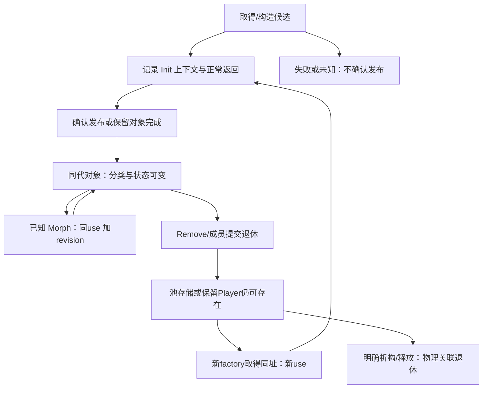

# tx-01-71：生命周期方案与原生诊断生产链补全

日期：2026-10-18。对应 [tx-01-70](tx-01-70-static-analysis-handoff.md) 的 A01–A13、E01–E10，以及新增身份观察的 B01/B07 静态依据。GPT6 Luna/max 子智能体先取证，主智能体复读原始导出、补查当前 IDA 并更正结论；本篇为合并时采用的补充结论。

遵循[现行规范](../../project-conventions.md)。当前 IDB 为 `F:\SteamLibrary\steamapps\common\The Binding of Isaac Rebirth\isaac-ng.exe.i64`，x86、imagebase `0x400000`、banner `v1.9.7.17.J460`。下文地址为 VA，RVA=VA−0x400000，偏移均为十六进制。没有修改 IDB、运行目标函数、计算/校验哈希、实现采集器或运行测试。

证据：子智能体[原始导出](../../../../artifacts/cs-t0/tx-01-71-static/agent-native-evidence.json)与[分析报告](tx-01-71-native-analysis.md)；主智能体[40 函数、9 段指令、18 个入口候选及调用者](../../../../artifacts/cs-t0/tx-01-71-static/primary-evidence.json)与[导出脚本](export_tx_01_71_review.py)。引用 tx-01-63/64 的内容属于已有当前证据；本轮重新读取和补查的事实不冒充运行时观察。

## 1. 复核更正

| 初期说法/歧义 | 当前采用结论与依据 |
|---|---|
| 诊断里的“Player+956”被误读为游戏Player字段，或写作0x956 | `NetInputDevice+0x3BC`，十进制956；`+0x3C0`为另一摘要值。ctor9015B0/reset901B70及local-device lookup支持对象域；不是Entity.Parent |
| `0x95999E`是native frame写入点 | 指令头是`0x95999D`，`83 BB E4 B3 04 00 00`，为`cmp [ebx+4B3E4],0`，是读。实际ready路径在910980末尾递增NetManager+0xC |
| 90D9B0或90F760邻近ring，所以是producer | 前者处理pending joins，后者处理drop messages；不能按地址邻近推断 |
| NPC Morph会改seed | 6C0F30直接改分类及冠军/config字段；`this[793]`是`+0xC64`，不是InitSeed。方法体没有直接写+3DC/+3EC；未穷尽虚helper不能作全称保留保证 |
| Replace目标偏移+0x368；目标地址不同就一律新ID | 9BEE80的`+368`是十进制，即+0x170 valid；已登记保留目标重新发布仍用其自身object_id。关系只在本批地址唯一也不足以排除旧槽指向复用地址，必须有同代事件依据 |
| RNG history仅在Online调用时追加 | 6EEF60只有`byte_C7AC68`的rand早返分流；其余已读主体无Online roster条件，正常MT路径追加trace。帧值来自NetManager相关字段，不等于Online-only |
| Room+1310与EntityList+F8是两份详细记录 | Room.EntityList在+1218，二者是同一32槽详细ring；NetManager+2C才是另一份12-byte summary ring |
| summary第三字是global RNG或world save checksum | 第三字来自683580读取的序列化online/lobby stream；源为Manager+14、NetManager+1018，不是已证明的GameState世界保存或MT摘要 |
| 标准分支owner叫StandardBodyHook | 955231→6FADC0对应LoopGameplayHook；StandardBodyHook另包6FAE09→708630。阶段方案已分开 |

这些更正不覆盖子智能体或历史原始JSON；完整原说法和后续修正均保留。

## 2. A01–A04：取得、初始化、发布、退休

`STATIC_CONFIRMED`：普通动态链仍是6FE410→6F0090→派生Init→Room序号→418500，见 [tx-01-63](tx-01-63-entity-lifecycle.md)。池满可先对旧槽Remove/ClearReferences，再返回同址；valid仍可能使发布走“更新已有视图”的分支。工厂非空、Init调用和发布调用不能各计一次出生。

Player9B9CD0普通分支new/ctor后先插入roster，随后虚Init，最后赋Room序号并发布；特殊参数−1分支使用Manager+0xD0/+D4/+D8的另一vector，Init(1,2,0,seed)后直接返回，不走普通发布。分配失败后的后续路径没有在本轮证明可安全执行；不能把伪代码中的非空假设提升为OOM保证。

Grid7EBCA0先检查索引/场景、70B2E0取得新对象，非空才Free旧槽、写新槽、写variant/varData，再709DB0 Init。MakeDoor7EEA90也可能替换Grid并建立door别名；Grid.Init正常返回与槽写入先后必须分别观察。

`DESIGN_PROPOSAL`：分开物理对象标识、本次逻辑使用和世界成员资格：

| 事件/状态 | 本地动作 | 不能推出的内容 |
|---|---|---|
| FACTORY_ACQUIRED / PLAYER_CONSTRUCTED / GRID_ALLOCATED | 分配candidate；同址旧use若已知则记录复用/退休关系；保留acquire_seq | 不立即登记活跃世界出生，不伪造publish成功 |
| INIT_ENTER/RETURN | 记录同线程调用栈、初始化revision；已知Morph则归同use；未知重Init使连续性不确定 | 不把每次Init都计出生 |
| PUBLISH_RETURN | 根据该次candidate与调用上下文记录一次已确认发布；重复发布只更新membership | valid=true、重复发布或已有对象回房不能单独计新生 |
| 创建owner正常结束 | 冻结可得出生描述，完成candidate；若被移除仍保留短命事件 | POST_INIT不是最终字段快照；最终值只在选定采样阶段复制 |
| 保留Player正常构造/恢复完成 | 可进入RETAINED状态，拥有本地object_id，无房间active membership | 不要求所有物理Player都走房间发布，也不把retained算活跃 |
| Remove / exists=false | 标记REMOVE_REQUESTED及属性变化 | 不是统一析构/释放，Player保留关系也未必结束 |
| 提交清引用、valid=false、摘表 | 退休对应世界membership；池use进入可复用/非活跃状态；引用关联按已知清理事件撤销 | 不把单次缺枚举当析构，不自动抹掉保留Player物理身份 |
| 新factory取得同址 | 新use_generation；旧use永不复活，即使旧列表仍临时含该地址 | 不因旧对象和新对象地址相同而合并 |
| Entity析构 / 已确认Grid释放或替换 | 退休物理关联；仅保留值副本与历史事件 | 退休后不解引用旧指针 |
| 未确认创建/失败/异常完成 | 候选标ABORTED或UNKNOWN；若先发生旧对象清理，旧身份仍不复活 | 不用空返回、未发布或计时清零补造新生 |

出生事件顺序采用“所选观察域内确认的创建完成/发布事件顺序”，另留请求/取得序号；嵌套子对象先发布时按实际完成事件排序，不把外层请求先到当成先出生。出生分类与seed是当时读到并冻结的描述，当前分类/seed另作快照。候选尚未确认时只有local candidate_id，没有跨进程spawn ordinal。



以上是观察语义方案；static evidence没有证明实际事件流无遗漏或所有异常都被通知。

## 3. A05–A08：Morph、Restore、边界与重入

### A05：两种Morph不能混为Init新生

- NPC `0x6C0F30`：参数与当前分类/冠军一致时直接返回0；否则直接改Type/Variant/SubType，更新冠军/config，通过虚槽+60/+64等处理本对象，正常返回1。没有直接工厂/418500调用，也没有直接+3EC/+3DC写；helper/任意Mod的全部副作用不在此全称闭合。
- Pickup `0x6E30A0`：KeepSeed为false时在`+0x3EC`写一次基于原值的RNG变换；保存部分状态，随后在**同一个this**经虚槽+4重新Init，再恢复部分成员。Index、位置/速度及flags有保存/恢复路径，特殊商店分支可另选Init seed；因此不能只凭传入KeepSeed或Init重入判身份。
- 策略：进入已确认Morph时压栈reason=MORPH；其内Init不分配新use，返回时记录classification/seed/revision变更。取消/无变化也不计出生。该策略只声明被观察到的正常本体调用；不把“无直接publish”写成所有helper都没有创建其它对象。

### A06：玩家恢复与替换

`0x7AE4B0`为同一Player上的恢复写入；入口先检查`Player+0x26C8`替换关联，非零时直接返回，正常路径随后恢复本对象大量成员，不是自己new一个Player的统一入口。`0x9BCAA0`则按保存关系创建或复用backup，并重建四个Esau保留槽；其间确有new/ctor/Init。两者不能共称“Restore保留旧对象”。

`0x9BEE80`有两类主要正常分支：目标Player已valid时交换roster/PlayerIndex及相关关系；目标尚未发布时替换roster指针、转接Twin/backup/部分引用并发布目标，源对象可invalid/exists=false/PlayerIndex=−1。没有把旧对象统一析构为前提；目标若已有保留对象，不因为重新发布就新造物理身份。方法正常退出清双方+26C8，异常展开清理没有被本轮证明。

策略：物理object_id在未发生明确新构造/复用前保留；Restore和Replace增加mutation revision，当前批次作废，并记录关系与membership变化。跨Restore不默认延续可比较状态；若恢复来源/事件关联不明，退休该比较映射并从FIRST_OBSERVED重建。SubPlayer `+0x1D98`、Twin `+0x1E68`、backup `+0x1E6C`、replaced `+0x26C8`及Esau槽分别保留，不相互替代。

### A07：Room/run代次

EntityList Reset418230会保留部分成员并重建视图，不是全体delete；Grid在房间销毁/替换路径可物理释放。故room_epoch是观察域边界，不直接等同全体物理对象销毁。已完整观察的persistent对象可保留本地object_id，但重新建立该房间的membership与跨进程映射；没有完整边界历史则标连续性未知。run teardown退休run和全部比较映射，新run不复用旧local key。代次从实际观察事务产生，不从相同指针/seed推断。

### A08：去重与重入

使用TLS有界reason栈，含outer/creation/morph/restore/publication token、对象域、candidate_id及进入序号。factory内Remove/清引用属于旧use；Morph内Init属于同use；嵌套Spawn有独立候选。相同对象多来源只合并membership，重复Remove/重复publish为幂等状态变更。全局单个staged bool或旧RGON的全局Pickup请求参数不作事件栈。栈/队列耗尽、配对异常或丢事件时使相关范围连续性未知，采样失败不改变原生执行。

## 4. A09–A13：覆盖、key、引用与无法静态保证的性质

### A09：启用前对象

按来源同步bootstrap，分配本地object_id，origin=FIRST_OBSERVED；未知生成顺序不得填observed_spawn_ordinal。已冻结A/B ordinal只能作为已知活跃Player语义锚，不扩成所有Player的身份。只有本次存在性、字段和已知来源可得，历史构造/复用不能从当前seed/index补造。

### A10：八类覆盖表

| 类别 | 推荐创建/变化观察 | 退休/再用及补源 | 明确范围 |
|---|---|---|---|
| NPC | 工厂6F0090、基Init6A93A0、发布418500、Morph6C0F30 | Remove/清引用/提交、再次factory取得、Entity析构 | 正常原生池/通用Spawn及同对象Morph |
| Tear | 同工厂/Init/发布 | 同上；短命事件独立于相邻快照 | Spawn后补写/立即Update不当成第二次出生 |
| Projectile | 同工厂/Init/发布 | 同上 | 不与Tear合并；未知专用timer不影响本地代次 |
| Pickup | 同工厂/Init/发布、Morph6E30A0 reason | 同上；保存记录与池槽不当active | Morph内Init不另计出生 |
| Familiar | 同工厂/Init/发布 | persistent/owner转接、复用、析构 | 独立Familiar.Player；不只枚举wisp |
| Effect | 同工厂/Init/发布 | 复用/移除/析构；来源不限effectEL | 调用方Spawn后改字段留到完整采样阶段 |
| Player | ctor753DA0、创建9B9CD0、恢复9BCAA0/7AE4B0、替换9BEE80、发布 | roster/Esau/SubPlayer/Twin/backup/replaced；构造与明确析构 | 普通、特殊−1及已确认保留/替换路径；保留对象非活跃名单 |
| Grid | 工厂70B2E0、Init709DB0、7EBCA0与MakeDoor7EEA90上下文 | 81E980、槽替换、Room生命周期；448+8来源 | Grid独立域；同一door/Grid指针同批别名合并 |

表中的公共基Init也用于发现未知上下文的重新初始化：未能归入已确认Morph/创建上下文时，不猜连续性。当前Game/Room路径、已确认构造工厂和来源是支持域；任意Mod直接分配、写虚表、绕过Init/工厂、未知间接创建/销毁不宣称覆盖。首次见对象或未知重Init有显式输出，不强行取得跨进程身份。

### A11：推荐身份分层

本地关联用`(run_epoch, domain, object_id, use_generation)`，不使用可变分类/seed作为连续性判据。物理构造与逻辑use、membership revision独立。跨进程采用已对齐创建事件序号加冻结出生描述的候选key；分类/seed当前值留在快照中。相同seed不合并，分类变化不改出生key，同key多对象保留冲突组。跨进程事件范围/顺序未对齐则不可宣称相等；裸地址不能补key。

### A12：关系解析

先复制关系槽，再在同一自有批次/事件序中解析；状态为NULL、KNOWN_CURRENT、UNRESOLVED、RETIRED、AMBIGUOUS_REUSE。当前已知地址若曾复用，单靠槽值不能证明写槽属于新use；需已观察写入/清理顺序或能支持同代的事件，否则保持歧义。Familiar.Player、Player backup等非统一追踪槽不能继承EntityPtr清引用保证。未枚举对象仅可作为未解析目标，不在后台解引用。

### A13：静态不能证明的内容

跨进程创建顺序天然相同、全局seed/key唯一、实际事件无丢失、全部Mod行为、未知worker并发、所有异常/OOM路径和真实Hook恢复均没有静态证明。具体退化行为已经定义：FIRST_OBSERVED、UNKNOWN_CONTINUITY、KEY_COLLISION、UNRESOLVED_REFERENCE、SAMPLE_GAP/INCOMPLETE；这些是功能输出，不是推进gate。静态目标无需伪造这些运行性质。

## 5. 身份观察的ABI与入口指令候选（B01/B07补充）

推荐的语义观察在**函数级统一owner**，这样不会只覆盖某一个直接call。当前引擎只有rel32 call/pointer patch，尚不能安装下表的入口detour；实现阶段需在同一有序事务中增加明确的entry patch类型、原字节保存、trampoline、在途计数及逆序恢复，不能把入口字节放进RelativeCallPatch。

下表只是已经恢复的最小ABI与完整指令边界，不是安装授权或运行验证。18个入口开头均未包含相对call/jump或x86 EIP相对数据引用；所列范围可以作为具体实现输入，但整段函数内的SEH/栈对齐必须按原样执行。继承旧调用者栈的ABI、返回值和original exactly-once都需保留。若实现改用callsite/vtable方案，应另明确其覆盖集合，不能沿用“函数入口覆盖”的声明。

| VA | 最小参数/返回存储约定 | 入口跨度及原字节 |
|---|---|---|
| 6F0090 | ECX=Factory，栈type32/选项，ret8，EAX对象 | 7：`55 8B EC 51 8B 45 08` |
| 6A93A0 | ECX=Entity，栈4个raw32，ret10h；不把伪代码EDI/ESI当额外参数 | 6：`55 8B EC 83 EC 30` |
| 418500 | ECX=EntityList，栈Entity*，ret4；保留EAX结果 | 7：`55 8B EC 53 8B 5D 08` |
| 6ACB00 | ECX=Entity，无栈参数，ret；观察后保留原生返回寄存器 | 5：`51 56 8B F1 57` |
| 6ACB60 | ECX=Entity，无栈参数，ret；仅记录清引用事实 | 5：`55 8B EC 51 53` |
| 6A8850 | ECX=Entity，基类析构，无栈参数，ret | 5：`55 8B EC 6A FF` |
| 753DA0 | ECX=新Player存储，无栈参数，EAX构造结果 | 6：`53 8B DC 83 EC 08` |
| 9B9CD0 | ECX=PlayerManager，栈角色参数，ret4，EAX对象/空 | 5：`55 8B EC 6A FF` |
| 9BCAA0 | ECX=PlayerManager，栈保存结构*，ret4 | 5：`55 8B EC 6A FF` |
| 9BEE80 | ECX=PlayerManager，栈旧/目标Player*，ret8，AL结果 | 6：`53 8B DC 83 EC 08` |
| 7AE4B0 | ECX=Player，栈保存结构*，ret4；记录恢复revision | 6：`53 8B DC 83 EC 08` |
| 6C0F30 | ECX=NPC，栈type/variant/subtype/champion，ret10h，AL结果 | 6：`55 8B EC 83 E4 F8` |
| 6E30A0 | ECX=Pickup，栈3个分类/3个bool槽，ret18h；保留EAX | 5：`55 8B EC 6A FF` |
| 70B2E0 | ECX=Grid type，EDX=index，无栈参数，EAX对象/空 | 5：`55 8B EC 6A FF` |
| 709DB0 | ECX=Grid，栈seed32，ret4 | 6：`55 8B EC 8B 45 08` |
| 7EBCA0 | ECX=Room，栈index/type/variant/seed/varData，ret14h，AL成功 | 5：`55 8B EC 53 56` |
| 7EEA90 | ECX=Room，栈door slot，ret4；返回寄存器按原样保留 | 5：`55 8B EC 6A FF` |
| 81E980 | ECX=Room，栈index/辅助网格值/装饰条件，retCh | 6：`55 8B EC 8B 55 08` |

只有本地原始指令与明确owner能用于设计。不能据此执行函数、覆盖第三方Hook、忽略同一事务容量，或声称已恢复任意异常展开。collector失败只停用自有观测，不调用原生创建/清理函数来修复状态。

## 6. E01–E03：真正的生产链、模式和来源

当前证据分三条，不能互换：

```text
动态实体更新：4186C0
  → EntityList+F8：32×24详细frame records
  → 每条frame的vector：56-byte Entity entries
  → 8FE3A0复制命中frame到local NetInputDevice+3BC并写framestate文本
  → 8FF600解析远端记录到remote NetInputDevice+3BC
  → 8FFC70写diff（诊断文本，不是producer）

NetManager ready处理：90B150 → 910980 → 90D640
  → NetManager+2C等ring描述：12-byte summary
  → 90D950按native frame查找；902950随原版frame-input广播取摘要

全局MT取随机数：6EEF60（C7AC68非零时rand早返）
  → 276-byte trace nodes链表
  → 904E70写RNG history文本（由9032D0报告路径调用）
```

详细生产者的精确开启条件是在41870C..418720比较`[Manager+4B3D8]`与`[Manager+4B3DC]`，即NetManager roster begin/end不相同。不是“所有单机每帧都有详细记录”，也不靠某个日志名猜Online模式。普通Room调用4186C0(arg0)，另有90D640(arg!=0)可Reset并调用同函数；因此生产函数可在不同上下文执行，不应直接绑定本项目Authority tick或post-standard阶段。

其来源是EntityList.updateEL按原生迭代规则访问的动态Entity。PreUpdate和Update有exists/flags/参数过滤，但详细entry写入位置在这些分支之后，不能简化为“仅成功执行过Update的活实体”。循环带初始尾对象/当时size边界；新追加、已移除待提交、非update来源和保留Player的覆盖不等同本项目多来源采集。Grid没有独立entry，main/persistent-only对象也没有由此保证包含。

## 7. E04/E05：详细记录与摘要的字段映射

### 24-byte frame头

`frame_slot = EntityList + 0xF8 + 24*slot`，同一地址也是`Room+0x1310+24*slot`：

| slot内偏移 | 内容 | 指令依据 |
|---|---|---|
| +0/4 | native frame | 418777取Manager+4B3E4，418780写入 |
| +4/+8/+C | 56-byte entry vector的begin/end/capacity | 418771/774重用清end，418D13..50追加/扩容 |
| +10/4 | 完成时全局MT状态摘要 | 4196C4调用6EF1F0，41972D写入 |
| +14/4 | 本次EntityList字段摘要 | 419721/727取EL+F0并写入 |

### 56-byte Entity entry

| entry内偏移/字节 | 源 | 与自有采集的关系 |
|---|---|---|
| +0/4 | 本次updateEL循环ordinal | **不是**Entity.Index(+20)，也不是永久ID |
| +4/+8/+C，各4 | Entity Type/Variant/SubType(+28/+2C/+30) | 同名原始字段 |
| +10/4 | Entity+3DC | 当前DropRNG首字，**不是InitSeed(+3EC)** |
| +14/4 | 6EF1F0返回值 | native文本GlobalSeed对应的MT状态摘要，不是run初始seed |
| +18/16 | Entity+38C起四个cached raw32 | 文本的pre position/velocity来源；不升级为完整统一帧前快照 |
| +28/8 | Entity+33C/+340 | 此实体迭代观察时的post position |
| +30/8 | Entity+360/+364 | 此实体迭代观察时的post velocity |

原字节在418BE2..418D50：`movups [esi+38C]`取得pre四字，SSE逐分量取得post，三次16-byte与一次8-byte存储组成56；未见该记录路径对浮点进行量化、epsilon比较或−0规范化。生产按updateEL访问次序append，没有按跨进程稳定key重排。

EL+E8的摘要writer由683410处理。该路径输入顺序明确为：循环ordinal、type、variant、subtype、DropRNG首字、post position的8 bytes、post velocity的8 bytes；完成时再输入6EF1F0的4-byte结果。pre四字只进详细记录，没有出现在这段逐实体feed中。所选writer模式为EL+F4控制的路径；可读指令显示基于raw字节/4-byte累积，不能拿Native摘要相等代替本项目逐字段相等。本轮只阅读代码与字段流向，未执行任何摘要计算或校验。

6EF1F0扫描`0xC7AC70`起`0x9C0` bytes（624×u32 MT状态）及当前MT index的4 bytes。它不调用6EEF60、不推进MT，但可能懒初始化CRC表，故不能当无副作用getter直接加入采集器。

### 12-byte summary

90D640在当前native frame已有slot时更新+4；没有时创建新项：`{frame:+0, EL+F0摘要:+4, serialized_online_state_crc:+8}`。后者在90D771通过序列化器读取Manager+14和NetManager+1018，在90D874调用683580读取原stream；另91ACC0/A89DE0生成变换后的自有buffer存到按frame关联的容器。不能将这个字段命名成详细frame的global RNG摘要，也不将online/lobby流当成GameState实体全集。

## 8. E06/E08：记录生命周期与副作用

详细ring为32槽，head在EL+3F8，count在+3FC。未满时count增加，满时head循环推进；复用槽只先把end重置为begin，vector容量可保留。扩容通过41CCF0；Reset418230还按native frame条件清历史计数，EntityList/Room析构释放向量存储。8FE3A0是对选中历史frame分配24-byte头并深拷贝56-byte vector，再挂到local NetInputDevice+3BC，不是借用live数组；NetInputDevice reset901B70释放对应记录并清+3BC/+3C0。远端解析与diff是另一端点副本。

summary ring由90D640生成，910980的ready正常路径在调用它后递增NetManager+0C；它在driver执行Room模拟之前的网络处理阶段被调用。正常连续路径可将它理解为对已完成EL字段的摘要，但不同早退、Reset/启动分支不能强配成“本轮C/S完整世界样本”。910980还按NetManager+10关联窗口淘汰summary和对应序列化buffer；具体帧字段不替代本项目Authority tick。

生产/输出不是纯读：EntityList更新原本就模拟/清理；诊断还写ring、扩容、初始化摘要表；summary序列化分配/变换缓冲并修改在线内部状态；文本写出路径创建目录/文件、查询和解析符号，报告链还涉及日志/screenshot。C/S collector不执行这些producer/dumper，不为获取格式而触发desync。

## 9. E07：RNG history具体是什么

6EEF60先检查全局byte_C7AC68；非零时直接rand()并早返，绕过本条MT trace。否则执行MT状态推进/tempering，然后追加双向链表node：

| node偏移/字节 | 内容 |
|---|---|
| +0/+4 | 链接 |
| +8/4 | 本次返回的随机结果 |
| +C/4 | Manager+4B3E4 native frame值 |
| +10/256 | RtlCaptureStackBackTrace最多64个4-byte地址 |
| +110/4 | 实际捕获栈深度；node总长0x114=276 |

调用`RtlCaptureStackBackTrace(0,64,node+10,0)`，其最后参数为0，没有生成backtrace hash。每次追加后按`node.frame >= current_frame−2*Manager[77050]−2`的原生unsigned比较保留窗口，旧头节点unlink/free；本轮不把startup unsigned减法边界或窗口配置含义外推成跨run契约。

904E70遍历这些记录并输出random number、frame及解析的栈地址/符号/源码行。它不是记录完整MT状态、所有对象RNG、每次Next输入、目标Entity身份或可重放指令序列。Entity内联DropRNG等可在别的函数直接推进，不保证经过6EEF60；rand旁路也说明history不是全随机操作全集。符号解析结果与历史epoxy标签不能直接当成真实调用模块归因。

## 10. E09/E10：与自有字段的覆盖差异及采用结论

| 自有候选 | native详细56-byte entry /所选EL feed | 采用结论 |
|---|---|---|
| Type/Variant/SubType | 直接包含 | 可作静态字段对照，但不是身份 |
| Position/Velocity | 单实体迭代post值；详细另有cached pre | 阶段不同，不能等同统一post-standard快照 |
| Entity.Index、InitSeed | 未直接包含；ordinal/DropSeed是不同来源 | 必须自有读取，不能借同名Seed替换 |
| HP/MaxHP、Player hearts | 未直接包含 | 没有生命完整覆盖证据 |
| State、timer、Flags、valid/exists/dead | 未直接包含 | 不能从摘要一致推导它们一致 |
| Parent/owner/Player保留关系 | 未直接包含 | 需要自有身份/关系表示 |
| DropRNG全部四字 | 只含当前首字 | shifts等不由此完整记录 |
| 全局MT状态 | 只有624字+index的摘要，没有在56-byte entry中可逆保存全状态 | 不等于初始seed或可逆snapshot |
| Grid及多来源membership | 无独立完整记录 | 自有Grid域与来源表仍必要 |
| 稳定身份/生命周期事件 | update循环序号和frame不提供本地use generation | 不复用为跨进程key |

“未直接包含”只针对这条明确的数据流；其它游戏字段可能通过运动或RNG产生间接影响，不能由此声称完全不影响native摘要。online/lobby stream是独立来源，未当作对上述字段的补全证明。

可采用的是生产入口、阶段区别、原始字段映射、窗口/缓冲生命周期和RNG trace语义。**不复用NetManager、NetInputDevice、原版FrameStore、Online等待条件或buffer作为C/S状态；不调用反序列化/apply，不计算或校验哈希，不声称得到可逆snapshot。**本项目继续采用自有结构化记录与逐字段比较。

本轮没有恢复整个online/lobby序列化语义、任意第三方Hook/Mod或全部异常/并发路径；这些不是最小只读采样与本次覆盖差异研究的必要前提。实际采集、跨进程匹配和恢复结果留待实现后的统一E2E。
