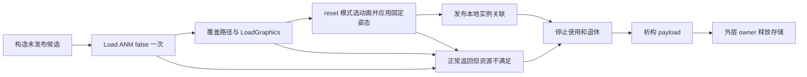

# tx-03-17：独立 Sprite 的创建、准备、应用与退休

日期：2026-10-23（Asia/Shanghai）。本轮继续 tx-03-16 的建议，研究独立 Sprite 的正常 owner 路径与失败后态，将资源准备和固定姿态描述对应到具体构造、引用、调用与清理。GPT-6 Luna / max 子任务研究退休与 Lua GC，主智能体研究构造、复制／交换和 staging，并独立复核子结论。见 [主审记录](tx-03-17-primary-review.md)和 [Luna 报告](tx-03-17-luna-sprite-retirement.md)。

本轮仅静态逆向与文档；不实现 adapter、网络 schema 或可玩 Replica，不运行游戏／构建／资源实验。tx-03-16 的失败验收与说明原样保留；本轮在新的实质研究中修正审阅器分类，不重跑或覆盖旧结果。

## 结果

可以明确一条**受限正常路径候选**：在本地 owner 中构造未发布的新 Sprite → 一次 Load(ANM,false) → 路径覆盖 → LoadGraphics → reset 模式选择动画并应用停止的逐层姿态 → 在已理解的主线程窗口发布本地实例 → 停止使用后析构，再由相同外层分配者释放外层存储。正常失败只清理未发布候选，不把 live Sprite 换图失败后的状态视为可回滚事务。

原生 copy／swap 不适合直接承担完整姿态提交。复制构造会将目标 Offset 和特殊 flags 重置；交换保留目标 Offset 和 overlay 顺序，只转移其它资源／状态并修复 layer owner。它们证明存在受管理的内容转移，不能证明“复制＝忠实克隆”或“交换＝整个姿态原子提交”。

Lua userdata 与自有原生存储也是不同 owner：正常 GC 经 wrapper 虚表清理 payload，传入删除标志 0；`408170` 只析构 Sprite，不释放外层。不能把原生析构、wrapper deleting destructor 和 Lua 块释放当成同一个 delete。

## 证据与地址

当前 IDB 输入为 `F:\SteamLibrary\steamapps\common\The Binding of Isaac Rebirth\isaac-ng.exe`，imagebase=`0x400000`；`RVA = VA - 0x400000`。字段偏移、表项 offset、callsite 与函数起点分别记录。没有校验文件身份或任何哈希，IDB 路径不证明磁盘文件内容相同。

| 原始 artifact | 范围 |
| --- | --- |
| [primary-owner-initial.json](../../artifacts/cs-t0/tx-03-17-static/primary-owner-initial.json) | Lua 创建、原生构造、Load／ANM 绑定、layer 初始化、swap |
| [primary-owner-transfer.json](../../artifacts/cs-t0/tx-03-17-static/primary-owner-transfer.json) | 按值 replacement helper、实际 copy／swap／清理 caller、较大派生对象的 swap |
| [primary-copy-construction.json](../../artifacts/cs-t0/tx-03-17-static/primary-copy-construction.json) | 资源及状态的复制构造、额外引用与重置字段 |
| [primary-pose-staging.json](../../artifacts/cs-t0/tx-03-17-static/primary-pose-staging.json) | state 深拷贝／reset、具名动画选择、换图、逐层图像处理与 pair helper |
| [primary-retirement-review.json](../../artifacts/cs-t0/tx-03-17-static/primary-retirement-review.json) | 主审独立导出的 Reset／析构／GC；其表读取多出一字为相邻字符串，见下文 |
| [primary-userdata-owner.json](../../artifacts/cs-t0/tx-03-17-static/primary-userdata-owner.json) | 正确的一槽 userdata vtable、类型查询与相邻字符串分类 |
| [primary-control-retirement.json](../../artifacts/cs-t0/tx-03-17-static/primary-control-retirement.json) | control 自身 strong／weak 释放与可选缓存 callback 分开 |
| [primary-allocation-wrapper.json](../../artifacts/cs-t0/tx-03-17-static/primary-allocation-wrapper.json) | wrapper 删除分支的释放调用链及实际寄存器转发，不推导任意外层分配配对 |

各文件保留完整指令 bytes、伪代码与当前静态 xrefs。`STATIC_CONFIRMED` 为直接静态事实；`STATIC_DERIVED` 为给定正常条件下的引用／清理推导；以下 adapter 顺序是 `DESIGN_PROPOSAL`，不是已运行功能。只读可重复取证脚本为 [export_static.py](../../artifacts/cs-t0/tx-03-17-static/export_static.py)，指定新的 `TX0317_OUTPUT`，保留 create-new。

| 入口／表 | VA | RVA | 正常 ABI／用途 |
| --- | --- | --- | --- |
| 原生构造 | `0x4074C0` | `0x74C0` | ECX=未构造 payload；无显式栈参，ret；调用者拥有外层存储 |
| 复制构造 | `0x407690` | `0x7690` | ECX=目标 payload；栈上传源对象指针；反编译器 EBP 伪参数不作为 API 参数 |
| 内容交换 | `0x407AE0` | `0x7AE0` | ECX／EDX=两个已构造 Sprite；无显式栈参，ret |
| 按值 replacement helper | `0x407E90` | `0x7E90` | ECX=目标；栈上传完整 `0x114` 字节临时对象，末尾 ret `0x114`，不是传一个指针 |
| Reset | `0x407F10` | `0x7F10` | ECX=已构造 Sprite；保留可重用的外层／string 容量等本地存储 |
| 原生析构 | `0x408170` | `0x8170` | ECX=已构造 Sprite；无删除标志，不释放外层 payload |
| Lua Sprite() | `0x8BB720` | `0x4BB720` | Lua C closure；创建 userdata，返回一个 Lua 结果 |
| Lua GC handler | `0x8C31F0` | `0x4C31F0` | 验证 userdata，再调其 vtable slot 0，删除标志=0 |
| owned userdata 析构槽目标 | `0x8C4CE0` | `0x4C4CE0` | ECX=wrapper；栈上传删除标志，ret 4；按 wrapper+8 清理 Sprite |
| owned userdata vtable 起点 | `0xB73228` | `0x773228` | 本轮确认 slot 0 指向 `8C4CE0`；不把相邻字符串当第二槽 |

## 创建与最终初始状态

`8BB720` 在 `8BB728` 推入 `0x11C`，经 lua_newuserdata 获得 284 字节 wrapper。wrapper+0 写 vtable，wrapper+4 指向 wrapper+8；payload 为 `0x114`（276）字节。`8BB756` 安装 metatable 后，`8BB762` 调 `4074C0`。这条链不经过 Entity 工厂／发布，但安装 metatable 先于构造完成，不能据正常路径声称构造异常时 GC 安全。

`4074C0` 初始化两个 native string、main／overlay state 的本地 Sprite 自指针及空数组、空 layer 指针，再在 `40766D` 调 Reset。它不分配或释放 Sprite 的外层存储；内部资源仍由原生 helper 的分配／释放配对负责。payload 地址在生命周期内需稳定，不能 memcpy 到新地址后保留旧 self／layer owner 指针。

本轮从 ctor→Reset 直接链补充 tx-03-16 未追的默认来源：

| 字段 | 正常构造结束的来源 |
| --- | --- |
| Offset（Sprite+94／98） | 从 `n3_2 / C7B644` 全局复制，不把运行时值默认为常量零 |
| Scale（Sprite+9C／A0） | 从 `C3793C / C37940` 全局复制，不把运行时值默认为常量一 |
| Rotation（+A4） | 直接写零 |
| Color（+A8..D3） | A8..B4 四个 f32=1，B8..D0 七个 DWORD=0；不是只有 RGBA |
| Flip（+100／101）、speed（+104） | Flip word=0，speed=1.0 |
| draw／loaded 相关 +108／109 | word=0；后续 Load 尾部会置 +109=1，不代表资源完备 |
| overlay 顺序（+70）、shadow（+10C）、flags（+110） | 直接写 0、-1、0 |

这些是当前函数的来源／写入，不证明全局从不变，也不将其当作跨版本布局。首次 Load 会按资源进一步创建 layer、借用 ANM 数组及设置 shadow／星号分类，所以 ctor 默认不等于资源准备完成后的支持状态。

## 复制／交换为什么不能充当通用提交

`407690` 深拷贝两个 string、经 `4086E0` 为两个 state 分配并复制各自 key 索引数组，重新建立目标 Sprite owner；借用的 ANM descriptor／定义仍共享。源 +109 非零时调用 ANM 加引用；每个新 layer 独立构造，复制路径与外观并 retain 图像 pair，layer+4 重新指向目标。

但是目标 Sprite Offset 在 `407767/407771` 明确写零，flags 在 `407857` 写零；overlay 顺序 +70 则复制源。Copy 保留的是定义过的子集，不是所有姿态语义，也不承诺复制失败对象或异常分配后的恢复。

`407AE0` 交换两个 native string、两套 state 的 descriptor／索引／frame／playing／事件、ANM 借用字段、layer 数组与大部分展示属性。state 的 owner 字段保持各自 Sprite 身份；尾部 `407E4A/407E6F` 重写双方每个 layer+4 owner。这个修复本身说明裸对象拷贝不够。

完整函数没有交换 Sprite+94／98 Offset，也没有交换 +70 overlay 顺序。它没有为 caller 维护任何外部 layer／descriptor 缓存别名、网络身份或绘制队列，所以交换后仍需让旧别名失效；逐条写入也不具有并发原子性。

真实 caller `8C0B00` 的正常路线是 `407690` 构造临时 → `407AE0` 交换到成员对象 → 清临时现在持有的旧内容。`407E90` 对按值临时做相同 swap／清理，raw `407EFC: C2 14 01` 清理整块参数。`753AD0` 还交换 payload 以外的派生字段，不能作为仅 `0x114` Sprite 的通用接口。

因此候选方案优先在**自有本地显示注册表中发布新对象关联**，不拿 native swap 冒充全部 DTO 的提交。若未来确需保持某个原生 payload 地址，必须另行定义保留字段与显式补写顺序；本轮不实现该分支。

## 资源与姿态准备的受限顺序

以下是适配设计，不是这次对游戏的操作。要求同一已理解主线程窗口、有效图形 context、资源／cache 搜索关系稳定、不重入、无其它 owner 观察未发布候选；正常分配及 helper 正常返回。完整 EH、OOM、worker 并发与任意热重载仍未知。

1. **构造并保持未发布。** 自有存储 owner 记录 raw／完整构造状态、generation、资源尝试和是否对外可见。若选 Lua userdata，则 Lua 持有外层存储，必须另有合法强关联控制其生存期；不能拿 GC 调度代替确定的 renderer 退休。
2. **新实例只 Load 一次 ANM，graphics=false。** 旧 filename 初始为空，避免在 live 对象上 Load(G) 先减 F 引用的反例。正常找到 ANM 后，实例 layer 与共享借用字段被建立、增加一次 ANM 引用；Load 仍无可靠整体成功结果，+109=1 不能作为就绪依据。
3. **覆盖路径，再 LoadGraphics。** 对声明范围内的 layer ordinal 调 Replace；同路径返回 false 可表示没有变更，不能一律判失败。逐层图像处理对所有 eligible layer 执行，不是仅当前可见 track；关联后的实际 image/control 和资源状态需有实现层的完整检查。不能只检查 +30 或先前候选 image loaded。
4. **选择 main／overlay 并准备固定姿态。** 只用已解释的 reset=true 选择路线，让本地数组按 descriptor 重新建立；未命名 overlay 用 RemoveOverlay 清掉。验证逻辑 track/key 到本地资源的映射，再将声明的 key 索引与外观对应到新实例。playing 保持停止，不调用 Update，也不消费 native event masks 裁决世界；原生 SetFrame 即使只设目标也会写事件位。这里仍缺少实现，不把可读数组自动变成已完成的写回代码。
5. **显式处理缺省与支持范围。** Offset／Scale 等来自全局的默认必须由本次描述覆盖或作为已声明环境；颜色、flip、顺序和省略字段按目标模型恢复，不沿用任意旧值。Load 设置的星号 flags、无效映射、非有限或零除法分母等不支持情况不通过清 bit 伪装成成功。
6. **只发布完成候选。** 本地 ID／代次与对象关联由自有 registry 管理，在没有在途自有 draw 的边界切换；不直接写 Entity／Room 成员。逻辑发布不表示全部原生 helper 可以回滚，也不表示旧对象在失败后获得继续显示的策略。遵循现行状态同步设计，失败不前进 AppliedAck，停止相关候选／Replica 的发布与显示，记录已执行前缀。
7. **退休旧对象或失败候选。** 先摘除自有使用与引用，再在有效 context 仍存在的正常 owner 窗口析构一次；自有外层存储随后由其原分配者释放。不能在窗口／context 已删除后由网络线程或任意 GC 时刻补做最后图像释放。

发布新关联只避免旧实例被本次 staging 部分改写，不等于 cache 完全隔离：ANM／图像缓存仍共享。资源描述不变、正常命中、没有原地重解析是本候选的范围；需要热重载或其它 owner 修改 cache 时，不能沿此正常路径外推安全。

## 正常失败的清理边界

| 停止位置 | 能解释的正常后态／清理 | 未获得的保证 |
| --- | --- | --- |
| raw allocation 尚未构造 | 外层 owner 释放自己的 raw 存储，不调 Sprite 析构 | 无效指针、错误分配者不在范围 |
| ctor 完整返回、尚未 Load | 空资源 Sprite 可 Reset／最终析构 | 部分 ctor／SEH／Lua longjmp 的可清理状态未知 |
| 新候选 Load 的 ANM cachemiss 正常返回 | 在缺失 key 保持缺失的窗口内，Reset 减引用仅警告后继续清本地字段 | filename 查找不是 acquired-reference token；cache 拓扑改变后不能推导仍不误减其它 owner |
| ANM 正常绑定，图像若干层失败 | ANM 引用一次；已初始化的 layer／pair 由 Reset 正常释放，借用指针清零，不能发布半套资源 | 纹理立即销毁、缓存马上清空、GPU 已 idle 或 control 异常均未证明 |
| reset 模式的动画名不存在 | 选择返回 false／警告；候选仍不发布，按已构造状态退休 | 不把保留旧 descriptor 当新名字接入成功 |
| 失效指针、异常分配、未知 EH、context 丢失、并发恢复 | 停止相关修改，记录对象与执行前缀 | 不盲目 Reset／dtor 猜测恢复，不宣称可强卸载 |

Reset 依 filename 查 ANM 节点减少引用，没有持有一个显式已获取引用的 token。新候选只尝试一次 Load 使正常成功路径的账本简单：成功加一，退休减一；它不证明所有失败时也必然拥有一份可减引用。应立即在相同稳定窗口处理普通失败，不能把失败对象搁置到 cache 已变化后再照旧减引用。

对 tx-03-15 的旧 F→失败 G 反例，Reset 清本地 state 数组和 layer 时不需要解引用 F 的 borrowed descriptor／layer definition；在 G 仍缺失、自己持有的数组／control 有效等条件下，可以解释本地结构清理。它不会补回丢失的 F 引用，也不会清除 Reload 累积的所有额外计数；不是通用修复或事务回滚。

## Reset、原生析构与 Lua GC

`407F10` 依次处理 filename 的 ANM 减引用、清 filename／default name、两套 state reset、layer 析构与数组释放、借用字段清零及展示字段复位。Reset 后仍是构造中的可重用 Sprite；string 的剩余容量与外层存储不等于已释放。

`408170` 调 Reset，再清 overlay／main state 数组和两个 native string，末尾 ret，不释放 `this`。正常已构造对象最终只析构一次；完整析构后的 string／对象不再当可重用 Sprite 继续调用。Reset 后再做最终析构在空路径正常状态不会再减少原 ANM 引用，但不因此允许重复析构任意对象。

Lua `__gc → 8C31F0` 从 `85C3E0` 验证并取得 wrapper，再于 `8C3207` push 0、`8C3209` 调 wrapper vtable slot 0。owned `Sprite()` 的表起点 `B73228`、slot 0 内容为 `8C4CE0`；它按 wrapper+8 执行同一组 payload 清理，最后转回基类 userdata vtable，仅在删除标志 bit0 非零时调用外层释放。GC 这条正常路径传零，所以没有执行该 native outer-delete；userdata 块的最终释放归 Lua 分配者，不由这条 handler 证明其具体时机。

layer+98 image／+9C control 需要区分。control 非空时先调其 +0C 自身减引用；`40C630` 在最后 strong 正常降零时可调用 image 虚析构，再处理 weak。`C7163C` 是依返回结果再调用的可选缓存 callback，不是控制块减引用或 image 删除发生的前提。提前显式 Reset 可控制 Lua-owned 对象的资源退休；若之后不再加载，稍后 GC 的空资源清理不等于又释放一次旧图像。

GC handler 没有直接调用 `408170`，不能把 Lua GC、native dtor 与 wrapper deleting dtor 串成同一调用栈。Lua 引用失效、lua_close、GC 与 renderer 的时机还需未来 owner 管理；正常 native 释放路径不能证明 GC 一定在正确 GL context 上发生。也不能在 GC 之外对同一 Lua-owned payload 再调用 wrapper 删除分支。

以上 wrapper 目标只对 `8BB720` 创建的 owned userdata 闭合，其它来源的 Sprite 包装不据此认定为拥有 payload。删除分支的 `AEF15C → A0F500 → A648B0` 调用链已重取；`A0F500` 实际把指针放入 EDX、CL=1 并传零大小，不能把伪代码 `A648B0(0)` 解读为没有指针参数，也不能据此选择任意宿主存储的释放函数。

## 完成范围与下一步

本轮得到可定位的正常 owner 顺序、copy／swap 的实际字段合同、native／Lua 退休区别和有限失败账本。没有实现 raw storage owner、资源就绪 predicate、姿态 applier、绘制注册表、generation／重入保护或对应 E2E。完整异常／worker 闭包、热重载、Player 组合绘制及 Room／Grid 副作用仍未解决。

下一步建议收敛一个可读资源清单与固定姿态 profile，研究并定义资源就绪检查、实例关联和正常退休接口，再据此实现最小单 Sprite 适配；不以当前静态报告宣称可直接启动通用 Replica。

本轮唯一一次验收为全部研究与编辑后的静态文档审阅，见 [主审记录](tx-03-17-primary-review.md)和 [final-static-review.json](../../artifacts/cs-t0/tx-03-17-static/final-static-review.json)。原始采集限制与失败保留，不运行哈希、游戏或其它测试。
